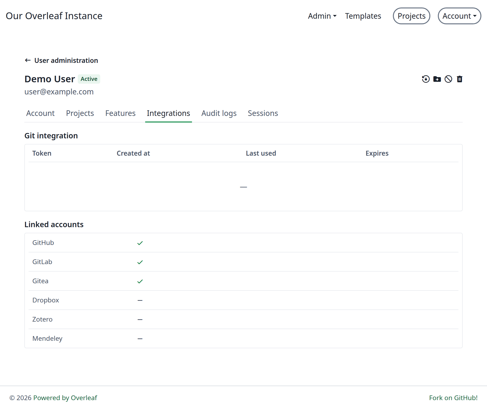
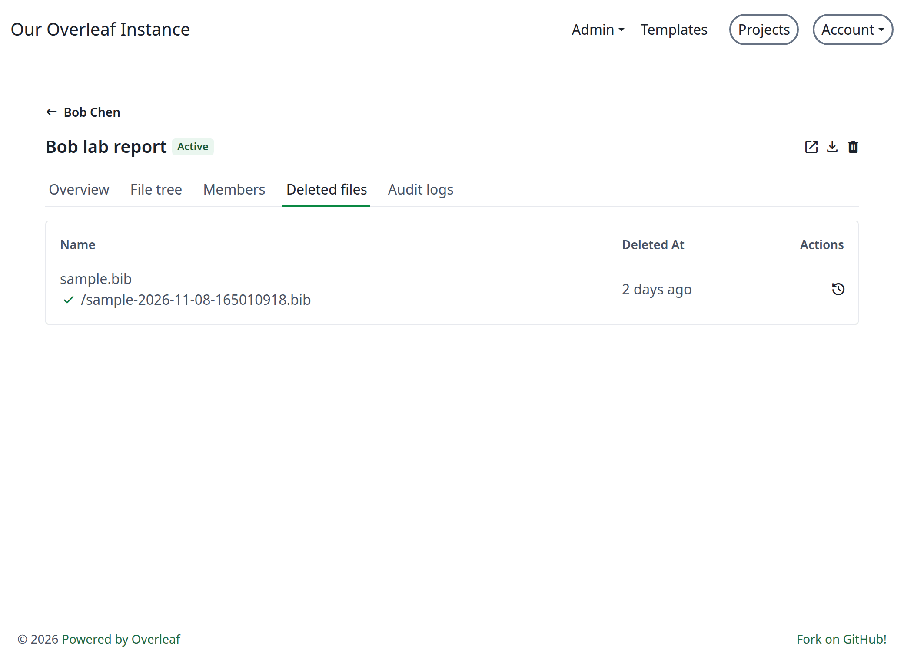

تشغيل نسخة Overleaf لمختبر أو قسم يجلب الأسئلة نفسها كل أسبوع. لماذا لا يستطيع هذا الطالب تسجيل الدخول؟ من لا يزال يستخدم الخادم؟ من منح ذلك الحساب صلاحيات المسؤول؟ أين ذهبت أطروحة العام الماضي؟ أعدنا بناء لوحة الإدارة لتتمكن من الإجابة عنها دون فتح واجهة أوامر قاعدة البيانات.

تتبع اللوحة الجديدة مظهر Overleaf 6.3، وهي مترجمة إلى كل لغة تدعمها الواجهة. وتضم قائمة واحدة لكل المستخدمين، وقائمة واحدة لكل المشاريع، وصفحة لكل منهم، ومكانًا لإدارة قوالبك، وسجلات التدقيق.

<Info>

دُمجت لوحة الإدارة الجديدة في فرعنا الرئيسي، وستصدر رسميًا في v6.4.0. كل لقطات الشاشة في هذا المقال مأخوذة من نسخة اختبار مليئة بحسابات وهمية.

</Info>

### ما الذي تتضمنه {#what’s-in-it}

* **قائمة المستخدمين**: البحث، والتصفية حسب طريقة تسجيل الدخول والدور والحالة، والإجراءات الجماعية.
* **صفحة المستخدم**: الحساب والمشاريع والميزات والتكاملات وسجلات التدقيق والجلسات لشخص واحد.
* **قائمة المشاريع**: كل مشروع في النسخة، مع إمكانية البحث بالاسم أو المعرّف أو المالك أو رابط المشاركة.
* **صفحة المشروع**: الإعدادات والملفات والأعضاء والملفات المحذوفة وسجلات التدقيق لمشروع واحد.
* **إدارة القوالب**: انشر مشروعًا بوصفه قالبًا، وحدّثه، وحافظ على ترتيب المعرض.
* **سجلات التدقيق**: من فعل ماذا، ومتى، ومن أي عنوان IP.

## قائمة واحدة لكل المستخدمين {#one-list-for-every-user}

انقر **Admin**، ثم **Manage Users**. كل حساب صف واحد يوضّح طريقة تسجيل دخوله ودوره وحالته.

<Frame caption="قائمة المستخدمين">
  
</Frame>

ابحث بالاسم أو البريد الإلكتروني أو المعرّف. عناوين الأعمدة **Login** و**Role** و**Status** هي عوامل تصفية، ويعرض كل خيار عدد الحسابات التي سيُرجعها. ترى بنظرة واحدة عدد من يدخلون عبر SAML، ويظهر كل مزوّد OIDC بالاسم الذي منحته إياه.

<Frame caption="التصفية حسب طريقة تسجيل الدخول">
  
</Frame>

لكل حساب حالة واحدة بالضبط، ومجموع الحالات الأربع يساوي العدد الكلي.

| الحالة       | معناها                                                          |
| ------------ | --------------------------------------------------------------- |
| **Active**   | سجّل الدخول أو فتح مشروعًا خلال آخر 12 شهرًا.                   |
| **Pending**  | لم يسجّل الدخول قط.                                             |
| **Inactive** | سجّل الدخول من قبل، لكن ليس خلال آخر 12 شهرًا.                  |
| **Disabled** | منع أحد المسؤولين الحساب من تسجيل الدخول.                       |

تبقى الحسابات المحذوفة بعيدًا في عامل تصفية خاص بها. إذا طابق البحث حسابًا محذوفًا أيضًا، فسيذكر ذلك سطر فوق الجدول ويعرض إظهاره.

<Frame caption="التصفية حسب الحالة">
  
</Frame>

يجري البحث والفرز والتقسيم إلى صفحات على الخادم، لذا لم تعد القوائم تتوقف عند أول 1,000 صف.

### أضف الأشخاص، مع البريد الإلكتروني أو بدونه {#bring-people-in-with-or-without-email}

يضيف **Create account** مستخدمًا ويمنحك الرابط الذي يحتاجه. عندما لا يكون [تسليم البريد الإلكتروني](/ar/on-premises/configuration/overleaf-toolkit/email-delivery  "mention") مُعدًّا، يوضّح مربع الحوار ذلك صراحةً ويتيح لك نسخ الرابط، فتستطيع حتى النسخة الصغيرة استقبال مستخدمين جدد.

<Frame caption="رابط تفعيل حساب جديد">
  
</Frame>

تقدّم اللوحة الرابط المناسب لكل حساب: **Send activation email** لحساب لم يسجّل الدخول قط، وهو صالح لمدة 7 أيام، و**Send reset link** لحساب سجّل الدخول من قبل، وهو صالح لمدة ساعة واحدة. لا تملك الحسابات التي تسجّل الدخول عبر SSO كلمة مرور محلية، لذا لا تحصل على أي منهما.

### غيّر حسابات كثيرة دفعة واحدة {#change-many-accounts-at-once}

حدّد بعض الحسابات، فيعرض شريط الأدوات **Send activation email** و**Transfer this user's projects** و**Disable** و**Enable** و**Make admin** و**Remove admin** و**Delete account**. يسرد مربع الحوار الحسابات قبل أن تؤكد. إذا فشل بعضها، يخبرك بأيها، ويبقى ما نجح بالفعل منجزًا.

<Frame caption="الإجراءات الجماعية">
  
</Frame>

### يصعب ارتكاب الخطأ {#hard-to-get-wrong}

* يُعلَّم حسابك بعلامة **You** وتظهر إجراءاته باهتة، فلا يمكنك تعطيل نفسك أو حذفها أو تخفيض دورها.
* يطلب كل إجراء تأكيدًا في مربع حوار يذكر اسم الحساب.
* يمكن لـ **Delete account** أن يسلّم مشاريع المستخدم إلى شخص آخر أولًا.
* يمكن استعادة الحساب المحذوف مع المشاريع التي حُذفت معه. وحده **Delete permanently** نهائي، ويحذّرك قبل التنفيذ.

## كل شيء عن شخص واحد {#everything-about-one-person}

انقر اسمًا لفتح صفحة المستخدم. تضم ست علامات تبويب، وأيقونات الإجراءات نفسها الموجودة في القائمة.

### الحساب {#account}

تفاصيل الحساب، من المعرّف وعناوين البريد الإلكتروني إلى آخر تسجيل دخول وعنوان IP الخاص به. انقر القلم لتغيير البريد الإلكتروني أو الأسماء أو كلمة المرور، أو لتشغيل **Admin** أو إيقافه.

<Frame caption="تعديل حساب">
  
</Frame>

### المشاريع {#projects}

المشاريع التي يملكها هذا الشخص، مع بحث وعامل تصفية للحالة وإجراءات خاصة بها.

<Frame caption="مشاريع مستخدم">
  
</Frame>

### الميزات {#features}

ما فُعّل لهذا الحساب، مثل عدد المتعاونين لكل مشروع، ومهلة الترجمة، والتكاملات، والذكاء الاصطناعي، مع استخدام الحساب للذكاء الاصطناعي وزر لإعادة تعيينه.

<Frame caption="ميزات مستخدم">
  
</Frame>

### التكاملات {#integrations}

رموز الوصول إلى Git الخاصة بالشخص، والخدمات التي ربطها.

<Frame caption="تكاملات مستخدم">
  
</Frame>

### الجلسات {#sessions}

الأماكن التي سجّل الشخص الدخول منها. يُخرجه **Clear sessions** من كل مكان، وهو أول ما يجب فعله عند فقدان حاسوب محمول.

<Frame caption="جلسات مستخدم">
  
</Frame>

## كل مشروع في النسخة {#every-project-on-the-instance}

انقر **Admin**، ثم **Project/Object Lookup**. تعرض القائمة مشاريع كل المستخدمين مع مالكيها وحالاتها. يقبل مربع البحث اسم المشروع أو معرّفه أو مالكه أو رابطًا. الصق رابط مشاركة وستجد المشروع الذي يقف خلفه.

<Frame caption="كل المشاريع">
  
</Frame>

يفصل عامل التصفية **Status** بين المشاريع **Active** و**Archived** و**Trashed** و**Deleted**. حدّد عدة مشاريع لتنزيلها في ملف `.zip` واحد، أو تغيير مالكها، أو حذفها. في عرض **Deleted**، يكون الزران **Restore** و**Delete permanently**.

<Frame caption="تصفية المشاريع حسب الحالة">
  
</Frame>

## كل شيء عن مشروع واحد {#everything-about-one-project}

انقر عنوان مشروع لفتح صفحته.

### نظرة عامة {#overview}

غيّر الاسم، ومشاركة الرابط، والمترجم، وإصدار TeX Live، والمستند الرئيسي. يمنح **Change project owner** المشروع لمستخدم آخر، وهذا مفيد عندما يغادر شخص المختبر ويجب أن تبقى أطروحته.

<Frame caption="تعديل مشروع">
  
</Frame>

### شجرة الملفات {#file-tree}

ملفات المشروع ومجلداته، للقراءة فقط.

<Frame caption="ملفات مشروع">
  
</Frame>

### الأعضاء {#members}

المالك والمتعاونون والدعوات المعلّقة. غيّر دور متعاون، أو أزل وصوله، أو أعد إرسال دعوة أو ألغها.

<Frame caption="تغيير أعضاء مشروع">
  
</Frame>

### الملفات المحذوفة {#deleted-files}

الملفات التي أُزيلت من المشروع. يضع **Restore file** نسخة في المجلد الجذر للمشروع، ويعرض الصف اسم النسخة.

<Frame caption="ملف مستعاد">
  
</Frame>

## إدارة القوالب {#template-management}

يبدأ القالب مشروعًا عاديًا. تنشره من المحرر، وتديره من صفحته في المعرض أو من لوحة الإدارة.

### كل القوالب في جدول واحد {#all-templates-in-one-table}

انقر **Admin**، ثم **Project/Object Lookup**، ثم علامة التبويب **Templates**. تسرد كل قالب منشور مع مؤلفه ومالكه ووقت آخر تغيير له، ويمكنك البحث فيها. انقر عنوانًا لفتح القالب، أو انقر مالكًا لفتح صفحة ذلك المستخدم، أو انقر سلة المهملات لحذف قالب. يُسجَّل الحذف في [سجل التدقيق الخاص بك](#when-there-is-no-log-left).

<Frame caption="كل القوالب في لوحة الإدارة">
  
</Frame>

### النشر من المحرر {#publish-from-the-editor}

افتح مشروعًا وترجمه حتى يبدو ملف PDF صحيحًا، لأن المعرض يعرض ملف PDF من آخر ترجمة ناجحة. ثم انقر **File**، ثم **Manage Template**، واملأ العنوان والمؤلف وفئة ووصفًا بصيغة Markdown وترخيصًا. ينتقل مترجم المشروع ومستنده الرئيسي مع القالب، فتستخدم المشاريع المفتوحة منه الإعدادات نفسها.

<Frame caption="نشر مشروع بوصفه قالبًا">
  
</Frame>

### تحديث قالب {#update-a-template}

لتغيير ملفات قالب وملف PDF الخاص به، انشر المشروع مرة أخرى بالعنوان نفسه. يخبرك مربع الحوار بأن العنوان موجود بالفعل، ويصبح الزر **Overwrite**. لا تتغير المشاريع التي فتحها الأشخاص من القالب من قبل.

<Frame caption="النشر بالعنوان نفسه">
  
</Frame>

### صفحة القالب {#the-template-page}

يستطيع الجميع استخدام **Open as Template** و**View PDF** وزر التنزيل. ويحصل المسؤولون أيضًا على **Admin: Source Project** و**Edit** و**Delete**.

<Frame caption="صفحة قالب">
  
</Frame>

يغيّر **Edit** ما يعرضه المعرض عن القالب: عنوانه ومؤلفه وفئته ووصفه وترخيصه، ولغة التدقيق الإملائي للمشاريع المفتوحة منه. لا يمس الملفات ولا ملف PDF. يحتفظ القالب بنسخته الخاصة من الملفات، لذا لا يؤدي حذف المشروع المصدر إلى حذف القالب معه.

<Frame caption="تعديل تفاصيل قالب">
  
</Frame>

### معرض لمستخدميك {#a-gallery-for-your-users}

يُفتح المعرض ببطاقة لكل فئة، ولكل فئة صفحتها الخاصة. تأتي الفئات من إعداد [القوالب](/ar/on-premises/configuration/overleaf-toolkit/templates  "mention") لديك، حيث يمكنك أيضًا السماح لمستخدم ليس مسؤولًا بالنشر.

<Frame caption="معرض القوالب">
  
</Frame>

تعرض صفحة **All templates** كل قالب مع معاينة لصفحته الأولى، ويمكن لمستخدميك البحث فيها وفرزها حسب العنوان أو التاريخ.

<Frame caption="كل القوالب">
  
</Frame>

## سجلات التدقيق: من فعل ماذا، ومتى {#audit-logs-who-did-what-and-when}

هذا هو الجزء الذي نفخر به أكثر من غيره. أصبح لكل حساب وكل مشروع سجل تدقيق خاص به، ويستطيع مسؤولو الموقع قراءته مباشرة في اللوحة.

افتح علامة التبويب **Audit logs** في صفحة مستخدم. تظهر الإدخالات الأحدث أولًا.

<Frame caption="سجل تدقيق حساب">
  
</Frame>

إذا قُرئت هذه الصفحة من الأسفل إلى الأعلى، فإنها تروي قصة. سجّلت Lena الدخول. رفع مسؤول مهلة الترجمة لديها إلى 300 ثانية، وأوقف وصولها إلى الذكاء الاصطناعي، وأرسل إليها رابط إعادة تعيين كلمة المرور، وجعلها مسؤولة ثم سحب ذلك، ثم عطّل الحساب وأعاد تفعيله. سجّلت Lena الدخول مجددًا، ومسح المسؤول جلساتها.

| العمود         | ما الذي يخبرك به                                                                     |
| -------------- | ------------------------------------------------------------------------------------ |
| **Date**       | متى حدث ذلك.                                                                         |
| **Operation**  | ما الذي حدث.                                                                         |
| **Initiator**  | من فعله. ما يفعله المسؤول بحساب يُظهر المسؤول، لا المستخدم.                          |
| **IP Address** | من أين جاء الطلب.                                                                    |
| **Info**       | التفاصيل، مثل مهلة الترجمة الجديدة، أو ما إذا كان البريد الإلكتروني قد أُرسل فعلًا.  |

### اعثر على الإدخال الذي تحتاجه {#find-the-entry-you-need}

ابحث حسب العملية أو عنوان IP. عنوان العمود **Operation** هو عامل تصفية يسرد كل عملية في هذا السجل وعدد مرات حدوثها.

<Frame caption="التصفية حسب العملية">
  
</Frame>

### سجل لكل مشروع {#a-log-for-every-project}

لصفحة المشروع علامة التبويب نفسها. وهي تُظهر من دُعي، ومن انضم، ومن تغيّر دوره، ومن نزّل المشروع، ومن تولّى ملكيته.

<Frame caption="سجل تدقيق مشروع">
  
</Frame>

### ما الذي يُسجَّل {#what-gets-recorded}

هذه هي العمليات الرئيسية في كل سجل، بالأسماء التي تراها في اللوحة.

| السجل  | المجال                  | العمليات                                                                                                                                                                                                                                    |
| ------ | ----------------------- | ------------------------------------------------------------------------------------------------------------------------------------------------------------------------------------------------------------------------------------------- |
| الحساب | تسجيل الدخول وكلمة المرور | Login, Logout, Failed password match, Update password, Reset password                                                                                                                                                                     |
| الحساب | البريد الإلكتروني وSSO  | Add email, Remove email, Change primary email, Link SSO, Unlink SSO                                                                                                                                                                         |
| الحساب | التكاملات               | Link GitHub, Unlink GitHub, Link Dropbox, Unlink Dropbox, Integration account linked, Integration account unlinked, Create Git token, Delete Git token                                                                                      |
| الحساب | إجراءات المسؤول         | Create account, Send activation email, Send password reset email, Change name, Change admin access, Change features, Change AI features, Reset AI usage, Account suspension, Account reactivation, Clear sessions, Transfer projects, Delete account, Restore account |
| المشروع | المشاركة               | Send invite, Resend invite, Revoke invite, Accept invite, Join via token, Accept via link sharing, Remove collaborator, Leave project, Project role changed, Toggle access level, Transfer ownership                                       |
| المشروع | الملفات                | Project downloaded, Project exported docx, Project exported markdown, Project exported html, Restore deleted doc                                                                                                                            |
| المشروع | إجراءات المسؤول        | Project deleted, Project restored                                                                                                                                                                                                           |
| المشروع | مزامنة Git             | Integration repo linked, Integration repo unlinked                                                                                                                                                                                          |

### عندما لا يتبقى سجل {#when-there-is-no-log-left}

يزيل **Delete permanently** الحساب أو المشروع مع سجله، أما القالب فلم يكن له سجل قط. لذلك تُكتب هذه الإجراءات في سجل المسؤول الذي نفّذها، مع البريد الإلكتروني أو المعرّف الخاص بما أُزيل.

<Frame caption="عمليات الحذف النهائي في سجل المسؤول نفسه">
  
</Frame>

### من المفيد معرفته {#good-to-know}

* تُحفظ الإدخالات لمدة عامين ونصف، ثم يزيلها MongoDB تلقائيًا.
* خلف وكيل عكسي، اضبط [`OVERLEAF_TRUSTED_PROXY_IPS`](/ar/on-premises/configuration/overleaf-toolkit/environment-variables  "mention") ليعرض السجل عنوان الزائر لا عنوان الوكيل.
* لا يُسجَّل كل شيء بعد. لا تظهر في سجل المشروع عمليات Git clone وpush، ولا التعديلات على إعدادات المشروع مثل اسمه أو مترجمه، ولا المشاريع التي ينشئها المالك أو يؤرشفها أو ينقلها إلى سلة المهملات أو يحذفها.

## جرّبها {#try-it}

تأتي اللوحة الجديدة مع Ayakaleaf Pro v6.4.0. الأدلة خطوة بخطوة متاحة بالفعل:

* [إدارة المستخدمين](/ar/on-premises/user-guide/administrators/user-management  "mention")
* [إدارة المشاريع](/ar/on-premises/user-guide/administrators/project-management  "mention")
* [إدارة القوالب](/on-premises/user-guide/administrators/template-management  "mention")

إذا كان هناك شيء ناقص أو لا يعمل كما تتوقع، فأخبرنا على [GitHub](https://github.com/ayaka-notes/ayakaleaf-pro/issues).
