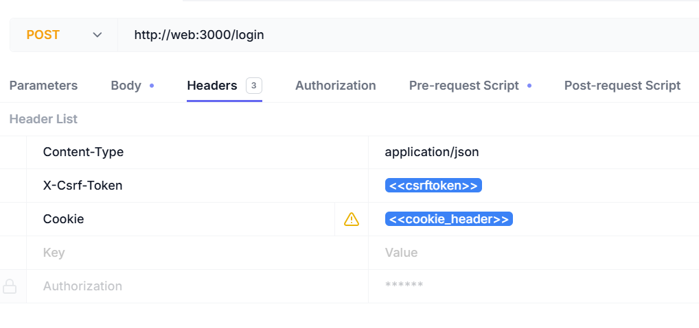

## أدوات التطوير الموصى بها {#develop-tools-recommended}

هذه الخدمات الاختيارية غير مطلوبة لتشغيل Overleaf، لكنها تساعد كثيرًا في التطوير وتصحيح الأخطاء وفحص البيانات. كلها جزء من بيئة التطوير، لذا لا يلزم إضافة أي شيء إلى `docker-compose.yml`. بعد تسجيل الدخول إلى الموقع، تشير قائمة **Dev tools** في شريط التنقل إلى الأدوات التي يقدّمها الموقع على مساراته الخاصة.

| الأداة | العنوان | مُعرّفة في |
| --- | --- | --- |
| **Grafana**, حالة كل خدمة ومقاييسها وسجلاتها | [http://localhost/grafana/](http://localhost/grafana/) | `develop/grafana/docker-compose.yml`, مفعّلة عند `GRAFANA_ENABLED=true` في `develop/dev.rc` (افتراضيًا) |
| **Mailpit**, صندوق وارد لكل بريد إلكتروني يرسله الموقع | [http://localhost/mailpit/](http://localhost/mailpit/) | `develop/mail/docker-compose.yml`, مفعّلة عند `MAILPIT_ENABLED=true` (افتراضيًا) |
| **Mongo Express**, واجهة لـ MongoDB | [http://localhost/mongo-express/](http://localhost/mongo-express/) | `develop/docker-compose.yml`, مفعّلة دائمًا |
| **RedisInsight**, واجهة لبيانات Redis | [http://localhost/redis-insight/](http://localhost/redis-insight/) | `develop/docker-compose.yml`, مفعّلة دائمًا |
| **Hoppscotch**, عميل API في المتصفح مشابه لـ Postman | [http://localhost:9170](http://localhost:9170/) (`HOPPSCOTCH_PORT`) | `develop/hoppscotch/docker-compose.yml`, مفعّلة عند `HOPPSCOTCH_ENABLED=true` (افتراضيًا) |

<Warning>

لا تملك أي من هذه الأدوات تسجيل دخول: المستخدمون المجهولون في Grafana هم مسؤولوها، ويمكن لـ Mongo Express تغيير أي مستند. يستمع الموقع وHoppscotch وMongo Express (8081) وRedisInsight (5540) على `127.0.0.1` للمضيف فقط، فلا تستطيع الأجهزة الأخرى الوصول إليها.

</Warning>

### Grafana {#grafana}

يقدّم الموقع Grafana على `/grafana/` عبر webpack-dev-server، لذا لا تحتاج إلى منفذ خاص بها. يحتوي مجلدها **Overleaf Develop** على لوحات المعلومات التالية:

| لوحة المعلومات | ما تعرضه |
| --- | --- |
| All services (الرئيسية) | حالة كل خدمة ومؤشرات المضيف والحِمل والسجلات. النقر على خدمة يفتح لوحة معلوماتها |
| Server | المعالج والحِمل والذاكرة والقرص والشبكة للمضيف، وعمليات الترجمة في clsi |
| Errors | سجلات الأخطاء واستجابات 5xx و4xx وأكثر رسائل الخطأ تكرارًا والمسارات الفاشلة |
| Data flow | مسار التعديل: document-updater وRedis وproject-history وhistory-v1 وMongo ومخزن الكائنات |
| Containers | حالة كل حاوية والمعالج والذاكرة والشبكة والقرص، بما في ذلك الترجمة في بيئة معزولة |
| واحدة لكل خدمة | خدمات Node.js وgit-bridge (JVM) وmongo وredis |

<Columns cols={2}>
<Column>

<Frame caption="All services: حالة كل خدمة والمضيف والموارد التي تستخدمها كل خدمة">
  
</Frame>

</Column>

<Column>

<Frame caption="Data flow: تعديل في طريقه من document-updater عبر project-history إلى history-v1 وMongo">
  
</Frame>

</Column>
</Columns>

يجمع Prometheus بيانات `/metrics` من الخدمات و`mongodb-exporter` و`redis-exporter` و`cadvisor` و`node-exporter`؛ ويرسل Alloy سجلات كل حاوية في المشروع إلى Loki، حيث تقرأها مرشحات **Log search** و**Service** و**Log level** في لوحات المعلومات. تعيش بياناتها داخل الحاويات فقط، لذا تُفرَّغ عند إعادة إنشائها. يعمل cAdvisor بامتيازات ويقرأ `/` و`/sys` وبيانات Docker ومقبس containerd على المضيف للقراءة فقط؛ ويقرأ node-exporter المسار `/` على المضيف.

لوحات المعلومات مُولَّدة: عدّل `develop/grafana/make-dashboards` وشغّله بدلًا من تعديل ملفات JSON.

### Mailpit {#mailpit}

مع `MAILPIT_ENABLED=true` يرسل `web` كل بريد إلكتروني إلى Mailpit بدلًا من خادم بريد حقيقي، ويكون تأكيد البريد الإلكتروني مفعّلًا (`EMAIL_CONFIRMATION_DISABLED=false`). يمكن عندها متابعة روابط التفعيل ودعوات المشاريع وإعادة تعيين كلمات المرور ورموز التأكيد من صندوق الوارد.

<Frame caption="بريد تفعيل ودعوة مشروع ورمز تأكيد وإعادة تعيين كلمة المرور في Mailpit">
  
</Frame>

لا يملك Mailpit وحدة تخزين: إعادة إنشاء حاويته تفرّغ صندوق الوارد.

### Mongo Express {#mongo-express}

يعرض Mongo Express مجموعات قاعدة البيانات `sharelatex`، ويمكنه عرض مستنداتها وتعديلها واستيرادها وتصديرها.

<Frame caption="مجموعات قاعدة البيانات sharelatex في Mongo Express">
  
</Frame>

### RedisInsight {#redisinsight}

يحفظ RedisInsight اتصالاته في `develop/data/redis-insight`. في المرة الأولى، اختر **Connect existing database** وأدخل المضيف `redis` والمنفذ `6379`.

<Frame caption="RedisInsight متصل بخدمة redis">
  
</Frame>

### إعداد Hoppscotch {#setup-hoppscotch}

#### تمرير طلبات API عبر الوكيل {#proxy-api-request}

يرسل Hoppscotch الطلبات من المتصفح، الذي لا يستطيع الوصول إلى الخدمات بأسمائها في Docker. يعمل الوكيل الخاص به، Proxyscotch، داخل شبكة Docker ويُقدَّم على `/proxy` من عنوان Hoppscotch. افتح [http://localhost:9170](http://localhost:9170/)، وانتقل إلى Settings → Interceptor، واختر **Proxy**، واضبط Proxy URL على `http://localhost:9170/proxy`. يبقى الإعداد محفوظًا في المتصفح.

<Frame caption="إعداد Interceptor. لقطة الشاشة من إعداد أقدم: استخدم `http://localhost:9170/proxy` كقيمة لـ Proxy URL.">
  
</Frame>

يمكنك الآن الاختبار باستخدام [http://web:3000/status](http://web:3000/status) للتحقق مما إذا كانت خدمة web تعمل:

<Frame>
  
</Frame>

#### استيراد واجهات API للخدمات {#import-the-service-apis}

يحتوي `develop/hoppscotch/openapi/` على ملف OpenAPI لواجهة API الداخلية لكل خدمة. في Hoppscotch افتح Collections → Import → Import from File واختر جميع الملفات دفعة واحدة. يصبح كل ملف مجموعة تذهب طلباتها إلى عنوان Docker الخاص بالخدمة. تُعرض الملفات نفسها في قسم [واجهة API للخدمات](/ar/dev/service-api/overview).

#### مشكلات CSRF {#csrf-problems}

<Warning>

إذا استخدمت Postman أو أدوات تصحيح أخرى لإنشاء طلب **post**، فقد تجد أن تسجيل الدخول **مرفوض**، والسبب هو الخطأ 403. ويرجع ذلك إلى أن Overleaf محمي بالتحقق من **csrf**.

</Warning>

<Frame>
  
</Frame>

قد ترى في وحدة التحكم ما يلي:

<Frame>
  
</Frame>

للتعامل مع ذلك أثناء تطويرك لـ Overleaf، عليك إعداد رمز csrf الخاص بك. وإليك الشرح المفصل.

<Steps>
<Step title="إضافة سكربت ما قبل الطلب">
أضف الشيفرة التالية إلى Pre-Request

<Frame>
  
</Frame>

السكربت كما يلي:

```js wrap
pm.sendRequest("http://web:3000/dev/csrf", function (err, res) {
    if (err) {
        console.log(err);
        return;
    }

    // 1) Save CSRF token (/dev/csrf)
    const token = res.text().trim();
    pw.env.set("csrftoken", token);
    console.log("csrftoken =", token);

    const setCookieHeader = (res.headers || []).find(h => h.key?.toLowerCase() === "set-cookie")?.value;
    console.log("set-cookie =", setCookieHeader);

    if (!setCookieHeader) return;

    const cookiePair = setCookieHeader.split(";")[0].trim(); // overleaf.sid=...
    pw.env.set("cookie_header", cookiePair);
    console.log("cookie_header =", cookiePair);
});
```
</Step>

<Step title="إضافة ترويسات الطلب">
عليك إضافة الترويسات التالية:

| اسم الترويسة  | قيمة الترويسة        |
| ------------ | ------------------- |
| Content-Type | `application/json`  |
| X-Csrf-Token | `<<csrftoken>>`     |
| Cookie       | `<<cookie_header>>` |

<Frame>
  
</Frame>
</Step>

<Step title="تسجيل الدخول باستخدام أدوات API">
يمكنك الآن تسجيل الدخول باسم المستخدم وكلمة المرور.

```json5
{
  "_csrf": "<<csrftoken>>",
  "email": "admin@overleaf.com",
  "password": "xxxxxx"
}
```

إليك الاستجابة عند إدخال اسم مستخدم أو كلمة مرور خاطئة.

<Frame>
  
</Frame>
</Step>
</Steps>
