نحن نحترم حقوق النشر، لذا ندرج هنا جميع الميزات والشيفرات المستخدمة في هذا المشروع. ونقدم في هذه الصفحة معلومات عن الميزات الجديدة في Ayakaleaf Pro وحقوق النشر المتعلقة بالشيفرة.

ما لم يُذكر خلاف ذلك، نستخدم Codex من OpenAI لمراجعة الشيفرة ومراجعة طلبات الدمج (PR). وقد أصلحنا خلال هذه العملية العديد من المشكلات الأمنية، ونعرب عن خالص امتناننا لهم. للتفاصيل، راجع [ayaka-notes/ayakaleaf-pro/pull](https://github.com/ayaka-notes/ayakaleaf-pro/pulls).

### نظرة عامة {#overview}

على مر السنين، بذل كثير من مطوري المجتمع جهودًا كبيرة لتحسين النسخة المجتمعية من Overleaf. وهم:

* [https://github.com/ertuil/overleaf](https://github.com/ertuil/overleaf)
* [https://github.com/AllanChain/lcpu-overleaf](https://github.com/AllanChain/lcpu-overleaf)
* [https://github.com/yu-i-i/overleaf-cep/](https://github.com/yu-i-i/overleaf-cep/)
* [https://github.com/ayaka-notes/overleaf](https://github.com/ayaka-notes/overleaf)
* [https://github.com/davrot/overleaf\_with\_admin\_extension](https://github.com/davrot/overleaf_with_admin_extension)
* [https://github.com/overleaf/overleaf/pull/1447](https://github.com/overleaf/overleaf/pull/1447) (التكامل مع GitHub)
* [https://github.com/overleaf/overleaf/pull/1385](https://github.com/overleaf/overleaf/pull/1385) (دعم Typst)

ربما استخدمنا شيفرات ذات صلة في مشروعنا، ونود أن نعرب عن امتناننا لهم.

#### الميزة 01: نظام القوالب {#features-01-templates-system}

طُوّرت هذه الميزة بشكل رئيسي بواسطة [yu-i-i/overleaf-cep](https://github.com/yu-i-i/overleaf-cep). وقد عدّلنا بعض الشيفرة لتحسينها، بحيث يمكنك:

* تنزيل القوالب مباشرةً من صفحات القوالب.
* فتح المشروع المقابل للقالب.
* التحويل إلى صور غلاف بجودة أعلى (وفي وقت أقصر).

<Columns cols={2}>
<Column>

<Frame>
  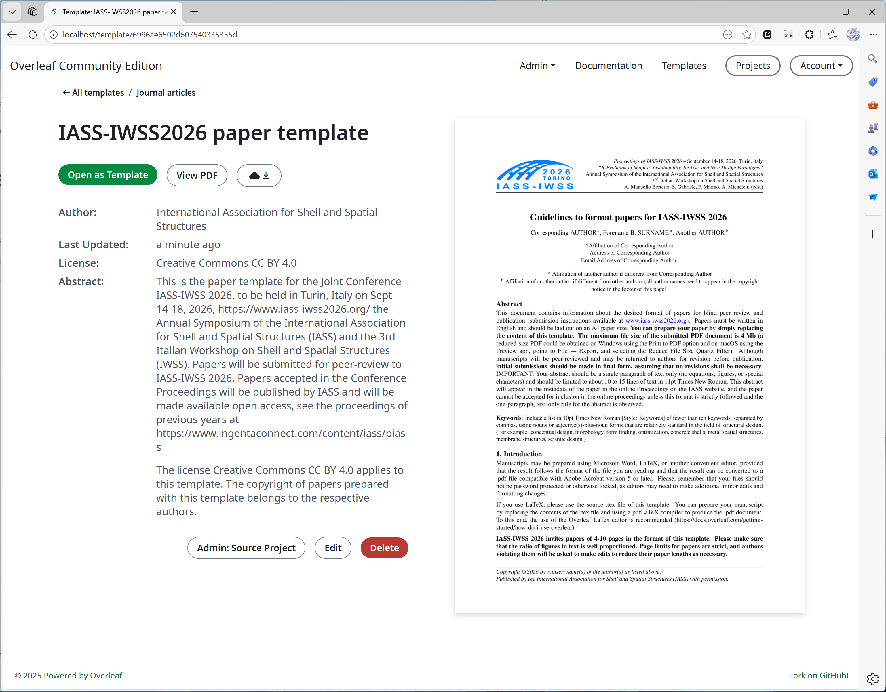
</Frame>

</Column>

<Column>

<Frame>
  
</Frame>

</Column>
</Columns>

#### الميزة 02: الترجمة المعزولة (Sandbox Compile) {#features-02-sandbox-compile}

نُفّذت هذه الميزة بواسطة [Overleaf الرسمي](https://github.com/overleaf/overleaf/tree/main/services/clsi)؛ وأضفنا بعض الشيفرة لتفعيلها. كما نوفر صورة [texlive-full](https://github.com/ayaka-notes/texlive-full) مبنية خصيصًا لـ Ayakaleaf Pro.

<Frame caption="الترجمة المعزولة">
  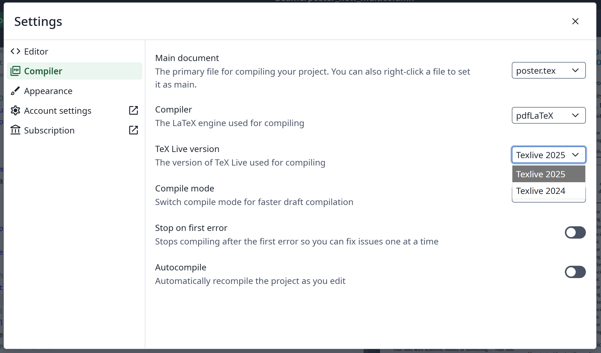
</Frame>

#### الميزة 03: التكامل مع Git {#features-03-​git-integration​}

طُوّرت هذه الميزة بواسطة [ayaka-notes/ayakaleaf-pro](https://github.com/ayaka-notes/ayakaleaf-pro). يوفر Overleaf مكوّنًا رسميًا يُسمى git-bridge، وهو متاح [هنا](https://github.com/overleaf/overleaf/tree/main/services/git-bridge).

لقد نفّذنا فقط موصّلًا بين git-bridge وOverleaf، وهو مماثل لما يفعله Overleaf على منصة SaaS الخاصة به.

<Columns cols={2}>
<Column>

<Frame>
  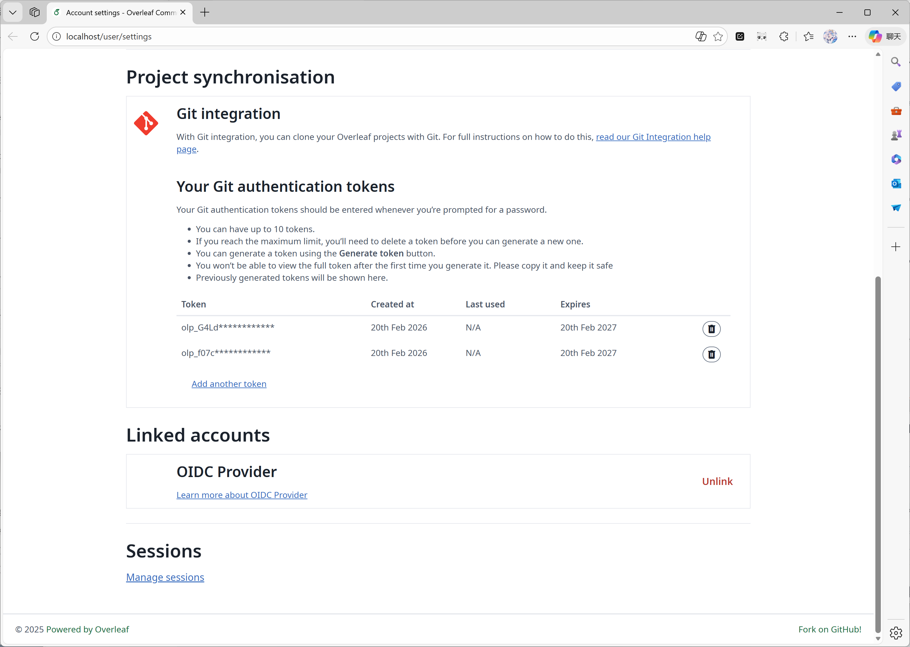
</Frame>

</Column>

<Column>

<Frame>
  
</Frame>

</Column>
</Columns>

#### الميزة 04: لوحة الرموز {#features-04-symbol-palette}

نُفّذت هذه الميزة بواسطة [Overleaf الرسمي](https://github.com/overleaf/overleaf/tree/main/services/clsi)؛ وأضفنا فقط الشيفرة الناقصة لمواكبة تحديثات المصدر الأصلي.

<Frame caption="لوحة الرموز">
  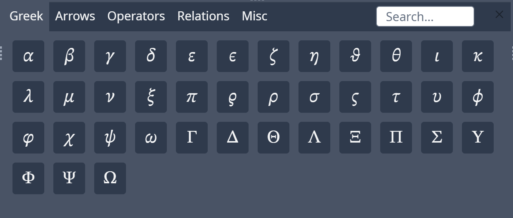
</Frame>

#### الميزة 05: لوحة الإدارة {#features-05-admin-panel}

<Warning>

عندما يضم نظامك 1000 مستخدم أو مشروع، فلن تعرض لوحة الإدارة سوى أحدث 1000 مستخدم أو مشروع. يُرجى استخدام لوحة البحث للبحث عن مستخدمين أو مشاريع محددة.

</Warning>

طُوّرت هذه الميزة بشكل رئيسي بواسطة [yu-i-i/overleaf-cep](https://github.com/yu-i-i/overleaf-cep). وقد عدّلنا بعض الشيفرة لتحسينها، بحيث يمكنك:

* البحث عن المستخدمين عبر الواجهة الخلفية عندما يكون لديك أكثر من 1000 مستخدم.
* البحث عن المشاريع عبر الواجهة الخلفية عندما يكون لديك أكثر من 1000 مشروع.
* فتح المشاريع مباشرةً من لوحة إدارة المشاريع.
* عرض حد وقت الترجمة للمستخدم وتعديله من لوحة الإدارة.
* إعادة تعيين كلمة مرور المستخدم مباشرةً من لوحة الإدارة.
* تحسينات أخرى...

<Columns cols={2}>
<Column>

<Frame>
  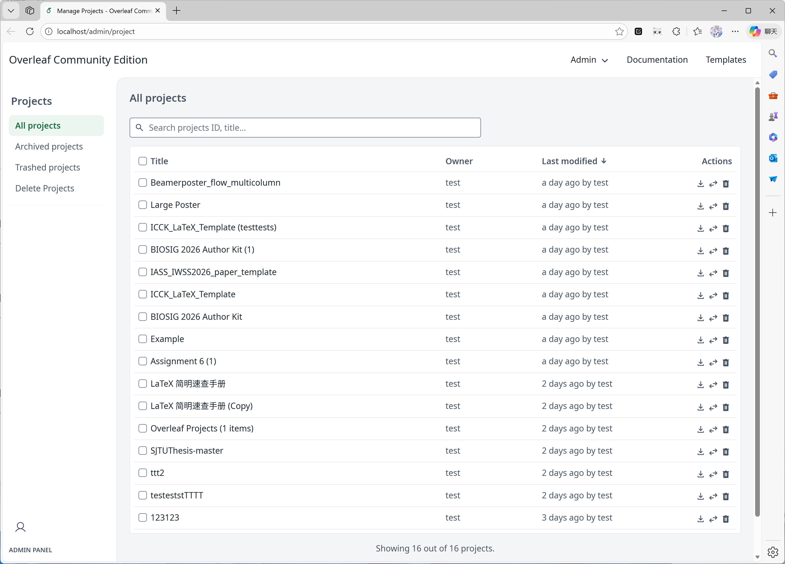
</Frame>

<Frame>
  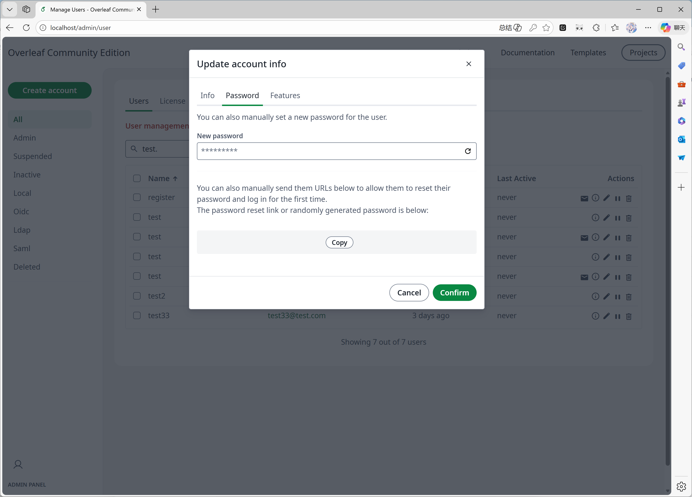
</Frame>

</Column>

<Column>

<Frame>
  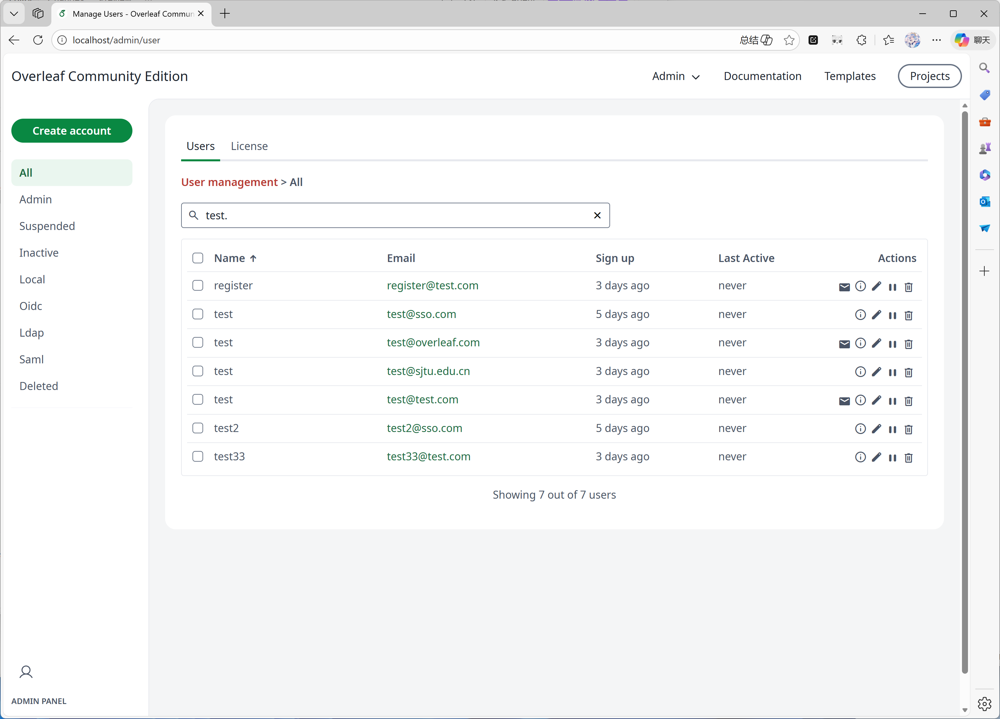
</Frame>

<Frame>
  
</Frame>

</Column>
</Columns>

#### الميزة 06: لوحة المراجعة {#features-06-review-panel}

طُوّرت هذه الميزة بشكل رئيسي بواسطة [Overleaf الرسمي](https://github.com/overleaf/overleaf/tree/main/services/clsi)، وأضفنا فقط الشيفرة الناقصة من [yu-i-i/overleaf-cep](https://github.com/yu-i-i/overleaf-cep) و[ertuil/overleaf](https://github.com/ertuil/overleaf)، وهي موصّل بين خدمة المحادثة وخدمة الويب.

<Frame caption="لوحة المراجعة">
  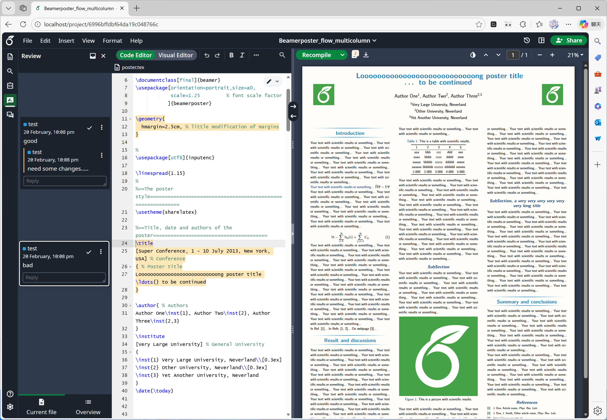
</Frame>

#### الميزة 07: الروابط الخارجية {#features-07-external-url}

طُوّرت هذه الميزة بشكل رئيسي بواسطة [yu-i-i/overleaf-cep](https://github.com/yu-i-i/overleaf-cep). فقد نفّذ CEP خدمة خارجية تُسمى linked-url-proxy، يمكن استخدامها بأمان لجلب الملفات الخارجية مع قيود على النطاقات وعناوين IP.

<Frame caption="الروابط الخارجية">
  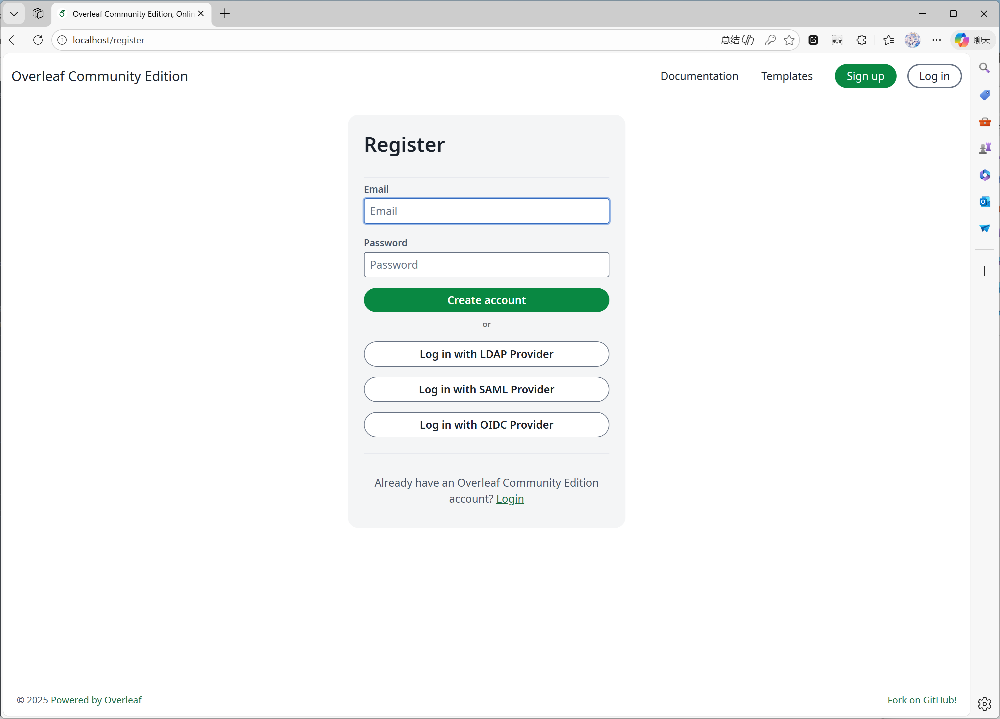
</Frame>

#### الميزة 08: تسجيل الدخول الموحّد (SSO) {#features-08-sso}

طُوّرت هذه الميزة بشكل رئيسي بواسطة [yu-i-i/overleaf-cep](https://github.com/yu-i-i/overleaf-cep). فقد نفّذ CEP وحدة فرعية لربط passport بمصادقة الويب في Overleaf.

<Frame caption="صفحة تسجيل الدخول">
  
</Frame>

#### الميزة 09: دعم ARM {#features-09-arm-supported}

نستخدم GitHub Actions لبناء صور Docker ونشرها لمعماريتي x86 وarm. وعند تنزيل الصورة، ستُختار المعمارية المناسبة تلقائيًا بناءً على نظامك.

<Frame caption="حزمة GitHub">
  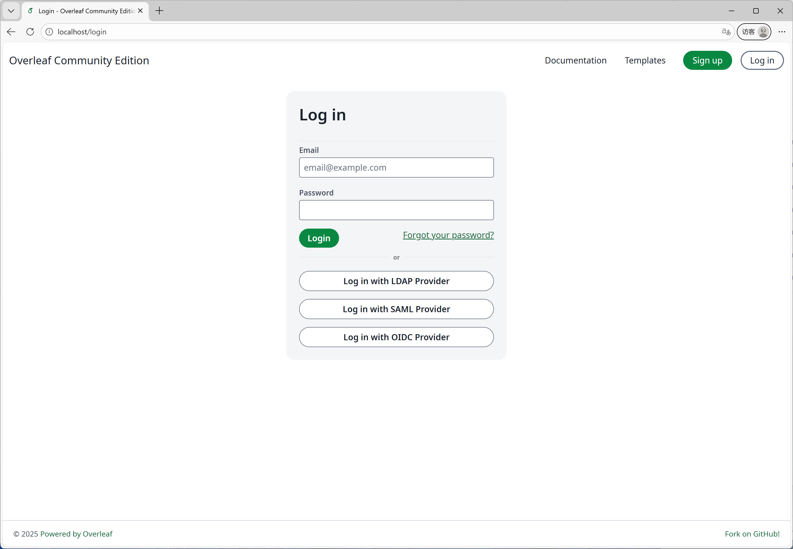
</Frame>

#### الميزة 10: التسجيل الذاتي {#features-10-self-registration}

طُوّرت هذه الميزة بواسطة [ayaka-notes/ayakaleaf-pro](https://github.com/ayaka-notes/ayakaleaf-pro). ويمكنك:

* قصر تسجيل المستخدمين على نطاق محدد
* فتح التسجيل لأي شخص لديه إمكانية الوصول إلى Overleaf الخاص بك

<Frame caption="صفحة التسجيل">
  
</Frame>

#### الميزة 11: ويكي التعلّم (Learn Wiki) {#features-11-learn-wiki}

طُوّرت هذه الميزة بواسطة [ayaka-notes/ayakaleaf-pro](https://github.com/ayaka-notes/ayakaleaf-pro). يمكنك الاطلاع على أحدث محتوى ويكي التعلّم من Overleaf، لكننا لا نملك أي حقوق نشر لتلك المستندات! فنحن نقوم فقط بتنزيلها من خادم Overleaf في المرة الأولى التي تفعّل فيها هذه الميزة، ثم نحدّثها دوريًا.

<Frame caption="صفحة الويكي">
  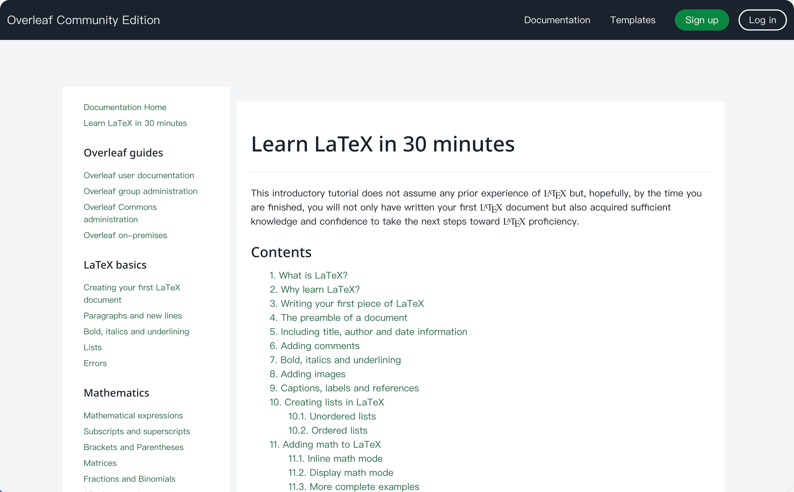
</Frame>

#### الميزة 12: المزامنة مع GitHub {#features-12-github-sync}

طُوّرت هذه الميزة بواسطة [ayaka-notes/ayakaleaf-pro](https://github.com/ayaka-notes/ayakaleaf-pro)، كما عُدّلت وأُصلحت بواسطة [yu-i-i/overleaf-cep](https://github.com/yu-i-i/overleaf-cep).

<Frame>
  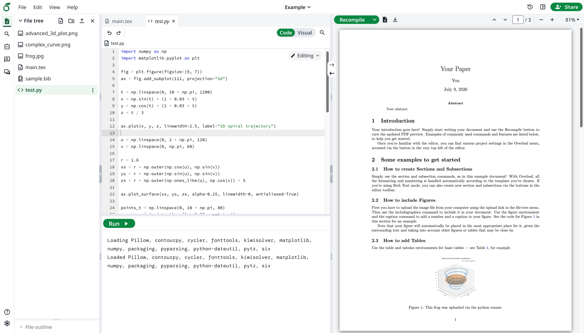
</Frame>

#### الميزة 13: مشغّل Python {#features-13-python-runner}

طُوّرت هذه الميزة بواسطة Overleaf الرسمي. ويمكنك تشغيل سكربتات Python في متصفحك.

إنها مدمجة ولا تحتاج إلى أي إعداد: افتح ملف `.py` في مشروع وانقر على **Run**. يعمل السكربت باستخدام Pyodide في متصفح المستخدم، لذا لا تتوفر إلا الحزم المدمجة في Pyodide.

* تعرض لوحة المخرجات أسفل المحرر ما يطبعه السكربت (آخر 100 سطر). انقر على **Stop** لمقاطعة التشغيل. يبدأ كل تشغيل بنسخة Python جديدة، لذا لا يُنقل أي شيء من التشغيل السابق.
* قبل كل تشغيل، تُنسخ الملفات النصية للمشروع إلى مجلد عمل السكربت، بحيث يمكن للسكربت فتحها بمسارها في المشروع، مثل `open('data/results.csv')`. أما الملفات الثنائية مثل الصور وملفات PDF فلا تُنسخ.
* تُحفظ الملفات التي يكتبها السكربت في ذلك المجلد إلى المشروع في المسار نفسه عند نجاح التشغيل، لتحل محل أي ملف يحمل الاسم نفسه. ولا يحفظ التشغيل الفاشل أي شيء. ويمكن للتشغيل الواحد حفظ ما يصل إلى 50 ملفًا، بحد 50 MB لكل ملف و 100 MB إجمالًا.
* لا يملك Matplotlib شاشة عرض: احفظ الرسوم البيانية باستخدام `plt.savefig('figure.png')`، ثم أدرج الصورة في مستند LaTeX الخاص بك.
* يقدّم مثيلك Pyodide وحزمه (مثل NumPy و pandas و SciPy و Matplotlib)، لذا لا يحتاج المتصفح إلى الوصول إلى الإنترنت. ولا يمكن استخدام الحزم المثبّتة عبر pip.

<Frame>
  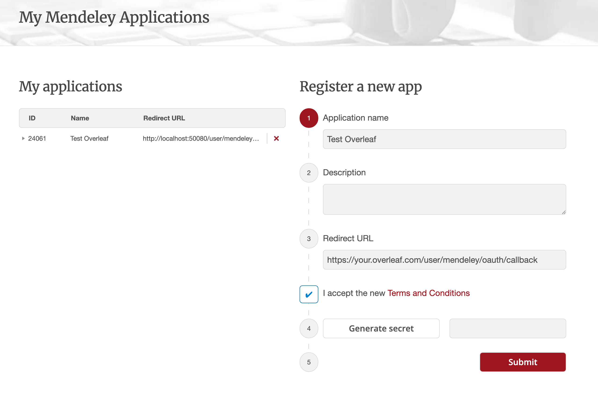
</Frame>

#### الميزة 14: البحث المتقدم في المراجع {#features-14-advanced-reference-search}

طُوّرت هذه الميزة بواسطة [davrot](https://github.com/davrot/)، وأُصلحت بواسطة [yu-i-i/overleaf-cep](https://github.com/yu-i-i/overleaf-cep)، وكذلك بواسطة [ayaka-notes/ayakaleaf-pro](https://github.com/ayaka-notes/ayakaleaf-pro).

إنها مدمجة ولا تحتاج إلى أي إعداد. تبحث في مُدخلات ملفات `.bib` الخاصة بالمشروع؛ اضغط `Ctrl+Space` داخل `\cite{}` لفتحها.

<Frame>
  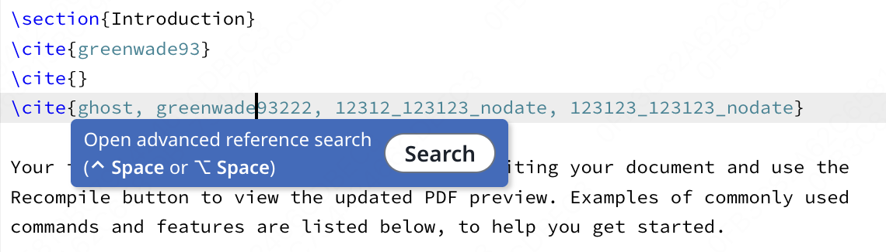
</Frame>

لوحة البحث:

<Frame>
  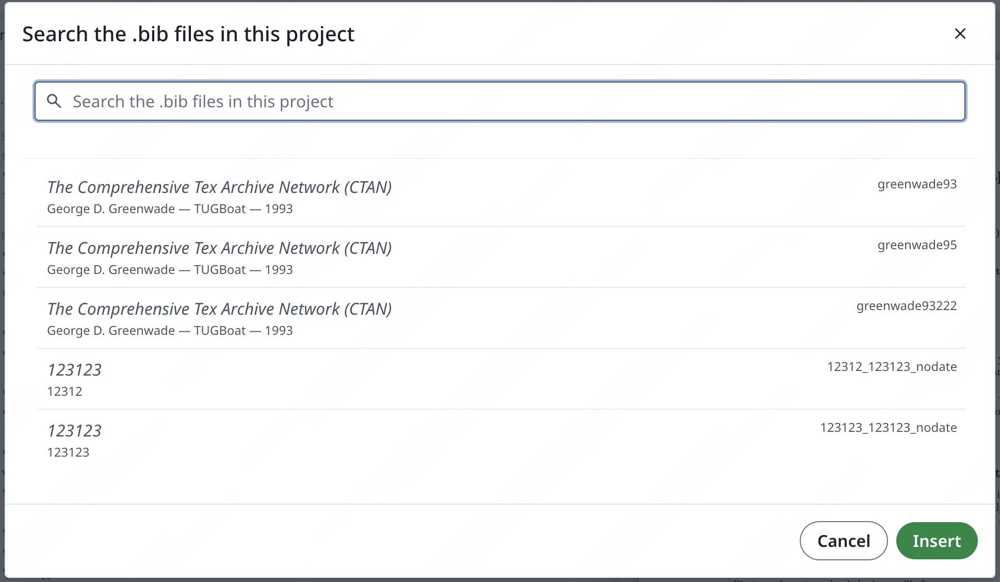
</Frame>

#### الميزة 15: التحويلات عبر Pandoc {#features-15-pandoc-conversions}

تتيح لك هذه الميزة استيراد مستندات Word أو Markdown كمشاريع LaTeX، أو تصدير مشاريع LaTeX إلى Markdown أو DOCX.

<Columns cols={2}>
<Column>

<Frame>
  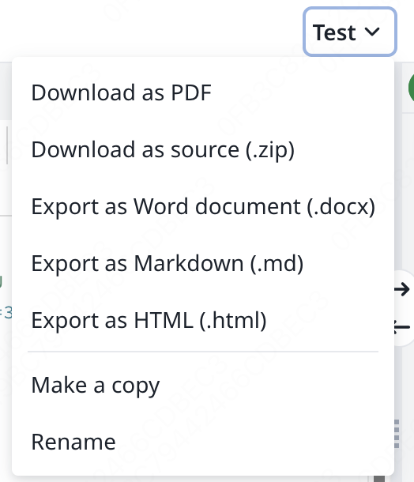
</Frame>

</Column>

<Column>

<Frame>
  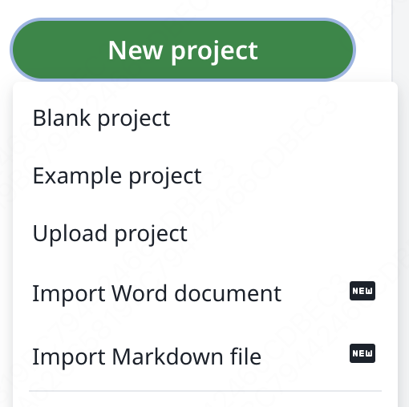
</Frame>

</Column>
</Columns>

#### الميزة 16: المحادثة بالذكاء الاصطناعي ومساعدات أخطاء LaTeX {#features-16-ai-chat-and-latex-error-assistants}

يقدم Ayakaleaf Pro مساعد الذكاء الاصطناعي (AI Assistant) الذي يمكنه استخدام مستندات مشروعك والتحديد الحالي كسياق للإجابة عن الأسئلة واقتراح تعديلات لتراجعها، بينما يقترح مساعد الأخطاء (Error Assistant) إصلاحًا محددًا عند تحديدك خطأ ترجمة في LaTeX.

<Frame>
  
</Frame>

#### الميزة 17: التكامل مع برامج إدارة المراجع {#features-17-reference-manager-integration}

طُوّرت هذه الميزة بواسطة [ayaka-notes/ayakaleaf-pro](https://github.com/ayaka-notes/ayakaleaf-pro). طُوّر التكامل مع Zotero في البداية بواسطة [davrot](https://github.com/davrot) و[yu-i-i/overleaf-cep](https://github.com/yu-i-i/overleaf-cep)؛ وقد أعدنا بناءه باستخدام OAuth وأضفنا التكامل مع Mendeley (OAuth 2.0) في الإصدار v6.3.0. يمكنك:

* ربط حساباتك في Zotero وMendeley من إعدادات الحساب.
* استيراد مكتبتك الشخصية أو مكتبة مجموعة كملف `.bib` إلى مشروعك.
* تحديث ملف `.bib` المستورد في أي وقت لإبقائه محدّثًا.

راجع [التكامل مع Zotero](/ar/on-premises/configuration/overleaf-toolkit/integrations/zotero-integration) و[التكامل مع Mendeley](/ar/on-premises/configuration/overleaf-toolkit/integrations/mendeley-integration) لمعرفة طريقة الإعداد.

<Columns cols={2}>
<Column>

<Frame>
  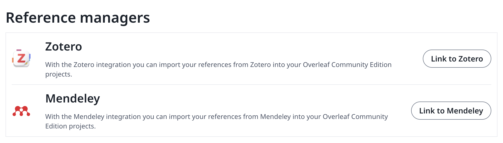
</Frame>

</Column>

<Column>

<Frame>
  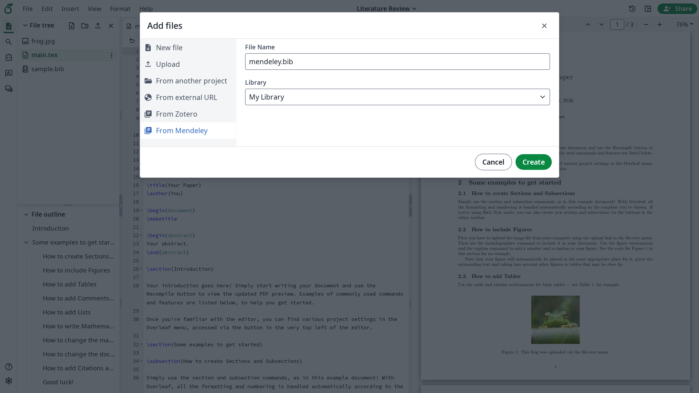
</Frame>

</Column>
</Columns>

#### الميزة 18: واجهة Open in Overleaf API {#features-18-open-in-overleaf-api}

طُوّرت هذه الميزة بواسطة [ayaka-notes/ayakaleaf-pro](https://github.com/ayaka-notes/ayakaleaf-pro)، وهي متوافقة مع واجهة "Open in Overleaf" API الخاصة بـ overleaf.com. يمكنك إضافة رابط أو زر "Open in Ayakaleaf" إلى موقعك الإلكتروني أو مدونتك أو مكتبة القوالب لديك، بحيث يتمكن الزوار من فتح مقتطف LaTeX أو ملف بعيد أو مشروع ZIP كمشروع جديد في مثيلك بنقرة واحدة. تفضّل بزيارة `/devs` على مثيلك لمعرفة التفاصيل، وراجع [Overleaf Import API](/ar/on-premises/configuration/overleaf-toolkit/integrations/overleaf-import-api).

<Frame>
  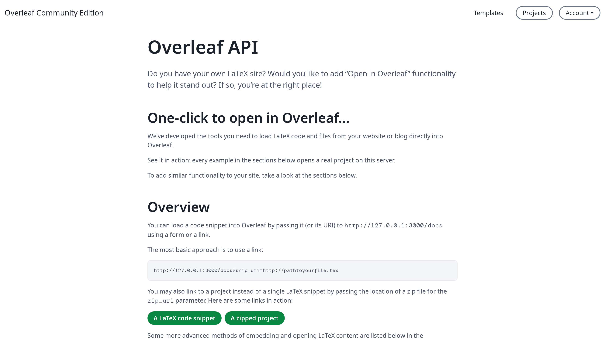
</Frame>

#### الميزة 19: المزامنة مع GitLab {#features-19-gitlab-sync}

طُوّرت هذه الميزة بواسطة [ayaka-notes/ayakaleaf-pro](https://github.com/ayaka-notes/ayakaleaf-pro) في الإصدار v6.3.1 كمعاينة مبكرة (الإطلاق الرسمي في الإصدار v6.4.0). وكما هو الحال في المزامنة مع GitHub، يمكنك ربط مشروع بمستودع على GitLab.com أو على نسخة GitLab المُدارة ذاتيًا لديك، ودفع الإيداعات (commits) من Overleaf ودمج الإيداعات القادمة من GitLab. راجع [المزامنة مع GitLab](/ar/on-premises/configuration/overleaf-toolkit/integrations/gitlab-synchronisation) لمعرفة طريقة الإعداد.

<Frame caption="مزامنة المشاريع في إعدادات الحساب">
  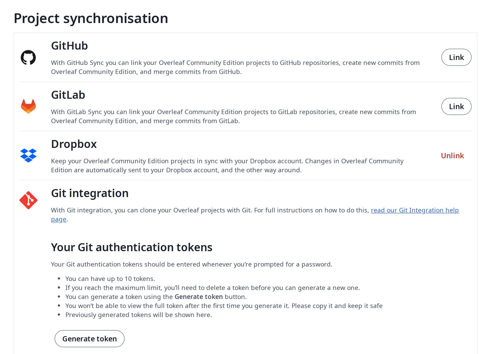
</Frame>

#### الميزة 20: المزامنة مع Dropbox {#features-20-dropbox-sync}

طُوّرت هذه الميزة بواسطة [ayaka-notes/ayakaleaf-pro](https://github.com/ayaka-notes/ayakaleaf-pro) في الإصدار v6.3.1 كمعاينة مبكرة (الإطلاق الرسمي في الإصدار v6.4.0)، على غرار المزامنة مع Dropbox في overleaf.com. بمجرد أن يربط المستخدم حسابه على Dropbox، يظهر كل مشروع من مشاريعه كمجلد في Dropbox الخاص به: تُرسَل التغييرات التي تُجرى في Overleaf إلى Dropbox، وتعود التغييرات التي تُجرى في Dropbox إلى Overleaf. راجع [المزامنة مع Dropbox](/ar/on-premises/configuration/overleaf-toolkit/integrations/dropbox-synchronisation) لمعرفة طريقة الإعداد.

<Frame caption="حالة المزامنة مع Dropbox في المحرر">
  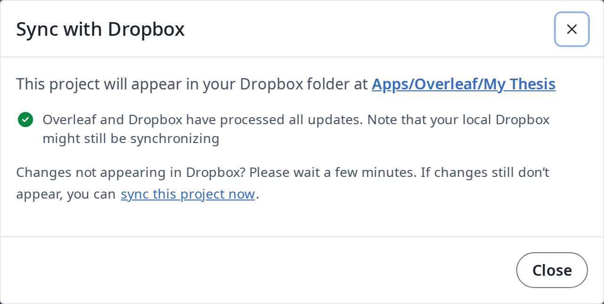
</Frame>

#### الميزة 21: خادم MCP {#features-21-mcp-server}

طُوّرت هذه الميزة بواسطة [ayaka-notes/ayakaleaf-pro](https://github.com/ayaka-notes/ayakaleaf-pro) في الإصدار v6.3.1. يمتلك كل مشروع خادم MCP خاصًا به، بحيث يمكن لعملاء الذكاء الاصطناعي مثل Claude Code و Codex و Cursor و VS Code و Gemini CLI قراءة ملفاته وتعديلها مباشرةً، وترجمته، وقراءة سجل LaTeX، وتنزيل ملف PDF، والرد على التعليقات. راجع [خادم MCP](/ar/on-premises/configuration/overleaf-toolkit/integrations/mcp-server) لمعرفة طريقة الإعداد.

<Frame caption="ربط عميل ذكاء اصطناعي بمشروع">
  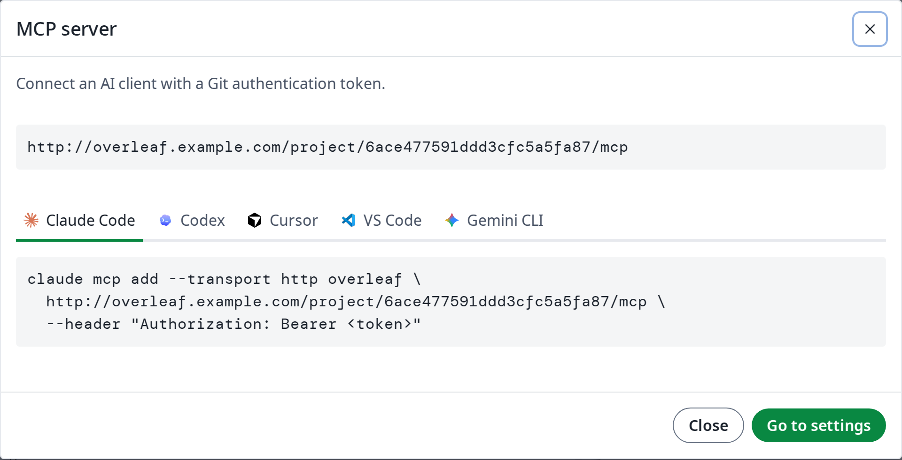
</Frame>

#### الميزة 22: المزامنة مع Gitea {#features-22-gitea-sync}

طُوّرت هذه الميزة بواسطة [ayaka-notes/ayakaleaf-pro](https://github.com/ayaka-notes/ayakaleaf-pro) في الإصدار v6.3.2 كمعاينة مبكرة (الإطلاق الرسمي في الإصدار v6.4.0). وكما هو الحال في المزامنة مع GitHub والمزامنة مع GitLab، يمكنك ربط مشروع بمستودع على gitea.com أو على نسخة Gitea المُدارة ذاتيًا لديك، ودفع الإيداعات (commits) من Overleaf ودمج الإيداعات القادمة من Gitea. راجع [المزامنة مع Gitea](/ar/on-premises/configuration/overleaf-toolkit/integrations/gitea-synchronisation) لمعرفة طريقة الإعداد.

#### الميزة 23: عدة عناوين بريد إلكتروني لكل حساب {#features-23-multiple-emails-per-account}

طُوِّرت هذه الميزة بواسطة [ayaka-notes/ayakaleaf-pro](https://github.com/ayaka-notes/ayakaleaf-pro) وهي متاحة اعتبارًا من v6.4.0. يضيف المستخدمون عناوين بريد أخرى إلى الحساب برمز يُرسل إلى كل منها، ويمكنهم نقل الحساب إلى بريد آخر، مثلًا قبل سحب عنوان الجامعة. راجع [عدة عناوين بريد إلكتروني](/on-premises/user-guide/users/multiple-emails).

<Frame caption="عنوانا بريد إلكتروني في حساب واحد">
  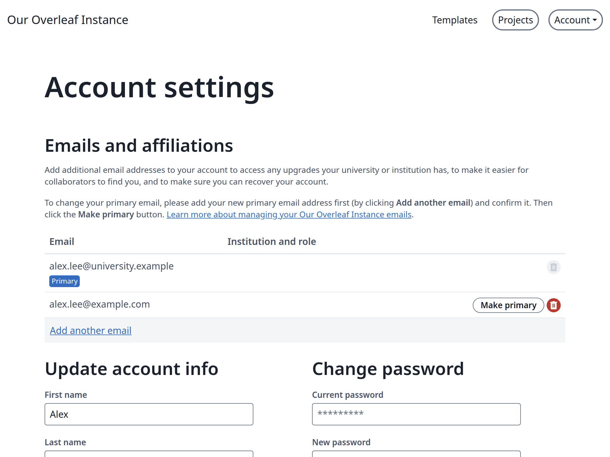
</Frame>
