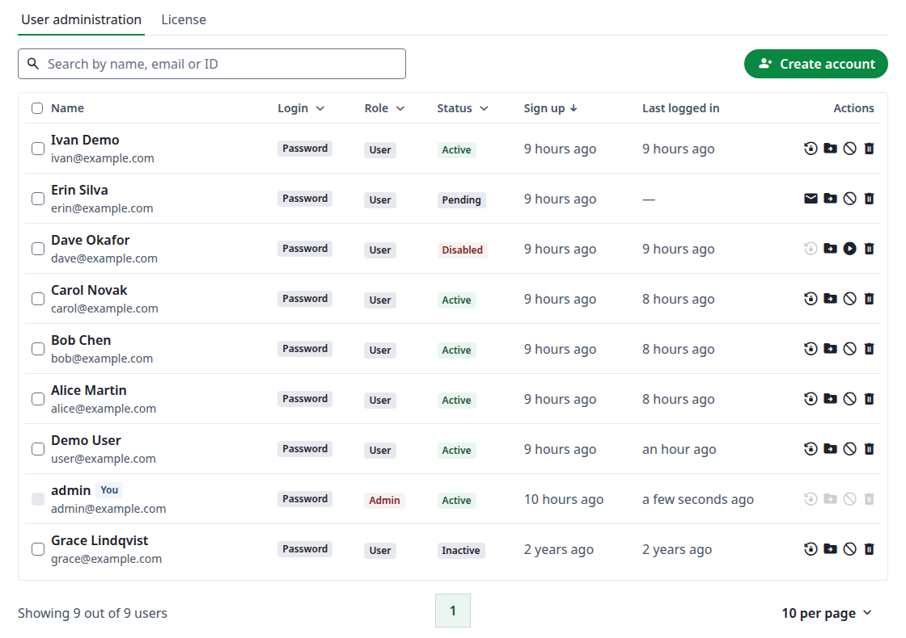
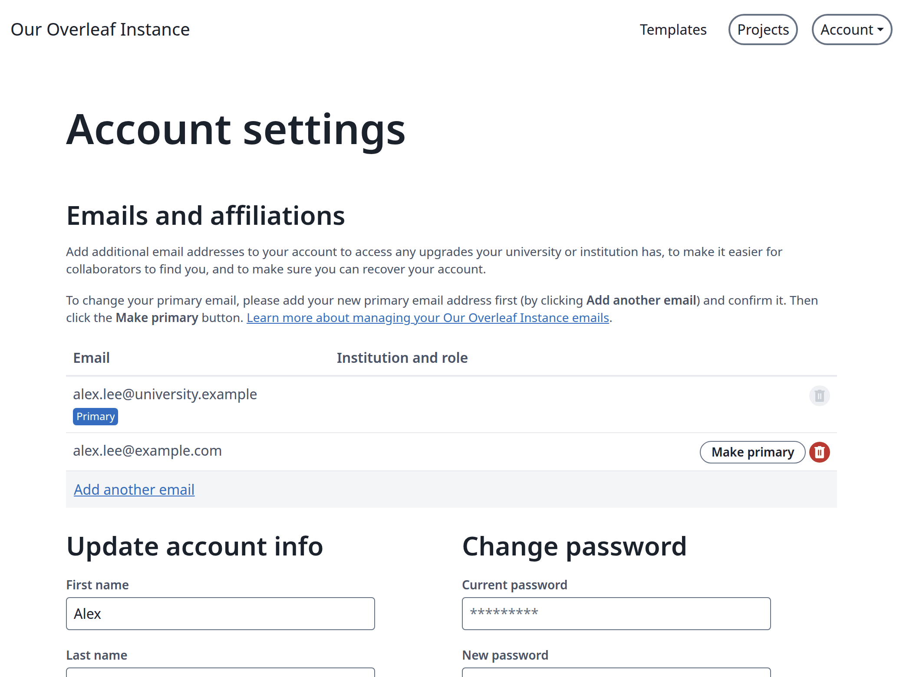

<Check>

يتيح لك ترخيص Ayakaleaf Pro تشغيل التطبيق في **أي بيئة** دون **أي قيود**؛ ويوصى بشدة بتجهيز بيئة غير إنتاجية للاختبار.

</Check>

ننشر معلومات إصداراتنا على GitHub. يُرجى زيارة [هذه الصفحة](https://github.com/ayaka-notes/ayakaleaf-pro/releases).

## Ayakaleaf Pro 6.3.4

<strong>تاريخ الإصدار:</strong> 2026.11.19

راجع: [https://github.com/ayaka-notes/ayakaleaf-pro/releases/tag/pro-v6.3.4](https://github.com/ayaka-notes/ayakaleaf-pro/releases/tag/pro-v6.3.4)

### التغييرات {#changes}

* لوحة الإدارة (معاينة مبكرة): يمكن إيقاف مزامنة GitLab وGitea لكل مستخدم من علامة التبويب Features، مثل مزامنة GitHub وDropbox.
* إصلاحات أمنية من إصدار Overleaf 6.3.4 الأصلي: فحوصات أكثر صرامة لمسارات الملفات، ورفض عمليات الرفع التي ستؤول أسماؤها بعد التنظيف إلى الملف نفسه.

### الترقية {#upgrade}

* من 6.3.3 أو 6.3.2 أو 6.3.1 أو 6.3.0: لا حاجة إلى أي ترحيل. اسحب الصورة الجديدة وأعد التشغيل.
* تبقى مزامنة GitLab وGitea مفعّلة لجميع المستخدمين: لا يلزم إضافة أي شيء إلى قاعدة البيانات.
* لإيقافها لجميع المستخدمين باستثناء المسؤولين، ثم تفعيلها مجددًا لبعض المستخدمين من علامة التبويب Features الخاصة بهم، الصق ما يلي في صدفة قاعدة البيانات (Toolkit: `bin/mongo`, Docker Compose: `docker compose exec mongo mongosh sharelatex`, Kubernetes: `kubectl -n overleaf exec -it mongo-0 -- mongosh 'mongodb://mongo-0.mongo:27017,mongo-1.mongo:27017,mongo-2.mongo:27017/sharelatex?replicaSet=overleaf'`):

```js
db.users.updateMany(
  { isAdmin: { $ne: true }, 'featuresOverrides.note': 'admin-panel' },
  { $set: {
      'features.gitlab': false, 'features.gitea': false,
      'featuresOverrides.$[o].features.gitlab': false,
      'featuresOverrides.$[o].features.gitea': false } },
  { arrayFilters: [{ 'o.note': 'admin-panel' }] })
db.users.updateMany(
  { isAdmin: { $ne: true }, 'featuresOverrides.note': { $ne: 'admin-panel' } },
  { $set: { 'features.gitlab': false, 'features.gitea': false },
    $push: { featuresOverrides: { note: 'admin-panel', features: { gitlab: false, gitea: false } } } })
```

### صورة Docker {#docker-image}

يمكنك العثور على صورة Docker هنا: [https://github.com/ayaka-notes/ayakaleaf-pro/pkgs/container/overleaf-pro](https://github.com/ayaka-notes/ayakaleaf-pro/pkgs/container/overleaf-pro)

```bash
docker pull ghcr.io/ayaka-notes/overleaf-pro:6.3.4
```

<Accordion title="ملاحظات الإصدار الرسمية">

<strong>تاريخ الإصدار:</strong> 2026-11-18

هذا إصدار أمني. يرفض مسارات الملفات التي تحتوي على شرطات مائلة عكسية أو أحرف تحكم أو `..` مرمّزة، ولا يزامن مع Dropbox المشاريع المسماة `.` أو `..`، ويرفض عمليات الرفع التي ستؤول أسماؤها بعد التنظيف إلى الملف نفسه، ويصلح البرنامج النصي `export-user-projects.mjs`.

المصدر: [https://docs.overleaf.com/on-premises/release-notes/release-notes-6.x.x](https://docs.overleaf.com/on-premises/release-notes/release-notes-6.x.x)

</Accordion>

## Ayakaleaf Pro 6.3.3

<strong>تاريخ الإصدار:</strong> 2026.11.15

راجع: [https://github.com/ayaka-notes/ayakaleaf-pro/releases/tag/pro-v6.3.3](https://github.com/ayaka-notes/ayakaleaf-pro/releases/tag/pro-v6.3.3)

يسعدنا ويشرّفنا أن نعلن عن إصدار Overleaf Pro 6.3.3. الإصدار الأصلي Overleaf 6.3.3 هو إصدار أمني يحدّث Node.js والحزم المثبّتة، ونحن نطرحه مع معاينة مبكرة للوحة الإدارة الجديدة، وعدة عناوين بريد إلكتروني لكل حساب، وخادم MCP أكبر، ومساعد ذكاء اصطناعي أفضل.

<Info>

تُطرح لوحة الإدارة الجديدة، وعناوين البريد الإلكتروني المتعددة، ومرفقات مساعد الذكاء الاصطناعي، وخيارات التسجيل الجديدة في 6.3.3 بوصفها **معاينة مبكرة** للاختبار التدريجي، وستصدر رسميًا في v6.4.0. وقد يتغير سلوكها قبل ذلك. يُرجى الإبلاغ عن أي مشكلات على [GitHub](https://github.com/ayaka-notes/ayakaleaf-pro/issues).

</Info>

### التغييرات {#changes}

* لوحة إدارة جديدة (معاينة مبكرة) مع سجلات التدقيق ومفاتيح تشغيل الميزات لكل مستخدم.
* عدة عناوين بريد إلكتروني لكل حساب (معاينة مبكرة).
* خادم MCP: السجل، والتغييرات المتعقَّبة، والتعليقات، والدردشة، ونقل الملفات، 33 أداة.
* مساعد الذكاء الاصطناعي: OpenAI Responses API، ومرفقات PDF، وقراءة صفحات الويب، والمحادثات الطويلة (معاينة مبكرة).
* التسجيل وتسجيل الدخول: reCAPTCHA v2 وقوائم نطاقات البريد الإلكتروني للتسجيل العام (معاينة مبكرة).
* Node.js 24.22.3 وتحديثات الحزم: التحديث الأمني في الإصدار الأصلي Overleaf 6.3.3.
* إصلاحات لأخطاء اكتشفها نظام اختبار E2E لدينا والتحقيق الداخلي في المشكلات Horizon (Internal Horizon Issue Investigation).

#### الميزة 01: لوحة الإدارة الجديدة (معاينة) {#feature-01-new-admin-panel-preview}

قائمة بكل المستخدمين وأخرى بكل المشاريع، وصفحة لكل منها، وإدارة القوالب، وسجلات التدقيق. يتخذ المسؤولون إجراءات على عدة مستخدمين دفعة واحدة، وينسخون روابط التفعيل وكلمة المرور عندما لا تُرسل رسالة بريد إلكتروني، ويشغّلون أو يوقفون لمستخدم واحد ميزات كبيرة مثل Dropbox وGit ومساعد الذكاء الاصطناعي وتعقّب التغييرات ولوحة الرموز. وتُسجَّل أيضًا عمليات تسجيل الدخول عبر SSO والتسجيلات والتكاملات ورموز Git والقوالب. راجع [إدارة المستخدمين](/ar/on-premises/user-guide/administrators/user-management) و[إدارة المشاريع](/ar/on-premises/user-guide/administrators/project-management).

<Frame caption="قائمة المستخدمين">
  
</Frame>

#### الميزة 02: عدة عناوين بريد إلكتروني لكل حساب (معاينة) {#feature-02-multiple-emails-per-account-preview}

يضيف المستخدمون عناوين بريد إلكتروني أخرى إلى حساباتهم برمز يُرسل إلى كل عنوان، ويمكنهم جعل عنوان آخر هو الأساسي، مثلًا قبل سحب عنوان الجامعة. لا يسجّل الدخول إلا البريد الأساسي. راجع [عدة عناوين بريد إلكتروني](/ar/on-premises/user-guide/users/multiple-emails).

<Frame caption="عنوانا بريد إلكتروني في حساب واحد">
  
</Frame>

#### الميزة 03: خادم MCP {#feature-03-mcp-server}

يمكن لعملاء الذكاء الاصطناعي تصفح سجل المشروع واستعادة الإصدارات، ومراجعة التغييرات المتعقَّبة، والتعليق على النص، وقراءة رسائل الدردشة وإرسالها، ونقل الملفات أو إعادة تسميتها: 33 أداة بعد أن كانت 17. راجع [الجديد في v6.3.3](/on-premises/user-guide/users/mcp-server#new-in-v6.3.3).

<Frame caption="تعليق أضافه عميل ذكاء اصطناعي">
  
</Frame>

#### الميزة 04: OpenAI Responses API {#feature-04-openai-responses-api}

اضبط `AI_API_MODE=responses` لنماذج الاستدلال الأحدث من OpenAI، مثل gpt-6.x، التي ترفض أدوات الدوال في Chat Completions. يعمل المساعدان والمرفقات وحصة الرموز كما في السابق. راجع [التكامل مع الذكاء الاصطناعي](/ar/on-premises/configuration/overleaf-toolkit/integrations/ai-integration).

#### الميزة 05: تحسينات مساعد الذكاء الاصطناعي (معاينة) {#feature-05-ai-assistant-improvements-preview}

أرفق ملفات PDF يصل حجمها إلى 2 ميغابايت إلى جانب الصور، مع `AI_PDF_MODEL` اختياري. يقرأ المساعد صفحات الويب عبر وكيل الروابط المرتبطة، وتُلخَّص المحادثات الطويلة كي تستمر. راجع [مساعد الذكاء الاصطناعي](/on-premises/user-guide/users/ai-assistant).

<Frame caption="المرفقات في دردشة الذكاء الاصطناعي">
  
</Frame>

#### الميزة 06: التسجيل وتسجيل الدخول (معاينة) {#feature-06-sign-up-and-login-preview}

يحمي reCAPTCHA v2 تسجيل الدخول وتسجيل الدخول عبر LDAP والتسجيل وإعادة تعيين كلمة المرور، ويقبل `OVERLEAF_ALLOW_PUBLIC_REGISTRATION` قائمة بنطاقات البريد الإلكتروني، مثل `@example.edu,@*.example.org`، أو `@*`. راجع [reCAPTCHA](/ar/on-premises/configuration/overleaf-toolkit/authentication/recaptcha) و[الوصول العام](/ar/on-premises/configuration/overleaf-toolkit/authentication/public-access).

### إصلاحات الأخطاء {#bug-fixes}

* لوحة الإدارة: يظل المسؤول المحذوف مذكورًا ببريده الإلكتروني في سجلات التدقيق وفي "Deleted by"، ويظهر باسم "Deleted user" بعد حذفه نهائيًا ([#178](https://github.com/ayaka-notes/ayakaleaf-pro/pull/178)).
* لوحة الإدارة: تُرفض الطلبات المباشرة لتعطيل الحساب الشخصي أو حذفه أو خفض صلاحياته.
* مساعد الذكاء الاصطناعي: من دون `AI_PDF_MODEL`، تُرسل المحادثة التي تحتوي على ملف PDF وصور إلى `AI_MODEL`، لا إلى `AI_IMAGE_MODEL` الذي قد لا يقرأ ملفات PDF ([#122](https://github.com/ayaka-notes/ayakaleaf-pro/issues/122)).
* معرض القوالب: لا يأخذ التعديل سوى حقول النموذج، ويُرد على الحقل غير النصي بالرمز 400 بدلًا من 500 ([#161](https://github.com/ayaka-notes/ayakaleaf-pro/issues/161)). ويسأل المعرض قاعدة البيانات عمّا إذا كان المستخدم مسؤولًا، كما يفعل `/admin`.
* Git bridge: ينكسر سطر أمر الاستنساخ عند حافة كتلة النسخ، لا عند علامات الترقيم.

### الترقية {#upgrade}

* من 6.3.2 أو 6.3.1 أو 6.3.0: لا حاجة إلى ترحيل. اسحب الصورة الجديدة وأعد التشغيل.
* من 6.2.x أو أقدم مع استخدام Zotero أو Mendeley: شغّل أولًا ترحيل Zotero / Mendeley الوارد في [6.3.0](#ayakaleaf-pro-6.3.0).
* تحل لوحة الإدارة الجديدة محل القديمة. تحتاج عناوين البريد المتعددة إلى إرسال البريد الإلكتروني؛ أما reCAPTCHA وقائمة النطاقات و`AI_API_MODE` فلا تحتاج إلا إلى متغيرات بيئة جديدة.

### المساهمون {#contributors}

شكرًا لـ [@davrot](https://github.com/davrot) على ترويسة صفحة تسجيل الدخول ورابط التسجيل داخل البطاقة ([#142](https://github.com/ayaka-notes/ayakaleaf-pro/pull/142)).

### صورة Docker {#docker-image}

يمكنك العثور على صورة Docker هنا: [https://github.com/ayaka-notes/ayakaleaf-pro/pkgs/container/overleaf-pro](https://github.com/ayaka-notes/ayakaleaf-pro/pkgs/container/overleaf-pro)

```bash
docker pull ghcr.io/ayaka-notes/overleaf-pro:6.3.3
```

<Accordion title="ملاحظات الإصدار الرسمية">

<strong>تاريخ الإصدار:</strong> 2026-11-13

هذا إصدار أمني يتضمن تحديثات للحزم المثبّتة.

المصدر: [https://docs.overleaf.com/on-premises/release-notes/release-notes-6.x.x](https://docs.overleaf.com/on-premises/release-notes/release-notes-6.x.x)

</Accordion>

## Ayakaleaf Pro 6.3.2

<strong>تاريخ الإصدار:</strong> 2026.10.23

راجع: [https://github.com/ayaka-notes/ayakaleaf-pro/releases/tag/pro-v6.3.2](https://github.com/ayaka-notes/ayakaleaf-pro/releases/tag/pro-v6.3.2)

يسعدنا كثيرًا أن نعلن عن إصدار Overleaf Pro 6.3.2. إصدار Overleaf 6.3.2 من المصدر الأصلي (upstream) هو إصدار أمني يحدّث Node.js، ونحن نطرحه مع المزامنة مع Gitea وإصلاحات الأخطاء التي اكتُشفت منذ 6.3.1.

<Info>

تأتي المزامنة مع Gitea في الإصدار 6.3.2 بوصفها **معاينة مبكرة** للاختبار التدريجي، وستُطلَق رسميًا في الإصدار v6.4.0. وقد تتغيّر إعداداتها وسلوكها قبل ذلك. وهي معطّلة افتراضيًا. يُرجى الإبلاغ عن أي مشكلات على [GitHub](https://github.com/ayaka-notes/ayakaleaf-pro/issues).

</Info>

### التغييرات {#changes}

* مزامنة ثنائية الاتجاه مع Gitea (معاينة مبكرة)، لـ gitea.com و Gitea المُدار ذاتيًا 1.23+.
* Node.js 24.22.1، وهو التحديث الأمني في Overleaf 6.3.2 من المصدر الأصلي (upstream).
* إصلاحات لأخطاء اكتشفها نظام اختبار E2E لدينا والتحقيق الداخلي في المشكلات Horizon (Internal Horizon Issue Investigation).

#### الميزة 01: المزامنة مع Gitea (معاينة) {#feature-01-gitea-sync-preview}

مزامنة ثنائية الاتجاه مع Gitea، بالطريقة نفسها التي تعمل بها المزامنة مع GitHub والمزامنة مع GitLab: اربط حسابك، واستورد مستودعًا من قائمة المشروع الجديد، وصدّر مشروعًا، وادفع واسحب، وادمج عبر طلبات السحب (pull requests). لا يتجاوز Overleaf أبدًا حماية الفروع الخاصة بالمستودع. راجع [المزامنة مع Gitea](/ar/on-premises/configuration/overleaf-toolkit/integrations/gitea-synchronisation).

### إصلاحات الأخطاء {#bug-fixes}

* المزامنة مع GitHub و GitLab و Gitea: عندما يتعذّر حذف ملف في Overleaf بعد حذفه في المستودع، تفشل المزامنة ويمكن إعادة محاولتها، بدلًا من الإبلاغ عن النجاح وترك الملف في المشروع. ويفشل `git push` الذي يحذف ملفًا بالطريقة نفسها ([#121](https://github.com/ayaka-notes/ayakaleaf-pro/issues/121)).
* Git bridge: يبقى المستند الذي أُنشئ في المحرر بامتداد غير نصي (مثل `.csv`) مستندًا قابلًا للتحرير عندما يغيّره `git push`.
* تتبع التغييرات: يمكن للمحررين غير المسجّلين في مشروع مُشارَك عبر رابط حذف سلاسل التعليقات، لكن لم يعد بإمكانهم حلّها أو إعادة فتحها. ويمكن للمراجعين حذف ردودهم الخاصة.
* معرض القوالب: يتطلب نشر قالب صلاحية الوصول إلى المشروع.
* Learn: تبقى صفحات المساعدة المخزّنة مؤقتًا متاحة عندما يتعذّر الوصول إلى الويكي.

### الترقية {#upgrade}

* من 6.3.1 أو 6.3.0: لا حاجة إلى ترحيل. اسحب الصورة الجديدة وأعد التشغيل.
* من 6.2.x أو أقدم مع استخدام Zotero أو Mendeley: شغّل أولًا ترحيل Zotero / Mendeley الوارد في [6.3.0](#ayakaleaf-pro-6.3.0).
* المزامنة مع Gitea معطّلة افتراضيًا، ولا تحتاج إلا إلى متغيرات بيئة جديدة.

### صورة Docker {#docker-image}

يمكنك العثور على صورة Docker هنا: [https://github.com/ayaka-notes/ayakaleaf-pro/pkgs/container/overleaf-pro](https://github.com/ayaka-notes/ayakaleaf-pro/pkgs/container/overleaf-pro)

```bash
docker pull ghcr.io/ayaka-notes/overleaf-pro:6.3.2
```

<Accordion title="ملاحظات الإصدار الرسمية">

<strong>تاريخ الإصدار:</strong> 2026-10-23

هذا إصدار أمني يتضمن تحديثات للحزم المثبّتة.

المصدر: [https://docs.overleaf.com/on-premises/release-notes/release-notes-6.x.x](https://docs.overleaf.com/on-premises/release-notes/release-notes-6.x.x)

</Accordion>

## Ayakaleaf Pro 6.3.1

<strong>تاريخ الإصدار:</strong> 2026.10.18

راجع: [https://github.com/ayaka-notes/ayakaleaf-pro/releases/tag/pro-v6.3.1](https://github.com/ayaka-notes/ayakaleaf-pro/releases/tag/pro-v6.3.1)

يسعدنا كثيرًا أن نعلن عن إصدار Overleaf Pro 6.3.1. وبينما يركّز الإصدار التصحيحي المعتاد على إصلاحات بسيطة للإصدار v6.3.0، يذهب هذا الإصدار إلى أبعد من ذلك بكثير: فإلى جانب العديد من إصلاحات الأخطاء، يقدّم خمس ميزات جديدة.

<Info>

تأتي المزامنة مع Dropbox والمزامنة مع GitLab في الإصدار 6.3.1 بوصفهما **معاينتين مبكرتين** للاختبار التدريجي، وستُطلقان رسميًا في الإصدار v6.4.0. وقد تتغيّر إعداداتهما وسلوكهما قبل ذلك. كلتاهما معطّلتان افتراضيًا. يُرجى الإبلاغ عن أي مشكلات على [GitHub](https://github.com/ayaka-notes/ayakaleaf-pro/issues).

</Info>

### التغييرات {#changes}

* مزامنة ثنائية الاتجاه مع Dropbox (معاينة مبكرة).
* مزامنة ثنائية الاتجاه مع GitLab (معاينة مبكرة)، بما في ذلك GitLab المُدار ذاتيًا 15.10+.
* خادم MCP لكل مشروع لعملاء الذكاء الاصطناعي مثل Claude Code و Codex و Cursor و VS Code و Gemini CLI.
* دعم GitHub Enterprise في المزامنة مع GitHub.
* التعرّف على الرموز المكتوبة بخط اليد في لوحة الرموز، ويعمل بالكامل في المتصفح.
* إضافة `OVERLEAF_DISABLE_LOCAL_LOGIN` لإخفاء تسجيل الدخول بالبريد الإلكتروني وكلمة المرور على مثيلات SSO.
* إصلاحات لأخطاء اكتشفها نظام اختبار E2E لدينا والتحقيق الداخلي في المشكلات Horizon (Internal Horizon Issue Investigation).
* رقع Overleaf 6.3.1 من المصدر الأصلي (upstream).

#### الميزة 01: المزامنة مع Dropbox (معاينة) {#feature-01-dropbox-sync-preview}

يربط كل مستخدم حسابه الخاص على Dropbox، وتظهر المشاريع التي يملكها والمشتركة معه ضمن `Apps/<DROPBOX_APP_NAME>/`. تُرسَل التعديلات في Overleaf إلى Dropbox، وتعود التعديلات في Dropbox عبر webhook موقّع. يجب تفعيل Git bridge. راجع [المزامنة مع Dropbox](/ar/on-premises/configuration/overleaf-toolkit/integrations/dropbox-synchronisation).

#### الميزة 02: المزامنة مع GitLab (معاينة) {#feature-02-gitlab-sync-preview}

مزامنة ثنائية الاتجاه مع GitLab، بالطريقة نفسها التي تعمل بها المزامنة مع GitHub: اربط حسابك، واستورد مستودعًا من قائمة المشروع الجديد، وصدّر مشروعًا، وادفع واسحب، وادمج عبر طلبات الدمج (merge requests). راجع [المزامنة مع GitLab](/ar/on-premises/configuration/overleaf-toolkit/integrations/gitlab-synchronisation).

<Frame>
  
</Frame>

#### الميزة 03: خادم MCP {#feature-03-mcp-server}

يحصل كل مشروع على نقطة نهاية MCP على `/project/<project_id>/mcp`، وتُفعَّل مع git bridge. صادِق باستخدام رمز Git نفسه الذي تستخدمه مع `git clone`. يتبع الوصول أدوار المشروع، ويخضع كل أداة لحدّ معدّل الاستخدام. راجع [خادم MCP](/ar/on-premises/configuration/overleaf-toolkit/integrations/mcp-server).

<Frame>
  
</Frame>

#### الميزة 04: GitHub Enterprise {#feature-04-github-enterprise}

وجّه المزامنة مع GitHub إلى GitHub Enterprise Server أو GitHub Enterprise Cloud مع إقامة البيانات (data residency) باستخدام `GITHUB_SYNC_URL`. تبقى القيم الافتراضية على github.com. راجع [GitHub Enterprise](/ar/on-premises/configuration/overleaf-toolkit/integrations/github-synchronisation#github-enterprise).

#### الميزة 05: التعرّف على الرموز المكتوبة بخط اليد {#feature-05-handwritten-symbol-recognition}

بدّل لوحة الرموز إلى وضع الرسم وارسم رمزًا للحصول على أوامر LaTeX المطابقة. يعمل التعرّف في المتصفح باستخدام نموذج درّبته ayaka-notes، لذا لا تغادر أي بيانات جهاز المستخدم. يُخفى مفتاح الرسم في المتصفحات التي لا تدعم `OffscreenCanvas` (مثل Safari 15).

<Frame>
  
</Frame>

### إصلاحات الأخطاء {#bug-fixes}

* المصادقة: يمكن للحسابات المحلية تعيين كلمة مرورها وتغييرها على مثيلات SSO، ولم يعد بإمكان مستخدمي OIDC تغيير بريدهم الإلكتروني ([#112](https://github.com/ayaka-notes/ayakaleaf-pro/pull/112)). تُحفَظ طرق تسجيل الدخول عبر LDAP و SAML و OIDC، ويعمل تسجيل الخروج عبر SAML/OIDC مجددًا. راجع [الحسابات وكلمات المرور](/ar/on-premises/configuration/overleaf-toolkit/authentication#accounts-and-passwords).
* LDAP و SAML و OIDC: لم تعد سمات الاسم ذات القيم المتعددة (مثل `cn`) تُفشل تسجيل الدخول، وتُحوَّل عناوين البريد الإلكتروني في OIDC إلى أحرف صغيرة كما في LDAP و SAML، لذا فإن الحساب الذي يرسل مزوّد الهوية (IdP) بريده الإلكتروني بحالة أحرف مختلفة يُربَط بدلًا من أن يفشل.
* المستخدمون المعلَّقون: يؤدي تعليق مستخدم إلى إنهاء جلساته وإغلاق محرراته المفتوحة. وتُرفَض رموز Git الخاصة به وعمليات التنزيل عبر MCP.
* المزامنة مع GitHub: لا يمكن تصدير المشروع إلا لمالكه، وتبقى التعديلات التي أُجريت أثناء السحب معلّقة، وتُزامَن الملفات الفارغة، ويُتحقق من عمليات الدمج اليدوية على GitHub، ويُلغى الرمز المستبدَل عند إعادة الربط.
* Zotero / Mendeley: عرض رسالة لإعادة الربط عندما تتوقف بيانات الاعتماد عن العمل، وإعادة فهرسة المراجع بعد الاستيراد.
* طلبات API الخارجية (Zotero و Mendeley و GitHub و GitLab والبحث على الويب) تحصل على مهلة اتصال 3 ثوانٍ بدلًا من ثانية واحدة ([#106](https://github.com/ayaka-notes/ayakaleaf-pro/pull/106)).
* تتبع التغييرات: تتضمن بيانات المراجعة المستندات غير المحمّلة والتغييرات غير المحفوظة (من [yu-i-i/overleaf-cep#262](https://github.com/yu-i-i/overleaf-cep/pull/262)).
* مساعد الأخطاء: يقدّم إصلاحات للمستندات الموجودة في المشروع فقط ([#103](https://github.com/ayaka-notes/ayakaleaf-pro/pull/103)).
* لوحة الإدارة: تعمل استعادة مشروع محذوف وتغيير المالكين وتعديل المستخدمين بشكل صحيح. يستخدم البحث النص الحرفي، ولم يعد فشل البريد الإلكتروني يعطّل إنشاء الحسابات أو حذفها.
* معرض القوالب: يُرجع الفرز غير الصالح الرمز 400 بدلًا من 500، ويُتحقق من صحة معرّفات القوالب، ويطلب نشر مشروع بدون ملف رئيسي تحديد ملف رئيسي.
* Git bridge: يمرّر nginx المسار `/git/` إلى `GIT_BRIDGE_HOST` و `GIT_BRIDGE_PORT`، وتُخفى المسارات الداخلية.
* Sandboxed Compiles: يُحتفظ بحاويات المشاريع التي تُرجمت مؤخرًا لإعادة استخدامها.

### الترقية {#upgrade}

* من 6.3.0: لا حاجة إلى ترحيل. اسحب الصورة الجديدة وأعد التشغيل.
* من 6.2.x أو أقدم مع استخدام Zotero أو Mendeley: شغّل أولًا ترحيل Zotero / Mendeley الوارد في [6.3.0](#ayakaleaf-pro-6.3.0).
* المزامنة مع Dropbox والمزامنة مع GitLab معطّلتان افتراضيًا. لا تحتاج المزامنة مع GitLab إلا إلى متغيرات بيئة جديدة. أما المزامنة مع Dropbox فتحتاج أيضًا إلى إنشاء فهارس MongoDB الخاصة بها مرة واحدة، قبل أن يربط المستخدمون حساباتهم: راجع [إنشاء فهارس قاعدة البيانات](/ar/on-premises/configuration/overleaf-toolkit/integrations/dropbox-synchronisation#create-the-database-indexes).

### المساهمون {#contributors}

شكرًا لـ [@CPT-KK](https://github.com/CPT-KK) على إصلاحات كلمة مرور SSO والبريد الإلكتروني في OIDC ([#112](https://github.com/ayaka-notes/ayakaleaf-pro/pull/112))، ولـ [@aruznieto](https://github.com/aruznieto) على `OVERLEAF_DISABLE_LOCAL_LOGIN`.

### صورة Docker {#docker-image}

يمكنك العثور على صورة Docker هنا: [https://github.com/ayaka-notes/ayakaleaf-pro/pkgs/container/overleaf-pro](https://github.com/ayaka-notes/ayakaleaf-pro/pkgs/container/overleaf-pro)

```bash
docker pull ghcr.io/ayaka-notes/overleaf-pro:6.3.1
```

<Accordion title="ملاحظات الإصدار الرسمية">

<strong>تاريخ الإصدار:</strong> 2026-10-15

**إصلاحات الأخطاء**

* إصلاح رابط تنزيل الكل في مخرجات الترجمة.
* إصلاح أخطاء متعلقة بالتعديلات المجهولة.
* استعادة السكربت `suspend_users`، مع خيار `--reenable` لرفع التعليق.
* إصلاح عدم محاذاة الشعار عند ضبط كل من عنوان URL لصورة الترويسة وعنوان شريط التنقل.
* إصلاح السكربت `export-user-projects.mjs`.

**تغييرات أخرى**

* تحديث التبعيات الداخلية.

المصدر: [https://docs.overleaf.com/on-premises/release-notes/release-notes-6.x.x](https://docs.overleaf.com/on-premises/release-notes/release-notes-6.x.x)

</Accordion>

## Ayakaleaf Pro 6.3.0

<strong>تاريخ الإصدار:</strong> 2026.10.03 (إعادة إصدار؛ صدر في الأصل بتاريخ 2026.09.24)

راجع: [https://github.com/ayaka-notes/ayakaleaf-pro/releases/tag/pro-v6.3.0](https://github.com/ayaka-notes/ayakaleaf-pro/releases/tag/pro-v6.3.0)

<Warning>

صدر Ayakaleaf Pro 6.3.0 في الأصل بتاريخ 24 سبتمبر 2026. وتعالج إعادة الإصدار هذه مشكلات في تكاملات AI Assistant و Zotero و Mendeley نتجت عن تحديثات في المصدر الأصلي (upstream).

لا يُلحق الإصدار المنشور سابقًا أي ضرر ببياناتك. اسحب أحدث صورة `6.3.0` وقم بترقية نشرك. <strong>يجب على التثبيتات الحالية التي تحتوي على ملفات مراجع مرتبطة بـ Zotero أو Mendeley تشغيل الترحيل أدناه أيضًا.</strong> أما التثبيتات الجديدة فلا تحتاج إلى هذا الترحيل.

</Warning>

<Accordion title="ترحيل Zotero / Mendeley للتثبيتات الحالية">

عند الترقية إلى صورة 6.3.0 المعاد إصدارها، قم بترحيل البيانات الوصفية لملفات المراجع المرتبطة بـ Zotero/Mendeley باستخدام السكربت أدناه. يرافق هذا الترحيل الإصلاح `12031b8dfd`.

يعيد هذا الترحيل تسمية `zoteroGroupId` / `mendeleyGroupId` إلى `group_id`، ويعيد تسمية `importedByUserId` إلى `importer_id`، ويزيل `importedByName`.

انسخ MongoDB احتياطيًا وأوقف التطبيق قبل تشغيل الترحيل. أبقِ MongoDB قيد التشغيل. افتح الصدفة الخاصة به (استبدل `mongo` باسم حاويتك):

```bash
docker exec -it mongo mongosh
```

شغّل ما يلي في `mongosh` (استبدل `sharelatex` باسم قاعدة بياناتك):

```javascript
use sharelatex

(async () => {
  let updated = 0
  await db.projects.find({}, { rootFolder: 1 }).forEach(async project => {
    const changes = {}
    function visit(folders, path) {
      for (const [i, folder] of (folders || []).entries()) {
        const folderPath = `${path}.${i}`
        for (const [j, file] of (folder.fileRefs || []).entries()) {
          const data = { ...file.linkedFileData }
          if (!["zotero", "mendeley"].includes(data.provider)) continue
          const groupKey = `${data.provider}GroupId`
          if (![groupKey, "importedByUserId", "importedByName"].some(key => key in data)) continue
          for (const [oldKey, newKey] of [[groupKey, "group_id"], ["importedByUserId", "importer_id"]]) {
            if (data[oldKey] != null && data[oldKey] !== "") {
              const value = String(data[oldKey])
              if (newKey in data && data[newKey] !== value) {
                throw new Error(`Conflicting ${newKey}: project ${project._id}, file ${file._id}`)
              }
              data[newKey] = value
            }
            delete data[oldKey]
          }
          delete data.importedByName
          changes[`${folderPath}.fileRefs.${j}.linkedFileData`] = data
        }
        visit(folder.folders, `${folderPath}.folders`)
      }
    }
    visit(project.rootFolder, "rootFolder")
    if (!Object.keys(changes).length) return
    const result = await db.projects.updateOne(
      { _id: project._id, rootFolder: { $eq: project.rootFolder } },
      { $set: changes }
    )
    if (!result.matchedCount) throw new Error(`Project changed during migration: ${project._id}`)
    updated += result.modifiedCount
  })
  print(`Updated ${updated} project(s).`)
})()
```

يشمل السكربت المجلدات المتداخلة ولا يغيّر سوى البيانات الوصفية الخاصة بـ Zotero/Mendeley. ومن الآمن إعادة تشغيله: إذ يُبلغ الترحيل المكتمل عن `Updated 0 project(s).` في التشغيل التالي. وإذا توقف بسبب تعارض، فافحص المشروع/الملف المُبلغ عنه؛ فقد تكون المشاريع السابقة قد رُحّلت بالفعل.

شغّل التطبيق المحدّث، وأعد تحميل المحرر، وحدّث ملف مراجع موجودًا بصفتك المستورد الأصلي له. لا تُعاد كتابة اللقطات التاريخية. وللرجوع إلى التطبيق القديم، استعد النسخة الاحتياطية من MongoDB.

</Accordion>

نفخر كثيرًا بالإعلان عن إصدار Overleaf Pro 6.3.0، أقوى محرر LaTeX عبر الإنترنت وأغناه بالميزات في المجتمع. وبما أننا ركّزنا دائمًا على تحسين تجربة مستخدمينا، يجلب هذا الإصدار تغييرات ضخمة وميزات رائعة ستحبها بالتأكيد، بما في ذلك مساعد الذكاء الاصطناعي والتكامل مع مزوّدي المراجع من الأطراف الثالثة.

### التغييرات {#changes}

* AI Chat Assistant: دردش مع نموذج ذكاء اصطناعي عبر مزوّدك الخاص، مباشرةً في محررك.
* LaTeX Error Assistant: احصل على إصلاحات مقترحة بالذكاء الاصطناعي لأخطاء ترجمة LaTeX.
* التكامل مع Mendeley: استورد المراجع من Mendeley على غرار Zotero.
* Open in Overleaf API: أُضيفت واجهة برمجية لفتح المحتوى في Overleaf.
* معرض القوالب: أُضيف الترقيم والبحث والفرز من جانب الخادم، لذا لم تعد المعارض الكبيرة بحاجة إلى تحميل كل القوالب في المتصفح.
* الترجمات: حُدّثت تصحيحات الترجمة للإصدار 6.3.0، بما في ذلك نصوص الواجهة الجديدة في جميع اللغات المدعومة.
* Overleaf 6.3.0 الأصلي: يتضمن تحرير الملفات في علامات تبويب، وشعارات ترويسة منفصلة للسمتين الفاتحة والداكنة، وتحديثات للاعتماديات والصورة الأساسية.
* أُضيف `OVERLEAF_HEADER_IMAGE_URL_LIGHT` و `OVERLEAF_HEADER_IMAGE_URL_DARK` لدعم صور شعار ترويسة منفصلة للسمتين الفاتحة والداكنة.
* يمكن الآن فتح الملفات في علامات تبويب مختلفة في المحرر.
* أُضيف دعم وكلاء HTTP(S) قابلة للإعداد، بما في ذلك الوكلاء المستضافون محليًا، عبر `OVERLEAF_LINKED_URL_OUTBOUND_PROXY`، والذي تستخدمه أيضًا Open in Overleaf API.

#### الميزة 01: AI Assistant متاح الآن {#feature-01-ai-assistant-is-available-now}

الذكاء الاصطناعي هو كل ما تحتاجه، راجع دليل الإعداد: [تكامل الذكاء الاصطناعي](/ar/on-premises/configuration/overleaf-toolkit/integrations/ai-integration)

<Frame>
  
</Frame>

<Frame>
  
</Frame>

#### الميزة 02: Open in Overleaf API {#feature-02-open-in-overleaf-api}

هذه الميزة مفعّلة افتراضيًا، ويمكنك إنشاء رابطك الخاص لفتح مشروع LaTeX في نسخة Overleaf الخاصة بك. ما عليك سوى زيارة `your.overleaf.com/devs` للاطلاع على التفاصيل. راجع: [Overleaf Import API](/ar/on-premises/configuration/overleaf-toolkit/integrations/overleaf-import-api)

<Frame>
  
</Frame>

يمكنك الآن إضافة زر "Open in Overleaf" إلى موقعك أو مدونتك أو مكتبة القوالب لديك، حتى يتمكن المستخدمون من استيراد مقتطفات LaTeX أو الملفات البعيدة أو مشاريع ZIP بنقرة واحدة. يُفتح المحتوى كمشروع جديد في نسختك، جاهزًا للتحرير والترجمة — دون الحاجة إلى نسخ أو رفع يدوي.

<Frame>
  
</Frame>

#### الميزة 03: التكامل مع Mendeley {#feature-03-mendeley-integration}

على غرار التكامل مع Zotero، راجع: [التكامل مع Mendeley](/ar/on-premises/configuration/overleaf-toolkit/integrations/mendeley-integration)

<Frame>
  
</Frame>

#### الميزة 04: ترقيم صفحات القوالب {#feature-04-template-pagination}

أصبح المعرض الآن يُجري الترقيم والفرز والبحث في MongoDB. ويعمل دون أي تحضير؛ ومع آلاف القوالب، يمكنك مع ذلك إضافة هذه الفهارس للحفاظ على سرعته (من الآمن إعادة التشغيل، `mongo`/`sharelatex` = اسما الحاوية وقاعدة البيانات لديك):

```bash
docker exec mongo mongosh sharelatex --quiet --eval '
db.templates.createIndex({category:1,lastUpdated:-1},{name:"category_1_lastUpdated_-1",background:true});
db.templates.createIndex({lastUpdated:-1},{name:"lastUpdated_-1",background:true});
db.templates.createIndex({category:1,name:1},{name:"category_1_name_1_ci",collation:{locale:"en",strength:2},background:true});
db.templates.createIndex({name:1},{name:"name_1_ci",collation:{locale:"en",strength:2},background:true});
'
```

احتفظ بـ `collation` في الفهرسين `*_ci` كما هو مكتوب — إذ يستعلم المعرض باستخدام الـ collation نفسه، ولا يستخدم MongoDB إلا فهرسًا مطابقًا.

<Frame>
  
</Frame>

### صورة Docker {#docker-image}

يمكنك العثور على صورة docker هنا: [https://github.com/ayaka-notes/ayakaleaf-pro/pkgs/container/overleaf-pro](https://github.com/ayaka-notes/ayakaleaf-pro/pkgs/container/overleaf-pro)

```bash
docker pull ghcr.io/ayaka-notes/overleaf-pro:6.3.0
```

<Accordion title="ملاحظات الإصدار الرسمية">

<strong>تاريخ الإصدار:</strong> 2026-08-28

يتوفر TexLive 2026 لنسخ Server Pro التي تشغّل [Sandboxed Compiles](/ar/on-premises/configuration/overleaf-toolkit/sandboxed-compiles). راجع [الوثائق](/ar/on-premises/configuration/overleaf-toolkit/sandboxed-compiles#setup-the-texlive-image) للاطلاع على تعليمات الترقية، و[ملاحظات الإصدار](https://www.overleaf.com/blog/tex-live-2026-is-now-available) للاطلاع على أبرز التغييرات التي قدّمها هذا الإصدار.

**ميزات جديدة**

* أُضيف `OVERLEAF_HEADER_IMAGE_URL_LIGHT` و `OVERLEAF_HEADER_IMAGE_URL_DARK` لدعم صور شعار ترويسة منفصلة للسمتين الفاتحة والداكنة.
* يمكن الآن فتح الملفات في علامات تبويب مختلفة في المحرر.

**تغييرات أخرى**

* تحديثات أمنية للصورة الأساسية والحزم المثبتة.

المصدر: [https://docs.overleaf.com/on-premises/release-notes/release-notes-6.x.x](https://docs.overleaf.com/on-premises/release-notes/release-notes-6.x.x)

</Accordion>

## Ayakaleaf Pro 6.2.2

<strong>تاريخ الإصدار:</strong> 2026.07.23

راجع: [https://github.com/ayaka-notes/ayakaleaf-pro/releases/tag/pro-v6.2.2](https://github.com/ayaka-notes/ayakaleaf-pro/releases/tag/pro-v6.2.2)

### التغييرات {#changes}

نقل تصحيحات الإصلاح العاجل الرسمية التي صدرت في Overleaf الأصلي `6.2.2` (فوق `6.2.1`):

* إيقاف تسريب سر رمز دعوة المشروع إلى السجلات. إذ كان مشفّر رمز الدعوة يسجّل إعداداته الخاصة عند كل عملية تشفير/فك تشفير، والتي تضمنت كلمات مرور التشفير المشتقة من `OVERLEAF_INVITE_TOKEN_SECRET`.
* ترحيل البريد الإلكتروني الصادر من عميل AWS SES v1 المنتهي دعمه إلى SESv2. إذ كانت النسخ المُعدّة باستخدام مشغّل البريد `ses` قد تفشل في إرسال البريد تمامًا؛ ويجري الإرسال الآن عبر `SESv2Client`.
* إخفاء إدخالات المجموعات في القائمة المنسدلة لمشاركة المشروع خلف علامة الميزة الجديدة `group-link-sharing`، بحيث لم تعد مشاركة روابط المجموعات تُعرض في النسخ التي لا تنطبق عليها.
* إصلاح نافذة مشاركة المشروع للمتعاونين. إذ كان فتحها بصفتك غير مالك، أو مع تعطيل مسار `sharing-updates`، يُصدر طلبًا يفشل دائمًا ويُظهر خطأ "something went wrong".
* إضافة `scripts/flush_docs_with_pending_updates.js` إلى document-updater، وهو سكربت صيانة يستعيد المستندات التي بقيت مع قائمة انتظار `PendingUpdates` عالقة في Redis بعد تفريغ مشروعها أو حذفه حذفًا نهائيًا. يدعم `--dry-run` وفحص أمان `--estimated-docs`.
* تحديث الاعتماديات: `multer` 2.2.0، و `form-data` 2.5.6، و `protobufjs` 7.6.3، و `@grpc/grpc-js` 1.14.4.

يتضمن هذا الإصدار أيضًا الإصلاحات والتحسينات التالية من Ayakaleaf Pro:

* إضافة ترجمات كاملة لـ 16 لغة إضافية (cs, da, de, es, fi, fr, it, ja, ko, nl, no, pl, pt, ru, sv, tr)، مع إصلاح النصوص غير المترجمة مثل صفحة إعادة تعيين كلمة المرور. يُصلح [#38](https://github.com/ayaka-notes/ayakaleaf-pro/issues/38).
* إصلاح عدد العناصر في زر "show N more projects" في لوحة الإدارة، والذي كان يعرض رقمًا خاطئًا لأن العنصر النائب لصيغة الجمع لم يُمرَّر بشكل صحيح.
* إصلاح أخطاء التحقق عند التصدير إلى GitHub، والتي تُعرض الآن عبر مفاتيح i18n ثابتة بدلًا من الرسائل الخام، وإزالة مفاتيح الأخطاء التي لم تعد تستخدمها نافذة GitHub Sync.

### صورة Docker {#docker-image}

يمكنك العثور على صورة docker هنا: [https://github.com/ayaka-notes/ayakaleaf-pro/pkgs/container/overleaf-pro](https://github.com/ayaka-notes/ayakaleaf-pro/pkgs/container/overleaf-pro)

```bash
docker pull ghcr.io/ayaka-notes/overleaf-pro:6.2.2
```

<Accordion title="ملاحظات الإصدار الرسمية">

<strong>تاريخ الإصدار:</strong> 2026-07-20

**إصلاحات الأخطاء**

* [#1499](https://github.com/overleaf/overleaf/pull/1499): إصلاح تجاهل `OVERLEAF_INVITE_TOKEN_SECRET` في الإعدادات
* حلّ مشكلة تعطل نقل البريد الإلكتروني عبر SES API
* LDAP: حلّ خطأ "invalid email address" عند استخدام عنوان البريد الإلكتروني كاسم مستخدم
* Git: حلّ خطأ "fetch" عند استطلاع مستوى السجلات من عنوان URL خارجي
* حلّ تنبيه الخطأ الذي يظهر في نافذة مشاركة المشروع

**تغييرات أخرى**

* تقديم السكربت `flush_docs_with_pending_updates` لإدارة المستندات العالقة
* تحديث الاعتماديات الداخلية

المصدر: [https://docs.overleaf.com/on-premises/release-notes/release-notes-6.x.x](https://docs.overleaf.com/on-premises/release-notes/release-notes-6.x.x)

</Accordion>

## Ayakaleaf Pro 6.2.1

<strong>تاريخ الإصدار:</strong> 2026.07.18

راجع: [https://github.com/ayaka-notes/ayakaleaf-pro/releases/tag/pro-v6.2.1](https://github.com/ayaka-notes/ayakaleaf-pro/releases/tag/pro-v6.2.1)

### التغييرات {#changes}

نقل تصحيحات الإصلاح العاجل الرسمية التي صدرت في Overleaf الأصلي `6.2.1` (فوق `6.2.0`):

* تقوية رسالة `applyOtUpdate` في الوقت الفعلي بمخطط تحقق صارم بدلًا من قبول أي كائن، مع رفض عمليات التحرير المشوّهة.
* تخفيف ذلك المخطط بجعل `meta.tc` اختياريًا، بحيث لم تعد التحديثات الصالحة تُرفض بسبب التحقق الأكثر صرامة.
* إصلاح المحرر (عميل ShareJS) بحيث تُسقط العمليات التي تُختزل إلى عملية فارغة — سواء ألغتها عملية بعيدة/متزامنة، أو تراجع عنها المستخدم بالكامل — بدلًا من إرسالها إلى الخادم، ويُبلَّغ عن المستند بشكل صحيح بأنه محفوظ. يمنع ذلك مشكلات المزامنة الزائفة / "التغييرات غير المحفوظة" المتعلقة بالتراجع والتحرير المتزامن.

### صورة Docker {#docker-image}

يمكنك العثور على صورة docker هنا: [https://github.com/ayaka-notes/ayakaleaf-pro/pkgs/container/overleaf-pro](https://github.com/ayaka-notes/ayakaleaf-pro/pkgs/container/overleaf-pro)

```bash
docker pull ghcr.io/ayaka-notes/overleaf-pro:6.2.1
```

## Ayakaleaf Pro 6.2.0

<strong>تاريخ الإصدار:</strong> 2026.07.10

راجع: [https://github.com/ayaka-notes/ayakaleaf-pro/releases/tag/pro-v6.2.0](https://github.com/ayaka-notes/ayakaleaf-pro/releases/tag/pro-v6.2.0)

نفخر بالإعلان عن إصدار Overleaf Pro 6.2.0، أقوى محرر LaTeX عبر الإنترنت وأغناه بالميزات في المجتمع. شكر خاص لـ yu-i-i و davrot على مساهماتهما القيّمة، إذ حسّنا GitHub Sync وقدّما البحث المتقدم في الاستشهادات والتكامل مع Zotero.

### ملاحظات {#notes}

<Warning>

* أُضيف متغير بيئة جديد إلزامي هو `OVERLEAF_INVITE_TOKEN_SECRET`. يجب عليك إنشاؤه باستخدام `openssl rand -base64 32`. وإذا لم يُضبط، فستفشل نسخة Overleaf في البدء.
* إذا فعّلت GitHub Sync، فيجب عليك ضبط متغير البيئة `GITHUB_TOKEN_CIPHER_PASSWORD`. هذا المتغير مطلوب لتشفير رموز الوصول إلى GitHub بشكل آمن. ودونه ستفشل نسخة Overleaf في البدء.

</Warning>

* أُضيف متغير بيئة جديد `DEFAULT_LATEX_COMPILER` لتحديد المترجم الافتراضي الذي تستخدمه المشاريع الجديدة (`pdflatex` أو `latex` أو `xelatex` أو `lualatex`).
* أصبح المحرر المُعاد تصميمه الآن الخيار الوحيد المتاح.

### التغييرات {#changes}

يتضمن هذا الإصدار التحسينات والميزات الجديدة التالية.

* أصبح `MAX_UPLOAD_SIZE` الآن قابلًا للإعداد بدلًا من أن يكون محدودًا بـ **50 MB**.
* إصلاح حلقة إعادة تشغيل الحاوية عند تعطيل الترجمة المعزولة.
* فرض حذف رموز PAT ضمن نطاق المالك فقط في OAuth2.
* إصلاح مشكلة في استيراد LDAP.

تشمل الميزات:

* إضافة مشغّل Python يعمل في المتصفح.
* إضافة دعم Pandoc لاستيراد وتصدير Markdown و DOCX وصيغ أخرى.
* إضافة GitHub Sync.
* إضافة ترجمات صينية كاملة.
* إضافة التكامل مع Zotero.
* إضافة `DEFAULT_LATEX_COMPILER`.

#### الميزة 01: GitHub Sync {#feature-01-github-sync}

حافظ على تزامن مشاريع LaTeX مع مستودعات GitHub للحصول على سير عمل تطوير سلس. ادفع التغييرات واسحبها مباشرة من المحرر، وتعاون عبر طلبات الدمج (pull requests)، وادمجها مع خطوط CI/CD الحالية. يسهّل التحكم في الإصدارات تتبع المراجعات ومراجعة التغييرات والحفاظ على مستندات أكاديمية أو تقنية قابلة لإعادة الإنتاج.

راجع: [المزامنة مع GitHub](/ar/on-premises/configuration/overleaf-toolkit/integrations/github-synchronisation)

<Frame>
  
</Frame>

#### الميزة 02: الاستيراد/التصدير عبر Pandoc {#feature-02-pandoc-import/export}

استورد مستندات Microsoft Word و Markdown إلى مشاريع LaTeX قابلة للتحرير بالكامل، أو صدّر مشاريع LaTeX إلى Markdown و DOCX بنقرة واحدة. تعتمد هذه الميزة على Pandoc، وتتيح قابلية تشغيل بينية سلسة بين الكتابة الأكاديمية والتحرير التعاوني وسير عمل النشر، مع الحفاظ على بنية المستند قدر الإمكان.

راجع: [الاستيراد والتصدير باستخدام Pandoc](/ar/on-premises/configuration/overleaf-toolkit/pandoc-import-and-export)

<Frame>
  
</Frame>

#### الميزة 03: البحث المتقدم في المراجع {#feature-03-advanced-reference-search}

ابحث عن المراجع الببليوغرافية وأدرجها من قواعد بيانات أكاديمية متعددة مع تصفية ذكية ودعم فوري للاستشهادات. اكتشف الأوراق البحثية بسرعة، وعاين بياناتها الوصفية، وأنشئ إدخالات BibTeX دقيقة دون التنقل بين مواقع بحثية مختلفة، مما يحسّن كفاءة مراجعة الأدبيات بشكل كبير.

<Frame>
  
</Frame>

#### الميزة 04: مشغّل Python {#feature-04-python-runner}

نفّذ شيفرة Python مباشرة داخل مشروعك دون مغادرة المحرر. وهو مثالي لإنشاء الأشكال، ومعالجة مجموعات البيانات، وأتمتة سير عمل المستندات، أو تشغيل سكربتات بحثية قابلة لإعادة الإنتاج. ويمكن دمج النتائج في مستندات LaTeX، مما يجعل الحوسبة العلمية والكتابة جزءًا من سير عمل موحّد.

<Frame>
  
</Frame>

#### الميزة 05: Zotero {#feature-05-zotero}

اربط مكتبة Zotero مباشرة بسير عمل الكتابة لديك وأدر المراجع دون مغادرة المحرر. ابحث في مجموعات Zotero الشخصية، وأدرج الاستشهادات بنقرة واحدة، وأنشئ إدخالات BibTeX وزامنها تلقائيًا. يحافظ هذا التكامل على تحديث قائمة مراجعك، مما يبسّط إدارة الأدبيات للأوراق الأكاديمية والأطروحات والمستندات التقنية.

راجع: [التكامل مع Zotero](/ar/on-premises/configuration/overleaf-toolkit/integrations/zotero-integration)

<Frame>
  
</Frame>

### صورة Docker {#docker-image}

يمكنك العثور على صورة docker هنا: [https://github.com/ayaka-notes/ayakaleaf-pro/pkgs/container/overleaf-pro](https://github.com/ayaka-notes/ayakaleaf-pro/pkgs/container/overleaf-pro)

```bash
docker pull ghcr.io/ayaka-notes/overleaf-pro:6.2.0
```

<Accordion title="ملاحظات الإصدار الرسمية">

**تغييرات جذرية**

*   أُضيف متغير بيئة جديد إلزامي هو `OVERLEAF_INVITE_TOKEN_SECRET`. أنشئه باستخدام:

    ```bash
    openssl rand -base64 32
    ```

    الحد الأدنى للطول: **16 حرفًا**.

**ميزات جديدة**

* أصبح المحرر المُعاد تصميمه الآن الخيار الوحيد المتاح.
* إضافة `DEFAULT_LATEX_COMPILER`.

**إصلاحات الأخطاء**

* إزالة خيارات إدراج الصور من مشروع آخر أو من عناوين URL خارجية عند تعطيلها.

**تغييرات أخرى**

* تحديث تنسيق رسائل البريد الإلكتروني.
* تحديث الصورة الأساسية والحزم والاعتماديات الداخلية.

</Accordion>

## Ayakaleaf Pro 6.1.2

<strong>تاريخ الإصدار:</strong> 2026.02.21

راجع: [https://github.com/ayaka-notes/ayakaleaf-pro/releases/tag/pro-v6.1.2](https://github.com/ayaka-notes/ayakaleaf-pro/releases/tag/pro-v6.1.2)

### التغييرات {#changes}

* التراجع عن تصحيح filestore الخاص بـ ayaka-notes (أُصلح تدوير غلاف PDF بالفعل في المصدر الأصلي)
* تثبيت `poppler-utils` لـ filestore (رسمي من Overleaf)
* استخدام `pdftocairo` بدلًا من `convert` لتحويل غلاف PDF إلى PNG (رسمي من Overleaf)
* ضبط عرض صور المعاينة (1000) والصور المصغّرة (700) (رسمي من Overleaf)

### صورة Docker {#docker-image}

يمكنك العثور على صورة docker هنا: [https://github.com/ayaka-notes/ayakaleaf-pro/pkgs/container/overleaf-pro](https://github.com/ayaka-notes/ayakaleaf-pro/pkgs/container/overleaf-pro)

```bash
docker pull ghcr.io/ayaka-notes/overleaf-pro:6.1.2
```

### المشكلات المعروفة {#known-issues}

LDAP معطّل في هذا الإصدار. ولا يؤثر ذلك في الميزات الأخرى ما دام LDAP غير مفعّل. وقد أبلغنا المصدر الأصلي بالخلل ذي الصلة، وسنحدّث اعتمادية LDAP في الإصدار القادم.

## Ayakaleaf Pro 6.1.1

<strong>تاريخ الإصدار:</strong> 2026.02.20

راجع: [https://github.com/ayaka-notes/ayakaleaf-pro/releases/tag/pro-v6.1.1](https://github.com/ayaka-notes/ayakaleaf-pro/releases/tag/pro-v6.1.1)

### التغييرات {#changes}

تفعيل السمة العامة في Overleaf.

<Frame>
  
</Frame>

### صورة Docker {#docker-image}

يمكنك العثور على صورة docker هنا: [https://github.com/ayaka-notes/ayakaleaf-pro/pkgs/container/overleaf-pro](https://github.com/ayaka-notes/ayakaleaf-pro/pkgs/container/overleaf-pro)

```bash
docker pull ghcr.io/ayaka-notes/overleaf-pro:6.1.1
```

### ملاحظات {#notes}

**عمليات الترحيل**: إذا كنت مستخدمًا حاليًا لـ CE/Overleaf، فبما أننا فعّلنا ميزة استرجاع السجل في الإصدار 6.1.0، ستحتاج إلى تحديث مشاريعك الحالية لاستخدام هذه الميزة. للاطلاع على معلومات مفصّلة، راجع إصدار Overleaf Pro v6.1.0.

<Accordion title="ملاحظات الإصدار الرسمية">

**إصلاحات الأخطاء**

* إصلاح رابط الوثائق غير الصالح الذي يظهر عندما لا يكون `OVERLEAF_PROXY_LEARN` مضبوطًا على `true`.
* إزالة رابط الاشتراك غير الصالح في نافذة إعدادات المحرر المُعاد تصميمه.
* إزالة رابط "اتصل بنا" غير الصالح من القائمة.

**تغييرات أخرى**

* تحديث الاعتماديات الداخلية.

</Accordion>

## Ayakaleaf Pro 6.1.0

<strong>تاريخ الإصدار:</strong> 2026.02.20

راجع: [https://github.com/ayaka-notes/ayakaleaf-pro/releases/tag/pro-v6.1.0](https://github.com/ayaka-notes/ayakaleaf-pro/releases/tag/pro-v6.1.0)

### التغييرات {#changes}

يقدّم هذا الإصدار هذه [الميزات](/ar/on-premises/readme/features-and-copyright): القوالب، والترجمة المعزولة (Sandboxed Compiles)، والتكامل مع Git، ولوحة الرموز، ولوحة الإدارة، ولوحة المراجعة، وعناوين URL الخارجية، وتسجيل الدخول الموحّد (SSO)، وصور ARM. كما يتيح استرجاع سجل المشروع.

### صورة Docker {#docker-image}

يمكنك العثور على صورة docker هنا: [https://github.com/ayaka-notes/ayakaleaf-pro/pkgs/container/overleaf-pro](https://github.com/ayaka-notes/ayakaleaf-pro/pkgs/container/overleaf-pro)

```bash
docker pull ghcr.io/ayaka-notes/overleaf-pro:6.1.0
```

### ملاحظات {#notes}

**عمليات الترحيل**: إذا كنت مستخدمًا حاليًا لـ overleaf-cep أو Overleaf، ففعّل نطاقات السجل (history ranges) في مشاريعك الحالية لاستخدام ميزة استرجاع السجل. خذ نسخة احتياطية من MongoDB أولًا، ثم شغّل ما يلي في `mongosh` (استبدل `sharelatex` باسم قاعدة بياناتك):

```js
use sharelatex
db.projects.updateMany(
  {},
  { $set: { "overleaf.history.rangesSupportEnabled": true } }
)
```

<Accordion title="ملاحظات الإصدار الرسمية">

**التصميم الجديد لمحرر Overleaf**

يتضمن هذا الإصدار [التصميم الجديد](https://www.overleaf.com/blog/introducing-overleafs-new-look) لمحرر Overleaf، ويتيح العودة إلى التصميم القديم. بدءًا من الإصدار 6.2، يتوفر التصميم الجديد فقط.

**ميزات جديدة**

* [البحث على مستوى المشروع](https://www.overleaf.com/learn/how-to/How_to_search_in_an_Overleaf_project#Project-wide_search): البحث عن نص في جميع ملفات المشروع.

**تغييرات أخرى**

* تحديث الصورة الأساسية والحزم المثبتة والاعتماديات الداخلية.

</Accordion>

## Ayakaleaf Pro 6.0.1

<strong>تاريخ الإصدار:</strong> 2026.02.20

إصدار تصحيح تجريبي، راجع: [https://github.com/ayaka-notes/ayakaleaf-pro/releases/tag/pro-v6.0.1](https://github.com/ayaka-notes/ayakaleaf-pro/releases/tag/pro-v6.0.1)

هذا إصدار تجريبي لإصدار ثانوي، دون ميزات إضافية.

يُصلح هذا الإصدار عدة مشكلات في الترجمة ظهرت بعد آخر تحديثات runc.

<Info>

أصبح الحد الأدنى لإصدار MongoDB لـ Ayakaleaf Pro 6.0.1 الآن هو MongoDB 8.0. يمكنك الاطلاع على وثائقنا حول ترقية MongoDB [هنا](/ar/on-premises/maintenance/updating-mongodb#upgrading-mongodb).

</Info>

### صورة Docker {#docker-image}

يمكنك العثور على صورة docker هنا: [https://github.com/ayaka-notes/ayakaleaf-pro/pkgs/container/overleaf-pro](https://github.com/ayaka-notes/ayakaleaf-pro/pkgs/container/overleaf-pro)

```bash
docker pull ghcr.io/ayaka-notes/overleaf-pro:6.0.1
```

## Ayakaleaf Pro 6.0.0

<strong>تاريخ الإصدار:</strong> 2026.02.17

إصدار تجريبي، راجع: [https://github.com/ayaka-notes/ayakaleaf-pro/releases/tag/pro-v6.0.0](https://github.com/ayaka-notes/ayakaleaf-pro/releases/tag/pro-v6.0.0)

هذا إصدار تجريبي، وهو أيضًا الإصدار الأولي من Overleaf Pro. لا يحتوي هذا الإصدار على أي ميزة من Server Pro، لذا فهو مجرد نقطة البداية لنا. وسنضيف ميزات جديدة لاحقًا، مثل لوحة الإدارة و git-bridge ...

في هذا الإصدار، قدّمنا صورة Overleaf في Docker لمعمارية ARM. يمكنك تجربتها إذا كان لديك جهاز Mac أو خادم قائم على ARM، لكن بعض الميزات قد لا تعمل جيدًا (لم تُختبر بعد).

### صورة Docker {#docker-image}

يمكنك العثور على صورة docker هنا: [https://github.com/ayaka-notes/ayakaleaf-pro/pkgs/container/overleaf-pro](https://github.com/ayaka-notes/ayakaleaf-pro/pkgs/container/overleaf-pro)

للصورة متعددة المعماريات، راجع [هنا](https://github.com/ayaka-notes/ayakaleaf-pro/pkgs/container/overleaf-pro/691283454?tag=6.0.0).

```bash
docker pull ghcr.io/ayaka-notes/overleaf-pro:6.0.0
```

### ترحيل الملفات الثنائية {#binary-file-migration}

يخفّض هذا الإصدار الجديد مساحة التخزين التي تستهلكها الملفات الثنائية إلى النصف.

يتضمن Overleaf `5.5` ترحيلًا عبر الإنترنت، مما يتيح تقليل وقت التوقف إلى الحد الأدنى كجزء من الترقية. وقبل الترقية إلى Ayakaleaf Pro `v6`، تأكد من أنك تشغّل بالفعل أحدث إصدار من Overleaf `v5.5` ([ملاحظات الإصدار 5.x.x](https://docs.overleaf.com/on-premises/release-notes/release-notes-5.x.x)) وأنك شغّلت الترحيل.

[راجع تعليمات الترحيل الكاملة](https://docs.overleaf.com/on-premises/release-notes/release-notes-5.x.x/binary-files-migration) في وثائق Overleaf الرسمية.

### ترقية MongoDB إلى v8 {#mongodb-upgrade-to-v8}

يرفع هذا الإصدار الحد الأدنى لإصدار MongoDB إلى `8.0`.

إذا كنت تستخدم حاليًا MongoDB `v6` أو أقدم، فستحتاج إلى تحديث الإصدارات إصدارًا رئيسيًا واحدًا في كل مرة (`v6 → v7 → v8`).

<Warning>

يُرجى التأكد من وجود نسخة احتياطية من [قاعدة البيانات](/ar/on-premises/maintenance/data-and-backups) **قبل** الترقية. وفي حال التراجع، ستحتاج إلى استعادة النسخة الاحتياطية لقاعدة البيانات.

</Warning>

للاطلاع على تعليمات ترقية MongoDB `v6 → v7 → v8`، راجع دليلنا خطوة بخطوة [هنا](/ar/on-premises/maintenance/updating-mongodb#upgrading-mongodb).

### ترقية Redis إلى v7.4 {#redis-upgrade-to-v7-4}

يرفع هذا الإصدار أيضًا الحد الأدنى لإصدار Redis إلى `7.4`.

حدّث `REDIS_IMAGE` في `config/overleaf.rc` إلى `REDIS_IMAGE=7.4`.

### ميزات جديدة {#new-features}

* يمكن الآن تعطيل المشاركة عبر الروابط باستخدام `OVERLEAF_DISABLE_LINK_SHARING=true`.
* أصبح `OVERLEAF_MAINTENANCE_MESSAGE` و `OVERLEAF_MAINTENANCE_MESSAGE_HTML` متاحين الآن لتخصيص عنوان صفحة الصيانة ومحتواها.
* يمكن إعداد `OVERLEAF_USER_HARD_DELETION_DELAY` و `OVERLEAF_PROJECT_HARD_DELETION_DELAY` (بالمللي ثانية) لتعديل مهلة انتهاء صلاحية المستخدمين/المشاريع المحذوفة (القيمة الافتراضية 90 يومًا).

### إصلاحات الأخطاء {#bugfixes}

* إصلاح عرض التذييل الذي يحتوي على روابط.
* تحسين رسائل الخطأ عند أخطاء تسجيل الدخول عبر SAML.
* إصلاح عدم إضافة إدخال في سجل التدقيق عند تحديث حالة المسؤول للمستخدم أثناء تسجيل الدخول عبر SSO.
* إصلاح أخطاء لوحة السجل عند تفعيل TLS في Redis.
* يمكن الآن إيقاف عمليات الترجمة عند استخدام الترجمة غير المعزولة.

### تغييرات أخرى {#other-changes}

* تستخدم جميع الروابط إلى صفحة الحالة (المحددة عبر `OVERLEAF_STATUS_PAGE_URL`) الآن `HTTPS` وتُفتح في علامة تبويب جديدة في المتصفح.
