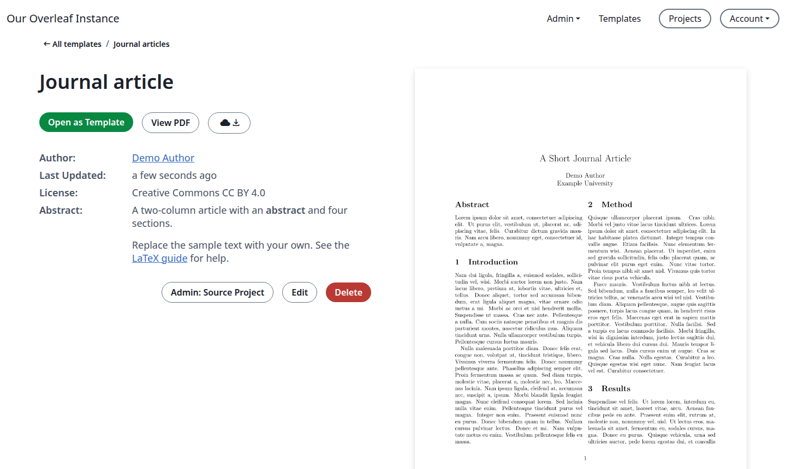

تنشر القوالب من المحرر، وتديرها من صفحتها في المعرض أو من لوحة الإدارة.

<Info>

لتفعيل المعرض أو اختيار فئاته أو السماح لمستخدم ليس مسؤولًا بالنشر، راجع [القوالب](/ar/on-premises/configuration/overleaf-toolkit/templates).

</Info>

## نشر مشروع {#publish-a-project}

<Steps>
<Step title="جمّع المشروع">
افتح المشروع وانقر على **Recompile**. ملف PDF الذي تراه هو الذي سيعرضه المعرض.

ما دام المحرر لا يحتوي على ملف PDF، كأن تفتح مشروعًا لا يُجمَّع، يظهر **Manage Template** باللون الرمادي.

<Frame caption="لا يوجد PDF بعد، لذا لا يوجد ما يُنشر">
  
</Frame>

<Warning>

يحفظ النشر الملفات كما هي الآن، وملف PDF الناتج عن آخر تجميع ناجح. إذا عدّلت المشروع بعد ذلك التجميع، أو فشل آخر تجميع، فسيعرض المعرض ملف PDF قديمًا بجانب ملفات أحدث قد لا تُجمَّع. أعد التجميع حتى يصبح ملف PDF صحيحًا، ثم انشر.

</Warning>
</Step>

<Step title="افتح النموذج">
في القائمة العلوية للمحرر، انقر على **File**، ثم على **Manage Template**.

<Frame caption="قائمة File">
  
</Frame>
</Step>

<Step title="املأ النموذج">
<Frame caption="مربع حوار Manage Template">
  
</Frame>

| الحقل | ملاحظات |
| --- | --- |
| **Title** | يبدأ باسم المشروع. يجب أن يكون فريدًا في المعرض. 150 حرفًا كحد أقصى. |
| **Author** | يبدأ باسمك. يصبح رابط Markdown مثل `[Demo Author](https://example.com)` رابطًا في صفحة القالب. |
| **Categories** | فئة واحدة، راجع [الفئات](/ar/on-premises/user-guide/administrators/template-management#categories). |
| **Description** | يدعم Markdown. 4096 حرفًا كحد أقصى. تعرضه صفحة القالب باسم **Abstract**، ويعرض المعرض بدايته كنص عادي. |
| **License** | **Creative Commons CC BY 4.0** أو **LaTeX Project Public License 1.3c** أو <strong>Other (as stated in the work)</strong>. |

ينتقل المُجمِّع والمستند الرئيسي للمشروع مع القالب، لذا اضبطهما في المشروع أولًا. تستخدم المشاريع المفتوحة من القالب الإعدادات نفسها.
</Step>

<Step title="انقر على Publish">
تُفتح صفحة القالب.

<Frame caption="القالب الجديد">
  
</Frame>

**Admin: Source Project** و**Edit** و**Delete** مخصصة لك وحدك. لا يرى المستخدمون الآخرون إلا **Open as Template** و**View PDF** وزر التنزيل.
</Step>

<Step title="تحقق من المعرض">
انقر على **Templates** في أعلى اليمين. يكون القالب الجديد الأول في القائمة.
</Step>
</Steps>

## الفئات {#categories}

ينتمي القالب إلى فئة واحدة. تأتي الأسماء والأوصاف من [إعداداتك](/ar/on-premises/configuration/overleaf-toolkit/templates#configuration) ولا يمكن تغييرها من الموقع.

تراها في هذه الأماكن:

* **Categories** في النموذج.
* البطاقات أعلى صفحة المعرض `/templates`. انقر على **Template Gallery** في صفحة **All templates** للوصول إليها.
* صفحة لكل فئة، مثل `/templates/presentation`. تعرض الفئة التي لا تحتوي على قوالب <strong>No Templates.</strong>
* **New project**، ثم **More templates**، في صفحة المشاريع.
* الرابط فوق العنوان في صفحة القالب.

<Frame caption="الفئات في صفحة المعرض">
  
</Frame>

يعني **All templates** في النموذج عدم وجود فئة خاصة: لا يظهر القالب إلا في القائمة الكاملة.

## تحديث قالب {#update-a-template}

لتغيير الملفات وملف PDF، انشر المشروع مرة أخرى بالعنوان نفسه.

<Steps>
<Step title="غيّر المشروع">
عدّل المشروع وانقر على **Recompile**.
</Step>

<Step title="انشر مرة أخرى">
انقر على **File**، ثم على **Manage Template**. يعرض النموذج تفاصيل القالب، ويمكنك تغييرها. انقر على **Publish**.

تظهر رسالة تفيد بأن العنوان موجود بالفعل، ويتحول الزر إلى **Overwrite**.

<Frame caption="النشر بالعنوان نفسه">
  
</Frame>

إذا غيّرت **Title** الآن، تختفي الرسالة وينشئ **Publish** قالبًا جديدًا.
</Step>

<Step title="انقر على Overwrite">
تُفتح صفحة القالب نفسها مع ملف PDF الجديد.

<Frame caption="القالب المحدَّث">
  
</Frame>

لا تتغير المشاريع التي فتحها المستخدمون من القالب من قبل.
</Step>
</Steps>

<Warning>

يعثر النموذج على القالب من خلال اسم المشروع. إذا أعدت تسمية القالب باستخدام **Edit**، فسيُفتح النموذج باسم المشروع واسمك والفئة الأولى ووصف فارغ، ولن تستعيد كتابة عنوان القالب تفاصيله. عندها سيستبدل **Overwrite** التفاصيل بما في النموذج، لذا املأها مرة أخرى أولًا.

</Warning>

## تعديل التفاصيل {#edit-the-details}

يغيّر هذا ما يعرضه المعرض عن القالب، لا ملفاته ولا ملف PDF الخاص به.

<Steps>
<Step title="افتح القالب">
انقر على **Templates** في أعلى اليمين، ثم انقر على القالب، ثم على **Edit**.
</Step>

<Step title="غيّر الحقول">
الحقول هي نفسها التي تظهر عند النشر، مع حقل إضافي: **Language** هي لغة التدقيق الإملائي للمشاريع المفتوحة من القالب. بالنسبة لمشروع نُشر باللغة الافتراضية تعرض **Off**، وتستخدم المشاريع المفتوحة منه <strong>English (American)</strong>.

<Frame caption="مربع حوار Edit template">
  
</Frame>

يُرفض العنوان الذي يستخدمه قالب آخر: يبقى **Save** رماديًا حتى تغيّر **Title**.
</Step>

<Step title="انقر على Save">
يُغلق مربع الحوار وتعرض صفحة القالب التفاصيل الجديدة.
</Step>
</Steps>

## المشروع المصدر {#the-source-project}

يفتح **Admin: Source Project** المشروع الذي نُشر منه القالب.

يحتفظ القالب بنسخته الخاصة من الملفات. إذا حذفت المشروع نهائيًا، يختفي الزر، ويظل بإمكان المستخدمين فتح القالب. أما المشروع الموجود في **Trash** فقط فيحتفظ بالزر. راجع أيضًا الأسئلة والأجوبة ضمن [القوالب](/ar/on-premises/configuration/overleaf-toolkit/templates).

## حذف قالب {#delete-a-template}

<Steps>
<Step title="انقر على Delete">
في صفحة القالب، انقر على **Delete**. يذكر مربع الحوار اسم القالب.

<Frame caption="مربع حوار Delete template">
  
</Frame>
</Step>

<Step title="انقر على Confirm">
تعود إلى الصفحة التي جئت منها، ولم يعد القالب في المعرض. يعرض رابطه الآن **Not found**.

يبقى المشروع المصدر، وكذلك المشاريع التي فتحها المستخدمون من القالب.
</Step>
</Steps>

## إدارة القوالب في لوحة الإدارة {#manage-templates-in-the-admin-panel}

انقر على **Admin**، ثم على **Project/Object Lookup**، ثم على علامة التبويب **Templates**. تسرد كل القوالب مع المؤلف والمالك، ويمكنك البحث فيها.

<Frame caption="كل القوالب في لوحة الإدارة">
  
</Frame>

* انقر على العنوان لفتح صفحة القالب، أو على أيقونة الفتح لفتحها في علامة تبويب جديدة.
* انقر على المالك لفتح صفحة ذلك المستخدم.
* انقر على أيقونة سلة المهملات، ثم على **Delete**، لحذف قالب. يحذّر مربع الحوار من أن هذا الإجراء لا يمكن التراجع عنه، ويخرج القالب من المعرض.

## إذا رُفض النشر {#if-publishing-is-refused}

يسمح لك النموذج بكتابة أكثر مما يقبله الموقع. يعرض **Title** الذي يتجاوز 150 حرفًا الرسالة `Template title exceeds the maximum length of 150 characters.`، ويعرض **Description** الذي يتجاوز 4096 حرفًا الرسالة `Template description exceeds the maximum length of 4096 characters.`

يبقى **Publish** بعد ذلك رماديًا حتى لو قصّرت النص. انقر على **Cancel**، ثم على **File** و**Manage Template**، واملأ النموذج مرة أخرى.
