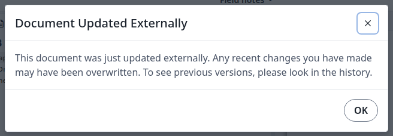

أبقِ جميع مشاريعك متزامنة مع مجلد في Dropbox. تنتقل التغييرات في الاتجاهين في الخلفية، مع استثناء واحد: ما تكتبه في المحرر يصل إلى Dropbox بعد بضع دقائق من مغادرتك المشروع، أو عند النقر على **sync this project now**.

<Info>

إذا لم تجد خيار Dropbox في **Account settings** أو في المحرر، فاطلب من المسؤول تفعيل [المزامنة مع Dropbox](/ar/on-premises/configuration/overleaf-toolkit/integrations/dropbox-synchronisation).

</Info>

## ربط حسابك على Dropbox {#link-your-dropbox-account}

تفعل ذلك مرة واحدة.

<Steps>
<Step title="افتح إعدادات حسابك">
انقر على **Account**، ثم **Account settings**. ضمن **Project synchronisation**، ابحث عن **Dropbox** وانقر على **Link**.

<Frame caption="Dropbox في إعدادات الحساب">
  
</Frame>
</Step>

<Step title="امنح التفويض على Dropbox">
يُفتح Dropbox. سجّل الدخول إذا طُلب منك ذلك، ثم امنح التطبيق التفويض.
</Step>

<Step title="تحقّق من الربط">
تعود إلى إعدادات الحساب. تخبرك رسالة خضراء بأن حسابك على Dropbox مرتبط، ويظهر على الزر الآن **Unlink**. تحت Dropbox، تعرض حالة أن مشاريعك قيد الإرسال.

<Frame caption="حسابك على Dropbox مرتبط">
  
</Frame>

تتغيّر الحالة إلى **Overleaf and Dropbox have processed all updates** عندما تصل جميعها.

<Frame caption="كل شيء متزامن">
  
</Frame>
</Step>
</Steps>

إذا لم يكن حسابك مرتبطًا بعد، تطلب منك بطاقة **Dropbox** في المحرر ربطه أولًا. انقر على **Update Dropbox Settings**: تُفتح إعدادات الحساب في علامة تبويب جديدة. اربط حسابك هناك، ثم أعد تحميل صفحة المحرر كما يخبرك مربع الحوار.

<Frame caption="الرسالة عندما لا يكون حسابك مرتبطًا">
  
</Frame>

إذا لم تسمح بالوصول على Dropbox، تعود إلى إعدادات الحساب دون أي رسالة، ويظل الزر يعرض **Link**.

### إذا كانت لديك مشاريع بالاسم نفسه {#if-you-have-projects-with-the-same-name}

لا يمكنك الربط ما دام لديك مشروعان بالاسم نفسه. تذكر الرسالة أسماءهما. تُحتسب أيضًا المشاريع المؤرشفة والمشاريع الموجودة في سلة المهملات.

<Frame caption="مشروعان بالاسم نفسه">
  
</Frame>

أعد تسمية أحدهما وانقر على **Link** مرة أخرى.

## العثور على مشاريعك في Dropbox {#find-your-projects-in-dropbox}

كل مشروع من مشاريعك هو مجلد في `Apps/<app name>/` في Dropbox، يضم جميع ملفاته. اختار المسؤول اسم التطبيق. تُزامَن جميع المشاريع، بما فيها التي ستنشئها لاحقًا: لا يمكنك اختيار بعضها فقط.

لرؤية مجلد مشروع، افتح المشروع. في الشريط الأيسر، انقر على **Integrations**، ثم **Dropbox**.

<Frame caption="لوحة Integrations">
  
</Frame>

يذكر مربع الحوار اسم المجلد ويضم رابطًا إليه على Dropbox.

<Frame caption="مجلد هذا المشروع">
  
</Frame>

المشروع الجديد الذي يحمل اسم مشروع موجود لديك يحصل على مجلد مرقّم، مثل `Field notes (1)`. يبيّن مربع الحوار أي مجلد هو مجلده.

<Frame caption="مجلد مرقّم">
  
</Frame>

## التغييرات التي تجريها في Overleaf {#changes-you-make-in-overleaf}

لا تحتاج إلى النقر على أي شيء.

* **الملفات الجديدة وعمليات إعادة التسمية والنقل والحذف** تصل إلى Dropbox فورًا. يظهر المجلد الجديد هناك مع أول ملف فيه.
* **إعادة تسمية مشروع** تعيد تسمية مجلده.
* **التعديلات التي تكتبها في المحرر** لا تصل إلى Dropbox ما دام المشروع مفتوحًا، والنقر على **Recompile** لا يرسلها. تُرسل بعد نحو ثلاث دقائق من مغادرة الجميع للمشروع. لإرسالها في وقت أبكر، راجع [فرض المزامنة](#force-a-sync).
* **حذف مشروع** يُبقي مجلده في Dropbox. احذف المجلد بنفسك إذا لم تعد بحاجة إليه.

## التغييرات التي تجريها في Dropbox {#changes-you-make-in-dropbox}

لا تحتاج هنا أيضًا إلى النقر على أي شيء. يُبلغ Dropbox ‏Overleaf بالتغيير، ويظهر عادةً في غضون ثوانٍ، حتى في محرر مفتوح، دون إعادة تحميل.

* **الملفات الجديدة والتعديلات وعمليات إعادة التسمية والحذف** في مجلد مشروع تُطبَّق على المشروع. وكذلك المجلدات الجديدة.
* **المجلد الجديد في المستوى الأعلى من مجلد التطبيق** يصبح مشروعًا جديدًا.
* **الملفات التي لا يزامنها Overleaf**، مثل ملفات `.DS_Store` أو `.aux`، تبقى في Dropbox فقط.

يَسِم سجل المشروع هذه التغييرات بـ <strong>(via Dropbox)</strong>.

### إذا كان الملف مفتوحًا في المحرر {#if-the-file-is-open-in-the-editor}

يتغيّر الملف أمامك، ويخبرك مربع حوار بذلك. انقر على **OK**.

<Frame caption="تغيّر ملف مفتوح لديك في Dropbox">
  
</Frame>

تحلّ نسخة Dropbox محل ما كتبته ولم يُرسَل بعد. لا يضيع نصك: يبقى في سجل المشروع.

<Frame caption="النص المستبدل في السجل">
  
</Frame>

### إعادة تسمية مجلد مشروع أو حذفه {#rename-or-delete-a-project-folder}

أعد تسمية المشروع في Overleaf، لا في Dropbox. بالنسبة إلى Overleaf، المجلد الذي أُعيدت تسميته في Dropbox هو مجلد محذوف ومجلد جديد: تحصل على مشروع جديد بالاسم الجديد، ويبقى المشروع القديم.

عندما تحذف مجلد مشروع في Dropbox، يبقى المشروع في قائمة مشاريعك مع ملفاته وسجله. في المرة التالية التي تفتحه فيها، يخبرك مربع حوار بذلك مرة واحدة. انقر على **OK**.

<Frame caption="اختفى مجلد هذا المشروع من Dropbox">
  
</Frame>

يستمر المشروع في المزامنة. لإعادة المشروع كاملًا إلى Dropbox، انقر على **sync this project now**.

### أثناء أرشفة المشروع أو وجوده في سلة المهملات {#while-a-project-is-archived-or-in-the-trash}

لا تُطبَّق التغييرات التي تجريها في مجلده على Dropbox، ولا تجلبها استعادة المشروع. يتوقف Overleaf عندها عن إرسال الملفات التي غيّرتها، فيختلف الجانبان. احفظ هذا الملف مرة أخرى في Dropbox: تحلّ نسخة Dropbox محل النسخة الموجودة في Overleaf.

## فرض المزامنة {#force-a-sync}

لكل مشروع رابطه الخاص. استخدمه عندما تريد أن تصل تعديلاتك إلى Dropbox الآن، دون مغادرة المشروع.

<Steps>
<Step title="افتح مربع حوار المزامنة">
افتح المشروع. في الشريط الأيسر، انقر على **Integrations**، ثم **Dropbox**.
</Step>

<Step title="انقر على sync this project now">
يوجد الرابط في نهاية <strong>Changes not appearing in Dropbox?</strong>
</Step>

<Step title="تحقّق من النتيجة">
تخبرك رسالة زرقاء بأن مزامنة يدوية قد بدأت، وتعرض الحالة **Sending and receiving updates**. تعود إلى **Overleaf and Dropbox have processed all updates** عند انتهاء المزامنة.

<Frame caption="مزامنة يدوية قيد التشغيل">
  
</Frame>
</Step>
</Steps>

يرسل الرابط المشروع كاملًا إلى Dropbox، بما في ذلك التعديلات التي لا تزال في المحرر. ويقرأ أيضًا التغييرات المنتظرة في Dropbox، لجميع مشاريعك. إذا لم يكن موقعك قادرًا على تلقي [إشعارات Dropbox](/ar/on-premises/configuration/overleaf-toolkit/integrations/dropbox-synchronisation#webhook)، فلن تصل التغييرات من Dropbox إلا بهذه الطريقة.

يمكنك فعل ذلك مرة واحدة في الدقيقة لكل مشروع. قبل ذلك، تطلب منك رسالة حمراء الانتظار.

<Frame caption="انتظر دقيقة قبل المرة التالية">
  
</Frame>

## إلغاء ربط حسابك على Dropbox {#unlink-your-dropbox-account}

<Steps>
<Step title="انقر على Unlink">
في **Account settings**، ضمن **Dropbox**، انقر على **Unlink**.
</Step>

<Step title="أكّد">
انقر على **Unlink** في مربع الحوار.

<Frame caption="إلغاء ربط حسابك">
  
</Frame>
</Step>

<Step title="تحقّق من النتيجة">
يعرض الزر **Link** مرة أخرى، وتخبرك بطاقة **Dropbox** في المحرر بأن حسابك غير مرتبط. لم يعد هناك شيء يُزامَن في أي اتجاه. تحتفظ مشاريعك والمجلدات في Dropbox بملفاتها.
</Step>
</Steps>

### الربط مرة أخرى لاحقًا {#link-again-later}

انقر على **Link**. تُرسَل مشاريعك إلى Dropbox مرة أخرى:

* يحلّ كل ملف محل الملف الذي يحمل الاسم نفسه في Dropbox. ما غيّرته في تلك الملفات في Dropbox أثناء إلغاء الربط سيُستبدل، لذا انقل هذه التغييرات إلى المشروع أولًا.
* الملف الموجود في Dropbox فقط يبقى هناك، ويدخل المشروع عندما تغيّره في المرة التالية.
* المشروع الذي أعدت تسميته أثناء إلغاء الربط يحصل على مجلد جديد. يبقى المجلد القديم.

### إذا ألغى Overleaf ربط حسابك {#if-overleaf-unlinks-your-account}

يلغي Overleaf ربط حسابك عندما لا يعود Dropbox يقبل الربط. تعرض قائمة المشاريع السبب حتى تربط حسابك مرة أخرى.

<Frame caption="أُلغي ربط حسابك">
  
</Frame>

لمعرفة الأسباب، راجع قسم Q\&A في [المزامنة مع Dropbox](/ar/on-premises/configuration/overleaf-toolkit/integrations/dropbox-synchronisation).

<Info>

لمعرفة ما يحصل عليه المتعاونون في مشروع مشترك، راجع [كيف تعمل المزامنة](/ar/on-premises/configuration/overleaf-toolkit/integrations/dropbox-synchronisation#كيف-تعمل-المزامنة).

</Info>
