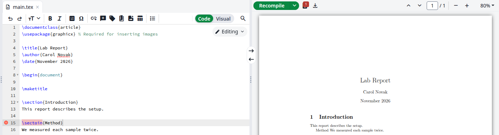

<Info>

إذا لم يكن لمدخل السجل زر **Suggest fix**، فوجّه المسؤول إلى [التكامل مع الذكاء الاصطناعي](/ar/on-premises/configuration/overleaf-toolkit/integrations/ai-integration).

</Info>

<Steps>
<Step title="افتح السجلات">
بعد تجميع فيه أخطاء، يظهر رقم أحمر على أيقونة السجلات بجوار **Recompile**، وتُعلِّم نقطة حمراء السطر في المحرر. انقر على الأيقونة. إذا لم ينتج التجميع ملف PDF، فإن السجلات مفتوحة بالفعل.

<Frame caption="تجميع فيه خطأ واحد">
  
</Frame>
</Step>

<Step title="انقر على Suggest fix">
انقر على أيقونة الوميض، **Suggest fix**، على يمين مدخل السجل. وهي موجودة أيضًا في التحذيرات التي تشير إلى ملف في مشروعك.

<Frame caption="زر Suggest fix">
  
</Frame>

في المرة الأولى، يعرض المدخل **Before you use Error Assist**. انقر على **Accept and continue**. تفعل ذلك مرة واحدة، وهو يشمل أيضًا [مساعد الذكاء الاصطناعي](/ar/on-premises/user-guide/users/ai-assistant).

<Frame caption="يُعرض مرة واحدة">
  
</Frame>
</Step>

<Step title="اقرأ الاقتراح">
يشرح المدخل الخطأ ويعرض السطر المطلوب تغييره: النص القديم في الصف <strong>-</strong> والنص الجديد في الصف <strong>+</strong>. يأخذك النقر على رقم السطر إلى ذلك السطر في المحرر، وتنسخ أيقونة النسخ النص الجديد.

<Frame caption="إصلاح مقترح">
  
</Frame>

إذا لم يكن لدى المساعد إصلاح، فإنه يكتفي بالشرح ولا يوجد ما يُطبَّق. أيقونة التحديث، **Suggest a different fix**، تطلب اقتراحًا آخر.
</Step>

<Step title="طبّقه أو اتركه">
لتطبيقه، انقر على **Apply suggestion**. يتغير السطر في المحرر، ويعرض المدخل **Suggestion applied**، ويُعاد تجميع المشروع. عندما لا يبقى أي خطأ، يعود ملف PDF. للتراجع عن التغيير، اضغط `Ctrl+Z` في المحرر.

<Frame caption="تم تطبيق الإصلاح">
  
</Frame>

لرفضه، لا تفعل شيئًا: لا يوجد زر رفض، ويبقى المستند كما هو حتى تنقر على **Apply suggestion**.

إذا عدّلت ذلك السطر أولًا، يُعطَّل **Apply suggestion**. انقر على **Suggest a different fix** للحصول على اقتراح جديد.
</Step>
</Steps>

## العثور على الاقتراح مرة أخرى {#find-the-suggestion-again}

بعد التجميع التالي، تعرض السجلات الاقتراح باسم **Last suggested fix**، سواء طبّقته أم لا. انقر على السهم لفتحه.

<Frame caption="يبقى الاقتراح الأخير في السجلات">
  
</Frame>

يُحتسب مساعد الأخطاء ضمن الحد نفسه الخاص بمساعد الذكاء الاصطناعي، راجع [استخدام الرموز](/ar/on-premises/user-guide/users/ai-assistant#token-usage).
