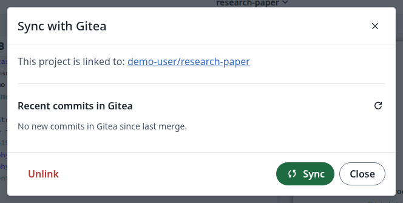
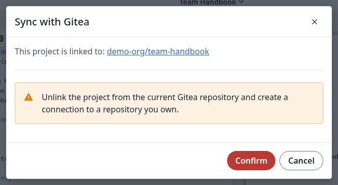

اربط مشروعًا بمستودع على Gitea. تنتقل التغييرات في الاتجاهين، ولا يحدث ذلك إلا عند النقر على **Sync**: لا شيء يُزامَن من تلقاء نفسه.

<Info>

يجب على المسؤول تفعيل [المزامنة مع Gitea](/ar/on-premises/configuration/overleaf-toolkit/integrations/gitea-synchronisation) أولًا.

</Info>

## ربط حسابك على Gitea {#link-your-gitea-account}

تفعل ذلك مرة واحدة.

<Steps>
<Step title="افتح إعدادات حسابك">
انقر على **Account**، ثم **Account settings**. ضمن **Project synchronisation**، ابحث عن **Gitea** وانقر على **Link**.

<Frame caption="Gitea في إعدادات الحساب">
  
</Frame>
</Step>

<Step title="امنح التفويض على Gitea">
يُفتح Gitea. سجّل الدخول إذا طُلب منك ذلك، ثم امنح التطبيق التفويض.
</Step>

<Step title="تحقّق من الربط">
تعود إلى إعدادات الحساب. تخبرك رسالة خضراء بأن حسابك على Gitea مرتبط، ويظهر على الزر الآن **Unlink**.

<Frame caption="حسابك على Gitea مرتبط">
  
</Frame>
</Step>
</Steps>

إذا لم يكن حسابك مرتبطًا بعد، يطلب منك **Import from Gitea** وبطاقة **Gitea** في المحرر ربطه أولًا. انقر على **Link to your Gitea account**. ستصل أيضًا إلى إعدادات الحساب، في علامة تبويب جديدة إذا بدأت من المحرر. ثم ارجع وابدأ من جديد.

<Frame caption="الرسالة عندما لا يكون حسابك مرتبطًا">
  
</Frame>

## استيراد مستودع {#import-a-repository}

ينشئ هذا مشروعًا جديدًا من مستودع على Gitea، مرتبطًا به مسبقًا.

<Steps>
<Step title="افتح مربع حوار الاستيراد">
في صفحة المشاريع، انقر على **New project**، ثم **Import from Gitea**.

<Frame caption="قائمة New project">
  
</Frame>
</Step>

<Step title="اختر المستودع">
انقر على **Import to Overleaf** بجوار المستودع. تتضمن القائمة مستودعاتك ومستودعات مؤسساتك. لا يظهر المستودع الفارغ في القائمة: فهو يحتاج إلى commit واحد على الأقل.

<Frame caption="مستودعاتك على Gitea">
  
</Frame>
</Step>

<Step title="تحقّق من المشروع">
يُفتح المشروع الجديد مع ملفات المستودع.

<Frame caption="المشروع المستورد">
  
</Frame>
</Step>
</Steps>

## تصدير مشروع إلى مستودع جديد {#export-a-project-to-a-new-repository}

ينشئ هذا مستودعًا من مشروع ويربطهما معًا. لا يمكن ربط المشروع إلا بهذه الطريقة أو بالاستيراد: لا يمكنك ربطه بمستودع موجود بالفعل.

<Steps>
<Step title="افتح Gitea في المحرر">
افتح المشروع. في الشريط الأيسر، انقر على **Integrations**، ثم **Gitea**.

<Frame caption="لوحة Integrations">
  
</Frame>
</Step>

<Step title="املأ بيانات المستودع">
اختر **Owner**، ويمكن أن يكون أنت أو إحدى مؤسساتك. عند اختيار مؤسسة، يصبح اسم هذا الحقل **Organization**. يبدأ **Repository Name** باسم المشروع: إذا كان الاسم يحتوي على مسافات، فغيّره، لأن Gitea لا يقبلها. الوصف اختياري، و**Private** محدد افتراضيًا. انقر على **Create a Gitea repository**.

<Frame caption="Export Project to Gitea">
  
</Frame>

إذا كان الاسم يحتوي على مسافات أو كان مستخدمًا بالفعل، يعرض مربع الحوار <strong>Please check that the repository name is valid, and that you have permission to create the repository.</strong> غيّر الاسم وانقر على الزر مرة أخرى.
</Step>

<Step title="تحقّق من الربط">
يعرض مربع الحوار الآن **This project is linked to** واسم المستودع.

<Frame caption="المشروع مرتبط">
  
</Frame>
</Step>
</Steps>

## المزامنة {#sync}

<Steps>
<Step title="افتح مربع حوار المزامنة">
افتح مشروعًا مرتبطًا. في الشريط الأيسر، انقر على **Integrations**، ثم **Gitea**.

يسرد **Recent commits in Gitea** ما سيدخل إلى المشروع.

<Frame caption="commit جديد ينتظر على Gitea">
  
</Frame>
</Step>

<Step title="صِف تغييراتك">
إذا غيّرت شيئًا في المشروع، يظهر مربع لرسالة الـ commit. وهو اختياري: إذا تركته فارغًا، يكون اسم الـ commit هو `Updates from Overleaf`.

<Frame caption="رسالة الـ commit لتغييراتك">
  
</Frame>
</Step>

<Step title="انقر على Sync">
انقر على **Sync**. تدخل الـ commits الجديدة من Gitea إلى المشروع، وتذهب تغييراتك إلى الفرع الافتراضي في المستودع. إذا غيّر الجانبان أشياء مختلفة، تُدمج لك عبر طلب سحب (pull request)، يبقى على Gitea كسجل.
</Step>

<Step title="تحقّق من النتيجة">
يعرض مربع الحوار <strong>No new commits in Gitea since last merge.</strong> ويختفي مربع رسالة الـ commit. الملفات في المحرر والـ commits على Gitea محدّثة.

<Frame caption="كل شيء متزامن">
  
</Frame>
</Step>
</Steps>

### إذا تغيّرت الأسطر نفسها في الجانبين {#if-the-same-lines-changed-on-both-sides}

يخبرك مربع الحوار بأنه تعذّر دمج التغييرات، ويذكر فرعًا جديدًا، `overleaf-YYYY-MM-DD-HHMMSS`، يحتوي على تغييراتك. يفتح Overleaf أيضًا طلب سحب من ذلك الفرع على Gitea.

<Frame caption="تعارض">
  
</Frame>

1.  ادمج ذلك الفرع في الفرع الافتراضي باستخدام Git، وأصلح التعارض. يمكنك إغلاق مربع الحوار في هذه الأثناء: فهو يعرض الرسالة نفسها عند فتحه مرة أخرى.

    ```bash
    git clone <repository-address>
    cd <repository-name>
    git merge origin/overleaf-YYYY-MM-DD-HHMMSS
    # fix the conflict in the file Git names
    git add <file>
    git commit
    git push
    ```
2. انقر على **I have manually merged. Continue**. تدخل النتيجة المدموجة إلى المشروع. إذا نقرت عليه قبل دمج الفرع، يبقى مربع الحوار كما هو.
3. يبقى الفرع على Gitea ويبقى طلب السحب الخاص به مفتوحًا. أغلق طلب السحب واحذف الفرع عندما لا تعود بحاجة إليهما.

يظهر مربع الحوار نفسه عندما تحجز قاعدة حماية الفرع طلب السحب، مثلًا عندما يحتاج إلى موافقة، حتى إن لم تكن هناك أسطر متعارضة. عندما تسمح القاعدة بذلك، ادمج طلب السحب على Gitea وانقر على **I have manually merged. Continue**. راجع [كيف تعمل المزامنة مع Gitea](/ar/on-premises/configuration/overleaf-toolkit/integrations/gitea-synchronisation#how-syncing-works-with-gitea).

## إلغاء ربط مشروع {#unlink-a-project}

افعل ذلك عندما لا تعود تريد مزامنة المشروع.

<Steps>
<Step title="انقر على Unlink">
في مربع حوار المزامنة، انقر على **Unlink**.
</Step>

<Step title="أكّد">
انقر على **Confirm**. يزيل هذا الربط فقط: الاتصال بمستودع تملكه، الذي يذكره التحذير، هو خيار متاح لك لاحقًا، وليس شيئًا يحدث الآن.

<Frame caption="تأكيد إلغاء الربط">
  
</Frame>
</Step>

<Step title="تحقّق من النتيجة">
يعرض مربع الحوار الآن **Export Project to Gitea**. يحتفظ كل من المشروع والمستودع بمحتواه. للمزامنة مرة أخرى، صدّر المشروع إلى مستودع جديد، أو استورد المستودع إلى مشروع جديد.
</Step>
</Steps>

## إلغاء ربط حسابك على Gitea {#unlink-your-gitea-account}

في **Account settings**، ضمن **Gitea**، انقر على **Unlink**، ثم انقر على **Unlink** مرة أخرى في مربع الحوار.

<Frame caption="إلغاء ربط حسابك">
  
</Frame>

تبقى مشاريعك مرتبطة بمستودعاتها. لا يمكنك مزامنتها حتى تربط حسابك مرة أخرى.

<Info>

لمعرفة من يمكنه فعل ماذا في مشروع مشترك، راجع [من يمكنه الربط والمزامنة](/ar/on-premises/configuration/overleaf-toolkit/integrations/gitea-synchronisation#who-can-link-and-sync).

</Info>
