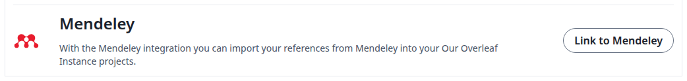
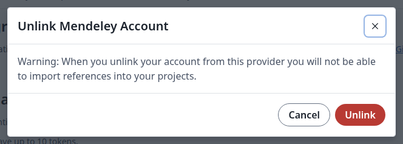

استورد مكتبة Mendeley إلى مشروع كملف `.bib`، ثم اقتبس منه كالمعتاد. الملف نسخة: لا يتغير إلا عندما تنقر على **Refresh**.

<Info>

إذا لم يظهر لك خيار Mendeley في **Account settings**، فاطلب من المسؤول تفعيل [تكامل Mendeley](/ar/on-premises/configuration/overleaf-toolkit/integrations/mendeley-integration).

</Info>

## اربط حسابك في Mendeley {#link-your-mendeley-account}

تفعل ذلك مرة واحدة.

<Steps>
<Step title="افتح إعدادات حسابك">
انقر على **Account**، ثم على **Account settings**. ضمن **Reference managers**، ابحث عن **Mendeley** وانقر على **Link to Mendeley**.

<Frame caption="Mendeley في إعدادات الحساب">
  
</Frame>

تنقلك بطاقة **Mendeley** في لوحة **Integrations** بالمحرر إلى المكان نفسه، في علامة التبويب نفسها.

<Frame caption="لوحة Integrations">
  
</Frame>
</Step>

<Step title="امنح الإذن في Mendeley">
تُفتح Mendeley. سجّل الدخول إذا طُلب منك ذلك، ثم امنح التطبيق الإذن.
</Step>

<Step title="تحقق من الربط">
تعود إلى إعدادات الحساب. تظهر رسالة خضراء تقول **Reference manager linked**، ويصبح الزر **Unlink**.

<Frame caption="حسابك في Mendeley مرتبط">
  
</Frame>
</Step>
</Steps>

إذا لم تسمح بالوصول في Mendeley، يعرض القسم نفسه **Sorry, something went wrong**. انقر على **Link to Mendeley** للمحاولة مرة أخرى.

## أنشئ ملفًا من مكتبتك {#create-a-file-from-your-library}

<Steps>
<Step title="افتح مربع الحوار Add files">
افتح مشروعًا. في شجرة الملفات، انقر على **New file**، ثم على **From Mendeley**. لا يظهر هذا الخيار إلا بعد ربط حسابك.
</Step>

<Step title="اختر اسم الملف والمكتبة">
تكون قيمة **File Name** في البداية `mendeley.bib`. احتفظ بالامتداد `.bib`: فبدونه لن تحصل على معاينة، ولن يجد `\cite` ولا `\bibliography` المدخلات.

تكون قيمة **Library** في البداية **My Library**، وتعرض أيضًا مجموعاتك. يحتوي الملف الواحد على مكتبة واحدة.

<Frame caption="ملف من مكتبتك الشخصية">
  
</Frame>
</Step>

<Step title="انقر على Create">
يُغلق مربع الحوار ويظهر الملف في شجرة الملفات. انقر عليه: يعرض وقت استيراده ومدخلاته. لا يمكنك تعديله في المحرر.

<Frame caption="الملف المستورد">
  
</Frame>

إذا بدا أن **Create** لا يفعل شيئًا، فهناك ملف بهذا الاسم بالفعل. اختر اسمًا آخر.
</Step>
</Steps>

### استيراد مجموعة {#import-a-group}

كرر الخطوات نفسها باسم ملف خاص بها، واختر المجموعة ضمن **Library**. يمكن أن يحتوي المشروع على عدة ملفات من هذا النوع.

<Frame caption="ملف من مجموعة">
  
</Frame>

## الاقتباس من الملف {#cite-from-the-file}

<Steps>
<Step title="ابدأ اقتباسًا">
في ملف `.tex`، اكتب `\cite{`. تعرض القائمة مدخلات جميع ملفات `.bib` في المشروع. انقر على أحدها لإدراجه.

<Frame caption="مدخلات الملفات المستوردة">
  
</Frame>
</Step>

<Step title="أو ابحث بالعنوان أو المؤلف">
انقر على **Search** أسفل القائمة، أو اضغط Ctrl+Space داخل الأقواس المعقوفة. اكتب للتصفية، وانقر على مدخل واحد أو أكثر، ثم انقر على **Insert**.

<Frame caption="البحث عن المراجع">
  
</Frame>
</Step>

<Step title="أضف قائمة المراجع">
أضف هذه الأسطر قبل `\end{document}`، مستخدمًا اسم ملفك دون `.bib`. إذا كانت لديك عدة ملفات، فافصل الأسماء بفواصل.

```latex
\bibliographystyle{plain}
\bibliography{mendeley}
```

انقر على **Recompile**. يظهر المرجع في ملف PDF.

<Frame caption="المرجع بعد التجميع">
  
</Frame>
</Step>
</Steps>

لا تُعرض الملفات المستوردة في **Settings** ضمن **References**، **Main bibliography file for this project**، لذا تبقى القائمة فارغة إذا لم يكن في المشروع ملف `.bib` آخر. ومع ذلك يمكنك الاقتباس منها.

<Frame caption="القائمة الفارغة أمر متوقع">
  
</Frame>

## حدّث الملف {#refresh-the-file}

لا تصل التغييرات في مكتبتك على Mendeley إلى المشروع من تلقاء نفسها.

<Steps>
<Step title="افتح الملف">
في شجرة الملفات، انقر على الملف المستورد.
</Step>

<Step title="انقر على Refresh">
يُعاد استيراد الملف بالكامل من المكتبة التي اخترتها عند إنشائه: تظهر المدخلات الجديدة وتختفي المحذوفة. ويتغير الوقت في الأعلى.

<Frame caption="الملف بعد التحديث">
  
</Frame>
</Step>

<Step title="أعد التجميع">
انقر على **Recompile** لتحديث ملف PDF.
</Step>
</Steps>

يُحدَّث كل ملف على حدة: حدّث ملف مجموعتك بشكل منفصل. لمعرفة من يمكنه تحديث ملف في مشروع مشترك، راجع [ملاحظات المسؤولين](/on-premises/configuration/overleaf-toolkit/integrations/mendeley-integration#notes).

## ألغِ ربط حسابك في Mendeley {#unlink-your-mendeley-account}

في **Account settings**، ضمن **Mendeley**، انقر على **Unlink**، ثم انقر على **Unlink** مرة أخرى في مربع الحوار. يعود الزر إلى **Link to Mendeley**.

<Frame caption="إلغاء ربط حسابك">
  
</Frame>

تبقى الملفات التي استوردتها في مشاريعك وتظل قابلة للتجميع. يختفي **From Mendeley** من مربع الحوار **Add files**، ويعرض **Refresh** خطأ حتى تربط حسابك مرة أخرى.

<Frame caption="التحديث دون حساب مرتبط">
  
</Frame>

بعد إعادة الربط، يعمل **Refresh** على الملفات نفسها.

## إذا حدث خطأ ما {#if-something-goes-wrong}

**Could not load references from Mendeley, please re-link your account and try again**، أو **There was an error accessing your Mendeley data** في مربع الحوار **Add files**: لم يعد Overleaf قادرًا على قراءة مكتبتك، مثلًا لأنك ألغيت وصوله في Mendeley. في **Account settings**، انقر على **Unlink**، ثم على **Link to Mendeley**. وحتى ذلك الحين يفشل **Create** أيضًا مع الرسالة **The project that contains this file is not shared with you**، حتى في مشروعك الخاص.

<Frame caption="لم يعد Overleaf قادرًا على قراءة مكتبتك">
  
</Frame>

**The remote service produced an error** عند النقر على **Refresh**: فشل الطلب إلى Mendeley. يحتفظ الملف بمحتواه. انقر على **Refresh** مرة أخرى لاحقًا.
