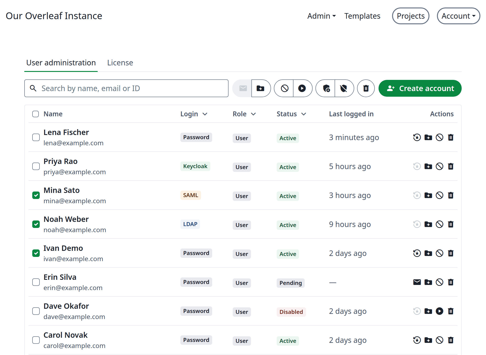
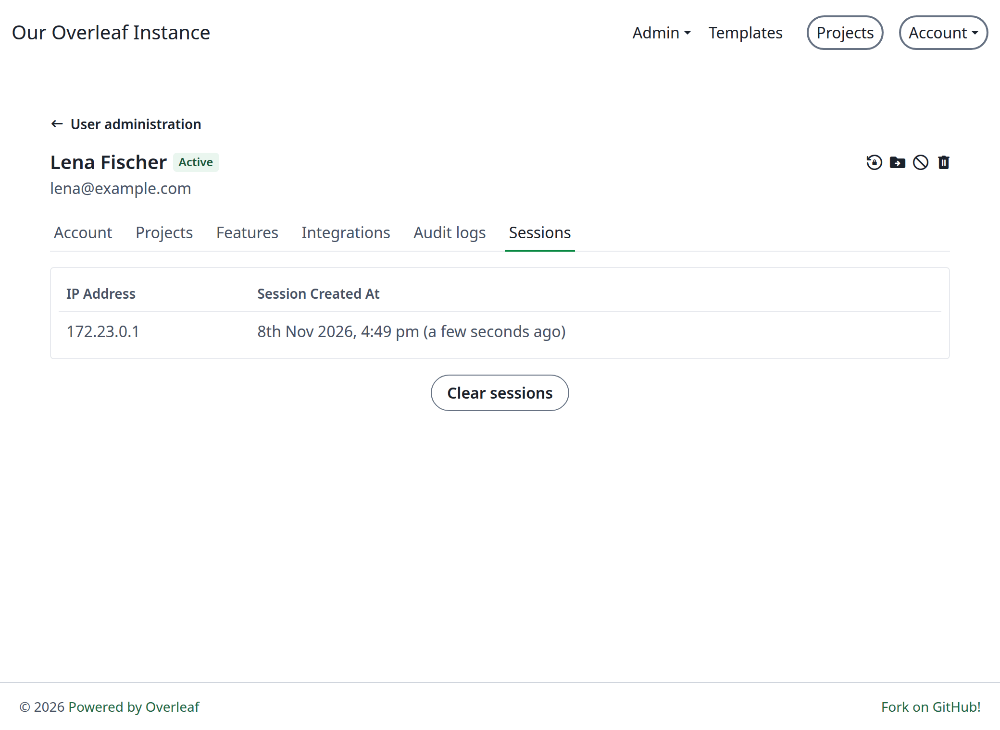
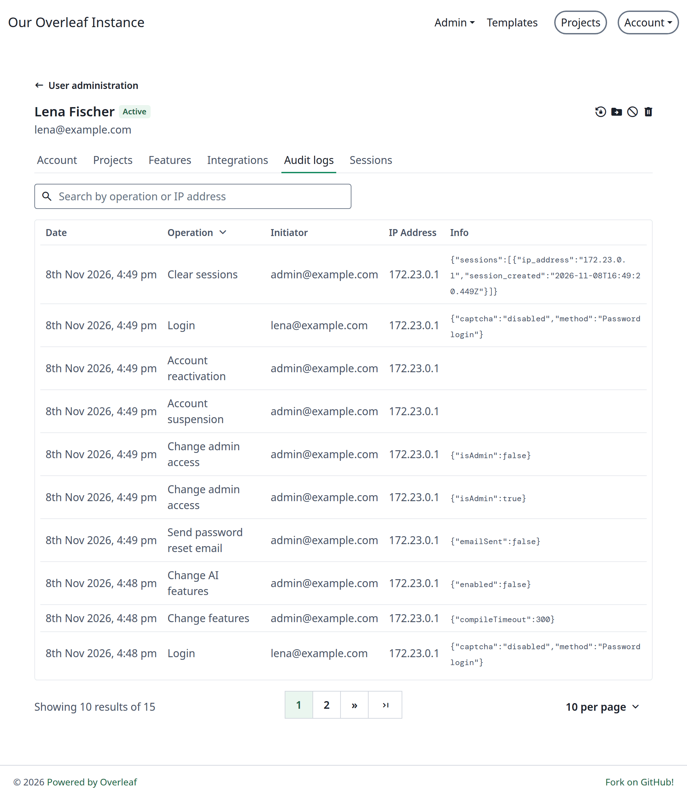

Provoz instance Overleaf pro laboratoř nebo katedru přináší každý týden stejné otázky. Proč se tento student nemůže přihlásit? Kdo ještě používá server? Kdo dal tomu účtu administrátorská práva? Kam se poděla loňská diplomová práce? Administrátorský panel jsme postavili znovu, abyste na ně mohli odpovědět bez otevírání databázového shellu.

Nový panel vychází ze vzhledu Overleaf 6.3 a je přeložen do všech jazyků, které rozhraní podporuje. Obsahuje jeden seznam všech uživatelů, jeden seznam všech projektů, stránku pro každý z nich, místo pro správu šablon a auditní protokoly.

<Info>

Nový administrátorský panel je sloučen do naší hlavní větve a oficiálně vyjde ve verzi v6.4.0. Všechny snímky obrazovky v tomto článku pocházejí z testovací instance naplněné smyšlenými účty.

</Info>

### Co obsahuje {#what’s-in-it}

* **Seznam uživatelů**: vyhledávání, filtry podle způsobu přihlášení, role a stavu a hromadné akce.
* **Stránka uživatele**: účet, projekty, funkce, integrace, auditní protokoly a relace jedné osoby.
* **Seznam projektů**: všechny projekty v instanci, vyhledatelné podle názvu, ID, vlastníka nebo odkazu ke sdílení.
* **Stránka projektu**: nastavení, soubory, členové, smazané soubory a auditní protokoly jednoho projektu.
* **Správa šablon**: publikujte projekt jako šablonu, aktualizujte ji a udržujte galerii v pořádku.
* **Auditní protokoly**: kdo co udělal, kdy a z jaké IP adresy.

## Jeden seznam pro všechny uživatele {#one-list-for-every-user}

Klikněte na **Admin** a poté na **Manage Users**. Každý účet je jeden řádek, který ukazuje, jak se přihlašuje, jeho roli a stav.

<Frame caption="Seznam uživatelů">
  
</Frame>

Vyhledávejte podle jména, e-mailu nebo ID. Záhlaví **Login**, **Role** a **Status** jsou filtry a každá možnost ukazuje, kolik účtů by vrátila. Na první pohled vidíte, kolik lidí přichází přes SAML, a každý poskytovatel OIDC se zobrazuje pod názvem, který jste mu dali.

<Frame caption="Filtrování podle způsobu přihlášení">
  
</Frame>

Každý účet má právě jeden stav a čtyři stavy dohromady dávají celkový počet.

| Stav         | Co znamená                                                                 |
| ------------ | -------------------------------------------------------------------------- |
| **Active**   | Přihlásil se nebo otevřel projekt v posledních 12 měsících.                |
| **Pending**  | Nikdy se nepřihlásil.                                                      |
| **Inactive** | Dříve se přihlásil, ale ne v posledních 12 měsících.                       |
| **Disabled** | Administrátor účtu zakázal přihlašování.                                   |

Smazané účty nepřekážejí, mají vlastní filtr. Pokud vyhledávání odpovídá i smazanému účtu, řádek nad tabulkou na to upozorní a nabídne jeho zobrazení.

<Frame caption="Filtrování podle stavu">
  
</Frame>

Vyhledávání, řazení a stránkování probíhají na serveru, takže seznamy už nekončí po prvních 1 000 řádcích.

### Přidávejte lidi s e-mailem i bez něj {#bring-people-in-with-or-without-email}

**Create account** přidá uživatele a dá vám odkaz, který potřebuje. Pokud [doručování e-mailů](/cs/on-premises/configuration/overleaf-toolkit/email-delivery  "mention") není nastaveno, dialog to jasně řekne a umožní vám odkaz zkopírovat, takže i malá instance může přijímat nové lidi.

<Frame caption="Aktivační odkaz nového účtu">
  
</Frame>

Panel nabízí pro každý účet správný odkaz: **Send activation email** pro účet, který se nikdy nepřihlásil, platný 7 dní, a **Send reset link** pro účet, který se už přihlásil, platný 1 hodinu. Účty, které se přihlašují přes SSO, nemají místní heslo, takže nedostanou ani jeden.

### Měňte mnoho účtů najednou {#change-many-accounts-at-once}

Zaškrtněte několik účtů a panel nástrojů nabídne **Send activation email**, **Transfer this user's projects**, **Disable**, **Enable**, **Make admin**, **Remove admin** a **Delete account**. Před potvrzením dialog účty vypíše. Pokud některé selžou, řekne vám které, a co už proběhlo, zůstane hotové.

<Frame caption="Hromadné akce">
  
</Frame>

### Těžko se splést {#hard-to-get-wrong}

* Váš vlastní účet je označen **You** a jeho akce jsou zašedlé, takže se nemůžete zakázat, smazat ani si odebrat roli.
* Každá akce žádá potvrzení v dialogu, který účet jmenuje.
* **Delete account** může nejdřív předat projekty uživatele někomu jinému.
* Smazaný účet lze obnovit spolu s projekty, které byly smazány s ním. Konečné je jen **Delete permanently** a varuje vás.

## Vše o jedné osobě {#everything-about-one-person}

Kliknutím na jméno otevřete stránku uživatele. Má šest karet a stejné ikony akcí jako seznam.

### Účet {#account}

Podrobnosti účtu, od ID a e-mailů po poslední přihlášení a jeho IP adresu. Kliknutím na tužku změníte e-mail, jména nebo heslo, případně zapnete či vypnete **Admin**.

<Frame caption="Úprava účtu">
  
</Frame>

### Projekty {#projects}

Projekty, které tato osoba vlastní, s vlastním vyhledáváním, filtrem stavu a akcemi.

<Frame caption="Projekty uživatele">
  
</Frame>

### Funkce {#features}

Co má tento účet zapnuté, například počet spolupracovníků na projekt, časový limit kompilace, integrace a AI, spolu s využitím AI tímto účtem a tlačítkem pro jeho vynulování.

<Frame caption="Funkce uživatele">
  
</Frame>

### Integrace {#integrations}

Přístupové tokeny Git této osoby a služby, které propojila.

<Frame caption="Integrace uživatele">
  
</Frame>

### Relace {#sessions}

Kde je osoba přihlášena. **Clear sessions** ji všude odhlásí, což je první věc, kterou je třeba udělat, když zmizí notebook.

<Frame caption="Relace uživatele">
  
</Frame>

## Všechny projekty v instanci {#every-project-on-the-instance}

Klikněte na **Admin** a poté na **Project/Object Lookup**. Seznam zobrazuje projekty všech uživatelů s jejich vlastníky a stavy. Do vyhledávacího pole můžete zadat název projektu, jeho ID, vlastníka nebo odkaz. Vložte odkaz ke sdílení a najdete projekt, který se za ním skrývá.

<Frame caption="Všechny projekty">
  
</Frame>

Filtr **Status** odděluje projekty **Active**, **Archived**, **Trashed** a **Deleted**. Zaškrtněte několik projektů a stáhněte je v jednom souboru `.zip`, změňte jejich vlastníka nebo je smažte. V zobrazení **Deleted** jsou tlačítka **Restore** a **Delete permanently**.

<Frame caption="Filtrování projektů podle stavu">
  
</Frame>

## Vše o jednom projektu {#everything-about-one-project}

Kliknutím na název projektu otevřete jeho stránku.

### Přehled {#overview}

Změňte název, sdílení odkazem, kompilátor, verzi TeX Live a hlavní dokument. **Change project owner** předá projekt jinému uživateli, což pomůže, když někdo odchází z laboratoře a jeho práce musí zůstat.

<Frame caption="Úprava projektu">
  
</Frame>

### Strom souborů {#file-tree}

Soubory a složky projektu, pouze pro čtení.

<Frame caption="Soubory projektu">
  
</Frame>

### Členové {#members}

Vlastník, spolupracovníci a čekající pozvánky. Změňte roli spolupracovníka, odeberte mu přístup nebo pozvánku znovu odešlete či zrušte.

<Frame caption="Změna členů projektu">
  
</Frame>

### Smazané soubory {#deleted-files}

Soubory odebrané z projektu. **Restore file** vloží kopii do kořenové složky projektu a řádek zobrazí název kopie.

<Frame caption="Obnovený soubor">
  
</Frame>

## Správa šablon {#template-management}

Šablona začíná jako obyčejný projekt. Publikujete ji z editoru a spravujete ji na její stránce v galerii nebo v administrátorském panelu.

### Všechny šablony v jedné tabulce {#all-templates-in-one-table}

Klikněte na **Admin**, poté na **Project/Object Lookup** a pak na kartu **Templates**. Zobrazuje každou publikovanou šablonu s autorem, vlastníkem a časem poslední změny a lze v ní vyhledávat. Kliknutím na název otevřete šablonu, kliknutím na vlastníka stránku tohoto uživatele a kliknutím na koš šablonu smažete. Smazání se zapíše do [vašeho vlastního auditního protokolu](#when-there-is-no-log-left).

<Frame caption="Všechny šablony v administrátorském panelu">
  
</Frame>

### Publikování z editoru {#publish-from-the-editor}

Otevřete projekt a kompilujte ho, dokud PDF nevypadá správně, protože galerie zobrazuje PDF z poslední úspěšné kompilace. Pak klikněte na **File** a na **Manage Template** a vyplňte název, autora, kategorii, popis v Markdownu a licenci. Kompilátor a hlavní dokument projektu přecházejí do šablony, takže projekty otevřené z ní používají stejné.

<Frame caption="Publikování projektu jako šablony">
  
</Frame>

### Aktualizace šablony {#update-a-template}

Chcete-li změnit soubory a PDF šablony, publikujte projekt znovu pod stejným názvem. Dialog vám sdělí, že název už existuje, a tlačítko se změní na **Overwrite**. Projekty, které už lidé ze šablony otevřeli, se nemění.

<Frame caption="Publikování pod stejným názvem">
  
</Frame>

### Stránka šablony {#the-template-page}

Každý může použít **Open as Template**, **View PDF** a tlačítko pro stažení. Administrátoři mají navíc **Admin: Source Project**, **Edit** a **Delete**.

<Frame caption="Stránka šablony">
  
</Frame>

**Edit** mění, co galerie o šabloně zobrazuje: název, autora, kategorii, popis a licenci a také jazyk kontroly pravopisu projektů otevřených ze šablony. Soubory ani PDF nemění. Šablona si uchovává vlastní kopii souborů, takže smazání zdrojového projektu šablonu neodstraní.

<Frame caption="Úprava podrobností šablony">
  
</Frame>

### Galerie pro vaše uživatele {#a-gallery-for-your-users}

Galerie se otevře s kartou pro každou kategorii a každá kategorie má vlastní stránku. Kategorie pocházejí z vaší konfigurace [šablon](/cs/on-premises/configuration/overleaf-toolkit/templates  "mention"), kde můžete také povolit publikování uživateli, který není administrátor.

<Frame caption="Galerie šablon">
  
</Frame>

Stránka **All templates** zobrazuje každou šablonu s náhledem první stránky a vaši uživatelé v ní mohou vyhledávat a řadit podle názvu nebo data.

<Frame caption="Všechny šablony">
  
</Frame>

## Auditní protokoly: kdo co udělal a kdy {#audit-logs-who-did-what-and-when}

Na tuto část jsme nejvíc pyšní. Každý účet a každý projekt má nyní vlastní auditní protokol a administrátoři webu ho mohou číst přímo v panelu.

Otevřete kartu **Audit logs** na stránce uživatele. Nejnovější záznamy jsou nahoře.

<Frame caption="Auditní protokol účtu">
  
</Frame>

Čtena zdola nahoru, tato stránka vypráví příběh. Lena se přihlásila. Administrátor jí zvýšil časový limit kompilace na 300 sekund, vypnul jí přístup k AI, poslal jí odkaz pro obnovení hesla, udělal z ní administrátorku a vzal to zpět, a pak účet zakázal a znovu povolil. Lena se znovu přihlásila a administrátor vymazal její relace.

| Sloupec        | Co vám řekne                                                                                            |
| -------------- | ------------------------------------------------------------------------------------------------------- |
| **Date**       | Kdy se to stalo.                                                                                        |
| **Operation**  | Co se stalo.                                                                                            |
| **Initiator**  | Kdo to udělal. U akcí administrátora s účtem se zobrazuje administrátor, ne uživatel.                   |
| **IP Address** | Odkud požadavek přišel.                                                                                 |
| **Info**       | Podrobnosti, například nový časový limit kompilace nebo zda e-mail skutečně odešel.                     |

### Najděte záznam, který potřebujete {#find-the-entry-you-need}

Vyhledávejte podle operace nebo IP adresy. Záhlaví **Operation** je filtr, který vypíše každou operaci v tomto protokolu a kolikrát nastala.

<Frame caption="Filtrování podle operace">
  
</Frame>

### Protokol pro každý projekt {#a-log-for-every-project}

Stránka projektu má stejnou kartu. Ukazuje, kdo byl pozván, kdo se připojil, komu se změnila role, kdo projekt stáhl a kdo ho převzal.

<Frame caption="Auditní protokol projektu">
  
</Frame>

### Co se zaznamenává {#what-gets-recorded}

Toto jsou hlavní operace v každém protokolu pod názvy, které vidíte v panelu.

| Protokol | Oblast                    | Operace                                                                                                                                                                                                                                     |
| -------- | ------------------------- | ------------------------------------------------------------------------------------------------------------------------------------------------------------------------------------------------------------------------------------------- |
| Účet     | Přihlášení a heslo        | Login, Logout, Failed password match, Update password, Reset password                                                                                                                                                                       |
| Účet     | E-mail a SSO              | Add email, Remove email, Change primary email, Link SSO, Unlink SSO                                                                                                                                                                         |
| Účet     | Integrace                 | Link GitHub, Unlink GitHub, Link Dropbox, Unlink Dropbox, Integration account linked, Integration account unlinked, Create Git token, Delete Git token                                                                                      |
| Účet     | Akce administrátorů       | Create account, Send activation email, Send password reset email, Change name, Change admin access, Change features, Change AI features, Reset AI usage, Account suspension, Account reactivation, Clear sessions, Transfer projects, Delete account, Restore account |
| Projekt  | Sdílení                   | Send invite, Resend invite, Revoke invite, Accept invite, Join via token, Accept via link sharing, Remove collaborator, Leave project, Project role changed, Toggle access level, Transfer ownership                                       |
| Projekt  | Soubory                   | Project downloaded, Project exported docx, Project exported markdown, Project exported html, Restore deleted doc                                                                                                                            |
| Projekt  | Akce administrátorů       | Project deleted, Project restored                                                                                                                                                                                                           |
| Projekt  | Synchronizace Git         | Integration repo linked, Integration repo unlinked                                                                                                                                                                                          |

### Když už žádný protokol nezbyde {#when-there-is-no-log-left}

**Delete permanently** odstraní účet nebo projekt i s jeho protokolem a šablona žádný protokol nikdy neměla. Tyto akce se proto zapisují do protokolu administrátora, který je provedl, spolu s e-mailem nebo ID toho, co bylo odstraněno.

<Frame caption="Trvalá smazání ve vlastním protokolu administrátora">
  
</Frame>

### Dobré vědět {#good-to-know}

* Záznamy se uchovávají dva a půl roku, poté je MongoDB automaticky odstraní.
* Za reverzní proxy nastavte [`OVERLEAF_TRUSTED_PROXY_IPS`](/cs/on-premises/configuration/overleaf-toolkit/environment-variables  "mention"), aby protokol zobrazoval adresu návštěvníka, a ne proxy.
* Zatím se nezaznamenává všechno. Git clone a push, změny nastavení projektu, jako je název nebo kompilátor, a projekty, které vlastník vytvoří, archivuje, vyhodí do koše nebo smaže, se v protokolu projektu nezobrazují.

## Vyzkoušejte to {#try-it}

Nový panel je součástí Ayakaleaf Pro v6.4.0. Podrobné návody jsou už online:

* [Správa uživatelů](/cs/on-premises/user-guide/administrators/user-management  "mention")
* [Správa projektů](/cs/on-premises/user-guide/administrators/project-management  "mention")
* [Správa šablon](/on-premises/user-guide/administrators/template-management  "mention")

Pokud něco chybí nebo nefunguje tak, jak očekáváte, dejte nám prosím vědět na [GitHub](https://github.com/ayaka-notes/ayakaleaf-pro/issues).
