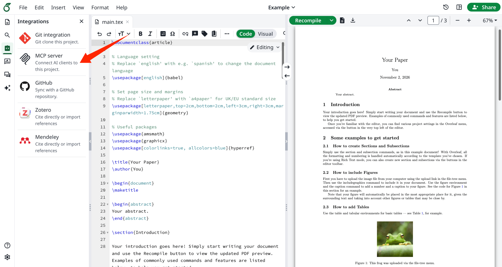
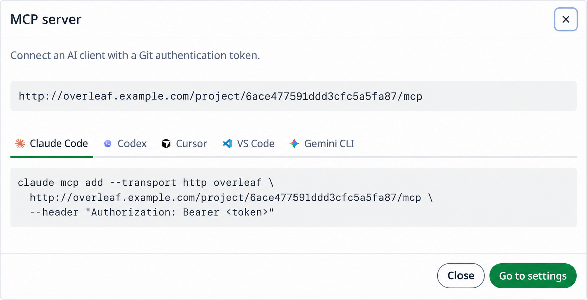

Každý projekt má vlastní MCP server, takže na něm mohou pracovat AI klienti jako Claude Code, Codex, Cursor, VS Code nebo Gemini CLI: číst a upravovat jeho soubory, kompilovat jej, číst log LaTeXu, stahovat PDF a odpovídat na komentáře.

<Info>

Tuto funkci vyvinul projekt [ayaka-notes/ayakaleaf-pro](https://github.com/ayaka-notes/ayakaleaf-pro). Je k dispozici od verze v6.3.1.

</Info>

<Columns cols={2}>
<Column>

<Frame>
  
</Frame>

</Column>

<Column>

<Frame>
  
</Frame>

</Column>
</Columns>

### Nastavení

MCP server je součástí integrace Gitu: povolte [git-bridge](/cs/on-premises/configuration/overleaf-toolkit/integrations/git-integration) a MCP server bude k dispozici také. Nic dalšího není potřeba konfigurovat.

### Připojení AI klienta

1. V **nastavení účtu** vygenerujte autentizační token pro Git. Stejný token se používá pro MCP server i pro Git.
2. V editoru otevřete **Integrace** a klikněte na **MCP server**. Zobrazí se adresa MCP serveru projektu, `https://<your-overleaf>/project/<project_id>/mcp`, a postup, jak ji přidat do jednotlivých AI klientů: zkopírujte příkaz a nahraďte `<token>` svým tokenem.

Token se odesílá jako HTTP hlavička `Authorization: Bearer <token>`. Například příkaz pro Claude Code je:

```bash
claude mcp add --transport http overleaf \
  https://<your-overleaf>/project/<project_id>/mcp \
  --header "Authorization: Bearer <token>"
```

### Použití

Po připojení zadávejte AI klientovi pokyny běžnými slovy. Například:

| Požádáte | AI klient použije |
| --- | --- |
| _Oprav překlepy v úvodu._ | `read_file`, `edit_file`: úpravy se živě zobrazují v editoru |
| _Zkompiluj projekt a oprav chyby LaTeXu._ | `compile`, `get_compile_log`, `edit_file` |
| _Odpověz na otevřené komentáře a pak je vyřeš._ | `list_comments`, `reply_to_comment`, `resolve_comment` |
| _Přepni na XeLaTeX a stáhni PDF._ | `update_settings`, `compile`, `get_output_file_link` |

### Nástroje

| Skupina | Nástroje |
| --- | --- |
| Projekt | `get_clone_info`, `get_settings`, `update_settings`, `list_versions` |
| Soubory | `list_files`, `read_file`, `edit_file`, `write_file`, `delete_file` |
| Kompilace | `compile`, `get_compile_log`, `get_output_file_link`, `word_count` |
| Komentáře | `list_comments`, `reply_to_comment`, `resolve_comment`, `reopen_comment` |

Úpravy provedené pomocí `edit_file` a `write_file` se živě zobrazují v editoru a slučují se s úpravami spolupracovníků. Pro mnoho souborů najednou, binární soubory nebo přejmenování může AI klient projekt také naklonovat pomocí Gitu a provést push.

### Oprávnění

MCP server se řídí nastavením sdílení projektu, stejně jako Git:

* Každý, kdo může projekt zobrazit, jej může číst, kompilovat a stahovat jeho výstup.
* Měnit jeho soubory a nastavení mohou pouze vlastník a editoři.
* Recenzenti mohou navíc odpovídat na komentáře a řešit nebo znovu otevírat komentáře, které sami založili.
* Čtenáři, kteří se připojili pomocí odkazu, komentáře nevidí, stejně jako v editoru.

### Otázky a odpovědi

<Accordion title="V editoru nevidím Integrations ani MCP server">

<strong>Odpověď:</strong> MCP server nemá vlastní proměnnou prostředí. Povoluje se pomocí `GIT_BRIDGE_ENABLED=true` v `config/overleaf.rc`, viz [Integrace s Gitem](/cs/on-premises/configuration/overleaf-toolkit/integrations/git-integration). Po změně spusťte `bin/up -d`. Bez git-bridge editor v levém panelu nezobrazuje záložku **Integrations**.

</Accordion>
