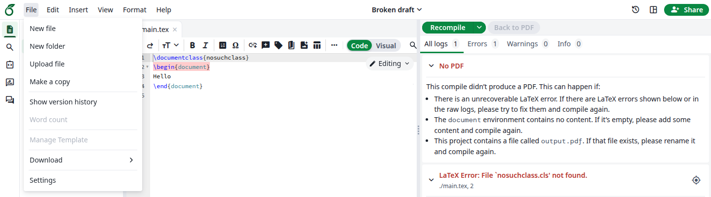
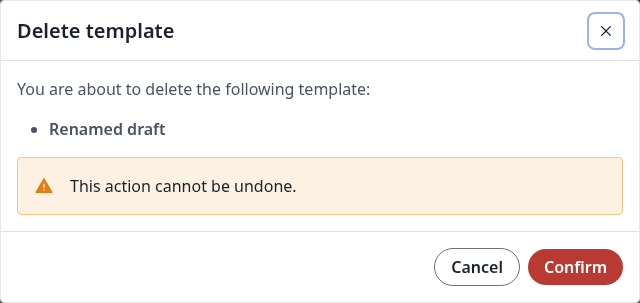

Šablony publikujete z editoru a spravujete je na jejich stránce v galerii nebo v administrátorském panelu.

<Info>

Chcete-li galerii zapnout, vybrat její kategorie nebo povolit publikování uživateli, který není administrátor, viz [Šablony](/cs/on-premises/configuration/overleaf-toolkit/templates).

</Info>

## Publikování projektu {#publish-a-project}

<Steps>
<Step title="Zkompilujte projekt">
Otevřete projekt a klikněte na **Recompile**. PDF, které vidíte, je to, které galerie zobrazí.

Dokud editor nemá PDF, například když otevřete projekt, který se nezkompiluje, je položka **Manage Template** zašedlá.

<Frame caption="Zatím žádné PDF, takže není co publikovat">
  
</Frame>

<Warning>

Publikování uloží soubory v jejich aktuální podobě a PDF z poslední úspěšné kompilace. Pokud jste projekt po této kompilaci upravili nebo poslední kompilace selhala, galerie zobrazí staré PDF vedle novějších souborů, které se nemusí zkompilovat. Kompilujte znovu, dokud PDF nebude v pořádku, a pak publikujte.

</Warning>
</Step>

<Step title="Otevřete formulář">
V horní nabídce editoru klikněte na **File** a poté na **Manage Template**.

<Frame caption="Nabídka File">
  
</Frame>
</Step>

<Step title="Vyplňte formulář">
<Frame caption="Dialog Manage Template">
  
</Frame>

| Pole | Poznámky |
| --- | --- |
| **Title** | Na začátku je to název projektu. Musí být v galerii jedinečný. Nejvýše 150 znaků. |
| **Author** | Na začátku je to vaše jméno. Odkaz Markdown, například `[Demo Author](https://example.com)`, se na stránce šablony stane odkazem. |
| **Categories** | Jedna kategorie, viz [Kategorie](/cs/on-premises/user-guide/administrators/template-management#categories). |
| **Description** | Podporuje Markdown. Nejvýše 4096 znaků. Stránka šablony jej zobrazuje jako **Abstract** a galerie zobrazuje jeho začátek jako prostý text. |
| **License** | **Creative Commons CC BY 4.0**, **LaTeX Project Public License 1.3c** nebo <strong>Other (as stated in the work)</strong>. |

Kompilátor a hlavní dokument projektu přecházejí se šablonou, proto je nejprve nastavte v projektu. Projekty otevřené ze šablony používají stejné.
</Step>

<Step title="Klikněte na Publish">
Otevře se stránka šablony.

<Frame caption="Nová šablona">
  
</Frame>

**Admin: Source Project**, **Edit** a **Delete** jsou jen pro vás. Ostatní uživatelé vidí pouze **Open as Template**, **View PDF** a tlačítko pro stažení.
</Step>

<Step title="Zkontrolujte galerii">
Klikněte na **Templates** vpravo nahoře. Nová šablona je v seznamu první.
</Step>
</Steps>

## Kategorie {#categories}

Šablona patří do jedné kategorie. Názvy a popisy pocházejí z vaší [konfigurace](/cs/on-premises/configuration/overleaf-toolkit/templates#configuration) a na webu je nelze změnit.

Vidíte je na těchto místech:

* **Categories** ve formuláři.
* Karty v horní části stránky galerie `/templates`. Dostanete se tam kliknutím na **Template Gallery** na stránce **All templates**.
* Stránka pro každou kategorii, například `/templates/presentation`. Kategorie bez šablon zobrazuje <strong>No Templates.</strong>
* **New project** a poté **More templates** na stránce projektů.
* Odkaz nad názvem na stránce šablony.

<Frame caption="Kategorie na stránce galerie">
  
</Frame>

**All templates** ve formuláři znamená žádnou vlastní kategorii: šablona je pouze v úplném seznamu.

## Aktualizace šablony {#update-a-template}

Chcete-li změnit soubory a PDF, publikujte projekt znovu pod stejným názvem.

<Steps>
<Step title="Změňte projekt">
Upravte projekt a klikněte na **Recompile**.
</Step>

<Step title="Publikujte znovu">
Klikněte na **File** a poté na **Manage Template**. Formulář zobrazí údaje šablony, které můžete změnit. Klikněte na **Publish**.

Zobrazí se zpráva, že název už existuje, a tlačítko se změní na **Overwrite**.

<Frame caption="Publikování pod stejným názvem">
  
</Frame>

Pokud nyní změníte **Title**, zpráva zmizí a **Publish** vytvoří novou šablonu.
</Step>

<Step title="Klikněte na Overwrite">
Otevře se stejná stránka šablony s novým PDF.

<Frame caption="Aktualizovaná šablona">
  
</Frame>

Projekty, které uživatelé již ze šablony otevřeli, se nemění.
</Step>
</Steps>

<Warning>

Formulář hledá šablonu podle názvu projektu. Pokud jste šablonu přejmenovali pomocí **Edit**, formulář se otevře s názvem projektu, vaším jménem, první kategorií a prázdným popisem a zadání názvu šablony její údaje nevrátí. **Overwrite** pak údaje nahradí obsahem formuláře, proto je nejprve vyplňte znovu.

</Warning>

## Úprava údajů {#edit-the-details}

Tím změníte, co galerie o šabloně zobrazuje, nikoli její soubory nebo PDF.

<Steps>
<Step title="Otevřete šablonu">
Klikněte na **Templates** vpravo nahoře, klikněte na šablonu a poté na **Edit**.
</Step>

<Step title="Změňte pole">
Pole jsou stejná jako při publikování, s jedním navíc: **Language** je jazyk kontroly pravopisu projektů otevřených ze šablony. U projektu publikovaného s výchozím jazykem zobrazuje **Off** a projekty z něj otevřené používají <strong>English (American)</strong>.

<Frame caption="Dialog Edit template">
  
</Frame>

Název, který už má jiná šablona, je odmítnut: **Save** zůstane zašedlé, dokud nezměníte **Title**.
</Step>

<Step title="Klikněte na Save">
Dialog se zavře a stránka šablony zobrazí nové údaje.
</Step>
</Steps>

## Zdrojový projekt {#the-source-project}

**Admin: Source Project** otevře projekt, ze kterého byla šablona publikována.

Šablona si uchovává vlastní kopii souborů. Pokud projekt trvale smažete, tlačítko zmizí a uživatelé mohou šablonu dál otevírat. Projekt, který je pouze v **Trash**, tlačítko zachová. Viz také otázky a odpovědi v části [Šablony](/cs/on-premises/configuration/overleaf-toolkit/templates).

## Smazání šablony {#delete-a-template}

<Steps>
<Step title="Klikněte na Delete">
Na stránce šablony klikněte na **Delete**. Dialog uvádí název šablony.

<Frame caption="Dialog Delete template">
  
</Frame>
</Step>

<Step title="Klikněte na Confirm">
Vrátíte se na stránku, ze které jste přišli, a šablona už v galerii není. Její odkaz nyní zobrazuje **Not found**.

Zdrojový projekt zůstane, stejně jako projekty, které uživatelé ze šablony otevřeli.
</Step>
</Steps>

## Správa šablon v administrátorském panelu {#manage-templates-in-the-admin-panel}

Klikněte na **Admin**, poté na **Project/Object Lookup** a nakonec na kartu **Templates**. Uvádí všechny šablony s autorem a vlastníkem a můžete v ní vyhledávat.

<Frame caption="Všechny šablony v administrátorském panelu">
  
</Frame>

* Kliknutím na název otevřete stránku šablony, kliknutím na ikonu otevření ji otevřete na nové kartě.
* Kliknutím na vlastníka otevřete stránku tohoto uživatele.
* Kliknutím na ikonu koše a poté na **Delete** šablonu smažete. Dialog upozorní, že akci nelze vrátit zpět, a šablona z galerie zmizí.

## Pokud je publikování odmítnuto {#if-publishing-is-refused}

Formulář vám umožní zadat víc, než web přijme. **Title** delší než 150 znaků zobrazí `Template title exceeds the maximum length of 150 characters.` a **Description** delší než 4096 znaků zobrazí `Template description exceeds the maximum length of 4096 characters.`

**Publish** pak zůstane zašedlé, i když text zkrátíte. Klikněte na **Cancel**, poté na **File** a **Manage Template** a vyplňte formulář znovu.
