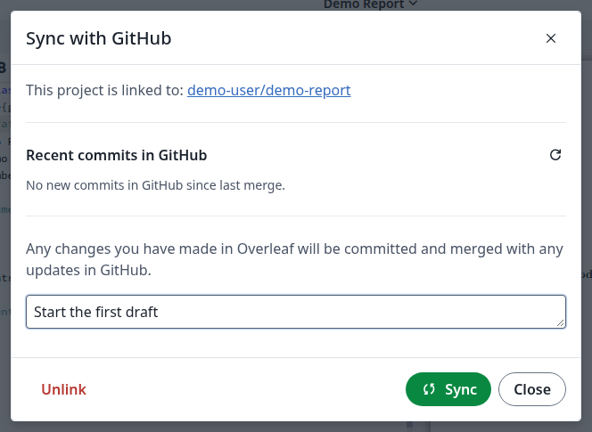
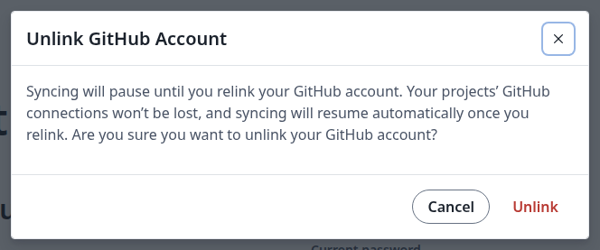

Připojte projekt k repozitáři na GitHubu. Změny se přenášejí oběma směry, a to jen když kliknete na **Sync**: nic se nesynchronizuje samo.

<Info>

Pokud v **Account settings** ani v editoru nevidíte možnost GitHub, požádejte správce o zapnutí [synchronizace s GitHubem](/cs/on-premises/configuration/overleaf-toolkit/integrations/github-synchronisation).

</Info>

## Propojení účtu GitHub {#link-your-github-account}

To uděláte jednou.

<Steps>
<Step title="Otevřete nastavení účtu">
Klikněte na **Account** a poté na **Account settings**. Přejděte na **GitHub** a klikněte na **Link**.

<Frame caption="GitHub v nastavení účtu">
  
</Frame>
</Step>

<Step title="Autorizujte na GitHubu">
Otevře se GitHub. Pokud budete vyzváni, přihlaste se, a poté aplikaci autorizujte.
</Step>

<Step title="Zkontrolujte propojení">
Vrátíte se do nastavení účtu a na tlačítku je teď **Unlink**.

<Frame caption="Váš účet GitHub je propojen">
  
</Frame>
</Step>
</Steps>

Pokud váš účet ještě není propojen, **Import from GitHub** a karta **GitHub** v editoru vás nejprve požádají o propojení. Klikněte na **Link to your GitHub account**. I tak se dostanete do nastavení účtu, na nové kartě, pokud jste začali v editoru. Poté se vraťte a začněte znovu.

<Frame caption="Výzva, když účet není propojen">
  
</Frame>

## Import repozitáře {#import-a-repository}

Tím vytvoříte z repozitáře na GitHubu nový projekt, který je s ním již propojen.

<Steps>
<Step title="Otevřete dialog importu">
Na stránce projektů klikněte na **New project** a poté na **Import from GitHub**.

<Frame caption="Nabídka New project">
  
</Frame>

<Info>

**New project** se zobrazí, jakmile máte nějaký projekt. Nabídka **Create a new project** na úvodní stránce import nemá, proto nejprve vytvořte prázdný projekt.

</Info>
</Step>

<Step title="Vyberte repozitář">
Klikněte na **Import to Overleaf** vedle repozitáře. Seznam obsahuje vaše repozitáře a repozitáře vašich organizací.

<Frame caption="Vaše repozitáře na GitHubu">
  
</Frame>

Pokud repozitář organizace chybí, klikněte na <strong>Can't see what you're looking for?</strong> a zobrazí se nápověda GitHubu ke schválení aplikace pro danou organizaci.
</Step>

<Step title="Zkontrolujte projekt">
Nový projekt se otevře se soubory z repozitáře.

<Frame caption="Importovaný projekt">
  
</Frame>
</Step>
</Steps>

## Export projektu do nového repozitáře {#export-a-project-to-a-new-repository}

Tím vytvoříte z projektu, který vlastníte, repozitář a propojíte je. Projekt lze propojit pouze tímto způsobem nebo importem: nelze ho propojit s již existujícím repozitářem.

<Steps>
<Step title="Otevřete GitHub v editoru">
Otevřete projekt. V levém panelu klikněte na **Integrations** a poté na **GitHub**.

<Frame caption="Panel Integrations">
  
</Frame>
</Step>

<Step title="Vyplňte repozitář">
Zvolte **Owner**, tedy sebe nebo jednu ze svých organizací. **Repository Name** je zpočátku název projektu. Popis je volitelný a **Private** je ve výchozím stavu vybráno. Klikněte na **Create a GitHub repository**.

<Frame caption="Export Project to GitHub">
  
</Frame>
</Step>

<Step title="Zkontrolujte propojení">
Dialog teď uvádí **This project is linked to** a název repozitáře.

<Frame caption="Projekt je propojen">
  
</Frame>
</Step>
</Steps>

## Synchronizace {#sync}

<Steps>
<Step title="Otevřete dialog synchronizace">
Otevřete propojený projekt. V levém panelu klikněte na **Integrations** a poté na **GitHub**.

**Recent commits in GitHub** uvádí, co přibude do projektu.

<Frame caption="Nový commit čeká na GitHubu">
  
</Frame>
</Step>

<Step title="Popište své změny">
Pokud jste v projektu něco změnili, zobrazí se pole pro zprávu commitu. Je volitelné: když ho necháte prázdné, commit se jmenuje `Updates from Overleaf`.

<Frame caption="Zpráva commitu pro vaše změny">
  
</Frame>
</Step>

<Step title="Klikněte na Sync">
Klikněte na **Sync**. Nové commity z GitHubu přibudou do projektu a vaše změny se odešlou do výchozí větve repozitáře. Pokud obě strany změnily různé věci, sloučí se automaticky.
</Step>

<Step title="Zkontrolujte výsledek">
Dialog zobrazí <strong>No new commits in GitHub since last merge.</strong> a pole pro zprávu commitu zmizí. Soubory v editoru i commity na GitHubu jsou aktuální.

<Frame caption="Vše je synchronizováno">
  
</Frame>
</Step>
</Steps>

### Pokud se na obou stranách změnily stejné řádky {#if-the-same-lines-changed-on-both-sides}

Dialog oznámí, že změny nebylo možné sloučit, a uvede novou větev `overleaf-YYYY-MM-DD-HHMMSS`, která obsahuje vaše změny.

<Frame caption="Konflikt">
  
</Frame>

1. Slučte tuto větev do výchozí větve na GitHubu nebo pomocí Gitu. Dialog můžete mezitím zavřít: po opětovném otevření zobrazí stejnou zprávu.
2. Klikněte na **I have manually merged. Continue**. Sloučený výsledek přibude do projektu.
3. Větev zůstane na GitHubu. Smažte ji, až ji nebudete potřebovat.

## Zrušení propojení projektu {#unlink-a-project}

Udělejte to, když už nechcete, aby se projekt synchronizoval. Může to udělat pouze vlastník projektu.

<Steps>
<Step title="Klikněte na Unlink">
V dialogu synchronizace klikněte na **Unlink**.
</Step>

<Step title="Potvrďte">
Klikněte na **Confirm**. Poznámka o předplatném vám nebrání projekt znovu propojit.

<Frame caption="Potvrzení zrušení propojení">
  
</Frame>
</Step>

<Step title="Zkontrolujte výsledek">
Dialog teď zobrazuje **Export Project to GitHub**. Projekt i repozitář si ponechají svůj obsah. Chcete-li znovu synchronizovat, exportujte projekt do nového repozitáře nebo importujte repozitář do nového projektu.
</Step>
</Steps>

## Zrušení propojení účtu GitHub {#unlink-your-github-account}

V **Account settings** v části **GitHub** klikněte na **Unlink** a poté v dialogu znovu na **Unlink**.

<Frame caption="Zrušení propojení účtu">
  
</Frame>

Vaše projekty zůstanou propojené se svými repozitáři. Synchronizovat je nemůžete, dokud účet znovu nepropojíte.

<Info>

Kdo co může dělat ve sdíleném projektu, najdete v části [Kdo může propojovat a synchronizovat](/cs/on-premises/configuration/overleaf-toolkit/integrations/github-synchronisation#who-can-link-and-sync). Každý spolupracovník, který synchronizuje, propojí svůj vlastní účet GitHub.

</Info>
