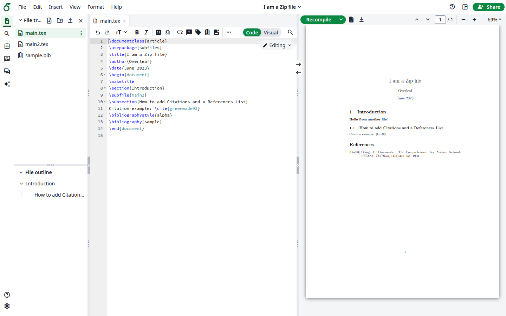
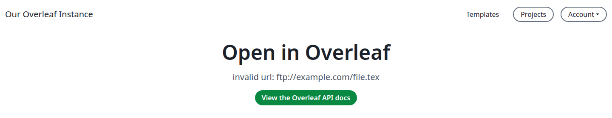

Umístěte odkaz na svůj web, blog nebo stránku kurzu. Každý, kdo na něj klikne, dostane vlastní nový projekt s vašimi soubory. Nic není třeba nastavovat.

Návštěvníci potřebují účet ve vaší instanci. Nepřihlášený návštěvník se nejprve dostane na přihlašovací stránku a projekt se otevře po přihlášení.

Stránky této funkce používají název Overleaf. Váš odkaz nebo tlačítko může obsahovat libovolný text, například **Open in Ayakaleaf**.

## Prohlédněte si příklady {#see-the-examples}

Otevřete na svém webu `/devs`, například `https://ayakaleaf.example.com/devs`. Žádná nabídka na tuto stránku neodkazuje, proto adresu zadejte ručně. Ve výchozím nastavení ji uvidíte jen po přihlášení.

<Frame caption="Stránka Overleaf API">
  
</Frame>

Klikněte na **A LaTeX code snippet** nebo **A zipped project**. Otevře se nový projekt s příkladem.

<Frame caption="Projekt ze zip příkladu">
  
</Frame>

## Odkaz na soubor na vašem webu {#link-to-a-file-on-your-website}

<Steps>
<Step title="Sestavte odkaz">
Za `/docs?snip_uri=` vložte adresu souboru zakódovanou pro URL:

```text
https://ayakaleaf.example.com/docs?snip_uri=https%3A%2F%2Fexample.com%2Fmain.tex
```

Pro zabalený projekt použijte `zip_uri`:

```text
https://ayakaleaf.example.com/docs?zip_uri=https%3A%2F%2Fexample.com%2Fproject.zip
```

Vaše instance soubor stahuje, takže musí být dostupný přes HTTP nebo HTTPS. Adresy v soukromé síti se odmítají, viz [External URL](/cs/on-premises/configuration/overleaf-toolkit/external-url).
</Step>

<Step title="Přidejte ho na stránku">
```html
<a href="https://ayakaleaf.example.com/docs?snip_uri=https%3A%2F%2Fexample.com%2Fmain.tex">Open in Ayakaleaf</a>
```
</Step>

<Step title="Klikněte na něj">
Nový projekt se otevře v editoru s jediným souborem uloženým jako `main.tex`.

<Frame caption="Projekt otevřený z odkazu">
  
</Frame>

Každé kliknutí vytvoří další projekt. Projekt je kopie, takže pozdější změny vašeho souboru se do něj nedostanou.
</Step>
</Steps>

## Vložení souboru do odkazu {#put-the-file-in-the-link}

U malého souboru nemusíte nic hostovat: vložte jeho obsah do odkazu jako Base64 data URL. V JavaScriptu:

```javascript
const tex = '\\documentclass{article}\n\\begin{document}\nHello from a link.\n\\end{document}\n'
const link = 'https://ayakaleaf.example.com/docs?' + new URLSearchParams({
  snip_uri: 'data:application/x-tex;base64,' + btoa(tex),
  name: 'Hello from a link',
})
```

`btoa` přijímá jen znaky Latin-1, proto jiný text nejprve zakódujte jako UTF-8. Pro zabalený projekt použijte `zip_uri` a `data:application/zip;base64,`.

Odkaz delší než asi 8 KB se odmítne s chybou **414 Request-URI Too Large**. Pro větší obsah soubor hostujte nebo použijte [formulář](#use-a-button-instead-of-a-link).

## Volba možností {#choose-the-options}

Přidejte tyto parametry do odkazu nebo do formuláře jako skrytá pole:

| Parametr                   | Co dělá                                                                                                                 | Příklad                                            |
| --------------------------- | ---------------------------------------------------------------------------------------------------------------------------- | -------------------------------------------------- |
| `name`                      | Pojmenuje projekt. Bez něj zabalený projekt převezme název ze svého `\title` a cokoli jiného se jmenuje `Open in Overleaf project`. | `name=My%20notes`                                  |
| `engine`                    | Nastaví kompilátor: `latex_dvipdf`, `pdflatex`, `xelatex` nebo `lualatex`.                                                      | `engine=xelatex`                                   |
| `main_document`             | Nastaví hlavní soubor `.tex`, který se otevře jako první.                                                                                | `main_document=thesis.tex`                         |
| `snip_uri[]`, `snip_name[]` | Importuje několik souborů, každý s vlastním názvem, ve stejném pořadí.                                                            | `snip_uri[]=.../a.tex&snip_name[]=a.tex`           |

Soubor `.tex` bez `\documentclass` se zabalí do standardního dokumentu, takže se hned zkompiluje:

```latex
\documentclass[12pt]{article}
\usepackage[english]{babel}
\usepackage{amsmath}
\usepackage{tikz}
\begin{document}
Your file
\end{document}
```

## Tlačítko místo odkazu {#use-a-button-instead-of-a-link}

Formulář odesílá stejné parametry jako odkaz:

```html
<form action="https://ayakaleaf.example.com/docs" method="post" target="_blank">
  <input type="hidden" name="snip_uri" value="https://example.com/main.tex">
  <input type="hidden" name="engine" value="xelatex">
  <button type="submit">Open in Ayakaleaf</button>
</form>
```

Chcete-li poslat přímo LaTeX, použijte `snip` pro prostý text nebo `encoded_snip` pro text prošlý funkcí `encodeURIComponent`.

Formulář nefunguje vždy, a proto je odkaz lepší volbou, pokud váš soubor není pro odkaz příliš dlouhý:

| Kde je formulář                                     | Návštěvník je přihlášen            | Návštěvník není přihlášen        |
| ----------------------------------------------------- | ------------------------------- | ------------------------------- |
| Na stejné doméně jako vaše instance nebo na subdoméně   | Projekt se otevře               | Přihlašovací stránka, žádný projekt      |
| Na jiné doméně                                     | Přihlašovací stránka, žádný projekt      | Přihlašovací stránka, žádný projekt      |

Pokud správce nastaví `OVERLEAF_ALLOW_PUBLIC_ACCESS=true`, projekt se otevře ve všech těchto případech, v případě potřeby po přihlášení. Toto nastavení také zpřístupní další stránky nepřihlášeným návštěvníkům, viz [Page Access](/cs/on-premises/configuration/overleaf-toolkit/authentication/public-access#page-access).

Další nastavení dostupná správcům najdete v [Overleaf Import API](/cs/on-premises/configuration/overleaf-toolkit/integrations/overleaf-import-api). Stránka `/devs` obsahuje další příklady.

## Když se projekt neotevře {#if-the-project-does-not-open}

Stránka uvede, co se pokazilo. **View the Overleaf API docs** vás přenese na `/devs`.

<Frame caption="Odkaz, který instance nemůže použít">
  
</Frame>

| Zpráva                                      | Proč                                                 | Co dělat                                  |
| -------------------------------------------- | --------------------------------------------------- | ------------------------------------------- |
| `no snippet, snip_uri or zip_uri provided`   | Odkaz neobsahuje žádný z těchto parametrů                          | Zkontrolujte názvy parametrů                   |
| `invalid url: ...`                           | Adresa nezačíná HTTP ani HTTPS       | Použijte adresu HTTP nebo HTTPS, případně data URL |
| `could not download ... (HTTP 404)`          | Soubor na této adrese není                     | Zkontrolujte adresu                           |
| `could not download ... (HTTP 403)`          | Adresa je v soukromé síti                 | Hostujte soubor tam, kam má vaše instance přístup |
| `zip_uri did not resolve to a zip archive`   | Soubor za `zip_uri` není soubor zip         | Zkontrolujte soubor                              |
| `invalid base64 data url`                    | Data URL je poškozená                             | Soubor znovu zakódujte a odkaz zakódujte pro URL |
