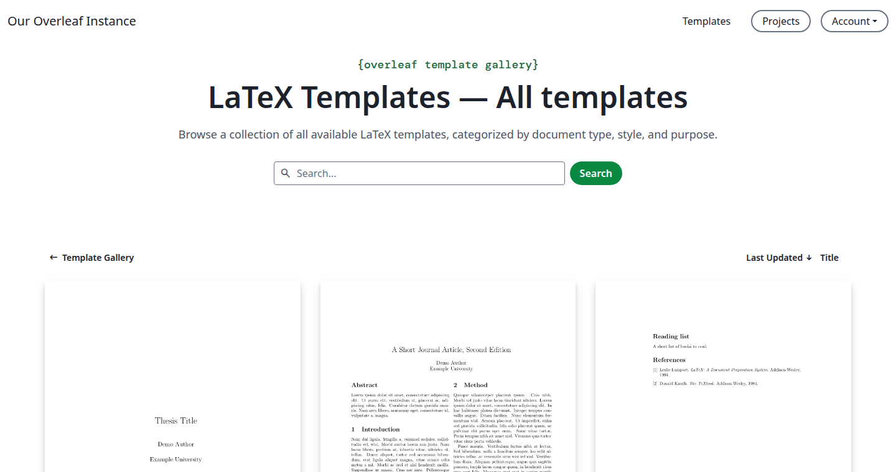

Šablony jsou projekty, které publikoval váš administrátor. Otevřením šablony získáte nový vlastní projekt.

<Info>

Pokud nevidíte odkaz **Templates**, požádejte administrátora, aby zapnul [galerii šablon](/cs/on-premises/configuration/overleaf-toolkit/templates).

</Info>

## Otevření galerie {#open-the-gallery}

Na stránce projektů klikněte vpravo nahoře na **Templates**.

<Frame caption="Odkaz Templates">
  
</Frame>

Otevře se stránka **All templates** s naposledy aktualizovanými šablonami na prvním místě.

<Frame caption="Všechny šablony">
  
</Frame>

Pokud zatím nemáte žádné projekty, klikněte na uvítací stránce na **Browse templates**.

<Frame caption="Uvítací stránka">
  
</Frame>

Pokud projekty máte, můžete také kliknout na **New project**, poté na **More templates** a pak na kategorii.

<Frame caption="More templates">
  
</Frame>

Ve výchozím nastavení galerie vyžaduje přihlášení: pokud vám někdo pošle odkaz na šablonu a nejste přihlášeni, přejdete nejprve na přihlašovací stránku a pak na šablonu.

## Hledání šablony {#find-a-template}

**Vyhledávejte** v poli. Seznam se aktualizuje během psaní a porovnává název, autora a popis. Pokud nic neodpovídá, stránka zobrazí <strong>No Templates.</strong>

<Frame caption="Hledání slides">
  
</Frame>

**Řaďte** pomocí **Last Updated** nebo **Title** vpravo nad seznamem. Opětovným kliknutím na použité řazení obrátíte pořadí.

**Přepínejte stránky** pod seznamem. Stránka zobrazuje devět šablon.

<Frame caption="Tlačítka stránek">
  
</Frame>

<strong>Procházení podle kategorie:</strong> na stránce **All templates** klikněte na **Template Gallery**. Stránka galerie má kartu pro každou kategorii a pod nimi všechny šablony.

<Frame caption="Kategorie">
  
</Frame>

Kliknutím na kartu zobrazíte šablony dané kategorie. I zde můžete vyhledávat a řadit a **All templates** vás vrátí zpět.

<Frame caption="Stránka kategorie">
  
</Frame>

## Otevření šablony jako nového projektu {#open-a-template-as-a-new-project}

<Steps>
<Step title="Otevřete šablonu">
Klikněte na šablonu. Uvidíte náhled její první stránky, autora, poslední aktualizaci, licenci a abstrakt.

<Frame caption="Stránka šablony">
  
</Frame>

**View PDF** otevře celé PDF. Tlačítko vedle něj stáhne soubory jako zip.
</Step>

<Step title="Klikněte na Open as Template">
Po krátké načítací obrazovce se editor otevře s vaším novým projektem.

<Frame caption="Váš nový projekt">
  
</Frame>
</Step>

<Step title="Zkontrolujte projekt">
Projekt má název a soubory šablony a stejný kompilátor i hlavní dokument. Při otevření se zkompiluje a v seznamu projektů jste jeho vlastníkem vy.

Opětovné otevření stejné šablony vytvoří další projekt, například `Journal article (1)`.

<Frame caption="Každé otevření vytvoří projekt">
  
</Frame>
</Step>
</Steps>

Váš projekt na šabloně nezávisí: zůstane beze změny, když je šablona aktualizována nebo smazána.

<Info>

Běžný účet nemůže šablony publikovat ani měnit: nabídka **File** nemá **Manage Template** a stránka šablony nemá **Edit** ani **Delete**. Chcete-li přidat šablonu do galerie, požádejte administrátora.

</Info>
