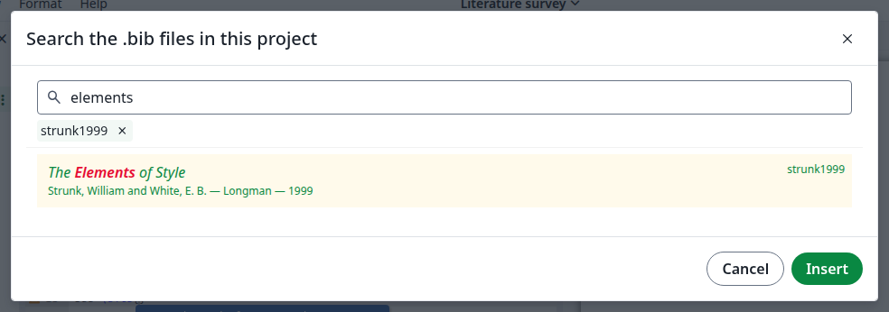
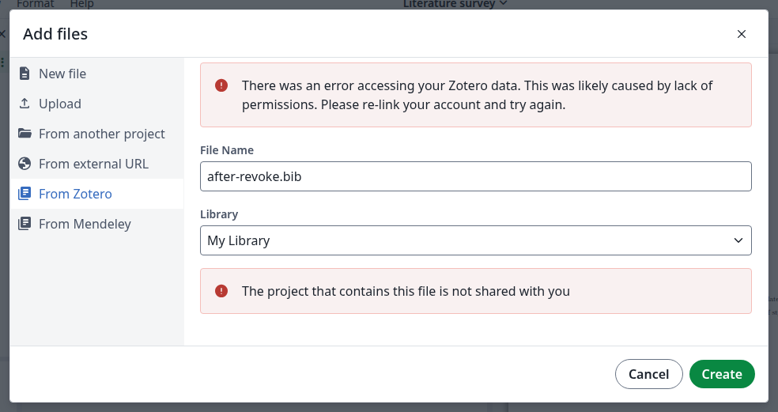

Importujte knihovnu Zotero do projektu jako soubor `.bib` a pak z něj citujte jako obvykle. Soubor je kopie: změní se, jen když kliknete na **Refresh**.

<Info>

Pokud v **Account settings** nevidíte žádnou možnost Zotero, požádejte správce o zapnutí [integrace Zotero](/cs/on-premises/configuration/overleaf-toolkit/integrations/zotero-integration).

</Info>

## Propojení účtu Zotero {#link-your-zotero-account}

Tento krok provedete jen jednou.

<Steps>
<Step title="Otevřete nastavení účtu">
Klikněte na **Account** a pak na **Account settings**. V části **Reference managers** najděte **Zotero** a klikněte na **Link to Zotero**.

<Frame caption="Zotero v nastavení účtu">
  
</Frame>

Karta **Zotero** v panelu **Integrations** editoru vás zavede na stejné místo ve stejné záložce.

<Frame caption="Panel Integrations">
  
</Frame>
</Step>

<Step title="Udělte oprávnění v aplikaci Zotero">
Otevře se Zotero. Pokud budete vyzváni, přihlaste se a pak aplikaci udělte oprávnění. Žádá jen o čtení vaší knihovny a skupin, takže v aplikaci Zotero nemůže nic změnit.
</Step>

<Step title="Zkontrolujte propojení">
Vrátíte se do nastavení účtu. Zelená zpráva říká **Reference manager linked** a na tlačítku je nyní **Unlink**.

<Frame caption="Účet Zotero je propojený">
  
</Frame>
</Step>
</Steps>

Pokud přístup v aplikaci Zotero nepovolíte, zobrazí se ve stejné části **Sorry, something went wrong**. Klikněte na **Link to Zotero** a zkuste to znovu.

## Vytvoření souboru z knihovny {#create-a-file-from-your-library}

<Steps>
<Step title="Otevřete dialog Add files">
Otevřete projekt. Ve stromu souborů klikněte na **New file** a pak na **From Zotero**. Tato položka se zobrazí až po propojení účtu.
</Step>

<Step title="Zvolte název souboru a knihovnu">
Pole **File Name** má výchozí hodnotu `zotero.bib`. Ponechte příponu `.bib`: bez ní neuvidíte náhled a `\cite` ani `\bibliography` nenajdou záznamy.

Pole **Library** má výchozí hodnotu **My Library** a nabízí také vaše skupinové knihovny. Jeden soubor obsahuje jednu knihovnu.

<Frame caption="Soubor z osobní knihovny">
  
</Frame>
</Step>

<Step title="Klikněte na Create">
Dialog se zavře a soubor se objeví ve stromu souborů. Klikněte na něj: zobrazí čas importu a své záznamy. V editoru ho upravovat nemůžete.

<Frame caption="Importovaný soubor">
  
</Frame>

Pokud se zdá, že **Create** nic nedělá, soubor s tímto názvem už existuje. Zvolte jiný název.
</Step>
</Steps>

### Import skupinové knihovny {#import-a-group-library}

Postup zopakujte s vlastním názvem souboru a v poli **Library** zvolte skupinu. Projekt může obsahovat několik takových souborů.

<Frame caption="Soubor ze skupinové knihovny">
  
</Frame>

## Citování ze souboru {#cite-from-the-file}

<Steps>
<Step title="Začněte citaci">
V souboru `.tex` napište `\cite{`. Seznam zobrazí záznamy ze všech souborů `.bib` v projektu. Kliknutím na záznam ho vložíte.

<Frame caption="Záznamy z importovaných souborů">
  
</Frame>
</Step>

<Step title="Nebo hledejte podle názvu či autora">
Klikněte na **Search** pod seznamem nebo stiskněte Ctrl+Mezerník uvnitř složených závorek. Psaním filtrujte, klikněte na jeden nebo více záznamů a pak na **Insert**.

<Frame caption="Vyhledávání referencí">
  
</Frame>
</Step>

<Step title="Přidejte seznam literatury">
Před `\end{document}` přidejte tyto řádky s názvy souborů bez `.bib`, oddělenými čárkami:

```latex
\bibliographystyle{plain}
\bibliography{reading-group,zotero}
```

Klikněte na **Recompile**. Reference se objeví v PDF.

<Frame caption="Zkompilovaná reference">
  
</Frame>
</Step>
</Steps>

Importované soubory se nenabízejí v **Settings** v části **References**, **Main bibliography file for this project**, takže seznam zůstane prázdný, pokud projekt nemá jiný soubor `.bib`. Citovat z nich přesto můžete.

<Frame caption="Prázdný seznam je očekávaný">
  
</Frame>

## Obnovení souboru {#refresh-the-file}

Změny v knihovně Zotero se do projektu nedostanou samy a kompilace je nenačte.

<Steps>
<Step title="Otevřete soubor">
Ve stromu souborů klikněte na importovaný soubor.
</Step>

<Step title="Klikněte na Refresh">
Celý soubor se znovu importuje z knihovny, kterou jste zvolili při jeho vytvoření: nové záznamy se objeví a odstraněné zmizí. Čas nahoře se změní.

<Frame caption="Obnovený soubor">
  
</Frame>
</Step>

<Step title="Znovu zkompilujte">
Nové záznamy jsou hned v seznamu `\cite{`. Kliknutím na **Recompile** aktualizujete PDF.
</Step>
</Steps>

Každý soubor se obnovuje samostatně: soubor skupiny obnovte zvlášť. Kdo může obnovit soubor ve sdíleném projektu, najdete v [poznámkách pro správce](/on-premises/configuration/overleaf-toolkit/integrations/zotero-integration#notes).

## Zrušení propojení účtu Zotero {#unlink-your-zotero-account}

V **Account settings** v části **Zotero** klikněte na **Unlink** a pak v dialogu znovu na **Unlink**. Na tlačítku je opět **Link to Zotero**.

<Frame caption="Zrušení propojení účtu">
  
</Frame>

Importované soubory zůstanou ve vašich projektech a dál se kompilují. Položka **From Zotero** zmizí z dialogu **Add files** a **Refresh** zobrazuje chybu, dokud účet znovu nepropojíte.

<Frame caption="Obnovení bez propojeného účtu">
  
</Frame>

Po opětovném propojení **Refresh** funguje se stejnými soubory.

## Když se něco pokazí {#if-something-goes-wrong}

**Could not load references from Zotero, please re-link your account and try again** nebo **There was an error accessing your Zotero data** v dialogu **Add files**: Overleaf už nemůže číst vaši knihovnu, například proto, že jste mu v aplikaci Zotero odebrali přístup. V **Account settings** klikněte na **Unlink** a pak na **Link to Zotero**. Do té doby selhává i **Create** se zprávou **The project that contains this file is not shared with you**, a to i ve vašem vlastním projektu.

<Frame caption="Overleaf už nemůže číst vaši knihovnu">
  
</Frame>

**The remote service produced an error** po kliknutí na **Refresh**: požadavek na Zotero selhal. Soubor si ponechá svůj obsah. Klikněte na **Refresh** později znovu.
