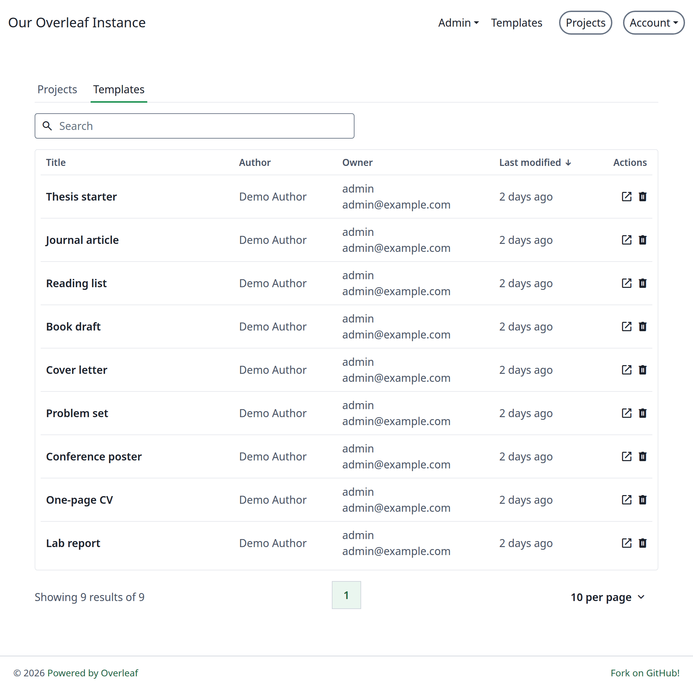

Når man driver en Overleaf-instans for et laboratorium eller et institut, kommer de samme spørgsmål hver uge. Hvorfor kan denne studerende ikke logge ind? Hvem bruger stadig serveren? Hvem gav den konto administratorrettigheder? Hvor blev sidste års speciale af? Vi har bygget administrationspanelet om, så du kan besvare dem uden at åbne en database-shell.

Det nye panel følger udseendet fra Overleaf 6.3 og er oversat til alle de sprog, brugerfladen understøtter. Det har én liste over alle brugere, én liste over alle projekter, en side for hver af dem, et sted til at administrere dine skabeloner og audit-logs.

<Info>

Det nye administrationspanel er flettet ind i vores hovedgren og udgives officielt i v6.4.0. Alle skærmbilleder i dette indlæg stammer fra en testinstans fyldt med opdigtede konti.

</Info>

### Hvad det indeholder {#what’s-in-it}

* **Brugerliste**: søgning, filtre efter loginmetode, rolle og status samt massehandlinger.
* **Brugerside**: kontoen, projekterne, funktionerne, integrationerne, audit-logs og sessionerne for én person.
* **Projektliste**: alle projekter på instansen, søgbare efter navn, ID, ejer eller delingslink.
* **Projektside**: indstillinger, filer, medlemmer, slettede filer og audit-logs for ét projekt.
* **Skabelonadministration**: udgiv et projekt som skabelon, opdater det, og hold galleriet i orden.
* **Audit-logs**: hvem der gjorde hvad, hvornår og fra hvilken IP-adresse.

## Én liste over alle brugere {#one-list-for-every-user}

Klik på **Admin** og derefter på **Manage Users**. Hver konto er én række, der viser, hvordan den logger ind, dens rolle og dens status.

<Frame caption="Brugerlisten">
  
</Frame>

Søg efter navn, e-mail eller ID. Kolonneoverskrifterne **Login**, **Role** og **Status** er filtre, og hver mulighed viser, hvor mange konti den ville returnere. Du kan med et blik se, hvor mange der kommer ind via SAML, og hver OIDC-udbyder vises under det navn, du har givet den.

<Frame caption="Filtrering efter loginmetode">
  
</Frame>

Hver konto har præcis én status, og de fire statusser lægges sammen til det samlede antal.

| Status       | Hvad det betyder                                                       |
| ------------ | ---------------------------------------------------------------------- |
| **Active**   | Har logget ind eller åbnet et projekt inden for de seneste 12 måneder. |
| **Pending**  | Har aldrig logget ind.                                                 |
| **Inactive** | Har logget ind før, men ikke inden for de seneste 12 måneder.          |
| **Disabled** | En administrator har forhindret kontoen i at logge ind.                |

Slettede konti holdes af vejen i deres eget filter. Hvis en søgning også rammer en slettet konto, fortæller en linje over tabellen det og tilbyder at vise den.

<Frame caption="Filtrering efter status">
  
</Frame>

Søgning, sortering og sideinddeling kører på serveren, så listerne stopper ikke længere ved de første 1.000 rækker.

### Få folk ind, med eller uden e-mail {#bring-people-in-with-or-without-email}

**Create account** tilføjer en bruger og giver dig det link, vedkommende skal bruge. Når [e-mail-levering](/da/on-premises/configuration/overleaf-toolkit/email-delivery  "mention") ikke er sat op, siger dialogen det tydeligt og lader dig kopiere linket, så selv en lille instans kan tage imod nye brugere.

<Frame caption="Aktiveringslinket til en ny konto">
  
</Frame>

Panelet tilbyder det rigtige link til hver konto: **Send activation email** til en konto, der aldrig har logget ind, gyldigt i 7 dage, og **Send reset link** til en, der har, gyldigt i 1 time. Konti, der logger ind via SSO, har ingen lokal adgangskode og får derfor ingen af dem.

### Ændr mange konti på én gang {#change-many-accounts-at-once}

Sæt flueben ved nogle konti, og værktøjslinjen tilbyder **Send activation email**, **Transfer this user's projects**, **Disable**, **Enable**, **Make admin**, **Remove admin** og **Delete account**. Dialogen viser konti, før du bekræfter. Hvis nogle af dem fejler, fortæller den dig hvilke, og det, der allerede lykkedes, forbliver gjort.

<Frame caption="Massehandlinger">
  
</Frame>

### Svært at gøre forkert {#hard-to-get-wrong}

* Din egen konto er markeret med **You**, og dens handlinger er nedtonede, så du ikke kan deaktivere, slette eller degradere dig selv.
* Hver handling beder om bekræftelse i en dialog, der nævner kontoen ved navn.
* **Delete account** kan først overdrage brugerens projekter til en anden.
* En slettet konto kan gendannes sammen med de projekter, der blev slettet med den. Kun **Delete permanently** er endeligt, og den advarer dig.

## Alt om én person {#everything-about-one-person}

Klik på et navn for at åbne brugerens side. Den har seks faner og de samme handlingsikoner som listen.

### Konto {#account}

Kontoens oplysninger, fra ID og e-mails til seneste login og dets IP-adresse. Klik på blyanten for at ændre e-mail, navne eller adgangskode eller for at slå **Admin** til eller fra.

<Frame caption="Redigering af en konto">
  
</Frame>

### Projekter {#projects}

De projekter, personen ejer, med deres egen søgning, statusfilter og handlinger.

<Frame caption="En brugers projekter">
  
</Frame>

### Funktioner {#features}

Hvad der er slået til for kontoen, såsom samarbejdspartnere pr. projekt, kompileringstimeout, integrationer og AI, sammen med kontoens AI-forbrug og en knap til at nulstille det.

<Frame caption="En brugers funktioner">
  
</Frame>

### Integrationer {#integrations}

Personens Git-adgangstokens og de tjenester, vedkommende har tilknyttet.

<Frame caption="En brugers integrationer">
  
</Frame>

### Sessioner {#sessions}

Hvor personen er logget ind. **Clear sessions** logger vedkommende ud overalt, og det er det første, du skal gøre, når en bærbar computer forsvinder.

<Frame caption="En brugers sessioner">
  
</Frame>

## Alle projekter på instansen {#every-project-on-the-instance}

Klik på **Admin** og derefter på **Project/Object Lookup**. Listen viser alle brugeres projekter med deres ejere og statusser. Søgefeltet tager et projekts navn, dets ID, dets ejer eller et link. Indsæt et delingslink, og du finder projektet bag det.

<Frame caption="Alle projekter">
  
</Frame>

Filteret **Status** adskiller projekter, der er **Active**, **Archived**, **Trashed** og **Deleted**. Sæt flueben ved flere projekter for at downloade dem i én `.zip`-fil, skifte deres ejer eller slette dem. I visningen **Deleted** er knapperne **Restore** og **Delete permanently**.

<Frame caption="Filtrering af projekter efter status">
  
</Frame>

## Alt om ét projekt {#everything-about-one-project}

Klik på et projekts titel for at åbne dets side.

### Oversigt {#overview}

Skift navn, linkdeling, compiler, TeX Live-version og hoveddokument. **Change project owner** giver projektet til en anden bruger, hvilket hjælper, når nogen forlader laboratoriet, og deres speciale skal blive.

<Frame caption="Redigering af et projekt">
  
</Frame>

### Filtræ {#file-tree}

Projektets filer og mapper, skrivebeskyttet.

<Frame caption="Et projekts filer">
  
</Frame>

### Medlemmer {#members}

Ejeren, samarbejdspartnerne og de ventende invitationer. Skift en samarbejdspartners rolle, fjern vedkommendes adgang, eller send en invitation igen eller tilbagekald den.

<Frame caption="Ændring af et projekts medlemmer">
  
</Frame>

### Slettede filer {#deleted-files}

Filer, der er fjernet fra projektet. **Restore file** lægger en kopi i projektets rodmappe, og rækken viser kopiens navn.

<Frame caption="En gendannet fil">
  
</Frame>

## Skabelonadministration {#template-management}

En skabelon starter som et almindeligt projekt. Du udgiver den fra editoren og administrerer den fra dens side i galleriet eller fra administrationspanelet.

### Alle skabeloner i én tabel {#all-templates-in-one-table}

Klik på **Admin**, derefter på **Project/Object Lookup** og så på fanen **Templates**. Den viser alle udgivne skabeloner med forfatter, ejer og tidspunktet for seneste ændring, og du kan søge i den. Klik på en titel for at åbne skabelonen, klik på en ejer for at åbne brugerens side, eller klik på skraldespanden for at slette en skabelon. En sletning skrives i [din egen audit-log](#when-there-is-no-log-left).

<Frame caption="Alle skabeloner i administrationspanelet">
  
</Frame>

### Udgiv fra editoren {#publish-from-the-editor}

Åbn et projekt, og kompilér det, indtil PDF'en ser rigtig ud, for galleriet viser PDF'en fra den seneste vellykkede kompilering. Klik derefter på **File** og så på **Manage Template**, og udfyld titel, forfatter, en kategori, en beskrivelse i Markdown og en licens. Projektets compiler og hoveddokument følger med skabelonen, så projekter, der åbnes fra den, bruger de samme.

<Frame caption="Udgivelse af et projekt som skabelon">
  
</Frame>

### Opdater en skabelon {#update-a-template}

For at ændre en skabelons filer og PDF udgiver du projektet igen under samme titel. Dialogen fortæller dig, at titlen allerede findes, og knappen bliver til **Overwrite**. Projekter, som folk allerede har åbnet fra skabelonen, ændres ikke.

<Frame caption="Udgivelse under samme titel">
  
</Frame>

### Skabelonsiden {#the-template-page}

Alle kan bruge **Open as Template**, **View PDF** og downloadknappen. Administratorer får også **Admin: Source Project**, **Edit** og **Delete**.

<Frame caption="En skabelons side">
  
</Frame>

**Edit** ændrer, hvad galleriet viser om en skabelon: titel, forfatter, kategori, beskrivelse og licens samt stavekontrolsproget for projekter, der åbnes fra den. Den rører ikke filerne eller PDF'en. Skabelonen har sin egen kopi af filerne, så sletning af kildeprojektet tager ikke skabelonen med.

<Frame caption="Redigering af en skabelons oplysninger">
  
</Frame>

### Et galleri til dine brugere {#a-gallery-for-your-users}

Galleriet åbner med et kort for hver kategori, og hver kategori har sin egen side. Kategorierne kommer fra din konfiguration af [Skabeloner](/da/on-premises/configuration/overleaf-toolkit/templates  "mention"), hvor du også kan lade en bruger, der ikke er administrator, udgive.

<Frame caption="Skabelongalleriet">
  
</Frame>

Siden **All templates** viser alle skabeloner med en forhåndsvisning af deres første side, og dine brugere kan søge i den og sortere den efter titel eller dato.

<Frame caption="Alle skabeloner">
  
</Frame>

## Audit-logs: hvem gjorde hvad, og hvornår {#audit-logs-who-did-what-and-when}

Det er den del, vi er gladest for. Hver konto og hvert projekt har nu sin egen audit-log, og webstedets administratorer kan læse den direkte i panelet.

Åbn fanen **Audit logs** på en brugers side. De nyeste poster kommer først.

<Frame caption="En kontos audit-log">
  
</Frame>

Læst nedefra og op fortæller siden en historie. Lena loggede ind. En administrator hævede hendes kompileringstimeout til 300 sekunder, slog hendes AI-adgang fra, sendte hende et link til nulstilling af adgangskode, gjorde hende til administrator og tog det tilbage og deaktiverede og genaktiverede derefter kontoen. Lena loggede ind igen, og administratoren ryddede hendes sessioner.

| Kolonne        | Hvad den fortæller dig                                                                              |
| -------------- | --------------------------------------------------------------------------------------------------- |
| **Date**       | Hvornår det skete.                                                                                  |
| **Operation**  | Hvad der skete.                                                                                     |
| **Initiator**  | Hvem der gjorde det. Det, en administrator gør ved en konto, viser administratoren, ikke brugeren.   |
| **IP Address** | Hvor anmodningen kom fra.                                                                           |
| **Info**       | Detaljerne, såsom den nye kompileringstimeout, eller om e-mailen faktisk blev sendt.                |

### Find den post, du har brug for {#find-the-entry-you-need}

Søg efter handling eller IP-adresse. Kolonneoverskriften **Operation** er et filter, der viser alle handlinger i denne log, og hvor mange gange hver skete.

<Frame caption="Filtrering efter handling">
  
</Frame>

### En log for hvert projekt {#a-log-for-every-project}

Projektsiden har den samme fane. Den viser, hvem der blev inviteret, hvem der kom med, hvis rolle der blev ændret, hvem der downloadede projektet, og hvem der overtog det.

<Frame caption="Et projekts audit-log">
  
</Frame>

### Hvad der registreres {#what-gets-recorded}

Dette er de vigtigste handlinger i hver log under de navne, du ser i panelet.

| Log     | Område                   | Handlinger                                                                                                                                                                                                                                  |
| ------- | ------------------------ | ------------------------------------------------------------------------------------------------------------------------------------------------------------------------------------------------------------------------------------------- |
| Konto   | Login og adgangskode     | Login, Logout, Failed password match, Update password, Reset password                                                                                                                                                                       |
| Konto   | E-mail og SSO            | Add email, Remove email, Change primary email, Link SSO, Unlink SSO                                                                                                                                                                         |
| Konto   | Integrationer            | Link GitHub, Unlink GitHub, Link Dropbox, Unlink Dropbox, Integration account linked, Integration account unlinked, Create Git token, Delete Git token                                                                                      |
| Konto   | Administratorhandlinger  | Create account, Send activation email, Send password reset email, Change name, Change admin access, Change features, Change AI features, Reset AI usage, Account suspension, Account reactivation, Clear sessions, Transfer projects, Delete account, Restore account |
| Projekt | Deling                   | Send invite, Resend invite, Revoke invite, Accept invite, Join via token, Accept via link sharing, Remove collaborator, Leave project, Project role changed, Toggle access level, Transfer ownership                                       |
| Projekt | Filer                    | Project downloaded, Project exported docx, Project exported markdown, Project exported html, Restore deleted doc                                                                                                                            |
| Projekt | Administratorhandlinger  | Project deleted, Project restored                                                                                                                                                                                                           |
| Projekt | Git-synkronisering       | Integration repo linked, Integration repo unlinked                                                                                                                                                                                          |

### Når der ikke er nogen log tilbage {#when-there-is-no-log-left}

**Delete permanently** fjerner en konto eller et projekt sammen med dens log, og en skabelon har aldrig haft en. Derfor skrives disse handlinger i loggen for den administrator, der udførte dem, sammen med e-mailen eller ID'et for det, der blev fjernet.

<Frame caption="Permanente sletninger i administratorens egen log">
  
</Frame>

### Godt at vide {#good-to-know}

* Poster gemmes i to et halvt år, hvorefter MongoDB fjerner dem automatisk.
* Bag en reverse proxy skal du sætte [`OVERLEAF_TRUSTED_PROXY_IPS`](/da/on-premises/configuration/overleaf-toolkit/environment-variables  "mention"), så loggen viser besøgendes adresse og ikke proxyens.
* Ikke alt registreres endnu. Git clone og push, ændringer af et projekts indstillinger såsom navn eller compiler, og de projekter en ejer opretter, arkiverer, kasserer eller sletter, vises ikke i projektloggen.

## Prøv det {#try-it}

Det nye panel følger med Ayakaleaf Pro v6.4.0. Trin-for-trin-vejledningerne er allerede online:

* [Brugeradministration](/da/on-premises/user-guide/administrators/user-management  "mention")
* [Projektadministration](/da/on-premises/user-guide/administrators/project-management  "mention")
* [Skabelonadministration](/on-premises/user-guide/administrators/template-management  "mention")

Hvis der mangler noget, eller noget ikke virker, som du forventer, så fortæl os det på [GitHub](https://github.com/ayaka-notes/ayakaleaf-pro/issues).
