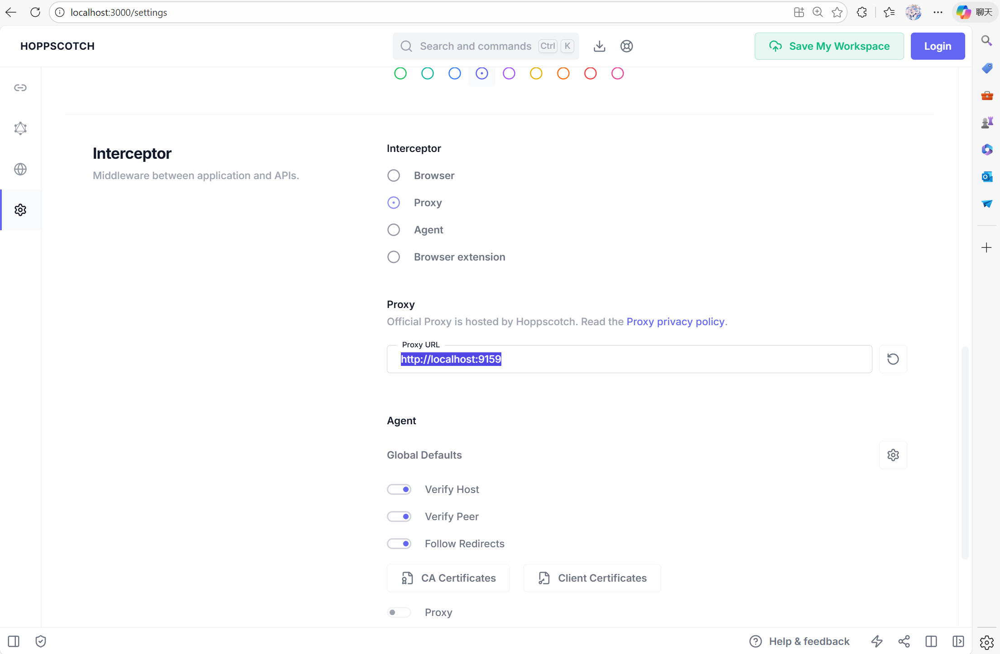

## Anbefalede udviklingsværktøjer {#develop-tools-recommended}

Disse valgfrie tjenester er ikke nødvendige for at køre Overleaf, men de hjælper meget, når du udvikler, fejlsøger og undersøger dataene. De er alle en del af udviklingsmiljøet, så der er intet at tilføje til `docker-compose.yml`. Når du er logget ind på sitet, linker menuen **Dev tools** i navigationslinjen til de værktøjer, sitet serverer på sine egne stier.

| Værktøj | Adresse | Defineret i |
| --- | --- | --- |
| **Grafana**, tilstand, målinger og logs for hver tjeneste | [http://localhost/grafana/](http://localhost/grafana/) | `develop/grafana/docker-compose.yml`, slået til, når `GRAFANA_ENABLED=true` i `develop/dev.rc` (standard) |
| **Mailpit**, en indbakke til hver e-mail, sitet sender | [http://localhost/mailpit/](http://localhost/mailpit/) | `develop/mail/docker-compose.yml`, slået til, når `MAILPIT_ENABLED=true` (standard) |
| **Mongo Express**, en brugerflade til MongoDB | [http://localhost/mongo-express/](http://localhost/mongo-express/) | `develop/docker-compose.yml`, altid slået til |
| **RedisInsight**, en brugerflade til Redis-dataene | [http://localhost/redis-insight/](http://localhost/redis-insight/) | `develop/docker-compose.yml`, altid slået til |
| **Hoppscotch**, en browserbaseret API-klient, der ligner Postman | [http://localhost:9170](http://localhost:9170/) (`HOPPSCOTCH_PORT`) | `develop/hoppscotch/docker-compose.yml`, slået til, når `HOPPSCOTCH_ENABLED=true` (standard) |

<Warning>

Ingen af disse værktøjer har login: Grafanas anonyme brugere er dens administratorer, og Mongo Express kan ændre ethvert dokument. Sitet, Hoppscotch, Mongo Express (8081) og RedisInsight (5540) lytter kun på værtens `127.0.0.1`, så andre værter kan ikke nå dem.

</Warning>

### Grafana {#grafana}

Grafana serveres af sitet på `/grafana/` via webpack-dev-server, så den behøver ingen egen port. Dens mappe **Overleaf Develop** har disse dashboards:

| Dashboard | Hvad det viser |
| --- | --- |
| All services (start) | Tilstand for hver tjeneste, værtsmålere, belastning og logs. Et klik på en tjeneste åbner dens dashboard |
| Server | CPU, belastning, hukommelse, disk og netværk for værten samt clsis kompileringer |
| Errors | Fejllogs, 5xx- og 4xx-svar, de hyppigste fejlmeddelelser og fejlende ruter |
| Data flow | Vejen for en ændring: document-updater og Redis, project-history, history-v1, Mongo, objektlager |
| Containers | Tilstand for hver container, CPU, hukommelse, netværk og disk, inklusive sandkassekompileringer |
| Ét pr. tjeneste | Node.js-tjenesterne, git-bridge (JVM), mongo og redis |

<Columns cols={2}>
<Column>

<Frame caption="All services: tilstanden for hver tjeneste, værten og de ressourcer, hver tjeneste bruger">
  
</Frame>

</Column>

<Column>

<Frame caption="Data flow: en ændring på vej fra document-updater gennem project-history til history-v1 og Mongo">
  
</Frame>

</Column>
</Columns>

Prometheus henter `/metrics` fra tjenesterne, `mongodb-exporter`, `redis-exporter`, `cadvisor` og `node-exporter`; Alloy sender logs fra hver container i projektet til Loki, hvor dashboardenes filtre **Log search**, **Service** og **Log level** læser dem. Deres data findes kun i containerne, så de tømmes, når containerne genskabes. cAdvisor kører privilegeret og læser værtens `/`, `/sys`, Docker-data og containerd-socket, skrivebeskyttet; node-exporter læser værtens `/`.

Dashboardene genereres: ret `develop/grafana/make-dashboards`, og kør det i stedet for at redigere JSON-filerne.

### Mailpit {#mailpit}

Med `MAILPIT_ENABLED=true` sender `web` alle e-mails til Mailpit i stedet for til en rigtig mailserver, og e-mailbekræftelse er slået til (`EMAIL_CONFIRMATION_DISABLED=false`). Aktiveringslinks, projektinvitationer, nulstillinger af adgangskode og bekræftelseskoder kan så følges fra indbakken.

<Frame caption="En aktiveringsmail, en projektinvitation, en bekræftelseskode og en nulstilling af adgangskode i Mailpit">
  
</Frame>

Mailpit har intet volumen: hvis containeren genskabes, tømmes indbakken.

### Mongo Express {#mongo-express}

Mongo Express viser samlingerne i databasen `sharelatex` og kan vise, redigere, importere og eksportere deres dokumenter.

<Frame caption="Samlingerne i databasen sharelatex i Mongo Express">
  
</Frame>

### RedisInsight {#redisinsight}

RedisInsight gemmer sine forbindelser i `develop/data/redis-insight`. Første gang vælger du **Connect existing database** og angiver værten `redis` og porten `6379`.

<Frame caption="RedisInsight forbundet til tjenesten redis">
  
</Frame>

### Opsætning af Hoppscotch {#setup-hoppscotch}

#### Proxy for API-forespørgsler {#proxy-api-request}

Hoppscotch sender forespørgsler fra browseren, som ikke kan nå tjenesterne via deres Docker-navne. Dens proxy, Proxyscotch, kører i Docker-netværket og serveres på `/proxy` på Hoppscotch-adressen. Åbn [http://localhost:9170](http://localhost:9170/), gå til Settings → Interceptor, vælg **Proxy**, og sæt Proxy URL til `http://localhost:9170/proxy`. Indstillingen gemmes i browseren.

<Frame caption="Interceptor-indstillingen. Skærmbilledet er fra en ældre opsætning: brug `http://localhost:9170/proxy` som Proxy URL.">
  
</Frame>

Nu kan du teste med [http://web:3000/status](http://web:3000/status) for at kontrollere, om web kører:

<Frame>
  
</Frame>

#### Importér tjenesternes API'er {#import-the-service-apis}

`develop/hoppscotch/openapi/` har en OpenAPI-fil til hver tjenestes interne API. Åbn Collections → Import → Import from File i Hoppscotch, og vælg alle filerne på én gang. Hver fil bliver en samling, hvis forespørgsler går til tjenestens Docker-adresse. De samme filer vises i afsnittet [Tjeneste-API](/da/dev/service-api/overview).

#### CSRF-problemer {#csrf-problems}

<Warning>

Hvis du bruger Postman eller andre fejlfindingsværktøjer til at sende en **POST**-forespørgsel, vil du muligvis opleve, at login bliver **afvist** med en 403-fejl. Det skyldes, at Overleaf er beskyttet af **CSRF**-verifikation.

</Warning>

<Frame>
  
</Frame>

I din konsol vil du muligvis se:

<Frame>
  
</Frame>

For at håndtere dette i din Overleaf-udvikling skal du opsætte dit CSRF-token. Her er en detaljeret vejledning.

<Steps>
<Step title="Tilføj pre-request">
Tilføj følgende kode under Pre-Request

<Frame>
  
</Frame>

Scriptet ser således ud:

```js wrap
pm.sendRequest("http://web:3000/dev/csrf", function (err, res) {
    if (err) {
        console.log(err);
        return;
    }

    // 1) Save CSRF token (/dev/csrf)
    const token = res.text().trim();
    pw.env.set("csrftoken", token);
    console.log("csrftoken =", token);

    const setCookieHeader = (res.headers || []).find(h => h.key?.toLowerCase() === "set-cookie")?.value;
    console.log("set-cookie =", setCookieHeader);

    if (!setCookieHeader) return;

    const cookiePair = setCookieHeader.split(";")[0].trim(); // overleaf.sid=...
    pw.env.set("cookie_header", cookiePair);
    console.log("cookie_header =", cookiePair);
});
```
</Step>

<Step title="Tilføj request-headers">
Du skal tilføje følgende headers:

| Headernavn   | Headerværdi         |
| ------------ | ------------------- |
| Content-Type | `application/json`  |
| X-Csrf-Token | `<<csrftoken>>`     |
| Cookie       | `<<cookie_header>>` |

<Frame>
  
</Frame>
</Step>

<Step title="Log ind med API-værktøjer">
Nu kan du logge ind med dit brugernavn og din adgangskode.

```json5
{
  "_csrf": "<<csrftoken>>",
  "email": "admin@overleaf.com",
  "password": "xxxxxx"
}
```

Her er svaret, når du indtaster et forkert brugernavn eller en forkert adgangskode.

<Frame>
  
</Frame>
</Step>
</Steps>
