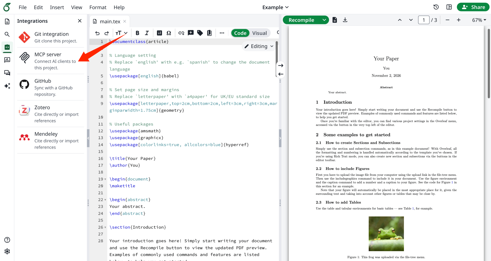

Hvert projekt har en MCP-server, så AI-klienter som Claude Code, Codex, Cursor, VS Code eller Gemini CLI kan arbejde på det: læse og redigere dets filer, kompilere det, læse LaTeX-loggen, downloade PDF'en og besvare kommentarer. Fra v6.3.3 kan de også gennemse historikken og gendanne versioner, gennemgå sporede ændringer, tilføje kommentarer, bruge projektchatten og flytte filer.

<Info>

Denne funktion er udviklet af [ayaka-notes/ayakaleaf-pro](https://github.com/ayaka-notes/ayakaleaf-pro). Den er introduceret i v6.3.1 og senere. Værktøjerne til historik, sporede ændringer, projektchat, nye kommentarer og flytning af filer findes fra v6.3.3, se [Nyt i v6.3.3](/da/on-premises/user-guide/users/mcp-server#new-in-v6.3.3).

</Info>

<Columns cols={2}>
<Column>

<Frame>
  
</Frame>

</Column>

<Column>

<Frame>
  
</Frame>

</Column>
</Columns>

### Opsætning {#setup}

MCP-serveren følger med Git-integrationen: aktivér [git-bridge](/da/on-premises/configuration/overleaf-toolkit/integrations/git-integration), så er MCP-serveren også tilgængelig. Der er intet andet at konfigurere.

### Forbind en AI-klient {#connect-an-ai-client}

1. Generér et Git-godkendelsestoken under **Account Settings**. Det samme token bruges til MCP-serveren og til Git.
2. Åbn **Integrations** i editoren, og klik på **MCP server**. Her vises adressen på projektets MCP-server, `https://<your-overleaf>/project/<project_id>/mcp`, og hvordan du tilføjer den til hver AI-klient: kopiér kommandoen, og erstat `<token>` med dit token.

Tokenet sendes som HTTP-headeren `Authorization: Bearer <token>`. Kommandoen til Claude Code er for eksempel:

```bash
claude mcp add --transport http overleaf \
  https://<your-overleaf>/project/<project_id>/mcp \
  --header "Authorization: Bearer <token>"
```

### Brug {#usage}

Når forbindelsen er oprettet, kan du bede AI-klienten om ting med almindelige ord. For eksempel:

| Du beder om | AI-klienten bruger |
| --- | --- |
| _Ret stavefejlene i indledningen._ | `read_file`, `edit_file`: redigeringerne vises live i editoren |
| _Kompilér projektet, og ret LaTeX-fejlene._ | `compile`, `get_compile_log`, `edit_file` |
| _Besvar de åbne kommentarer, og markér dem derefter som løst._ | `list_comments`, `reply_to_comment`, `resolve_comment` |
| _Skift til XeLaTeX, og download PDF'en._ | `update_settings`, `compile`, `get_output_file_link` |
| _Omskriv resuméet som en sporet ændring._ | `read_file`, `edit_file` med `trackChanges` (v6.3.3) |
| _Hvad er ændret siden den indsendte version?_ | `list_versions`, `list_changes`, `diff` (v6.3.3) |
| _Flyt kapitlerne til en mappe ved navn chapters._ | `move_file` (v6.3.3) |

### Værktøjer {#tools}

| Gruppe | Værktøjer |
| --- | --- |
| Projekt | `get_clone_info`, `get_settings`, `update_settings` |
| Filer | `list_files`, `read_file`, `edit_file`, `write_file`, `delete_file`, `move_file`, `create_folder` |
| Kompilering | `compile`, `get_compile_log`, `get_output_file_link`, `word_count` |
| Kommentarer | `list_comments`, `reply_to_comment`, `resolve_comment`, `reopen_comment`, `add_comment`, `edit_comment_message`, `delete_comment_message` |
| Sporede ændringer | `list_tracked_changes`, `accept_tracked_changes`, `reject_tracked_changes` |
| Historik | `list_versions`, `list_changes`, `diff`, `create_version`, `delete_version`, `restore_file`, `restore_project` |
| Chat | `list_chat_messages`, `send_chat_message` |

v6.3.3 har 33 værktøjer, eller 31 med `OVERLEAF_DISABLE_CHAT=true`, som fjerner chatværktøjerne. v6.3.1 og v6.3.2 har de øvrige 17: alt ovenfor undtagen `move_file`, `create_folder`, `add_comment`, `edit_comment_message`, `delete_comment_message`, værktøjerne til sporede ændringer, chatværktøjerne og historikværktøjerne bortset fra `list_versions`. I v6.3.3 læser `read_file` også en fil i en version af historikken, `edit_file` og `write_file` tager `trackChanges`, og `update_settings` angiver også sproget for stavekontrollen.

Ændringer foretaget med `edit_file`, `write_file` og `move_file` vises live i editoren og flettes med samarbejdspartnernes. Til mange filer på én gang eller binære filer kan AI-klienten også klone projektet med Git og pushe.

Med `trackChanges` er en ændring af en eksisterende fil en sporet ændring af tokenets bruger, også når sporing af ændringer er slået fra i projektet; en ny fil er det aldrig. Uden `trackChanges` følger ændringerne projektets indstilling for sporing af ændringer.

### Tilladelser {#permissions}

MCP-serveren følger projektets delingsindstillinger, ligesom Git:

* Alle, der kan se projektet, kan læse det, kompilere det og downloade dets output.
* Kun ejeren og redaktører kan ændre dets filer og indstillinger, gendanne versioner og acceptere eller afvise sporede ændringer.
* Korrekturlæsere kan også tilføje kommentarer og svare på dem, løse, genåbne eller slette de kommentarer, de selv har startet, og gemme versioner. De kan ikke redigere filer, heller ikke som sporede ændringer.
* Alle redigerer kun deres egne kommentarbeskeder, og korrekturlæsere sletter kun deres egne.
* Kun ejeren sletter versioner, som andre har gemt.
* Læsere, der er kommet med via et link, kan ikke se kommentarerne, de sporede ændringer, historikken eller chatten, ligesom i editoren. Inviterede læsere kan se dem og bruge chatten.
* Hvis projektejeren ikke har **Full project history**, viser historikværktøjerne kun ændringerne fra de seneste 24 timer, som historikpanelet gør. Administratorer ser dem alle.

Brugervejledningen har en tabel over, hvad hver rolle må, se [Hvem må hvad](/da/on-premises/user-guide/users/mcp-server#who-may-do-what).

### Spørgsmål og svar {#q&a}

<Accordion title="Jeg kan ikke se Integrations eller MCP server i editoren">

<strong>Svar:</strong> MCP-serveren har ingen egen miljøvariabel. Den aktiveres med `GIT_BRIDGE_ENABLED=true` i `config/overleaf.rc`, se [Git-integration](/da/on-premises/configuration/overleaf-toolkit/integrations/git-integration). Kør `bin/up -d`, når du har ændret den. Uden git-bridge viser editoren ikke fanen **Integrations** i sit venstre panel.

</Accordion>

<Accordion title="AI-klienten siger »Track changes is off for this project«">

<strong>Svar:</strong> Klienten bad om en sporet ændring, men projektejerens konto har ikke sporing af ændringer. Klik på **Admin** og derefter på **Manage Users**, åbn ejeren, og slå **Track changes** til på fanen **Features**, se [Features](/da/on-premises/user-guide/administrators/user-management#features). Ændringer uden `trackChanges` virker stadig.

</Accordion>

<Accordion title="AI-klienten ser kun ændringerne fra de seneste 24 timer">

<strong>Svar:</strong> Projektejerens konto har ikke fuld projekthistorik, så historikværktøjerne viser det, historikpanelet viser: ændringerne fra de seneste 24 timer. Klik på **Admin** og derefter på **Manage Users**, åbn ejeren, og slå **Full project history** til på fanen **Features**, se [Features](/da/on-premises/user-guide/administrators/user-management#features).

</Accordion>
