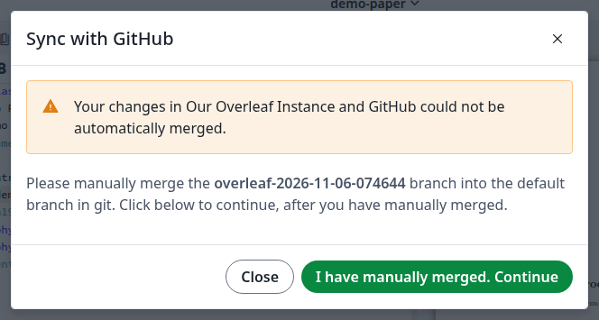

Forbind et projekt med et GitHub-repository. Ændringer går begge veje, og kun når du klikker på **Sync**: intet synkroniseres af sig selv.

<Info>

Hvis du ikke kan se en GitHub-indstilling i **Account settings** eller i editoren, så bed din administrator om at slå [GitHub-synkronisering](/da/on-premises/configuration/overleaf-toolkit/integrations/github-synchronisation) til.

</Info>

## Tilknyt din GitHub-konto {#link-your-github-account}

Det gør du én gang.

<Steps>
<Step title="Åbn dine kontoindstillinger">
Klik på **Account** og derefter på **Account settings**. Rul ned til **GitHub**, og klik på **Link**.

<Frame caption="GitHub i kontoindstillingerne">
  
</Frame>
</Step>

<Step title="Godkend på GitHub">
GitHub åbnes. Log ind, hvis du bliver bedt om det, og godkend derefter programmet.
</Step>

<Step title="Kontrollér tilknytningen">
Du er tilbage i kontoindstillingerne, og på knappen står der nu **Unlink**.

<Frame caption="Din GitHub-konto er tilknyttet">
  
</Frame>
</Step>
</Steps>

Hvis din konto endnu ikke er tilknyttet, beder **Import from GitHub** og kortet **GitHub** i editoren dig om at tilknytte den først. Klik på **Link to your GitHub account**. Så ender du også i kontoindstillingerne, i en ny fane, hvis du startede i editoren. Gå derefter tilbage, og start forfra.

<Frame caption="Meddelelsen, når din konto ikke er tilknyttet">
  
</Frame>

## Importér et repository {#import-a-repository}

Dette opretter et nyt projekt fra et GitHub-repository, der allerede er tilknyttet det.

<Steps>
<Step title="Åbn importdialogboksen">
Klik på **New project** på projektsiden og derefter på **Import from GitHub**.

<Frame caption="Menuen New project">
  
</Frame>

<Info>

**New project** vises, når du har et projekt. Menuen **Create a new project** på velkomstsiden har ingen import, så opret først et tomt projekt.

</Info>
</Step>

<Step title="Vælg repository">
Klik på **Import to Overleaf** ud for repositoryet. Listen indeholder dine repositories og dine organisationers.

<Frame caption="Dine GitHub-repositories">
  
</Frame>

Hvis en organisations repository mangler, klikker du på <strong>Can't see what you're looking for?</strong> for at se GitHubs hjælp til at godkende programmet for den organisation.
</Step>

<Step title="Kontrollér projektet">
Det nye projekt åbnes med repositoryets filer.

<Frame caption="Det importerede projekt">
  
</Frame>
</Step>
</Steps>

## Eksportér et projekt til et nyt repository {#export-a-project-to-a-new-repository}

Dette opretter et repository fra et projekt, du ejer, og tilknytter dem. Et projekt kan kun tilknyttes på denne måde eller ved import: du kan ikke tilknytte det til et repository, der allerede findes.

<Steps>
<Step title="Åbn GitHub i editoren">
Åbn projektet. Klik på **Integrations** i venstre bjælke og derefter på **GitHub**.

<Frame caption="Panelet Integrations">
  
</Frame>
</Step>

<Step title="Udfyld repositoryet">
Vælg **Owner**, som kan være dig eller en af dine organisationer. **Repository Name** er fra starten projektets navn. Beskrivelsen er valgfri, og **Private** er valgt som standard. Klik på **Create a GitHub repository**.

<Frame caption="Export Project to GitHub">
  
</Frame>
</Step>

<Step title="Kontrollér tilknytningen">
Dialogboksen viser nu **This project is linked to** og navnet på repositoryet.

<Frame caption="Projektet er tilknyttet">
  
</Frame>
</Step>
</Steps>

## Synkronisér {#sync}

<Steps>
<Step title="Åbn synkroniseringsdialogboksen">
Åbn et tilknyttet projekt. Klik på **Integrations** i venstre bjælke og derefter på **GitHub**.

**Recent commits in GitHub** viser, hvad der kommer ind i projektet.

<Frame caption="Et nyt commit venter på GitHub">
  
</Frame>
</Step>

<Step title="Beskriv dine ændringer">
Hvis du har ændret noget i projektet, vises et felt til commit-beskeden. Det er valgfrit: hvis du lader det stå tomt, hedder commitet `Updates from Overleaf`.

<Frame caption="Commit-beskeden for dine ændringer">
  
</Frame>
</Step>

<Step title="Klik på Sync">
Klik på **Sync**. Nye commits fra GitHub kommer ind i projektet, og dine ændringer går til repositoryets standardgren. Hvis begge sider har ændret forskellige ting, flettes de for dig.
</Step>

<Step title="Kontrollér resultatet">
Dialogboksen viser <strong>No new commits in GitHub since last merge.</strong>, og feltet til commit-beskeden er væk. Filerne i editoren og commits på GitHub er opdaterede.

<Frame caption="Alt er synkroniseret">
  
</Frame>
</Step>
</Steps>

### Hvis de samme linjer er ændret på begge sider {#if-the-same-lines-changed-on-both-sides}

Dialogboksen siger, at ændringerne ikke kunne flettes, og nævner en ny gren, `overleaf-YYYY-MM-DD-HHMMSS`, som indeholder dine ændringer.

<Frame caption="En konflikt">
  
</Frame>

1. Flet den gren ind i standardgrenen på GitHub eller med Git. Du kan lukke dialogboksen i mellemtiden: den viser den samme meddelelse, når du åbner den igen.
2. Klik på **I have manually merged. Continue**. Det flettede resultat kommer ind i projektet.
3. Grenen bliver på GitHub. Slet den, når du ikke længere har brug for den.

## Fjern tilknytningen af et projekt {#unlink-a-project}

Gør dette, når du ikke længere vil have, at projektet synkroniseres. Kun projektejeren kan gøre det.

<Steps>
<Step title="Klik på Unlink">
Klik på **Unlink** i synkroniseringsdialogboksen.
</Step>

<Step title="Bekræft">
Klik på **Confirm**. Bemærkningen om et abonnement forhindrer dig ikke i at tilknytte projektet igen.

<Frame caption="Bekræft fjernelsen af tilknytningen">
  
</Frame>
</Step>

<Step title="Kontrollér resultatet">
Dialogboksen viser nu **Export Project to GitHub**. Både projektet og repositoryet beholder deres indhold. For at synkronisere igen eksporterer du projektet til et nyt repository eller importerer repositoryet til et nyt projekt.
</Step>
</Steps>

## Fjern tilknytningen af din GitHub-konto {#unlink-your-github-account}

I **Account settings**, under **GitHub**, klikker du på **Unlink** og derefter på **Unlink** igen i dialogboksen.

<Frame caption="Fjern tilknytningen af din konto">
  
</Frame>

Dine projekter forbliver tilknyttet deres repositories. Du kan ikke synkronisere dem, før du tilknytter din konto igen.

<Info>

Hvem der kan gøre hvad i et delt projekt, finder du i [Hvem kan tilknytte og synkronisere](/da/on-premises/configuration/overleaf-toolkit/integrations/github-synchronisation#who-can-link-and-sync). Hver samarbejdspartner, der synkroniserer, tilknytter sin egen GitHub-konto.

</Info>
