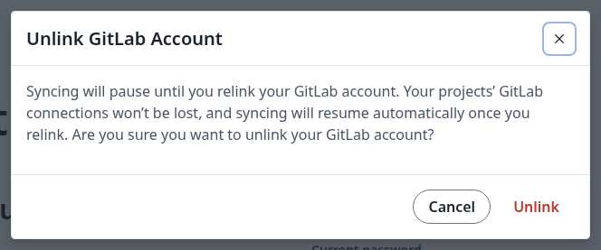

Forbind et projekt med et GitLab-repository. Ændringer går begge veje, og kun når du klikker på **Sync**: intet synkroniseres af sig selv.

<Info>

En administrator skal først slå [GitLab-synkronisering](/da/on-premises/configuration/overleaf-toolkit/integrations/gitlab-synchronisation) til.

</Info>

## Tilknyt din GitLab-konto {#link-your-gitlab-account}

Det gør du én gang.

<Steps>
<Step title="Åbn dine kontoindstillinger">
Klik på **Account** og derefter på **Account settings**. Under **Project synchronisation** finder du **GitLab** og klikker på **Link**.

<Frame caption="GitLab i kontoindstillingerne">
  
</Frame>
</Step>

<Step title="Godkend på GitLab">
GitLab åbnes. Log ind, hvis du bliver bedt om det, og godkend derefter programmet.
</Step>

<Step title="Kontrollér tilknytningen">
Du er tilbage i kontoindstillingerne. En grøn meddelelse siger, at din GitLab-konto er tilknyttet, og på knappen står der nu **Unlink**.

<Frame caption="Din GitLab-konto er tilknyttet">
  
</Frame>
</Step>
</Steps>

Hvis din konto endnu ikke er tilknyttet, beder **Import from GitLab** og kortet **GitLab** i editoren dig om at tilknytte den først. Klik på **Link to your GitLab account**. Så ender du også i kontoindstillingerne, i en ny fane, hvis du startede i editoren. Gå derefter tilbage, og start forfra.

<Frame caption="Meddelelsen, når din konto ikke er tilknyttet">
  
</Frame>

## Importér et repository {#import-a-repository}

Dette opretter et nyt projekt fra et GitLab-repository, der allerede er tilknyttet det.

<Steps>
<Step title="Åbn importdialogboksen">
Klik på **New project** på projektsiden og derefter på **Import from GitLab**.

<Frame caption="Menuen New project">
  
</Frame>
</Step>

<Step title="Vælg repository">
Klik på **Import to Overleaf** ud for repositoryet. Listen indeholder dine repositories og dine gruppers.

<Frame caption="Dine GitLab-repositories">
  
</Frame>
</Step>

<Step title="Kontrollér projektet">
Det nye projekt åbnes med repositoryets filer.

<Frame caption="Det importerede projekt">
  
</Frame>
</Step>
</Steps>

## Eksportér et projekt til et nyt repository {#export-a-project-to-a-new-repository}

Dette opretter et repository fra et projekt og tilknytter dem. Et projekt kan kun tilknyttes på denne måde eller ved import: du kan ikke tilknytte det til et repository, der allerede findes.

<Steps>
<Step title="Åbn GitLab i editoren">
Åbn projektet. Klik på **Integrations** i venstre bjælke og derefter på **GitLab**.

<Frame caption="Panelet Integrations">
  
</Frame>
</Step>

<Step title="Udfyld repositoryet">
Vælg **Owner**, som kan være dig eller en af dine grupper. Når du vælger en gruppe, hedder feltet **Organization**. **Repository Name** er fra starten projektets navn. Beskrivelsen er valgfri, og **Private** er valgt som standard. Klik på **Create a GitLab repository**.

<Frame caption="Export Project to GitLab">
  
</Frame>

Hvis navnet allerede er taget, viser dialogboksen <strong>Please check that the repository name is valid, and that you have permission to create the repository.</strong> Ret navnet, og klik på knappen igen.
</Step>

<Step title="Kontrollér tilknytningen">
Dialogboksen viser nu **This project is linked to** og navnet på repositoryet.

<Frame caption="Projektet er tilknyttet">
  
</Frame>
</Step>
</Steps>

## Synkronisér {#sync}

<Steps>
<Step title="Åbn synkroniseringsdialogboksen">
Åbn et tilknyttet projekt. Klik på **Integrations** i venstre bjælke og derefter på **GitLab**.

**Recent commits in GitLab** viser, hvad der kommer ind i projektet.

<Frame caption="Et nyt commit venter på GitLab">
  
</Frame>
</Step>

<Step title="Beskriv dine ændringer">
Hvis du har ændret noget i projektet, vises et felt til commit-beskeden. Det er valgfrit: hvis du lader det stå tomt, hedder commitet `Updates from Overleaf`.

<Frame caption="Commit-beskeden for dine ændringer">
  
</Frame>
</Step>

<Step title="Klik på Sync">
Klik på **Sync**. Nye commits fra GitLab kommer ind i projektet, og dine ændringer går til repositoryets standardgren. Hvis begge sider har ændret forskellige ting, flettes de for dig.
</Step>

<Step title="Kontrollér resultatet">
Dialogboksen viser <strong>No new commits in GitLab since last merge.</strong>, og feltet til commit-beskeden er væk. Filerne i editoren og commits på GitLab er opdaterede.

<Frame caption="Alt er synkroniseret">
  
</Frame>
</Step>
</Steps>

### Hvis de samme linjer er ændret på begge sider {#if-the-same-lines-changed-on-both-sides}

Dialogboksen siger, at ændringerne ikke kunne flettes, og nævner en ny gren, `overleaf-YYYY-MM-DD-HHMMSS`, som indeholder dine ændringer. Overleaf åbner også en merge request fra den gren på GitLab.

<Frame caption="En konflikt">
  
</Frame>

1. Flet den gren ind i standardgrenen på GitLab eller med Git. Du kan lukke dialogboksen i mellemtiden: den viser den samme meddelelse, når du åbner den igen.
2. Klik på **I have manually merged. Continue**. Det flettede resultat kommer ind i projektet. Hvis du klikker, før grenen er flettet, forbliver dialogboksen uændret.
3. Grenen bliver på GitLab, medmindre du slettede den ved fletningen. Slet den, når du ikke længere har brug for den.

Den samme dialogboks vises, når repositoryets fletteregler holder merge requesten tilbage, for eksempel når den kræver en godkendelse, selv om ingen linjer er i konflikt. Når reglen tillader det, fletter du merge requesten på GitLab og klikker på **I have manually merged. Continue**. Se [Sådan fungerer synkronisering med GitLab](/da/on-premises/configuration/overleaf-toolkit/integrations/gitlab-synchronisation#how-syncing-works-with-gitlab).

## Fjern tilknytningen af et projekt {#unlink-a-project}

Gør dette, når du ikke længere vil have, at projektet synkroniseres.

<Steps>
<Step title="Klik på Unlink">
Klik på **Unlink** i synkroniseringsdialogboksen.
</Step>

<Step title="Bekræft">
Klik på **Confirm**. Dette fjerner kun tilknytningen: forbindelsen til et repository, du ejer, som advarslen nævner, er en mulighed, du har bagefter, ikke noget, der sker nu.

<Frame caption="Bekræft fjernelsen af tilknytningen">
  
</Frame>
</Step>

<Step title="Kontrollér resultatet">
Dialogboksen viser nu **Export Project to GitLab**. Både projektet og repositoryet beholder deres indhold. For at synkronisere igen eksporterer du projektet til et nyt repository eller importerer repositoryet til et nyt projekt.
</Step>
</Steps>

## Fjern tilknytningen af din GitLab-konto {#unlink-your-gitlab-account}

I **Account settings**, under **GitLab**, klikker du på **Unlink** og derefter på **Unlink** igen i dialogboksen.

<Frame caption="Fjern tilknytningen af din konto">
  
</Frame>

Dine projekter forbliver tilknyttet deres repositories. Du kan ikke synkronisere dem, før du tilknytter din konto igen.

<Info>

Hvem der kan gøre hvad i et delt projekt, finder du i [Hvem kan tilknytte og synkronisere](/da/on-premises/configuration/overleaf-toolkit/integrations/gitlab-synchronisation#who-can-link-and-sync).

</Info>
