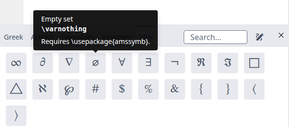
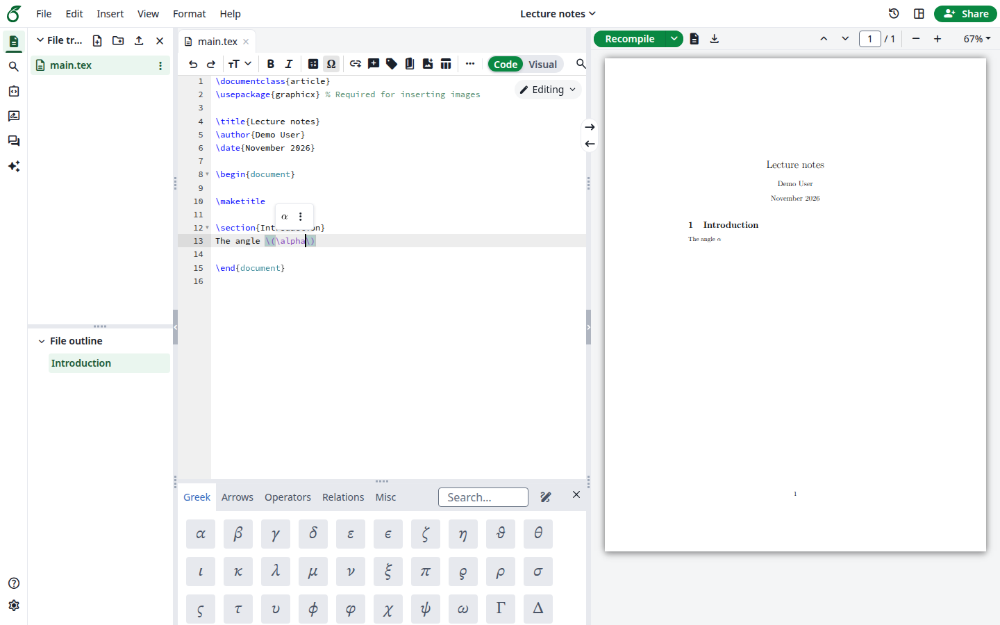

Symbolpaletten indsætter matematiske symboler i dit dokument. Hvis du ikke kender et symbols navn, så tegn det, og din browser finder kommandoen. Intet skal sættes op.

## Indsæt et symbol {#insert-a-symbol}

<Steps>
<Step title="Placer markøren i matematiktilstand">
De fleste symboler virker kun i matematiktilstand. Klik der, hvor symbolet skal stå. Klik på **Insert math** i editorens værktøjslinje og derefter på **Inline**. Markøren står nu mellem `\(` og `\)`.

<Frame caption="Menuen Insert math">
  
</Frame>
</Step>

<Step title="Åbn paletten">
Klik på knappen **Ω**, **Insert symbol**, i værktøjslinjen. Du kan også klikke på **Insert** og derefter **Symbol** øverst på siden. Paletten åbnes under editoren.

<Frame caption="Symbolpaletten">
  
</Frame>
</Step>

<Step title="Find symbolet">
Klik på en fane: **Greek**, **Arrows**, **Operators**, **Relations** eller **Misc**. Hold markøren over et symbol for at se dets navn og kommando. Nogle viser også en note, f.eks. den pakke, de kræver.

<Frame caption="Et symbols navn, kommando og note">
  
</Frame>
</Step>

<Step title="Klik på det">
Kommandoen vises ved markøren. Paletten forbliver åben, så du straks kan tilføje det næste symbol. Klik på **Recompile** for at se symbolet i PDF'en.

<Frame caption="Symbolet i dokumentet og PDF'en">
  
</Frame>
</Step>
</Steps>

Paletten fungerer på samme måde i **Visual**-editoren.

## Søg efter et symbol {#search-for-a-symbol}

Skriv i feltet **Search**. Du kan søge efter en kommando (`\sum`), et ord fra symbolets navn (`arrow`) eller selve tegnet (`α`). Søgningen dækker alle fanerne. Ryd feltet for at gå tilbage til fanerne.

<Frame caption="Søgning efter arrow">
  
</Frame>

Hvis intet matcher, viser paletten **No symbols found**.

## Tegn et symbol {#draw-a-symbol}

Brug dette, når du kan forestille dig et symbol, men ikke kender dets navn.

<Steps>
<Step title="Klik på blyantikonet">
Klik på blyantikonet, **Draw a symbol**, til højre for feltet **Search**. Fanerne nedtones, og en stiplet boks vises til højre.

<strong>Loading model…</strong> vises, indtil genkendelsen er klar. Første gang downloader din browser cirka 40 MB fra dit websted. Derefter beholder den filerne.

<Frame caption="Tegnetilstand">
  
</Frame>
</Step>

<Step title="Tegn i den stiplede boks">
Når du afslutter et strøg, vises op til ti match til venstre, det nærmeste først. Hold markøren over et match for at se dets kommando. For et symbol med flere strøg opdateres matchene efter hvert strøg.

<Frame caption="Matchene for en tegning">
  
</Frame>
</Step>

<Step title="Klik på matchet">
Kommandoen vises ved markøren. Din tegning bliver stående, så du kan prøve et andet match. Klik på **Clear**, før du tegner det næste symbol.

<Frame caption="Kommandoen ved markøren">
  
</Frame>
</Step>
</Steps>

For at gå tilbage til fanerne skal du klikke på blyantikonet igen eller klikke i feltet **Search**.

Genkendelsen kører i din browser. Din tegning sendes ikke til dit websted.

### Match, der kræver en pakke {#matches-that-need-a-package}

Tegning kender mere end 1.300 kommandoer, mens fanerne viser 117. Mange af de andre kommer fra en LaTeX-pakke. I så fald viser værktøjstippet den linje, der skal tilføjes.

<Frame caption="Et match, der kræver en pakke">
  
</Frame>

Tilføj linjen i din præambel før `\begin{document}`:

```latex
\usepackage{amssymb}
```

Paletten tilføjer den ikke for dig.

## Brug tastaturet {#use-the-keyboard}

Tryk på Tab fra feltet **Search**, indtil et symbol er valgt. Piletasterne flytter mellem symbolerne. Enter indsætter det valgte symbol og lukker paletten.

## Luk paletten {#close-the-palette}

Klik på <strong>×</strong> øverst til højre i paletten. Knappen **Ω** samt **Insert** og derefter **Symbol** lukker den også.

## Hvis noget går galt {#if-something-goes-wrong}

| Hvad du ser | Hvorfor | Hvad du skal gøre |
| ------------ | --- | ---------- |
| Kompileringen siger **Missing \$ inserted** | Symbolet står uden for matematiktilstand | Flyt det mellem `\(` og `\)`, eller brug **Insert math** først |
| Kompileringen siger **Undefined control sequence** | Kommandoen kræver en pakke | Hold markøren over symbolet i paletten for at se hvilken, og tilføj den til din præambel |
| Der er intet blyantikon | Din browser kan ikke køre genkendelsen, f.eks. Safari 15 | Opdater din browser, eller brug en anden. Fanerne og søgningen virker stadig |
| **Recognition unavailable** under den stiplede boks | Browseren kunne ikke indlæse genkendelsesfilerne | Klik på **Please try again** |
