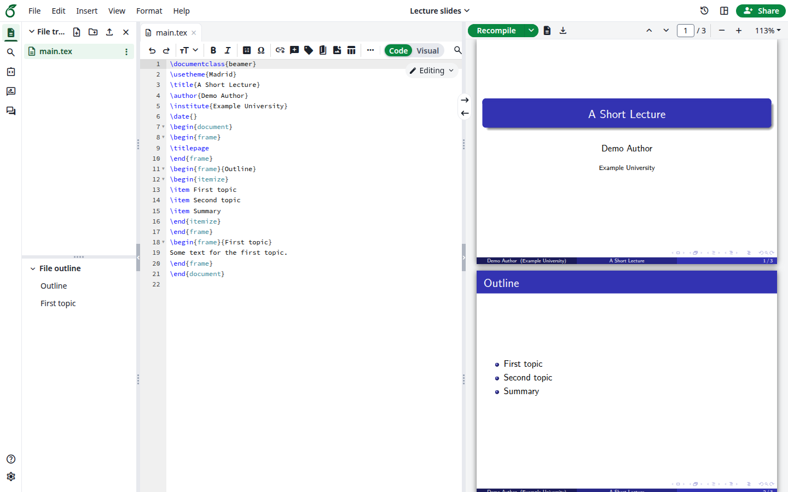

Skabeloner er projekter, som din administrator har udgivet. Når du åbner en, får du et nyt projekt, der er dit eget.

<Info>

Hvis du ikke ser noget **Templates**-link, så bed din administrator om at slå [skabelongalleriet](/da/on-premises/configuration/overleaf-toolkit/templates) til.

</Info>

## Åbn galleriet {#open-the-gallery}

Klik på **Templates** øverst til højre på projektsiden.

<Frame caption="Linket Templates">
  
</Frame>

Siden **All templates** åbnes med de senest opdaterede skabeloner først.

<Frame caption="Alle skabeloner">
  
</Frame>

Hvis du endnu ikke har nogen projekter, så klik på **Browse templates** på velkomstsiden.

<Frame caption="Velkomstsiden">
  
</Frame>

Hvis du har projekter, kan du også klikke på **New project**, derefter **More templates** og så en kategori.

<Frame caption="More templates">
  
</Frame>

Som standard kræver galleriet login: Hvis nogen sender dig et link til en skabelon, og du ikke er logget ind, kommer du først til loginsiden og derefter til skabelonen.

## Find en skabelon {#find-a-template}

**Søg** i feltet. Listen opdateres, mens du skriver, og matcher titel, forfatter og beskrivelse. Hvis intet matcher, viser siden <strong>No Templates.</strong>

<Frame caption="Søgning efter slides">
  
</Frame>

**Sorter** med **Last Updated** eller **Title**, til højre over listen. Klik på den aktive sortering igen for at vende rækkefølgen.

**Skift side** under listen. En side viser ni skabeloner.

<Frame caption="Sideknapperne">
  
</Frame>

<strong>Gennemse efter kategori:</strong> klik på **Template Gallery** på siden **All templates**. Gallerisiden har et kort for hver kategori med alle skabeloner nedenunder.

<Frame caption="Kategorierne">
  
</Frame>

Klik på et kort for at se skabelonerne i den kategori. Du kan også søge og sortere her, og **All templates** fører dig tilbage.

<Frame caption="En kategoriside">
  
</Frame>

## Åbn en skabelon som et nyt projekt {#open-a-template-as-a-new-project}

<Steps>
<Step title="Åbn skabelonen">
Klik på en skabelon. Du ser et eksempel på den første side, forfatteren, den seneste opdatering, licensen og resuméet.

<Frame caption="Skabelonsiden">
  
</Frame>

**View PDF** åbner hele PDF'en. Knappen ved siden af downloader filerne som zip.
</Step>

<Step title="Klik på Open as Template">
Efter en kort indlæsningsskærm åbner editoren med dit nye projekt.

<Frame caption="Dit nye projekt">
  
</Frame>
</Step>

<Step title="Tjek projektet">
Projektet har skabelonens navn og filer samt samme compiler og hoveddokument. Det kompileres, når det åbnes, og du er ejer på projektlisten.

Hvis du åbner den samme skabelon igen, oprettes endnu et projekt, f.eks. `Journal article (1)`.

<Frame caption="Hver åbning opretter et projekt">
  
</Frame>
</Step>
</Steps>

Dit projekt afhænger ikke af skabelonen: det forbliver, som det er, når skabelonen opdateres eller slettes.

<Info>

En almindelig konto kan ikke udgive eller ændre skabeloner: menuen **File** har ingen **Manage Template**, og skabelonsiden har hverken **Edit** eller **Delete**. Bed din administrator om at tilføje en skabelon til galleriet.

</Info>
