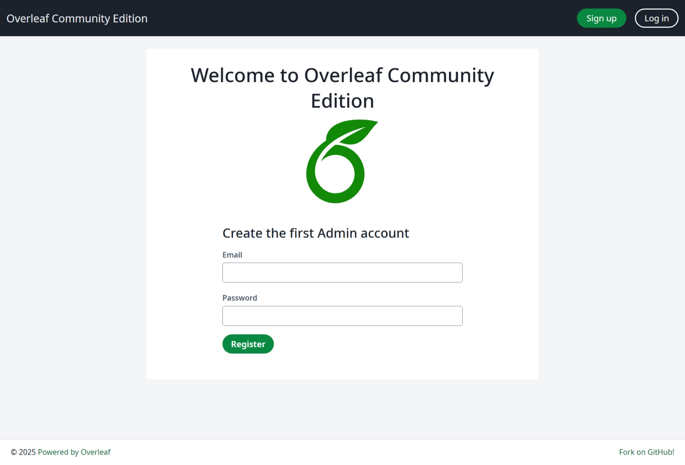

Um Zeit zu sparen und die Entwicklungsumgebung schnell aufzubauen, stellen wir eine weitere Variante der Konfiguration der Entwicklungsumgebung bereit: GitHub Codespace.

## Konfigurationsanleitung {#configuration-tutorial}

<Steps>
<Step title="Codespaces erstellen">
Klicken Sie auf die folgende Schaltfläche, um einen Cloud-Codespace für die Entwicklung von server-pro zu erstellen.

[](https://codespaces.new/ayaka-notes/ayakaleaf-pro)

Es wird empfohlen, als **Machine Type** mindestens **4-core** zu wählen. Für größere Maschinentypen können Sie beim offiziellen Support-Team von GitHub [hier](https://support.github.com/contact?tags=rr-codespaces%2Ccat_codespaces) ein Ticket einreichen.

<Frame>
  
</Frame>
</Step>

<Step title="Setup-Skript ausführen">
Sie müssen geduldig warten, bis der Codespace erstellt ist. Sobald Sie Zugriff auf Ihr Terminal haben, führen Sie den folgenden Befehl aus:

```text
cd develop/
bin/setup
bin/i18n
```

`bin/setup` lädt die Images herunter und startet die Dienste; `bin/i18n` wendet anschließend die Übersetzungen der Ayakaleaf-Pro-Module an, die in den committeten Locale-Dateien nicht enthalten sind, siehe [i18n-Übersetzungen aktualisieren](/de/dev/environment/update-i18n-translations).

<Frame>
  
</Frame>

<Warning>

Mit diesem Skript (`bin/setup`) können Sie die Entwicklungsumgebung in kürzester Zeit auf dem neuesten Commit des Branches `server-pro` einrichten. Für ältere Versionen bzw. andere Branches ist es möglicherweise nicht geeignet.

Wir bauen das Docker-Image für die Entwicklung täglich mit [GitHub Action](https://github.com/ayaka-notes/ayakaleaf-pro/actions).

</Warning>
</Step>

<Step title="Auf das Launchpad zugreifen">
Wechseln Sie zum Tab „Ports“; dort sehen Sie eine Liste der verfügbaren Web-Ports. Klicken Sie auf den Port `80` (der `OVERLEAF_PORT` in `develop/dev.rc`). Jetzt sollten Sie die Launchpad-Seite sehen. Mailpit, Grafana, Mongo Express und RedisInsight liegen unter Pfaden desselben Ports (`/mailpit/`, `/grafana/`, `/mongo-express/` und `/redis-insight/`), und das Menü **Dev tools** der Website verlinkt auf sie, sobald Sie angemeldet sind. Die RustFS-Konsole liegt auf 9001 und Hoppscotch auf 9170, siehe [Ports](/de/dev/environment/setup-develop-environment-local#ports).

<Frame>
  
</Frame>

Sie sehen dann:

<Frame>
  
</Frame>
</Step>

<Step title="Viel Spaß beim Entwickeln">
Jetzt ist Ihre Zeit gekommen! Beginnen Sie mit der Entwicklung Ihrer großartigen Funktion. `bin/setup` startet bereits jeden Dienst im Entwicklungsmodus (`node --watch`, wie `bin/dev`), sodass Codeänderungen ohne weiteren Befehl sichtbar werden.

Führen Sie nach einer Änderung an `develop/dev.rc` erneut `bin/setup` aus: Es läuft über `bin/docker-compose`, das die Dateien der eingeschalteten Funktionen hinzufügt.

<Warning>

Starten Sie die Dienste nicht von Hand mit `docker compose -f docker-compose.yml -f docker-compose.dev.yml -f docker-compose.image.yml up`. Dabei werden die Funktionsdateien von `dev.rc` übersprungen, sodass `web`, `filestore` und `history-v1` ohne die RustFS-Einstellungen neu erstellt werden und auf lokale Volumes zurückfallen, in denen der Verlauf und die Binärdateien Ihrer Projekte fehlen.

</Warning>
</Step>
</Steps>
