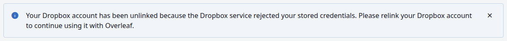

Halten Sie alle Ihre Projekte mit einem Ordner in Ihrer Dropbox synchron. Änderungen fließen im Hintergrund in beide Richtungen, mit einer Ausnahme: Was Sie im Editor tippen, erreicht Dropbox einige Minuten nachdem Sie das Projekt verlassen haben oder wenn Sie auf **sync this project now** klicken.

<Info>

Wenn Sie in **Account settings** oder im Editor keine Dropbox-Option sehen, bitten Sie Ihren Administrator, die [Dropbox-Synchronisierung](/de/on-premises/configuration/overleaf-toolkit/integrations/dropbox-synchronisation) zu aktivieren.

</Info>

## Ihr Dropbox-Konto verknüpfen {#link-your-dropbox-account}

Das tun Sie nur einmal.

<Steps>
<Step title="Kontoeinstellungen öffnen">
Klicken Sie auf **Account** und dann auf **Account settings**. Suchen Sie unter **Project synchronisation** nach **Dropbox** und klicken Sie auf **Link**.

<Frame caption="Dropbox in den Kontoeinstellungen">
  
</Frame>
</Step>

<Step title="Auf Dropbox autorisieren">
Dropbox öffnet sich. Melden Sie sich an, falls Sie dazu aufgefordert werden, und autorisieren Sie dann die Anwendung.
</Step>

<Step title="Verknüpfung prüfen">
Sie sind zurück in den Kontoeinstellungen. Eine grüne Meldung bestätigt, dass Ihr Dropbox-Konto verknüpft ist, und die Schaltfläche heißt jetzt **Unlink**. Unter Dropbox zeigt ein Status, dass Ihre Projekte gesendet werden.

<Frame caption="Ihr Dropbox-Konto ist verknüpft">
  
</Frame>

Der Status wechselt zu **Overleaf and Dropbox have processed all updates**, wenn alle angekommen sind.

<Frame caption="Alles ist synchron">
  
</Frame>
</Step>
</Steps>

Wenn Ihr Konto noch nicht verknüpft ist, fordert die Karte **Dropbox** im Editor Sie auf, es zuerst zu verknüpfen. Klicken Sie auf **Update Dropbox Settings**: Die Kontoeinstellungen öffnen sich in einem neuen Tab. Verknüpfen Sie dort Ihr Konto und laden Sie dann die Editorseite neu, wie der Dialog es Ihnen sagt.

<Frame caption="Die Aufforderung, wenn Ihr Konto nicht verknüpft ist">
  
</Frame>

Wenn Sie den Zugriff auf Dropbox nicht erlauben, kehren Sie ohne Meldung zu den Kontoeinstellungen zurück, und die Schaltfläche heißt weiterhin **Link**.

### Wenn Sie Projekte mit demselben Namen haben {#if-you-have-projects-with-the-same-name}

Sie können nicht verknüpfen, solange zwei Ihrer Projekte denselben Namen tragen. Die Meldung nennt sie. Archivierte Projekte und Projekte im Papierkorb zählen ebenfalls.

<Frame caption="Zwei Projekte mit demselben Namen">
  
</Frame>

Benennen Sie eines davon um und klicken Sie erneut auf **Link**.

## Ihre Projekte in Dropbox finden {#find-your-projects-in-dropbox}

Jedes Ihrer Projekte ist ein Ordner in `Apps/<app name>/` in Ihrer Dropbox, mit allen seinen Dateien. Den App-Namen hat Ihr Administrator gewählt. Jedes Projekt wird synchronisiert, auch die, die Sie später erstellen: Sie können keine Auswahl treffen.

Um den Ordner eines Projekts zu sehen, öffnen Sie das Projekt. Klicken Sie in der linken Leiste auf **Integrations** und dann auf **Dropbox**.

<Frame caption="Das Panel Integrations">
  
</Frame>

Der Dialog nennt den Ordner und verlinkt ihn auf Dropbox.

<Frame caption="Der Ordner dieses Projekts">
  
</Frame>

Ein neues Projekt, das wie ein bereits vorhandenes heißt, erhält einen nummerierten Ordner, zum Beispiel `Field notes (1)`. Der Dialog zeigt, welcher Ordner zu ihm gehört.

<Frame caption="Ein nummerierter Ordner">
  
</Frame>

## Änderungen, die Sie in Overleaf vornehmen {#changes-you-make-in-overleaf}

Sie müssen auf nichts klicken.

* **Neue Dateien, Umbenennungen, Verschiebungen und Löschungen** erreichen Dropbox sofort. Ein neuer Ordner erscheint dort mit seiner ersten Datei.
* **Das Umbenennen eines Projekts** benennt seinen Ordner um.
* **Bearbeitungen, die Sie im Editor tippen**, erreichen Dropbox nicht, solange das Projekt geöffnet ist, und ein Klick auf **Recompile** sendet sie nicht. Sie werden etwa drei Minuten nachdem alle das Projekt verlassen haben übertragen. Um sie früher zu senden, siehe [Eine Synchronisierung erzwingen](#force-a-sync).
* **Das Löschen eines Projekts** lässt seinen Ordner in Dropbox bestehen. Löschen Sie den Ordner selbst, wenn Sie ihn nicht mehr brauchen.

## Änderungen, die Sie in Dropbox vornehmen {#changes-you-make-in-dropbox}

Auch hier müssen Sie auf nichts klicken. Dropbox teilt Overleaf die Änderung mit, und sie erscheint meist innerhalb von Sekunden, auch in einem geöffneten Editor, ohne Neuladen.

* **Neue Dateien, Bearbeitungen, Umbenennungen und Löschungen** in einem Projektordner werden auf das Projekt angewendet. Ebenso neue Ordner.
* **Ein neuer Ordner auf oberster Ebene des App-Ordners** wird zu einem neuen Projekt.
* **Dateien, die Overleaf nicht synchronisiert**, etwa `.DS_Store`- oder `.aux`-Dateien, bleiben nur in Dropbox.

Der Verlauf des Projekts kennzeichnet diese Änderungen mit <strong>(via Dropbox)</strong>.

### Wenn die Datei im Editor geöffnet ist {#if-the-file-is-open-in-the-editor}

Die Datei ändert sich vor Ihren Augen, und ein Dialog weist Sie darauf hin. Klicken Sie auf **OK**.

<Frame caption="Eine geöffnete Datei wurde in Dropbox geändert">
  
</Frame>

Die Dropbox-Version ersetzt, was Sie getippt und noch nicht gesendet hatten. Ihr Text geht nicht verloren: Er bleibt im Verlauf des Projekts.

<Frame caption="Der ersetzte Text im Verlauf">
  
</Frame>

### Einen Projektordner umbenennen oder löschen {#rename-or-delete-a-project-folder}

Benennen Sie ein Projekt in Overleaf um, nicht in Dropbox. Für Overleaf ist ein in Dropbox umbenannter Ordner ein gelöschter Ordner und ein neuer: Sie erhalten ein neues Projekt mit dem neuen Namen, und das alte Projekt bleibt bestehen.

Wenn Sie einen Projektordner in Dropbox löschen, bleibt das Projekt mit seinen Dateien und seinem Verlauf in Ihrer Projektliste. Wenn Sie es das nächste Mal öffnen, weist ein Dialog Sie einmalig darauf hin. Klicken Sie auf **OK**.

<Frame caption="Der Ordner dieses Projekts fehlt in Dropbox">
  
</Frame>

Das Projekt wird weiter synchronisiert. Um es vollständig wieder in Dropbox abzulegen, klicken Sie auf **sync this project now**.

### Solange ein Projekt archiviert ist oder im Papierkorb liegt {#while-a-project-is-archived-or-in-the-trash}

Änderungen, die Sie in seinem Ordner in Dropbox vornehmen, werden nicht angewendet, und auch das Wiederherstellen des Projekts übernimmt sie nicht. Overleaf sendet die von Ihnen geänderten Dateien dann nicht mehr, sodass sich beide Seiten unterscheiden. Speichern Sie eine solche Datei in Dropbox noch einmal: Die Dropbox-Version ersetzt dann die in Overleaf.

## Eine Synchronisierung erzwingen {#force-a-sync}

Jedes Projekt hat einen eigenen Link. Verwenden Sie ihn, wenn Ihre Bearbeitungen sofort in Dropbox sein sollen, ohne das Projekt zu verlassen.

<Steps>
<Step title="Synchronisierungsdialog öffnen">
Öffnen Sie das Projekt. Klicken Sie in der linken Leiste auf **Integrations** und dann auf **Dropbox**.
</Step>

<Step title="Auf sync this project now klicken">
Der Link steht am Ende von <strong>Changes not appearing in Dropbox?</strong>
</Step>

<Step title="Ergebnis prüfen">
Eine blaue Meldung zeigt an, dass eine manuelle Synchronisierung begonnen hat, und der Status zeigt **Sending and receiving updates**. Er wechselt zurück zu **Overleaf and Dropbox have processed all updates**, wenn die Synchronisierung abgeschlossen ist.

<Frame caption="Eine manuelle Synchronisierung läuft">
  
</Frame>
</Step>
</Steps>

Der Link sendet das ganze Projekt an Dropbox, einschließlich der Bearbeitungen, die noch im Editor sind. Außerdem liest er die in Dropbox wartenden Änderungen für alle Ihre Projekte. Wenn Ihre Website keine [Benachrichtigungen von Dropbox](/de/on-premises/configuration/overleaf-toolkit/integrations/dropbox-synchronisation#webhook) empfangen kann, kommen Änderungen aus Dropbox nur auf diesem Weg an.

Sie können das einmal pro Minute und Projekt tun. Wenn Sie es früher versuchen, bittet Sie eine rote Meldung zu warten.

<Frame caption="Warten Sie eine Minute bis zur nächsten">
  
</Frame>

## Die Verknüpfung Ihres Dropbox-Kontos aufheben {#unlink-your-dropbox-account}

<Steps>
<Step title="Auf Unlink klicken">
Klicken Sie in **Account settings** unter **Dropbox** auf **Unlink**.
</Step>

<Step title="Bestätigen">
Klicken Sie im Dialog auf **Unlink**.

<Frame caption="Verknüpfung Ihres Kontos aufheben">
  
</Frame>
</Step>

<Step title="Ergebnis prüfen">
Die Schaltfläche heißt wieder **Link**, und die Karte **Dropbox** im Editor zeigt an, dass Ihr Konto nicht verknüpft ist. Es wird in keiner Richtung mehr etwas synchronisiert. Ihre Projekte und die Ordner in Dropbox behalten ihre Dateien.
</Step>
</Steps>

### Später erneut verknüpfen {#link-again-later}

Klicken Sie auf **Link**. Ihre Projekte werden erneut an Dropbox gesendet:

* Jede Datei ersetzt die gleichnamige Datei in Dropbox. Was Sie in diesen Dateien in Dropbox geändert haben, während die Verknüpfung aufgehoben war, wird überschrieben, also übertragen Sie solche Änderungen zuerst in das Projekt.
* Eine Datei, die nur in Dropbox existiert, bleibt dort und kommt in das Projekt, wenn Sie sie das nächste Mal ändern.
* Ein Projekt, das Sie ohne Verknüpfung umbenannt haben, erhält einen neuen Ordner. Der alte Ordner bleibt bestehen.

### Wenn Overleaf die Verknüpfung Ihres Kontos aufhebt {#if-overleaf-unlinks-your-account}

Overleaf hebt die Verknüpfung Ihres Kontos auf, wenn Dropbox die Verknüpfung nicht mehr akzeptiert. Die Projektliste zeigt den Grund an, bis Sie erneut verknüpfen.

<Frame caption="Die Verknüpfung Ihres Kontos wurde aufgehoben">
  
</Frame>

Die Gründe finden Sie im Q\&A der [Dropbox-Synchronisierung](/de/on-premises/configuration/overleaf-toolkit/integrations/dropbox-synchronisation).

<Info>

Was Mitarbeitende in einem geteilten Projekt erhalten, erfahren Sie unter [So funktioniert die Synchronisierung](/de/on-premises/configuration/overleaf-toolkit/integrations/dropbox-synchronisation#so-funktioniert-die-synchronisierung).

</Info>
