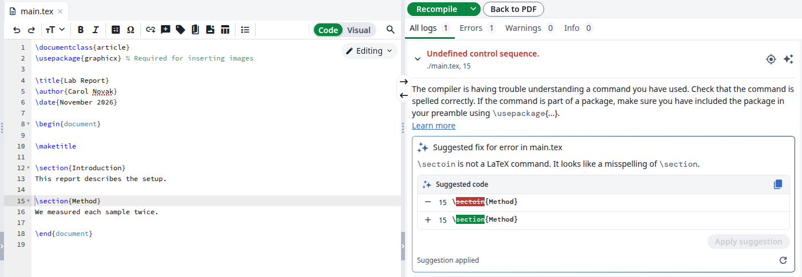

<Info>

Wenn ein Log-Eintrag keine Schaltfläche **Suggest fix** hat, verweisen Sie Ihren Administrator auf [KI-Integration](/de/on-premises/configuration/overleaf-toolkit/integrations/ai-integration).

</Info>

<Steps>
<Step title="Logs öffnen">
Nach einer Kompilierung mit Fehlern erscheint eine rote Zahl am Log-Symbol neben **Recompile**, und ein roter Punkt markiert die Zeile im Editor. Klicken Sie auf das Symbol. Wenn die Kompilierung kein PDF erzeugt hat, sind die Logs bereits geöffnet.

<Frame caption="Eine Kompilierung mit einem Fehler">
  
</Frame>
</Step>

<Step title="Auf Suggest fix klicken">
Klicken Sie rechts im Log-Eintrag auf das Funkelsymbol **Suggest fix**. Auch Warnungen, die auf eine Datei Ihres Projekts verweisen, haben es.

<Frame caption="Die Schaltfläche Suggest fix">
  
</Frame>

Beim ersten Mal steht im Eintrag **Before you use Error Assist**. Klicken Sie auf **Accept and continue**. Das tun Sie nur einmal, und es gilt auch für den [KI-Assistenten](/de/on-premises/user-guide/users/ai-assistant).

<Frame caption="Wird einmal angezeigt">
  
</Frame>
</Step>

<Step title="Vorschlag lesen">
Der Eintrag erklärt den Fehler und zeigt die zu ändernde Zeile: den alten Text in der Zeile <strong>-</strong> und den neuen Text in der Zeile <strong>+</strong>. Ein Klick auf die Zeilennummer bringt Sie zu dieser Zeile im Editor, und das Kopiersymbol kopiert den neuen Text.

<Frame caption="Eine vorgeschlagene Korrektur">
  
</Frame>

Wenn der Assistent keine Korrektur hat, erklärt er nur, und es gibt nichts zu übernehmen. Das Aktualisierungssymbol **Suggest a different fix** fragt erneut.
</Step>

<Step title="Übernehmen oder verwerfen">
Zum Übernehmen klicken Sie auf **Apply suggestion**. Die Zeile ändert sich im Editor, im Eintrag steht **Suggestion applied**, und das Projekt wird neu kompiliert. Sobald kein Fehler mehr übrig ist, ist das PDF wieder da. Um die Änderung rückgängig zu machen, drücken Sie im Editor `Ctrl+Z`.

<Frame caption="Die Korrektur ist übernommen">
  
</Frame>

Zum Verwerfen tun Sie nichts: Es gibt keine Schaltfläche zum Ablehnen, und das Dokument bleibt unverändert, bis Sie auf **Apply suggestion** klicken.

Wenn Sie diese Zeile vorher bearbeiten, ist **Apply suggestion** deaktiviert. Klicken Sie auf **Suggest a different fix**, um einen neuen Vorschlag zu erhalten.
</Step>
</Steps>

## Den Vorschlag wiederfinden {#find-the-suggestion-again}

Nach der nächsten Kompilierung führen die Logs den Vorschlag als **Last suggested fix**, ob Sie ihn übernommen haben oder nicht. Klicken Sie auf den Pfeil, um ihn zu öffnen.

<Frame caption="Der letzte Vorschlag bleibt in den Logs">
  
</Frame>

Der Fehlerassistent zählt zum selben Limit wie der KI-Assistent, siehe [Token-Nutzung](/de/on-premises/user-guide/users/ai-assistant#token-usage).
