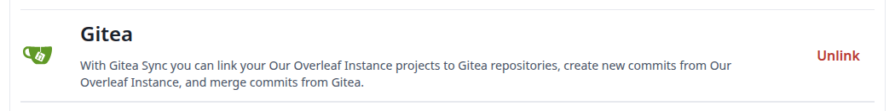

Verbinden Sie ein Projekt mit einem Gitea-Repository. Änderungen fließen in beide Richtungen, und zwar nur, wenn Sie auf **Sync** klicken: Nichts wird von selbst synchronisiert.

<Info>

Ein Administrator muss zuerst die [Gitea-Synchronisierung](/de/on-premises/configuration/overleaf-toolkit/integrations/gitea-synchronisation) aktivieren.

</Info>

## Ihr Gitea-Konto verknüpfen {#link-your-gitea-account}

Das tun Sie nur einmal.

<Steps>
<Step title="Kontoeinstellungen öffnen">
Klicken Sie auf **Account** und dann auf **Account settings**. Suchen Sie unter **Project synchronisation** nach **Gitea** und klicken Sie auf **Link**.

<Frame caption="Gitea in den Kontoeinstellungen">
  
</Frame>
</Step>

<Step title="Auf Gitea autorisieren">
Gitea öffnet sich. Melden Sie sich an, falls Sie dazu aufgefordert werden, und autorisieren Sie dann die Anwendung.
</Step>

<Step title="Verknüpfung prüfen">
Sie sind zurück in den Kontoeinstellungen. Eine grüne Meldung bestätigt, dass Ihr Gitea-Konto verknüpft ist, und die Schaltfläche heißt jetzt **Unlink**.

<Frame caption="Ihr Gitea-Konto ist verknüpft">
  
</Frame>
</Step>
</Steps>

Wenn Ihr Konto noch nicht verknüpft ist, fordern **Import from Gitea** und die Karte **Gitea** im Editor Sie auf, es zuerst zu verknüpfen. Klicken Sie auf **Link to your Gitea account**. Auch so landen Sie in den Kontoeinstellungen, in einem neuen Tab, wenn Sie im Editor begonnen haben. Gehen Sie dann zurück und beginnen Sie erneut.

<Frame caption="Die Aufforderung, wenn Ihr Konto nicht verknüpft ist">
  
</Frame>

## Ein Repository importieren {#import-a-repository}

Dadurch entsteht aus einem Gitea-Repository ein neues Projekt, das bereits mit ihm verknüpft ist.

<Steps>
<Step title="Importdialog öffnen">
Klicken Sie auf der Projektseite auf **New project** und dann auf **Import from Gitea**.

<Frame caption="Das Menü New project">
  
</Frame>
</Step>

<Step title="Repository auswählen">
Klicken Sie neben dem Repository auf **Import to Overleaf**. Die Liste enthält Ihre Repositories und die Ihrer Organisationen. Ein leeres Repository wird nicht aufgeführt: Es braucht mindestens einen Commit.

<Frame caption="Ihre Gitea-Repositories">
  
</Frame>
</Step>

<Step title="Projekt prüfen">
Das neue Projekt öffnet sich mit den Dateien des Repositorys.

<Frame caption="Das importierte Projekt">
  
</Frame>
</Step>
</Steps>

## Ein Projekt in ein neues Repository exportieren {#export-a-project-to-a-new-repository}

Dadurch entsteht aus einem Projekt ein Repository, und beide werden verknüpft. Ein Projekt lässt sich nur auf diese Weise oder durch Importieren verknüpfen: Sie können es nicht mit einem bereits vorhandenen Repository verknüpfen.

<Steps>
<Step title="Gitea im Editor öffnen">
Öffnen Sie das Projekt. Klicken Sie in der linken Leiste auf **Integrations** und dann auf **Gitea**.

<Frame caption="Das Panel Integrations">
  
</Frame>
</Step>

<Step title="Repository ausfüllen">
Wählen Sie den **Owner**, also Sie selbst oder eine Ihrer Organisationen. Wenn Sie eine Organisation wählen, heißt dieses Feld **Organization**. **Repository Name** ist anfangs der Name des Projekts: Wenn dieser Name Leerzeichen enthält, ändern Sie ihn, denn Gitea akzeptiert keine. Die Beschreibung ist optional, und **Private** ist standardmäßig ausgewählt. Klicken Sie auf **Create a Gitea repository**.

<Frame caption="Export Project to Gitea">
  
</Frame>

Wenn der Name Leerzeichen enthält oder bereits vergeben ist, zeigt der Dialog <strong>Please check that the repository name is valid, and that you have permission to create the repository.</strong> Ändern Sie den Namen und klicken Sie erneut auf die Schaltfläche.
</Step>

<Step title="Verknüpfung prüfen">
Der Dialog zeigt jetzt **This project is linked to** und nennt das Repository.

<Frame caption="Das Projekt ist verknüpft">
  
</Frame>
</Step>
</Steps>

## Synchronisieren {#sync}

<Steps>
<Step title="Synchronisierungsdialog öffnen">
Öffnen Sie ein verknüpftes Projekt. Klicken Sie in der linken Leiste auf **Integrations** und dann auf **Gitea**.

**Recent commits in Gitea** listet auf, was in das Projekt kommen wird.

<Frame caption="Ein neuer Commit wartet in Gitea">
  
</Frame>
</Step>

<Step title="Ihre Änderungen beschreiben">
Wenn Sie im Projekt etwas geändert haben, erscheint ein Feld für die Commit-Nachricht. Es ist optional: Wenn Sie es leer lassen, heißt der Commit `Updates from Overleaf`.

<Frame caption="Die Commit-Nachricht für Ihre Änderungen">
  
</Frame>
</Step>

<Step title="Auf Sync klicken">
Klicken Sie auf **Sync**. Neue Commits aus Gitea kommen in das Projekt, und Ihre Änderungen gehen in den Standard-Branch des Repositorys. Wenn beide Seiten Unterschiedliches geändert haben, werden die Änderungen für Sie über einen Pull Request zusammengeführt, der als Nachweis auf Gitea bleibt.
</Step>

<Step title="Ergebnis prüfen">
Der Dialog zeigt <strong>No new commits in Gitea since last merge.</strong>, und das Feld für die Commit-Nachricht ist verschwunden. Die Dateien im Editor und die Commits auf Gitea sind auf dem neuesten Stand.

<Frame caption="Alles ist synchron">
  
</Frame>
</Step>
</Steps>

### Wenn sich auf beiden Seiten dieselben Zeilen geändert haben {#if-the-same-lines-changed-on-both-sides}

Der Dialog meldet, dass die Änderungen nicht zusammengeführt werden konnten, und nennt einen neuen Branch, `overleaf-YYYY-MM-DD-HHMMSS`, der Ihre Änderungen enthält. Overleaf öffnet außerdem auf Gitea einen Pull Request aus diesem Branch.

<Frame caption="Ein Konflikt">
  
</Frame>

1.  Führen Sie diesen Branch mit Git in den Standard-Branch zusammen und beheben Sie den Konflikt. Sie können den Dialog in der Zwischenzeit schließen: Er zeigt dieselbe Meldung, wenn Sie ihn wieder öffnen.

    ```bash
    git clone <repository-address>
    cd <repository-name>
    git merge origin/overleaf-YYYY-MM-DD-HHMMSS
    # fix the conflict in the file Git names
    git add <file>
    git commit
    git push
    ```
2. Klicken Sie auf **I have manually merged. Continue**. Das zusammengeführte Ergebnis kommt in das Projekt. Wenn Sie darauf klicken, bevor der Branch zusammengeführt ist, bleibt der Dialog unverändert.
3. Der Branch bleibt auf Gitea, und sein Pull Request bleibt offen. Schließen Sie den Pull Request und löschen Sie den Branch, wenn Sie sie nicht mehr brauchen.

Derselbe Dialog erscheint, wenn eine Branch-Schutzregel den Pull Request zurückhält, etwa weil er eine Freigabe braucht, auch wenn keine Zeilen in Konflikt stehen. Sobald die Regel es erlaubt, führen Sie den Pull Request auf Gitea zusammen und klicken auf **I have manually merged. Continue**. Siehe [So funktioniert die Synchronisierung mit Gitea](/de/on-premises/configuration/overleaf-toolkit/integrations/gitea-synchronisation#how-syncing-works-with-gitea).

## Die Verknüpfung eines Projekts aufheben {#unlink-a-project}

Tun Sie das, wenn das Projekt nicht mehr synchronisiert werden soll.

<Steps>
<Step title="Auf Unlink klicken">
Klicken Sie im Synchronisierungsdialog auf **Unlink**.
</Step>

<Step title="Bestätigen">
Klicken Sie auf **Confirm**. Dadurch wird nur die Verknüpfung entfernt: Die Verbindung mit einem Repository, das Ihnen gehört, die in der Warnung erwähnt wird, ist eine Möglichkeit, die Sie danach haben, nicht etwas, das jetzt geschieht.

<Frame caption="Aufheben der Verknüpfung bestätigen">
  
</Frame>
</Step>

<Step title="Ergebnis prüfen">
Der Dialog zeigt jetzt **Export Project to Gitea**. Projekt und Repository behalten beide ihren Inhalt. Um wieder zu synchronisieren, exportieren Sie das Projekt in ein neues Repository oder importieren Sie das Repository in ein neues Projekt.
</Step>
</Steps>

## Die Verknüpfung Ihres Gitea-Kontos aufheben {#unlink-your-gitea-account}

Klicken Sie in **Account settings** unter **Gitea** auf **Unlink** und dann im Dialog erneut auf **Unlink**.

<Frame caption="Verknüpfung Ihres Kontos aufheben">
  
</Frame>

Ihre Projekte bleiben mit ihren Repositories verknüpft. Sie können sie erst wieder synchronisieren, wenn Sie Ihr Konto erneut verknüpfen.

<Info>

Wer in einem geteilten Projekt was tun kann, erfahren Sie unter [Wer verknüpfen und synchronisieren kann](/de/on-premises/configuration/overleaf-toolkit/integrations/gitea-synchronisation#who-can-link-and-sync).

</Info>
