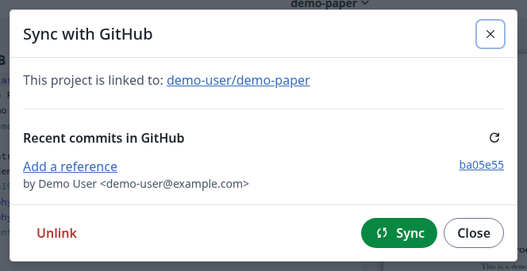

Verbinden Sie ein Projekt mit einem GitHub-Repository. Änderungen fließen in beide Richtungen, und zwar nur, wenn Sie auf **Sync** klicken: Nichts wird von selbst synchronisiert.

<Info>

Wenn Sie in **Account settings** oder im Editor keine GitHub-Option sehen, bitten Sie Ihren Administrator, die [GitHub-Synchronisierung](/de/on-premises/configuration/overleaf-toolkit/integrations/github-synchronisation) zu aktivieren.

</Info>

## Ihr GitHub-Konto verknüpfen {#link-your-github-account}

Das tun Sie nur einmal.

<Steps>
<Step title="Kontoeinstellungen öffnen">
Klicken Sie auf **Account** und dann auf **Account settings**. Scrollen Sie zu **GitHub** und klicken Sie auf **Link**.

<Frame caption="GitHub in den Kontoeinstellungen">
  
</Frame>
</Step>

<Step title="Auf GitHub autorisieren">
GitHub öffnet sich. Melden Sie sich an, falls Sie dazu aufgefordert werden, und autorisieren Sie dann die Anwendung.
</Step>

<Step title="Verknüpfung prüfen">
Sie sind zurück in den Kontoeinstellungen, und die Schaltfläche heißt jetzt **Unlink**.

<Frame caption="Ihr GitHub-Konto ist verknüpft">
  
</Frame>
</Step>
</Steps>

Wenn Ihr Konto noch nicht verknüpft ist, fordern **Import from GitHub** und die Karte **GitHub** im Editor Sie auf, es zuerst zu verknüpfen. Klicken Sie auf **Link to your GitHub account**. Auch so landen Sie in den Kontoeinstellungen, in einem neuen Tab, wenn Sie im Editor begonnen haben. Gehen Sie dann zurück und beginnen Sie erneut.

<Frame caption="Die Aufforderung, wenn Ihr Konto nicht verknüpft ist">
  
</Frame>

## Ein Repository importieren {#import-a-repository}

Dadurch entsteht aus einem GitHub-Repository ein neues Projekt, das bereits mit ihm verknüpft ist.

<Steps>
<Step title="Importdialog öffnen">
Klicken Sie auf der Projektseite auf **New project** und dann auf **Import from GitHub**.

<Frame caption="Das Menü New project">
  
</Frame>

<Info>

**New project** erscheint, sobald Sie ein Projekt haben. Das Menü **Create a new project** auf der Willkommensseite hat keinen Import, also erstellen Sie zuerst ein leeres Projekt.

</Info>
</Step>

<Step title="Repository auswählen">
Klicken Sie neben dem Repository auf **Import to Overleaf**. Die Liste enthält Ihre Repositories und die Ihrer Organisationen.

<Frame caption="Ihre GitHub-Repositories">
  
</Frame>

Wenn das Repository einer Organisation fehlt, klicken Sie auf <strong>Can't see what you're looking for?</strong>, um die Hilfe von GitHub zur Freigabe der Anwendung für diese Organisation zu öffnen.
</Step>

<Step title="Projekt prüfen">
Das neue Projekt öffnet sich mit den Dateien des Repositorys.

<Frame caption="Das importierte Projekt">
  
</Frame>
</Step>
</Steps>

## Ein Projekt in ein neues Repository exportieren {#export-a-project-to-a-new-repository}

Dadurch entsteht aus einem Projekt, das Ihnen gehört, ein Repository, und beide werden verknüpft. Ein Projekt lässt sich nur auf diese Weise oder durch Importieren verknüpfen: Sie können es nicht mit einem bereits vorhandenen Repository verknüpfen.

<Steps>
<Step title="GitHub im Editor öffnen">
Öffnen Sie das Projekt. Klicken Sie in der linken Leiste auf **Integrations** und dann auf **GitHub**.

<Frame caption="Das Panel Integrations">
  
</Frame>
</Step>

<Step title="Repository ausfüllen">
Wählen Sie den **Owner**, also Sie selbst oder eine Ihrer Organisationen. **Repository Name** ist anfangs der Name des Projekts. Die Beschreibung ist optional, und **Private** ist standardmäßig ausgewählt. Klicken Sie auf **Create a GitHub repository**.

<Frame caption="Export Project to GitHub">
  
</Frame>
</Step>

<Step title="Verknüpfung prüfen">
Der Dialog zeigt jetzt **This project is linked to** und nennt das Repository.

<Frame caption="Das Projekt ist verknüpft">
  
</Frame>
</Step>
</Steps>

## Synchronisieren {#sync}

<Steps>
<Step title="Synchronisierungsdialog öffnen">
Öffnen Sie ein verknüpftes Projekt. Klicken Sie in der linken Leiste auf **Integrations** und dann auf **GitHub**.

**Recent commits in GitHub** listet auf, was in das Projekt kommen wird.

<Frame caption="Ein neuer Commit wartet in GitHub">
  
</Frame>
</Step>

<Step title="Ihre Änderungen beschreiben">
Wenn Sie im Projekt etwas geändert haben, erscheint ein Feld für die Commit-Nachricht. Es ist optional: Wenn Sie es leer lassen, heißt der Commit `Updates from Overleaf`.

<Frame caption="Die Commit-Nachricht für Ihre Änderungen">
  
</Frame>
</Step>

<Step title="Auf Sync klicken">
Klicken Sie auf **Sync**. Neue Commits aus GitHub kommen in das Projekt, und Ihre Änderungen gehen in den Standard-Branch des Repositorys. Wenn beide Seiten Unterschiedliches geändert haben, werden die Änderungen für Sie zusammengeführt.
</Step>

<Step title="Ergebnis prüfen">
Der Dialog zeigt <strong>No new commits in GitHub since last merge.</strong>, und das Feld für die Commit-Nachricht ist verschwunden. Die Dateien im Editor und die Commits auf GitHub sind auf dem neuesten Stand.

<Frame caption="Alles ist synchron">
  
</Frame>
</Step>
</Steps>

### Wenn sich auf beiden Seiten dieselben Zeilen geändert haben {#if-the-same-lines-changed-on-both-sides}

Der Dialog meldet, dass die Änderungen nicht zusammengeführt werden konnten, und nennt einen neuen Branch, `overleaf-YYYY-MM-DD-HHMMSS`, der Ihre Änderungen enthält.

<Frame caption="Ein Konflikt">
  
</Frame>

1. Führen Sie diesen Branch auf GitHub oder mit Git in den Standard-Branch zusammen. Sie können den Dialog in der Zwischenzeit schließen: Er zeigt dieselbe Meldung, wenn Sie ihn wieder öffnen.
2. Klicken Sie auf **I have manually merged. Continue**. Das zusammengeführte Ergebnis kommt in das Projekt.
3. Der Branch bleibt auf GitHub. Löschen Sie ihn, wenn Sie ihn nicht mehr brauchen.

## Die Verknüpfung eines Projekts aufheben {#unlink-a-project}

Tun Sie das, wenn das Projekt nicht mehr synchronisiert werden soll. Nur der Projekteigentümer kann das.

<Steps>
<Step title="Auf Unlink klicken">
Klicken Sie im Synchronisierungsdialog auf **Unlink**.
</Step>

<Step title="Bestätigen">
Klicken Sie auf **Confirm**. Der Hinweis auf ein Abonnement hindert Sie nicht daran, das Projekt erneut zu verknüpfen.

<Frame caption="Aufheben der Verknüpfung bestätigen">
  
</Frame>
</Step>

<Step title="Ergebnis prüfen">
Der Dialog zeigt jetzt **Export Project to GitHub**. Projekt und Repository behalten beide ihren Inhalt. Um wieder zu synchronisieren, exportieren Sie das Projekt in ein neues Repository oder importieren Sie das Repository in ein neues Projekt.
</Step>
</Steps>

## Die Verknüpfung Ihres GitHub-Kontos aufheben {#unlink-your-github-account}

Klicken Sie in **Account settings** unter **GitHub** auf **Unlink** und dann im Dialog erneut auf **Unlink**.

<Frame caption="Verknüpfung Ihres Kontos aufheben">
  
</Frame>

Ihre Projekte bleiben mit ihren Repositories verknüpft. Sie können sie erst wieder synchronisieren, wenn Sie Ihr Konto erneut verknüpfen.

<Info>

Wer in einem geteilten Projekt was tun kann, erfahren Sie unter [Wer verknüpfen und synchronisieren kann](/de/on-premises/configuration/overleaf-toolkit/integrations/github-synchronisation#who-can-link-and-sync). Alle Mitarbeitenden, die synchronisieren, verknüpfen ihr eigenes GitHub-Konto.

</Info>
