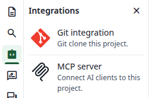

Jedes Projekt hat einen eigenen MCP-Server, sodass ein KI-Client auf Ihrem Computer das Projekt lesen und bearbeiten, es kompilieren und auf seine Kommentare antworten kann. Der Client meldet sich mit einem Git-Authentifizierungstoken an.

<Info>

Wenn Sie keine Karte **MCP server** sehen, verweisen Sie Ihren Administrator auf [MCP-Server](/de/on-premises/configuration/overleaf-toolkit/integrations/mcp-server).

</Info>

## Neu in v6.3.3 {#new-in-v6-3-3}

Ab v6.3.3 kann der Client auch mit dem Projektverlauf arbeiten: die Änderungen auflisten, zwei Versionen vergleichen, eine Datei so lesen, wie sie war, Versionen speichern und löschen und eine Datei oder das ganze Projekt wiederherstellen. Er kann die nachverfolgten Änderungen auflisten und annehmen oder ablehnen und seine eigenen Bearbeitungen als nachverfolgte Änderungen vornehmen, wenn Sie ihn darum bitten. Er kann einen Textabschnitt kommentieren und Kommentarnachrichten bearbeiten oder löschen, Nachrichten im Projektchat lesen und senden, Dateien und Ordner verschieben und umbenennen, Ordner erstellen und die Sprache der Rechtschreibprüfung ändern. Wer was darf, folgt wie im Editor Ihrer Rolle im Projekt, weil der Client mit Ihrem Token arbeitet: siehe [Wer was darf](#who-may-do-what).

Der MCP-Server wurde in v6.3.1 eingeführt. v6.3.1 und v6.3.2 haben dieselben 17 Tools, v6.3.3 hat 33.

| Tools | v6.3.1 und v6.3.2 | v6.3.3 |
| ----- | ----------------- | ------ |
| `get_clone_info`, `get_settings`, `list_files`, `delete_file`, `compile`, `get_compile_log`, `get_output_file_link`, `word_count`, `reply_to_comment`, `resolve_comment`, `reopen_comment` | Ja | Ja, unverändert |
| `read_file` | Der neueste Inhalt | Auch eine Datei, wie sie bei einer `version` war |
| `edit_file`, `write_file` | Folgen der Einstellung für nachverfolgte Änderungen des Projekts | Auch `trackChanges`, um die Bearbeitung zu einer nachverfolgten Änderung zu machen |
| `update_settings` | Compiler, TeX-Live-Image und Hauptdokument | Auch die Sprache der Rechtschreibprüfung |
| `list_versions` | Version, Kommentar und Datum | Auch die `id`, die `delete_version` erwartet, und wer sie gespeichert hat |
| `list_comments` | Nachrichten ohne ID | Auch die `id` jeder Nachricht, die `edit_comment_message` und `delete_comment_message` erwarten |
| `list_changes`, `diff`, `create_version`, `delete_version`, `restore_file`, `restore_project`, `list_tracked_changes`, `accept_tracked_changes`, `reject_tracked_changes`, `add_comment`, `edit_comment_message`, `delete_comment_message`, `list_chat_messages`, `send_chat_message`, `move_file`, `create_folder` | Nein | Ja |

## Einen Client verbinden {#connect-a-client}

<Steps>
<Step title="Dialog öffnen">
Öffnen Sie das Projekt. Klicken Sie in der linken Leiste auf **Integrations** und dann auf **MCP server**.

<Frame caption="Das Panel Integrations">
  
</Frame>

Der Dialog zeigt die Adresse des Servers dieses Projekts und einen Tab für jeden Client: **Claude Code**, **Codex**, **Cursor**, **VS Code** und **Gemini CLI**.

<Frame caption="Der Dialog MCP server">
  
</Frame>
</Step>

<Step title="Token erstellen">
Klicken Sie auf **Go to settings**. Ihre Kontoeinstellungen öffnen sich in einem neuen Tab. Klicken Sie unter **Git integration** auf **Generate token** oder auf **Add another token**, wenn Sie bereits eines haben. Klicken Sie auf **Copy** und bewahren Sie das Token sicher auf, denn Sie sehen es nur einmal. Klicken Sie dann auf **Close**.

<Frame caption="Ihr neues Token">
  
</Frame>

Ein Token, das Sie bereits für die [Git-Integration](/de/on-premises/user-guide/users/git-integration) verwenden, funktioniert ebenfalls, ebenso ein einziges Token für alle Ihre Projekte.
</Step>

<Step title="Server zum Client hinzufügen">
Klicken Sie zurück im Dialog auf den Tab Ihres Clients und dann neben der Konfiguration auf **Copy**.

| Tab | Wohin damit | Das Token |
| --- | ------------- | --------- |
| **Claude Code** | Befehl in einem Terminal ausführen | `<token>` im Befehl ersetzen |
| **Codex** | `~/.codex/config.toml` | In die Umgebungsvariable `OVERLEAF_TOKEN` setzen |
| **Cursor** | `~/.cursor/mcp.json` | In die Umgebungsvariable `OVERLEAF_TOKEN` setzen |
| **VS Code** | `.vscode/mcp.json` | Die Datei enthält statt des Tokens eine Passwortabfrage namens `overleaf-token` |
| **Gemini CLI** | Befehl in einem Terminal ausführen | `<token>` im Befehl ersetzen |

Die Adresse gehört zu einem Projekt. Um ein weiteres Projekt zu verbinden, fügen Sie es unter einem anderen Namen hinzu, denn `overleaf` ist bereits vergeben. Ändern Sie für Claude Code zum Beispiel `overleaf` im Befehl in `overleaf-lab`.
</Step>
</Steps>

## Verbindung prüfen {#check-the-connection}

### Mit Claude Code {#with-claude-code}

```bash
claude mcp list
```

Der Server wird als verbunden aufgeführt:

```text
overleaf: https://<your-site>/project/<project-id>/mcp (HTTP) - ✔ Connected
```

### Mit curl {#with-curl}

Das funktioniert unabhängig von Ihrem Client. Ersetzen Sie die Adresse und das Token und senden Sie die `initialize`-Anfrage des MCP-Protokolls:

```bash
curl -X POST https://<your-site>/project/<project-id>/mcp \
  -H "Authorization: Bearer <token>" \
  -H "Content-Type: application/json" \
  -H "Accept: application/json, text/event-stream" \
  -d '{"jsonrpc":"2.0","id":1,"method":"initialize","params":{"protocolVersion":"2025-06-18","capabilities":{},"clientInfo":{"name":"curl","version":"1.0"}}}'
```

Die Antwort nennt den Server, gefolgt von seinen Anweisungen für Clients:

```json
{"result":{"protocolVersion":"2025-06-18","capabilities":{"tools":{"listChanged":true}},"serverInfo":{"name":"overleaf","version":"1.0.0"},"instructions":"This server works on one Overleaf project. ..."},"jsonrpc":"2.0","id":1}
```

Um die Tools zu sehen, senden Sie `tools/list` mit demselben Befehl. Die Antwort listet 33 Tools auf, oder 31, wenn auf Ihrer Website der Projektchat ausgeschaltet ist. Vor v6.3.3 sind es 17.

```bash
  -d '{"jsonrpc":"2.0","id":2,"method":"tools/list","params":{}}'
```

Um eines aufzurufen, senden Sie `tools/call`:

```bash
  -d '{"jsonrpc":"2.0","id":3,"method":"tools/call","params":{"name":"list_files","arguments":{}}}'
```

```json
{"result":{"content":[{"type":"text","text":"[\n  {\n    \"path\": \"main.tex\",\n    \"type\": \"doc\"\n  }\n]"}]},"jsonrpc":"2.0","id":3}
```

### In Ihren Kontoeinstellungen {#in-your-account-settings}

Unter **Git integration** zeigt **Last used** das Datum für ein Token, das der Server empfangen hat.

<Frame caption="Das erste Token wurde verwendet">
  
</Frame>

### Wenn keine Verbindung zustande kommt {#if-it-does-not-connect}

| Was Sie sehen | Was es bedeutet |
| ------------ | ------------- |
| Status `401` oder in Claude Code `✘ Failed to connect` mit `HTTP 401` | Das Token fehlt, ist falsch oder wurde gelöscht |
| Status `404` | Kein Projekt hat diese ID |
| Status `405` | Die Anfrage war kein `POST` |
| Status `406` mit `Not Acceptable` | Der `Accept`-Header fehlt: Der Client muss sowohl `application/json` als auch `text/event-stream` akzeptieren |

## Was Sie sehen, wenn ein Client arbeitet {#what-you-see-when-a-client-works}

Bearbeitungen erscheinen in einem geöffneten Editor, während der Client sie vornimmt, wie die eines Mitarbeiters, ohne Neuladen. Neue Dateien und Ordner, Verschiebungen und Umbenennungen erscheinen im Dateibaum.

<Frame caption="Eine von edit_file hinzugefügte Zeile">
  
</Frame>

`edit_file` ändert nur Text, der genau einmal vorkommt. Andernfalls erhält der Client einen Fehler wie `oldString not found in main.tex, read_file again` oder `oldString appears 2 times in main.tex, add context`, und nichts ändert sich.

Ab v6.3.3 verschiebt oder benennt `move_file` eine Datei oder einen Ordner um und erstellt dabei bei Bedarf die Ordner des neuen Pfads, und `create_folder` erstellt einen Ordner. Wird die Datei nicht gefunden oder existiert der neue Pfad bereits, erhält der Client einen Fehler, und nichts ändert sich. `update_settings` kann auch die Sprache der Rechtschreibprüfung ändern, zum Beispiel auf `de`, oder die Rechtschreibprüfung ausschalten.

Antworten auf Kommentare erscheinen im Review-Panel unter Ihrem Namen, weil das Token Ihnen gehört. Ein über den Server aufgelöster Kommentar verschwindet aus dem Panel, und erneutes Öffnen bringt ihn zurück.

<Frame caption="Eine von reply_to_comment gesendete Antwort">
  
</Frame>

Ab v6.3.3 kommentiert `add_comment` einen Textabschnitt. Der Text muss genau einmal in der Datei vorkommen; kommt er mehrfach vor, gibt der Client zusätzlich einen längeren umgebenden Abschnitt an, der nur einmal vorkommt, und nur der Text wird kommentiert. Der Kommentar erscheint im Review-Panel unter Ihrem Namen und bleibt an seinem Text, wenn sich die Datei ändert. `edit_comment_message` ändert eine Ihrer eigenen Nachrichten. `delete_comment_message` löscht eine Nachricht, und das Löschen der ersten löscht den ganzen Kommentar, wie im Review-Panel.

`compile` kompiliert das Projekt und gibt die Liste der Ausgabedateien zurück. `get_output_file_link` liefert dann einen Link zum Herunterladen des PDFs oder einer anderen Ausgabedatei. Der Link braucht kein Token und funktioniert nach 5 Minuten nicht mehr.

Die vollständige Liste der Tools finden Sie unter [Tools](/on-premises/configuration/overleaf-toolkit/integrations/mcp-server#tools).

## Nachverfolgte Änderungen {#tracked-changes}

Ab v6.3.3 können Sie den Client bitten, seine Bearbeitungen als nachverfolgte Änderungen vorzunehmen, zum Beispiel *Rewrite the abstract as a tracked change*. `edit_file` und `write_file` machen die Änderung an einer bestehenden Datei dann zu einer nachverfolgten Änderung unter Ihrem Namen, selbst wenn die Nachverfolgung im Projekt ausgeschaltet ist, und Sie nehmen sie im Review-Panel an oder lehnen sie ab. Eine neue Datei ist nie eine nachverfolgte Änderung. Wenn Sie nicht darum bitten, folgen die Bearbeitungen der Einstellung für nachverfolgte Änderungen des Projekts, wie Ihre im Editor: Sie werden nachverfolgt, wenn die Nachverfolgung für Sie oder für alle eingeschaltet ist.

Wenn das Konto des Projektinhabers keine nachverfolgten Änderungen hat, erhält der Client `Track changes is off for this project`, und nichts ändert sich.

Um jede Bearbeitung des Clients zu prüfen, schalten Sie die Nachverfolgung für sich selbst ein. Um seine Bearbeitungen im Review-Panel von Ihren zu unterscheiden, geben Sie dem Client das Token eines anderen Kontos, mit dem Sie das Projekt teilen.

`list_tracked_changes` listet die nachverfolgten Änderungen mit ihrer Datei, dem eingefügten oder gelöschten Text, dem Autor und der Uhrzeit auf. `accept_tracked_changes` und `reject_tracked_changes` erwarten die IDs der Änderungen und funktionieren wie das Review-Panel: Eine angenommene Änderung bleibt im Text, eine abgelehnte Einfügung wird entfernt und eine abgelehnte Löschung kehrt zurück. Ein geöffneter Editor zeigt das Ergebnis ohne Neuladen. Die Tools weisen den Client an, nur die Änderungen anzunehmen oder abzulehnen, um die Sie bitten.

## Verlauf {#history}

Ab v6.3.3 sieht der Client den Projektverlauf so, wie ihn das Verlaufspanel zeigt.

| Tool | Was es tut |
| ---- | ------------ |
| `list_changes` | Listet die Änderungen auf, die neuesten zuerst: wer welche Dateien wann geändert hat, mit den Versionen vor und nach jeder Änderung. Ältere Änderungen kommen in weiteren Teilen. |
| `diff` | Vergleicht zwei Versionen: eine Datei als Unified Diff, wie `git diff`, oder die Dateien, die hinzugefügt, entfernt, bearbeitet oder umbenannt wurden |
| `read_file` mit `version` | Liest eine Datei so, wie sie bei einer Version war |
| `list_versions` | Listet die gespeicherten Versionen mit ihrem Kommentar und wer sie gespeichert hat |
| `create_version` | Speichert die neueste oder eine frühere Version mit einem Kommentar, wie **Label this version** |
| `delete_version` | Löscht eine gespeicherte Version; ihre Änderungen bleiben |
| `restore_file` | Stellt eine Datei so wieder her, wie sie bei einer Version war, wie **Restore this version** |
| `restore_project` | Stellt das ganze Projekt so wieder her, wie es bei einer Version war, wie **Restore project to this version** |

Eine Wiederherstellung ist selbst eine neue Änderung, Sie können sie also auf dieselbe Weise rückgängig machen. Die Tools weisen den Client an, nur auf Ihre Bitte hin wiederherzustellen.

Hat der Projektinhaber keinen vollständigen Projektverlauf, sieht der Client wie im Verlaufspanel nur die Änderungen der letzten 24 Stunden, oder die neueste Änderung, wenn alle älter sind. Ältere Versionen kann er nicht vergleichen, lesen oder wiederherstellen.

## Projektchat {#project-chat}

Ab v6.3.3 liest `list_chat_messages` den Projektchat, die neuesten zuerst, 50 Nachrichten auf einmal. `send_chat_message` sendet eine Nachricht unter Ihrem Namen, und sie erscheint sofort in einem geöffneten Chat. Ist der Projektchat auf Ihrer Website ausgeschaltet, hat der Client keines der beiden Tools.

## Wer was darf {#who-may-do-what}

Der Client darf, was Ihre Rolle im Projekt erlaubt.

| Was der Client tut | Inhaber | Bearbeiter | Reviewer | Betrachter (benannter Mitarbeiter) | Betrachter (Link-Freigabe) |
| -------------------- | ----: | -----: | -------: | --------------------------: | --------------------: |
| Dateien und Einstellungen lesen, kompilieren, das Log lesen, das PDF herunterladen | Ja | Ja | Ja | Ja | Ja |
| Dateien schreiben, bearbeiten, verschieben und löschen, Ordner erstellen, Einstellungen ändern | Ja | Ja | Nein | Nein | Nein |
| Verlauf, Kommentare und nachverfolgte Änderungen sehen | Ja | Ja | Ja | Ja | Nein |
| Chatnachrichten lesen und senden | Ja | Ja | Ja | Ja | Nein |
| Kommentare hinzufügen und darauf antworten | Ja | Ja | Ja | Nein | Nein |
| Einen Kommentar auflösen, erneut öffnen oder löschen | Ja | Ja | Die selbst begonnenen | Nein | Nein |
| Eine Kommentarnachricht bearbeiten | Eigene | Eigene | Eigene | Nein | Nein |
| Eine Kommentarnachricht löschen | Ja | Ja | Eigene | Nein | Nein |
| Nachverfolgte Änderungen annehmen oder ablehnen | Ja | Ja | Nein | Nein | Nein |
| Eine Version speichern | Ja | Ja | Ja | Nein | Nein |
| Eine gespeicherte Version löschen | Ja | Die selbst gespeicherten | Die selbst gespeicherten | Nein | Nein |
| Eine Datei oder das Projekt wiederherstellen | Ja | Ja | Nein | Nein | Nein |

Bearbeiter, die über einen Link beigetreten sind, zählen als Bearbeiter. Reviewer können über MCP keine Dateien bearbeiten, auch nicht als nachverfolgte Änderungen.

## Einen Client trennen {#disconnect-a-client}

Löschen Sie das Token: siehe [Ein Token löschen](/de/on-premises/user-guide/users/git-integration#delete-a-token). Ab dann antwortet der Server diesem Token mit `401`. Wenn Sie es auch für Git verwenden, akzeptiert auch Git es nicht mehr.
