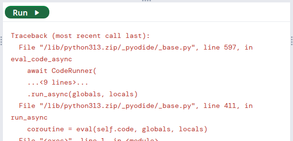

Python-Skripte laufen in Ihrem Browser, daher erscheint die Ausgabe direkt unter dem Editor. Sie müssen nichts einrichten.

<Steps>
<Step title="Skript erstellen">
Klicken Sie im Dateibaum auf das Symbol **New file**. Geben Sie einen Namen ein, der auf `.py` endet, und klicken Sie auf **Create**.

<Frame caption="Eine neue Python-Datei">
  
</Frame>

Unter dem Editor erscheinen die Schaltfläche **Run** und ein Ausgabebereich. Beim ersten Mal bleibt die Schaltfläche deaktiviert, solange Python lädt.
</Step>

<Step title="Skript ausführen">
Schreiben Sie Ihren Code und klicken Sie auf **Run**. Was das Skript ausgibt, erscheint im Ausgabebereich. Sie müssen nicht vorher speichern.

Dateien, die das Skript schreibt, landen in Ihrem Projekt. Eine Meldung nennt die Datei, zum Beispiel **results.txt saved to your project**, und die Datei erscheint im Dateibaum.

<Frame caption="Die Ausgabe und eine gespeicherte Datei">
  
</Frame>
</Step>

<Step title="Skript anhalten">
Während ein Skript läuft, wird **Run** zu **Stop**. Klicken Sie darauf, um das Skript zu unterbrechen. Der Ausgabebereich endet mit **Execution interrupted**.

<Frame caption="Ein laufendes Skript">
  
</Frame>
</Step>
</Steps>

## Eine Abbildung in Ihrem Dokument verwenden {#use-a-figure-in-your-document}

Plots haben kein Fenster, in dem sie erscheinen können, also speichern Sie sie in einer Datei. Zum Beispiel:

```python
import matplotlib.pyplot as plt

plt.plot([1, 2, 3], [1, 4, 9])
plt.savefig("figure.png")
```

`figure.png` erscheint in Ihrem Projekt und ist bereit für `\includegraphics{figure.png}`.

<Frame caption="Ein gespeicherter Plot">
  
</Frame>

## Dateien Ihres Projekts lesen {#read-your-project’s-files}

Ein Skript kann die Dateien Ihres Projekts über ihren Pfad öffnen:

```python
print(open("results.txt").read())
```

## Wenn etwas schiefgeht {#if-something-goes-wrong}

<strong>Das Skript löst einen Fehler aus.</strong> Der Fehler erscheint rot im Ausgabebereich, nach allem, was das Skript vorher ausgegeben hat.

<Frame caption="Ein Fehler in einem Skript">
  
</Frame>

<strong>`ModuleNotFoundError: No module named ...`.</strong> Nur die in Pyodide integrierten Pakete sind verfügbar, mit `pip` installierte Pakete können nicht verwendet werden. NumPy und Matplotlib gehören zu den verfügbaren, und die Meldung verlinkt auf die [vollständige Liste](https://pyodide.org/en/stable/usage/packages-in-pyodide.html).

<Frame caption="Ein nicht verfügbares Paket">
  
</Frame>
