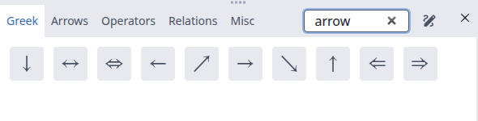

Die Symbolpalette fügt mathematische Symbole in Ihr Dokument ein. Wenn Sie den Namen eines Symbols nicht kennen, zeichnen Sie es, und Ihr Browser findet den Befehl. Es muss nichts eingerichtet werden.

## Ein Symbol einfügen {#insert-a-symbol}

<Steps>
<Step title="Cursor in den Mathematikmodus setzen">
Die meisten Symbole funktionieren nur im Mathematikmodus. Klicken Sie an die Stelle, an der das Symbol stehen soll. Klicken Sie in der Symbolleiste des Editors auf **Insert math** und dann auf **Inline**. Der Cursor steht jetzt zwischen `\(` und `\)`.

<Frame caption="Das Menü Insert math">
  
</Frame>
</Step>

<Step title="Palette öffnen">
Klicken Sie in der Symbolleiste auf die Schaltfläche **Ω**, **Insert symbol**. Sie können auch oben auf der Seite auf **Insert** und dann auf **Symbol** klicken. Die Palette öffnet sich unter dem Editor.

<Frame caption="Die Symbolpalette">
  
</Frame>
</Step>

<Step title="Symbol finden">
Klicken Sie auf einen Tab: **Greek**, **Arrows**, **Operators**, **Relations** oder **Misc**. Halten Sie den Mauszeiger über ein Symbol, um seinen Namen und Befehl zu sehen. Manche zeigen auch einen Hinweis, etwa das benötigte Paket.

<Frame caption="Name, Befehl und Hinweis eines Symbols">
  
</Frame>
</Step>

<Step title="Darauf klicken">
Der Befehl erscheint am Cursor. Die Palette bleibt offen, sodass Sie gleich das nächste Symbol hinzufügen können. Klicken Sie auf **Recompile**, um das Symbol im PDF zu sehen.

<Frame caption="Das Symbol im Dokument und im PDF">
  
</Frame>
</Step>
</Steps>

Die Palette funktioniert im **Visual**-Editor genauso.

## Nach einem Symbol suchen {#search-for-a-symbol}

Tippen Sie in das Feld **Search**. Sie können nach einem Befehl (`\sum`), einem Wort aus dem Namen des Symbols (`arrow`) oder dem Zeichen selbst (`α`) suchen. Die Suche umfasst alle Tabs. Leeren Sie das Feld, um zu den Tabs zurückzukehren.

<Frame caption="Suche nach arrow">
  
</Frame>

Wenn nichts passt, zeigt die Palette **No symbols found**.

## Ein Symbol zeichnen {#draw-a-symbol}

Verwenden Sie dies, wenn Sie sich ein Symbol vorstellen können, aber seinen Namen nicht kennen.

<Steps>
<Step title="Auf das Stiftsymbol klicken">
Klicken Sie rechts neben dem Feld **Search** auf das Stiftsymbol, **Draw a symbol**. Die Tabs werden ausgegraut und rechts erscheint ein gestricheltes Feld.

<strong>Loading model…</strong> wird angezeigt, bis die Erkennung bereit ist. Beim ersten Mal lädt Ihr Browser etwa 40 MB von Ihrer Website herunter. Danach behält er diese Dateien.

<Frame caption="Zeichenmodus">
  
</Frame>
</Step>

<Step title="Im gestrichelten Feld zeichnen">
Wenn Sie einen Strich beenden, erscheinen links bis zu zehn Treffer, der nächstliegende zuerst. Halten Sie den Mauszeiger über einen Treffer, um seinen Befehl zu sehen. Bei einem Symbol mit mehreren Strichen werden die Treffer nach jedem Strich aktualisiert.

<Frame caption="Die Treffer für eine Zeichnung">
  
</Frame>
</Step>

<Step title="Auf den Treffer klicken">
Der Befehl erscheint am Cursor. Ihre Zeichnung bleibt erhalten, sodass Sie einen anderen Treffer ausprobieren können. Klicken Sie auf **Clear**, bevor Sie das nächste Symbol zeichnen.

<Frame caption="Der Befehl am Cursor">
  
</Frame>
</Step>
</Steps>

Um zu den Tabs zurückzukehren, klicken Sie erneut auf das Stiftsymbol oder in das Feld **Search**.

Die Erkennung läuft in Ihrem Browser. Ihre Zeichnung wird nicht an Ihre Website gesendet.

### Treffer, die ein Paket benötigen {#matches-that-need-a-package}

Das Zeichnen kennt mehr als 1.300 Befehle, während die Tabs 117 auflisten. Viele der übrigen stammen aus einem LaTeX-Paket. In diesem Fall zeigt der Tooltip die Zeile, die Sie hinzufügen müssen.

<Frame caption="Ein Treffer, der ein Paket benötigt">
  
</Frame>

Fügen Sie die Zeile in Ihre Präambel ein, vor `\begin{document}`:

```latex
\usepackage{amssymb}
```

Die Palette fügt sie nicht für Sie hinzu.

## Die Tastatur verwenden {#use-the-keyboard}

Drücken Sie im Feld **Search** die Tabulatortaste, bis ein Symbol ausgewählt ist. Mit den Pfeiltasten wechseln Sie zwischen Symbolen. Die Eingabetaste fügt das ausgewählte Symbol ein und schließt die Palette.

## Die Palette schließen {#close-the-palette}

Klicken Sie oben rechts in der Palette auf das <strong>×</strong>. Auch die Schaltfläche **Ω** sowie **Insert** und dann **Symbol** schließen sie.

## Wenn etwas schiefgeht {#if-something-goes-wrong}

| Was Sie sehen | Warum | Was zu tun ist |
| ------------ | --- | ---------- |
| Die Kompilierung meldet **Missing \$ inserted** | Das Symbol steht außerhalb des Mathematikmodus | Verschieben Sie es zwischen `\(` und `\)`, oder verwenden Sie zuerst **Insert math** |
| Die Kompilierung meldet **Undefined control sequence** | Der Befehl benötigt ein Paket | Halten Sie den Mauszeiger in der Palette über das Symbol, um zu sehen, welches, und fügen Sie es Ihrer Präambel hinzu |
| Es gibt kein Stiftsymbol | Ihr Browser kann die Erkennung nicht ausführen, zum Beispiel Safari 15 | Aktualisieren Sie Ihren Browser oder verwenden Sie einen anderen. Die Tabs und die Suche funktionieren weiterhin |
| **Recognition unavailable** unter dem gestrichelten Feld | Der Browser konnte die Erkennungsdateien nicht laden | Klicken Sie auf **Please try again** |
