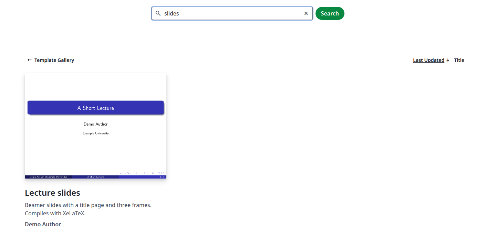

Vorlagen sind Projekte, die Ihr Administrator veröffentlicht hat. Wenn Sie eine öffnen, erhalten Sie ein neues, eigenes Projekt.

<Info>

Wenn Sie keinen Link **Templates** sehen, bitten Sie Ihren Administrator, die [Vorlagengalerie](/de/on-premises/configuration/overleaf-toolkit/templates) einzuschalten.

</Info>

## Die Galerie öffnen {#open-the-gallery}

Klicken Sie auf der Projektseite oben rechts auf **Templates**.

<Frame caption="Der Link Templates">
  
</Frame>

Die Seite **All templates** öffnet sich, mit den zuletzt aktualisierten Vorlagen zuerst.

<Frame caption="Alle Vorlagen">
  
</Frame>

Wenn Sie noch keine Projekte haben, klicken Sie auf der Willkommensseite auf **Browse templates**.

<Frame caption="Die Willkommensseite">
  
</Frame>

Wenn Sie Projekte haben, können Sie auch auf **New project**, dann auf **More templates** und dann auf eine Kategorie klicken.

<Frame caption="More templates">
  
</Frame>

Standardmäßig erfordert die Galerie eine Anmeldung: Wenn Ihnen jemand einen Link zu einer Vorlage schickt und Sie nicht angemeldet sind, gelangen Sie zuerst zur Anmeldeseite und dann zur Vorlage.

## Eine Vorlage finden {#find-a-template}

**Suchen** Sie im Feld. Die Liste aktualisiert sich während der Eingabe und durchsucht Titel, Autor und Beschreibung. Wenn nichts passt, zeigt die Seite <strong>No Templates.</strong>

<Frame caption="Suche nach slides">
  
</Frame>

**Sortieren** Sie mit **Last Updated** oder **Title**, rechts über der Liste. Klicken Sie erneut auf die aktive Sortierung, um die Reihenfolge umzukehren.

**Blättern** Sie unter der Liste. Eine Seite zeigt neun Vorlagen.

<Frame caption="Die Seitenschaltflächen">
  
</Frame>

<strong>Nach Kategorie durchsuchen:</strong> Klicken Sie auf der Seite **All templates** auf **Template Gallery**. Die Galerieseite hat für jede Kategorie eine Karte, darunter alle Vorlagen.

<Frame caption="Die Kategorien">
  
</Frame>

Klicken Sie auf eine Karte, um die Vorlagen dieser Kategorie zu sehen. Auch hier können Sie suchen und sortieren, und **All templates** bringt Sie zurück.

<Frame caption="Eine Kategorieseite">
  
</Frame>

## Eine Vorlage als neues Projekt öffnen {#open-a-template-as-a-new-project}

<Steps>
<Step title="Vorlage öffnen">
Klicken Sie auf eine Vorlage. Sie sehen eine Vorschau der ersten Seite, den Autor, die letzte Aktualisierung, die Lizenz und das Abstract.

<Frame caption="Die Vorlagenseite">
  
</Frame>

**View PDF** öffnet das gesamte PDF. Die Schaltfläche daneben lädt die Dateien als Zip herunter.
</Step>

<Step title="Auf Open as Template klicken">
Nach einem kurzen Ladebildschirm öffnet sich der Editor mit Ihrem neuen Projekt.

<Frame caption="Ihr neues Projekt">
  
</Frame>
</Step>

<Step title="Projekt prüfen">
Das Projekt hat den Namen und die Dateien der Vorlage sowie denselben Compiler und dasselbe Hauptdokument. Es wird beim Öffnen kompiliert, und Sie sind in der Projektliste sein Eigentümer.

Wenn Sie dieselbe Vorlage erneut öffnen, entsteht ein weiteres Projekt, etwa `Journal article (1)`.

<Frame caption="Jedes Öffnen erstellt ein Projekt">
  
</Frame>
</Step>
</Steps>

Ihr Projekt hängt nicht von der Vorlage ab: Es bleibt unverändert, wenn die Vorlage aktualisiert oder gelöscht wird.

<Info>

Ein normales Konto kann keine Vorlagen veröffentlichen oder ändern: Das Menü **File** hat kein **Manage Template**, und die Vorlagenseite hat weder **Edit** noch **Delete**. Um eine Vorlage zur Galerie hinzuzufügen, wenden Sie sich an Ihren Administrator.

</Info>
