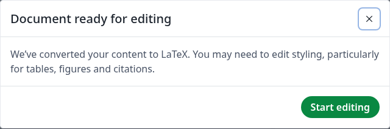
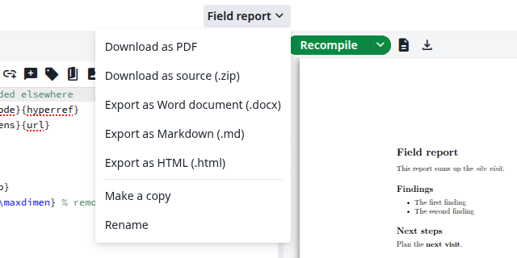

<Info>

Wenn Sie diese Optionen nicht sehen, bitten Sie Ihren Administrator, [Pandoc Import and Export](/de/on-premises/configuration/overleaf-toolkit/pandoc-import-and-export) zu aktivieren.

</Info>

## Ein Dokument importieren {#import-a-document}

Damit erstellen Sie ein neues LaTeX-Projekt aus einem Word-Dokument (`.docx`) oder einer Markdown-Datei (`.md`). Der Name des Projekts stammt aus dem Dateinamen.

<Steps>
<Step title="Importdialog öffnen">
Klicken Sie auf der Projektseite auf **New project**. Klicken Sie unter **Import** auf **Word document** oder **Markdown document**.

<Frame caption="Das Menü New project">
  
</Frame>
</Step>

<Step title="Datei auswählen">
Klicken Sie auf **Select .docx file** oder ziehen Sie die Datei in den Dialog. Für Markdown heißt die Schaltfläche **Select .md file**. Der Import startet sofort.

<Frame caption="Ein Word-Dokument auswählen">
  
</Frame>
</Step>

<Step title="Mit der Bearbeitung beginnen">
Das neue Projekt öffnet sich mit der Meldung **Document ready for editing**. Klicken Sie auf **Start editing**.

<Frame caption="Der Import ist abgeschlossen">
  
</Frame>
</Step>

<Step title="Ergebnis prüfen">
Das Dokument befindet sich jetzt in `main.tex`, seine Überschriften stehen in der Dateigliederung. Klicken Sie auf **Recompile**, um das PDF zu sehen. Prüfen Sie die Formatierung, besonders Tabellen, Abbildungen und Zitate, die eventuell nachbearbeitet werden müssen.

<Frame caption="Das importierte Projekt">
  
</Frame>
</Step>
</Steps>

### Wenn der Import fehlschlägt {#if-the-import-fails}

Wenn die Datei nicht konvertiert werden kann, zeigt der Dialog **Your document couldn't be imported**. Klappen Sie **Conversion error details** auf, um den Grund zu sehen. Es wird kein Projekt erstellt.

<Frame caption="Ein Dokument, das nicht importiert werden konnte">
  
</Frame>

Der Dialog nimmt nur den gewählten Typ an. Eine `.md`-Datei im Word-Dialog führt zu **You can only upload: .docx**.

## Ein Projekt exportieren {#export-a-project}

Öffnen Sie das Projekt und klicken Sie oben im Editor auf seinen Namen. Klicken Sie auf eine dieser Optionen:

| Option                              | Sie erhalten                                       |
| ----------------------------------- | --------------------------------------------- |
| <strong>Export as Word document (.docx)</strong> | Eine nach dem Projekt benannte `.docx`-Datei        |
| <strong>Export as Markdown (.md)</strong>        | Eine `.zip`-Datei mit `main.md`                  |
| <strong>Export as HTML (.html)</strong>          | Eine `.zip`-Datei mit `main.html`                |

Der Download startet von selbst. Die Konvertierung kann nicht jede LaTeX-Formatierung wiedergeben, prüfen Sie also das Ergebnis.

<Frame caption="Die Exportoptionen">
  
</Frame>
