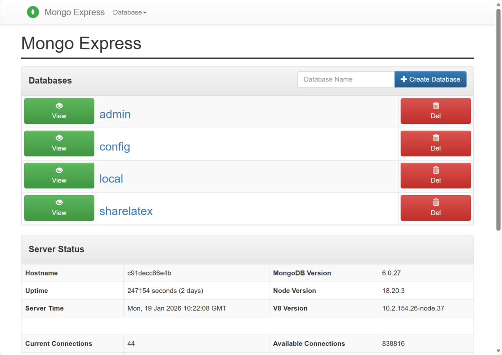

In this section, we will discuss Overleaf's data model. Overleaf uses MongoDB for data persistence, the only database name is called `sharelatex`, which is also the predecessor of Overleaf.

The dev environment already runs Mongo Express next to Mongo (see [setup-develop-tools.md](/dev/environment/setup-develop-tools  "mention")). Open [http://localhost:8081/](http://localhost:8081/) and log in with `admin:pass`.

<Frame>
  
</Frame>

You can also open a shell in the Mongo container from the `develop` directory:

```bash
bin/docker-compose exec mongo mongosh sharelatex
```

#### How the Pages Are Written

* Each page lists the fields that the code writes, with their type, meaning and the line of code that shows it: a Mongoose schema line, or the place that writes the field. Fields that only a migration, a script or one of the web modules writes say so.
* Many collections have no Mongoose schema: the services write them with the MongoDB driver.
* Indexes are only created by the migrations in `tools/migrations/`. CE runs those tagged `server-ce` at every start (`server-ce/init_scripts/900_run_web_migrations.sh`); Mongoose `autoIndex` is off (`services/web/app/src/infrastructure/Mongoose.mjs:7`). The index tables only list what a CE instance ends up with.
* The text of the docs is in Mongo, but other content is not. File content is stored as blobs and history as chunks in the history-v1 buckets (local folders, or S3 / RustFS); open docs live in Redis until document-updater flushes them.

#### Collections

Project and content:

| Collection | Page | Written by |
| ---------- | ---- | ---------- |
| `users` | [Users Collection](/dev/data-model/users-collection) | web |
| `projects` | [Projects Collection](/dev/data-model/projects-collection) | web |
| `docs` | [Docs Collection](/dev/data-model/docs-collection) | docstore |
| `rooms` | [Rooms Collection](/dev/data-model/rooms-collection) | chat |
| `messages` | [Messages Collection](/dev/data-model/messages-collection) | chat |
| `docSnapshots` | [Doc Snapshots Collection](/dev/data-model/doc-snapshots-collection) | document-updater |

History:

| Collection | Page | Written by |
| ---------- | ---- | ---------- |
| `projectHistoryChunks` | [Project History Chunks Collection](/dev/data-model/project-history-chunks-collection) | history-v1 |
| `projectHistoryBlobs` | [Project History Blobs Collection](/dev/data-model/project-history-blobs-collection) | history-v1 |
| `projectHistoryShardedBlobs` | [Project History Sharded Blobs Collection](/dev/data-model/project-history-sharded-blobs-collection) | history-v1 |
| `projectHistorySyncState` | [Project History Sync State Collection](/dev/data-model/project-history-sync-state-collection) | project-history |
| `projectHistoryFailures` | [Project History Failures Collection](/dev/data-model/project-history-failures-collection) | project-history |
| `projectHistoryLabels` | [Project History Labels Collection](/dev/data-model/project-history-labels-collection) | project-history |

Sharing, login and deletion:

| Collection | Page | Written by |
| ---------- | ---- | ---------- |
| `projectInvites` | [Project Invites Collection](/dev/data-model/project-invites-collection) | web |
| `tokens` | [Tokens Collection](/dev/data-model/tokens-collection) | web |
| `oauthAccessTokens` | [OAuth Access Tokens Collection](/dev/data-model/oauth-access-tokens-collection) | web, `oauth2-server` module |
| `oauthApplications` | [OAuth Applications Collection](/dev/data-model/oauth-applications-collection) | web, `git-bridge` module |
| `oauthAuthorizationCodes` | [OAuth Authorization Codes Collection](/dev/data-model/oauth-authorization-codes-collection) | nothing in Ayakaleaf Pro |
| `deletedProjects` | [Deleted Projects Collection](/dev/data-model/deleted-projects-collection) | web |
| `deletedUsers` | [Deleted Users Collection](/dev/data-model/deleted-users-collection) | web |

Integrations and templates:

| Collection | Page | Written by |
| ---------- | ---- | ---------- |
| `dropboxProjects` | [Dropbox Projects Collection](/dev/data-model/dropbox-projects-collection) | third-party-datastore, `dropbox` module |
| `dropboxEntities` | [Dropbox Entities Collection](/dev/data-model/dropbox-entities-collection) | third-party-datastore, `dropbox` module |
| `githubSyncProjectStates` | [GitHub Sync Project States Collection](/dev/data-model/github-sync-project-states-collection) | `github-sync` module |
| `githubSyncUserCredentials` | [GitHub Sync User Credentials Collection](/dev/data-model/github-sync-user-credentials-collection) | `github-sync` module |
| `gitlabSyncProjectStates` | [GitLab Sync Project States Collection](/dev/data-model/gitlab-sync-project-states-collection) | `gitlab-sync` module |
| `gitlabSyncUserCredentials` | [GitLab Sync User Credentials Collection](/dev/data-model/gitlab-sync-user-credentials-collection) | `gitlab-sync` module |
| `giteaSyncProjectStates` | [Gitea Sync Project States Collection](/dev/data-model/gitea-sync-project-states-collection) | `gitea-sync` module |
| `giteaSyncUserCredentials` | [Gitea Sync User Credentials Collection](/dev/data-model/gitea-sync-user-credentials-collection) | `gitea-sync` module |
| `templates` | [Templates Collection](/dev/data-model/templates-collection) | `template-gallery` module |

Dashboard, logs and the rest:

| Collection | Page | Written by |
| ---------- | ---- | ---------- |
| `tags` | [Tags Collection](/dev/data-model/tags-collection) | web |
| `notifications` | [Notifications Collection](/dev/data-model/notifications-collection) | notifications |
| `systemmessages` | [System Messages Collection](/dev/data-model/system-messages-collection) | web |
| `userAuditLogEntries` | [User Audit Log Entries Collection](/dev/data-model/user-audit-log-entries-collection) | web |
| `projectAuditLogEntries` | [Project Audit Log Entries Collection](/dev/data-model/project-audit-log-entries-collection) | web |
| `contacts` | [Contacts Collection](/dev/data-model/contacts-collection) | web |
| `spellingPreferences` | [Spelling Preferences Collection](/dev/data-model/spelling-preferences-collection) | web |
| `migrations` | [Migrations Collection](/dev/data-model/migrations-collection) | `tools/migrations` |

A CE database has more collections than these. Many are created empty by their index migrations and are only used on overleaf.com. For example, nothing in CE or our modules writes `splittests`, `samlLogs`, `notificationsPreferences`, `onboardingDataCollection` or `userfeatureusages` in normal use, so they have no page.
