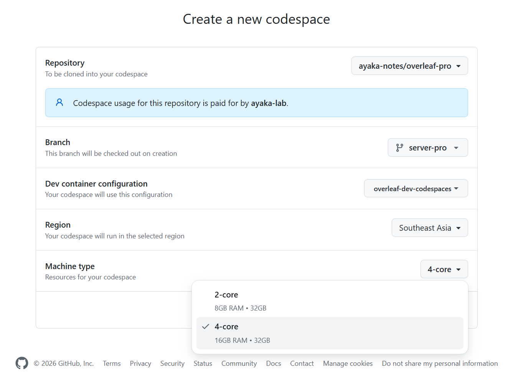
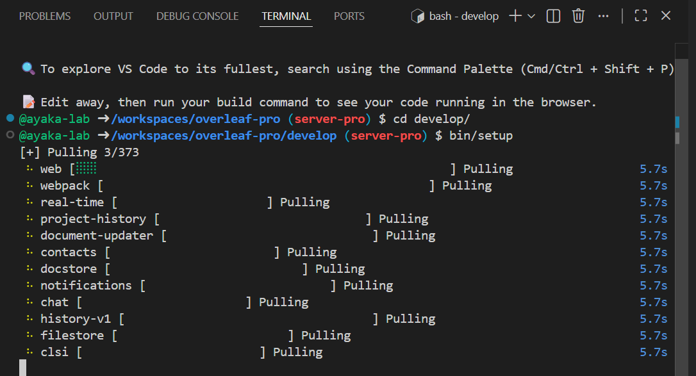
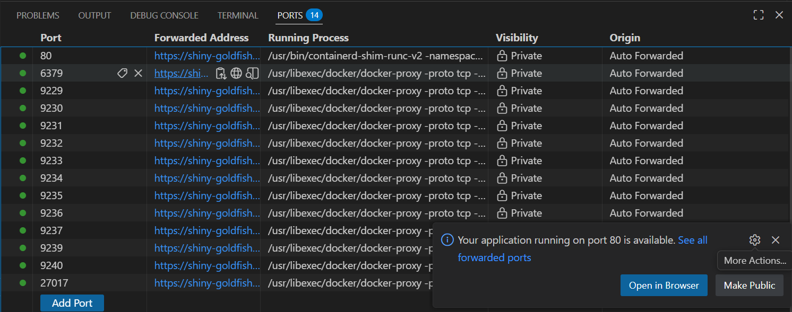
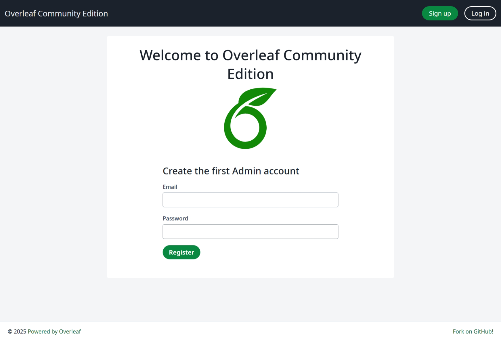

To save time and quickly build the development environment, we provide another version of the development environment configuration, that's GitHub Codespace.

## Configuration Tutorial

<Steps>
<Step title="Create Codespaces">
Click the following button to create a cloud codespaces for server-pro development.

[](https://codespaces.new/ayaka-notes/ayakaleaf-pro)

It's more recommented to choose **Machine Type** at least **4-core**. For larger machine type, you can make a request to GitHub's official support team by filing a ticket [here](https://support.github.com/contact?tags=rr-codespaces%2Ccat_codespaces).

<Frame>
  
</Frame>
</Step>

<Step title="Launch Setup Script">
You will need to wait patiently before the codespace get created. After you can have access to your Terminal, run the folloing command:

```text
cd develop/
bin/setup
bin/i18n
```

`bin/setup` pulls the images and starts the services; `bin/i18n` then applies the translations of the Ayakaleaf Pro modules, which the committed locale files do not contain, see [Update i18n Translations](/dev/environment/update-i18n-translations).

<Frame>
  
</Frame>

<Warning>

This script (`bin/setup`) allows you to set up the development environment on the latest commit of the `server-pro` branch in the shortest possible time. It may not be applicable to older versions/other branches.

We build development docker image every day with [GitHub Action](https://github.com/ayaka-notes/ayakaleaf-pro/actions).

</Warning>
</Step>

<Step title="Access Your Launchpad">
Switch to port tab, you will see a list of avaiable web port. Click the one with `80` (the `OVERLEAF_PORT` in `develop/dev.rc`). You should see launchpad page now. Mailpit, Grafana, Mongo Express and RedisInsight are on paths of the same port (`/mailpit/`, `/grafana/`, `/mongo-express/` and `/redis-insight/`), and the **Dev tools** menu of the site links to them once you are logged in. The RustFS console is on 9001 and Hoppscotch on 9170, see [Ports](/dev/environment/setup-develop-environment-local#ports).

<Frame>
  
</Frame>

You will see:

<Frame>
  
</Frame>
</Step>

<Step title="Enjoy Development">
Now, time to your own time! Start build your awesome feature. `bin/setup` already starts every service in development mode (`node --watch`, the same as `bin/dev`), so code changes show up without another command.

After changing `develop/dev.rc`, run `bin/setup` again: it goes through `bin/docker-compose`, which adds the files of the features that are turned on.

<Warning>

Do not start the services with `docker compose -f docker-compose.yml -f docker-compose.dev.yml -f docker-compose.image.yml up` by hand. It skips the feature files of `dev.rc`, so `web`, `filestore` and `history-v1` are recreated without the RustFS settings and fall back to local volumes, where the history and binary files of your projects are missing.

</Warning>
</Step>
</Steps>
