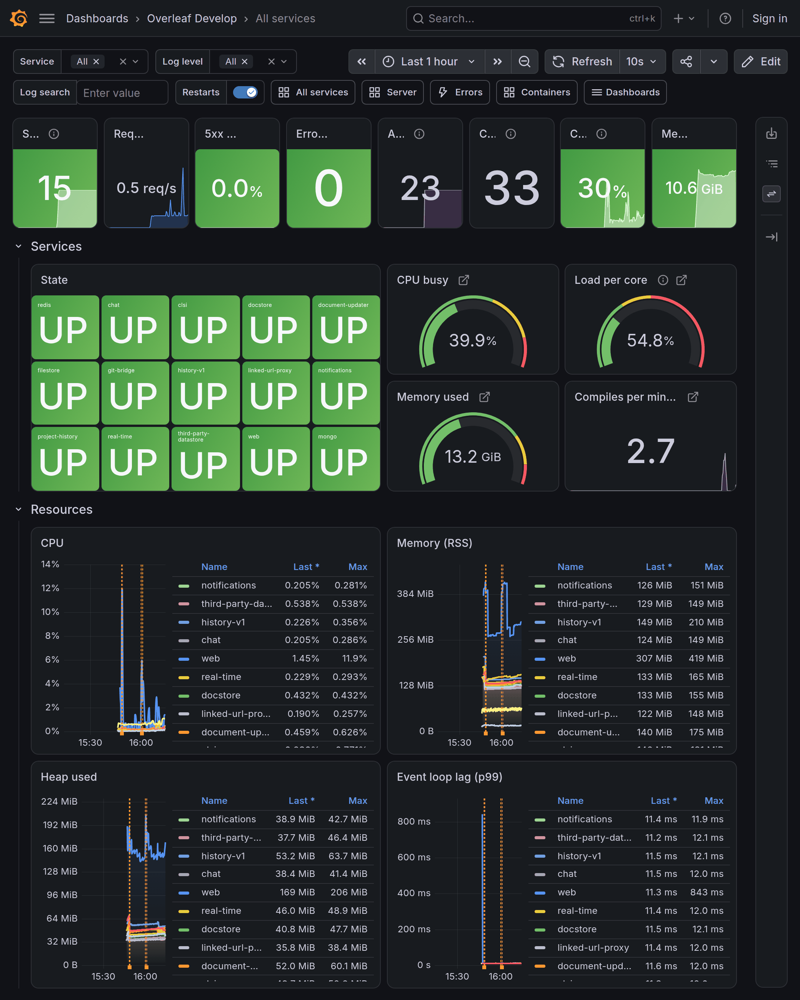
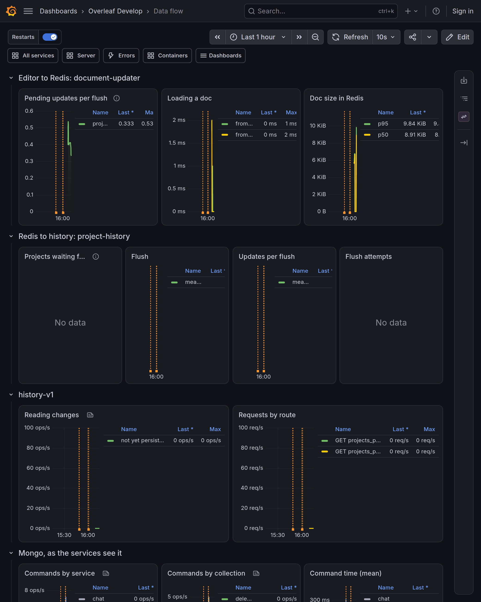
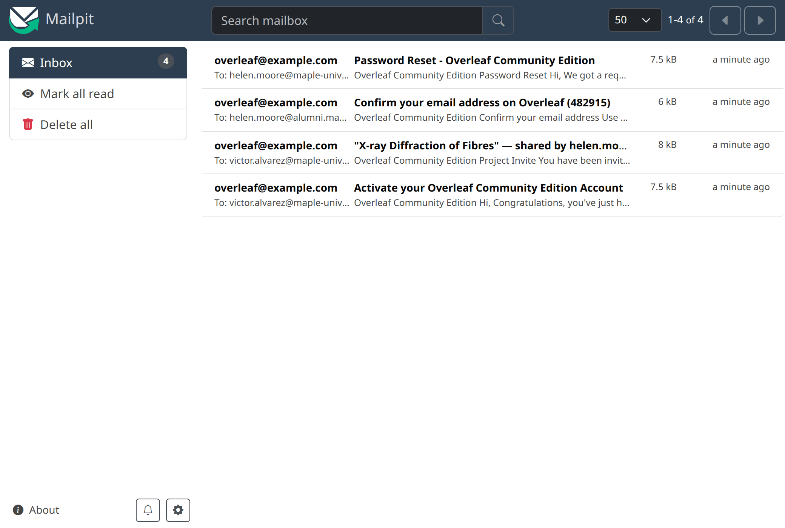
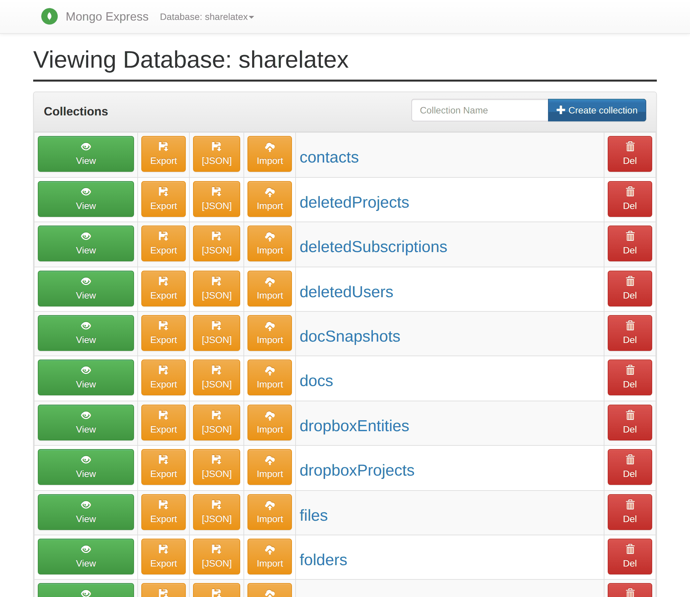
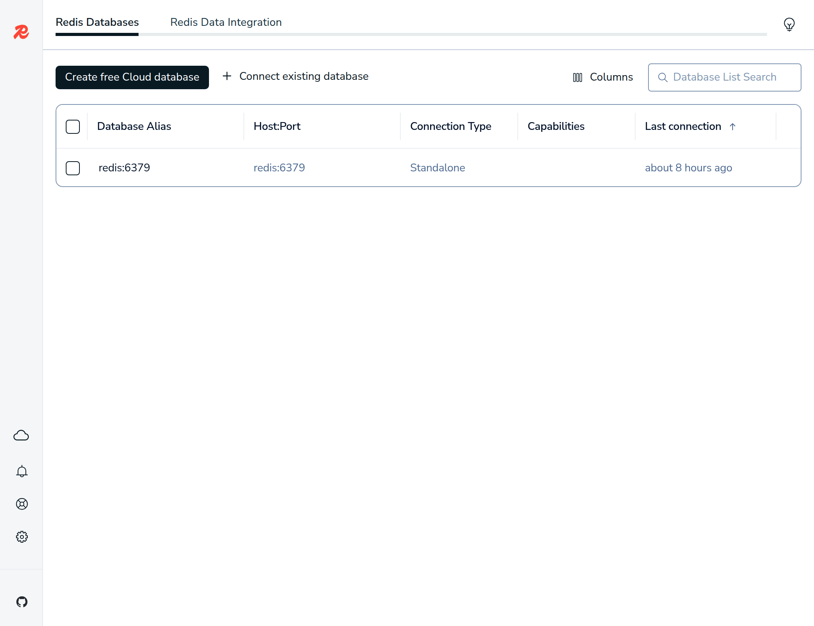
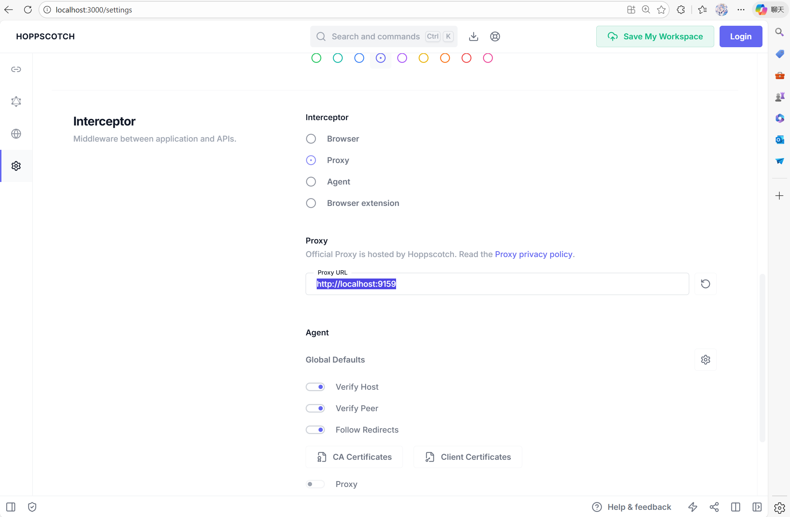
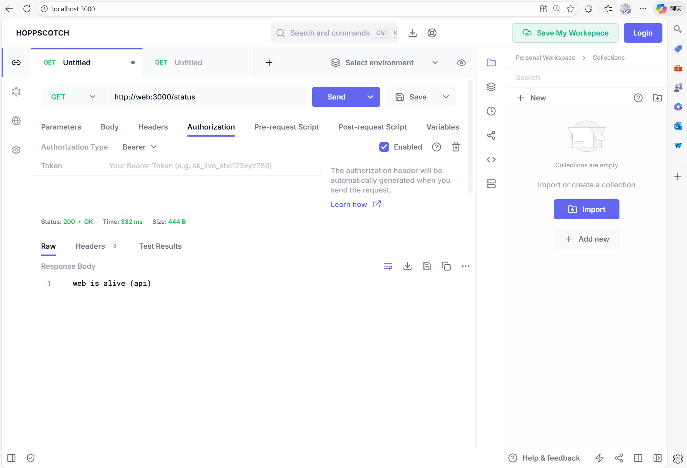
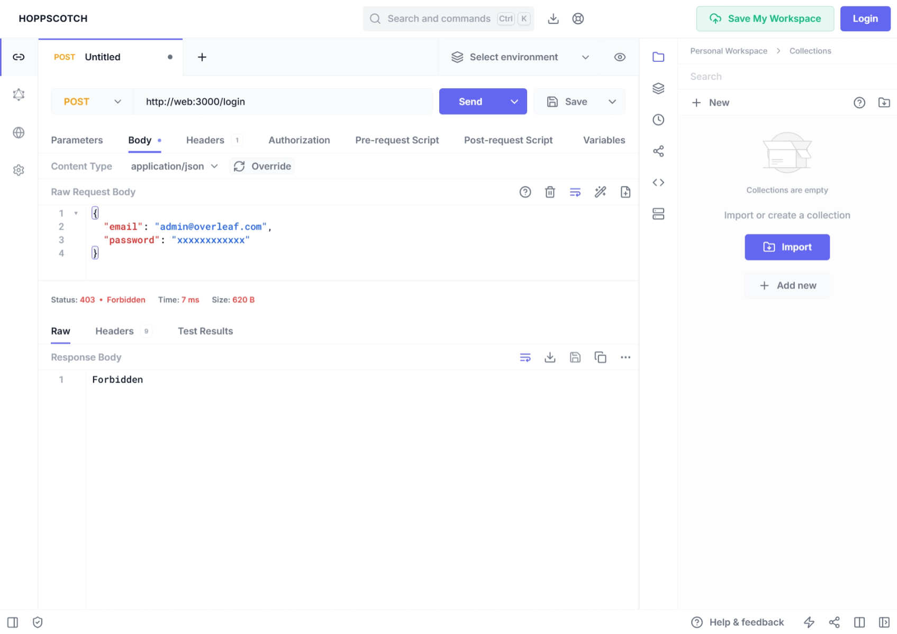
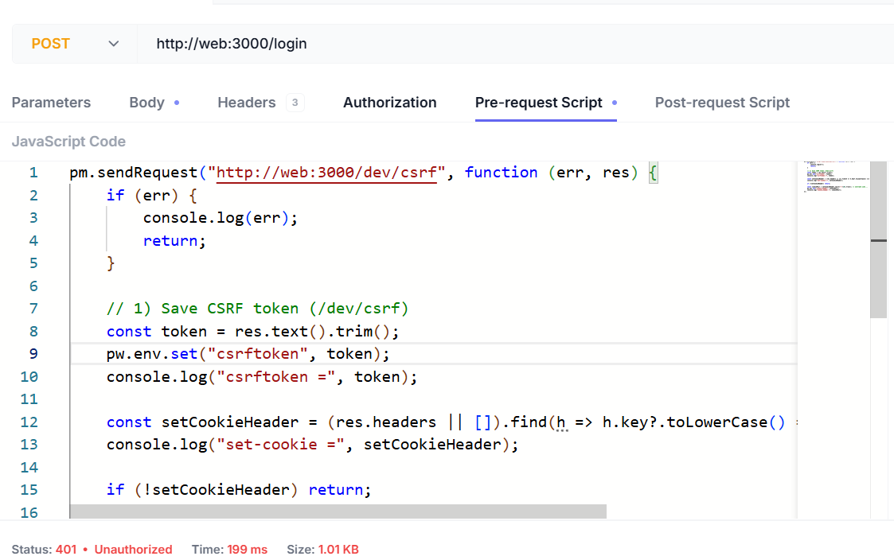
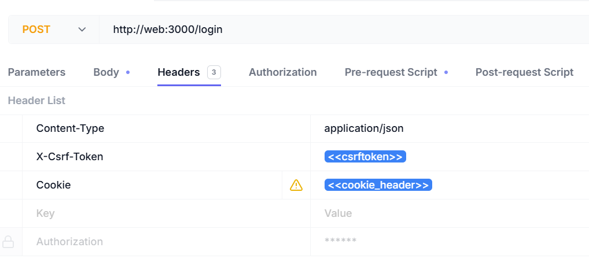

## Develop Tools Recommended

These optional services are not required to run Overleaf, but they help a lot when developing, debugging and looking into the data. All of them are part of the dev environment, so there is nothing to add to `docker-compose.yml`. Once you are logged in to the site, the **Dev tools** menu in its navbar links to the ones the site serves on its own paths.

| Tool                                                          | Address                                                             | Defined in                                                                                             |
| ------------------------------------------------------------- | ------------------------------------------------------------------- | ------------------------------------------------------------------------------------------------------ |
| **Grafana**, the state, metrics and logs of every service     | [http://localhost/grafana/](http://localhost/grafana/)              | `develop/grafana/docker-compose.yml`, on when `GRAFANA_ENABLED=true` in `develop/dev.rc` (the default) |
| **Mailpit**, an inbox for every email the site sends          | [http://localhost/mailpit/](http://localhost/mailpit/)              | `develop/mail/docker-compose.yml`, on when `MAILPIT_ENABLED=true` (the default)                        |
| **Mongo Express**, a UI for MongoDB                           | [http://localhost/mongo-express/](http://localhost/mongo-express/)  | `develop/docker-compose.yml`, always on                                                                |
| **RedisInsight**, a UI for the Redis data                     | [http://localhost/redis-insight/](http://localhost/redis-insight/)  | `develop/docker-compose.yml`, always on                                                                |
| **Hoppscotch**, a browser-based API client similar to Postman | [http://localhost:9170](http://localhost:9170/) (`HOPPSCOTCH_PORT`) | `develop/hoppscotch/docker-compose.yml`, on when `HOPPSCOTCH_ENABLED=true` (the default)               |

<Warning>

None of these tools has a login: Grafana's anonymous users are its admins, and Mongo Express can change any document. The site and Hoppscotch listen on `127.0.0.1` of the host only, but Mongo Express and RedisInsight also publish ports 8081 and 5540 on all interfaces. On a remote machine these two are reachable from other hosts, unless the network in front of the machine blocks the ports.

</Warning>

### Grafana

Grafana is served by the site on `/grafana/`, through webpack-dev-server, so it needs no port of its own. Its **Overleaf Develop** folder has these dashboards:

| Dashboard           | What it shows                                                                                     |
| ------------------- | ------------------------------------------------------------------------------------------------- |
| All services (home) | State of every service, host gauges, load and logs. A click on a service opens its dashboard      |
| Server              | CPU, load, memory, disk and network of the host, and the compiles of clsi                         |
| Errors              | Error logs, 5xx and 4xx responses, most frequent error messages and failing routes                |
| Data flow           | The path of an edit: document-updater and Redis, project-history, history-v1, Mongo, object store |
| Containers          | State of every container, CPU, memory, network and disk, sandboxed compiles included              |
| One per service     | The Node.js services, git-bridge (JVM), mongo and redis                                           |

<Columns cols={2}>
<Column>

<Frame caption="All services: the state of every service, the host, and the resources each service uses">
  
</Frame>

</Column>

<Column>

<Frame caption="Data flow: an edit on its way from document-updater through project-history to history-v1 and Mongo">
  
</Frame>

</Column>
</Columns>

Prometheus scrapes `/metrics` of the services, `mongodb-exporter`, `redis-exporter`, `cadvisor` and `node-exporter`; Alloy sends the logs of every container of the project to Loki, where the **Log search**, **Service** and **Log level** filters of the dashboards read them. Their data lives in the containers only, so recreating them empties it. cAdvisor runs privileged and reads the host's `/`, `/sys`, Docker data and the containerd socket, read-only; node-exporter reads the host's `/`.

The dashboards are generated: change `develop/grafana/make-dashboards` and run it, instead of editing the JSON files.

### Mailpit

With `MAILPIT_ENABLED=true`, `web` sends every email to Mailpit instead of a real mail server, and email confirmation is on (`EMAIL_CONFIRMATION_DISABLED=false`). Activation links, project invites, password resets and confirmation codes can then be followed from the inbox.

<Frame caption="An activation email, a project invite, a confirmation code and a password reset in Mailpit">
  
</Frame>

Mailpit has no volume: recreating its container empties the inbox.

### Mongo Express

Mongo Express shows the collections of the `sharelatex` database, and can view, edit, import and export their documents.

<Frame caption="The collections of the sharelatex database in Mongo Express">
  
</Frame>

### RedisInsight

RedisInsight keeps its connections in `develop/data/redis-insight`. The first time, choose **Connect existing database** and enter host `redis` and port `6379`.

<Frame caption="RedisInsight connected to the redis service">
  
</Frame>

### Setup Hoppscotch

#### Proxy API Request

Hoppscotch sends requests from the browser, which cannot reach the services by their Docker names. Its proxy, Proxyscotch, runs inside the Docker network and is served on `/proxy` of the Hoppscotch address. Open [http://localhost:9170](http://localhost:9170/), go to Settings → Interceptor, pick **Proxy** and set the Proxy URL to `http://localhost:9170/proxy`. The setting stays in the browser.

<Frame caption="The Interceptor setting. The screenshot is from an older setup: use `http://localhost:9170/proxy` as the Proxy URL.">
  
</Frame>

Now you can test with [http://web:3000/status](http://web:3000/status) to check if web is alive:

<Frame>
  
</Frame>

#### Import the Service APIs

`develop/hoppscotch/openapi/` has an OpenAPI file for the internal API of each service. In Hoppscotch, open Collections → Import → Import from File and select all files at once. Each file becomes a collection whose requests go to the service's Docker address. The same files are shown in the [Service API](/dev/service-api/overview) section.

#### CSRF Problems

<Warning>

If you use postman or other debug tools to generate a **post** request, you may find the login is **forbidden** with a 403 error. That's because Overleaf is protected by **csrf** verification.

</Warning>

<Frame>
  
</Frame>

In your console, you may see:

<Frame>
  
</Frame>

To deal with this in your overleaf development, you need to setup your csrf token. Here is the detailed tutorial.

<Steps>
<Step title="Add Pre Request">
Add the following code to Pre-Request

<Frame>
  
</Frame>

The script is as list:

```js wrap
pm.sendRequest("http://web:3000/dev/csrf", function (err, res) {
    if (err) {
        console.log(err);
        return;
    }

    // 1) Save CSRF token (/dev/csrf)
    const token = res.text().trim();
    pw.env.set("csrftoken", token);
    console.log("csrftoken =", token);

    const setCookieHeader = (res.headers || []).find(h => h.key?.toLowerCase() === "set-cookie")?.value;
    console.log("set-cookie =", setCookieHeader);

    if (!setCookieHeader) return;

    const cookiePair = setCookieHeader.split(";")[0].trim(); // overleaf.sid=...
    pw.env.set("cookie_header", cookiePair);
    console.log("cookie_header =", cookiePair);
});
```
</Step>

<Step title="Add Request Header">
You need to add the following headers:

| Header Name  | Header Value        |
| ------------ | ------------------- |
| Content-Type | `application/json`  |
| X-Csrf-Token | `<<csrftoken>>`     |
| Cookie       | `<<cookie_header>>` |

<Frame>
  
</Frame>
</Step>

<Step title="Login with API Tools">
Now you can login with your username and password.

```json5
{
  "_csrf": "<<csrftoken>>",
  "email": "admin@overleaf.com",
  "password": "xxxxxx"
}
```

Here is the response when you input the wrong username or password.

<Frame>
  
</Frame>
</Step>
</Steps>
