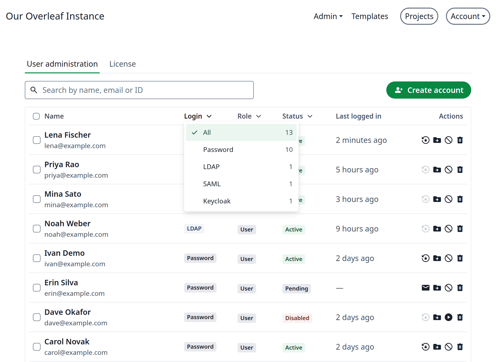

Administrar una instancia de Overleaf para un laboratorio o un departamento trae las mismas preguntas cada semana. ¿Por qué este estudiante no puede iniciar sesión? ¿Quién sigue usando el servidor? ¿Quién le dio derechos de administrador a esa cuenta? ¿Dónde está la tesis del año pasado? Hemos reconstruido el panel de administración para que puedas responderlas sin abrir una shell de base de datos.

El nuevo panel sigue el aspecto de Overleaf 6.3 y está traducido a todos los idiomas que admite la interfaz. Tiene una lista de todos los usuarios, una lista de todos los proyectos, una página para cada uno de ellos, un lugar para gestionar tus plantillas y registros de auditoría.

<Info>

El nuevo panel de administración está fusionado en nuestra rama principal y se publicará oficialmente en la v6.4.0. Todas las capturas de pantalla de esta entrada provienen de una instancia de prueba llena de cuentas inventadas.

</Info>

### Qué incluye {#what’s-in-it}

* **Lista de usuarios**: búsqueda, filtros por método de inicio de sesión, rol y estado, y acciones masivas.
* **Página de usuario**: la cuenta, los proyectos, las funciones, las integraciones, los registros de auditoría y las sesiones de una persona.
* **Lista de proyectos**: todos los proyectos de la instancia, con búsqueda por nombre, ID, propietario o enlace para compartir.
* **Página de proyecto**: la configuración, los archivos, los miembros, los archivos eliminados y los registros de auditoría de un proyecto.
* **Gestión de plantillas**: publica un proyecto como plantilla, actualízalo y mantén la galería en orden.
* **Registros de auditoría**: quién hizo qué, cuándo y desde qué dirección IP.

## Una sola lista para todos los usuarios {#one-list-for-every-user}

Haz clic en **Admin** y luego en **Manage Users**. Cada cuenta es una fila que muestra cómo inicia sesión, su rol y su estado.

<Frame caption="La lista de usuarios">
  
</Frame>

Busca por nombre, correo electrónico o ID. Los encabezados **Login**, **Role** y **Status** son filtros, y cada opción muestra cuántas cuentas devolvería. Ves de un vistazo cuántas personas entran por SAML, y cada proveedor OIDC aparece con el nombre que le diste.

<Frame caption="Filtrar por método de inicio de sesión">
  
</Frame>

Cada cuenta tiene exactamente un estado, y los cuatro estados suman el total.

| Estado       | Qué significa                                                               |
| ------------ | --------------------------------------------------------------------------- |
| **Active**   | Inició sesión o abrió un proyecto en los últimos 12 meses.                  |
| **Pending**  | Nunca ha iniciado sesión.                                                   |
| **Inactive** | Inició sesión antes, pero no en los últimos 12 meses.                       |
| **Disabled** | Un administrador impidió que la cuenta inicie sesión.                       |

Las cuentas eliminadas no estorban: tienen su propio filtro. Si una búsqueda también coincide con una cuenta eliminada, una línea sobre la tabla lo indica y ofrece mostrarla.

<Frame caption="Filtrar por estado">
  
</Frame>

La búsqueda, la ordenación y la paginación se ejecutan en el servidor, así que las listas ya no se detienen en las primeras 1000 filas.

### Incorpora personas, con o sin correo electrónico {#bring-people-in-with-or-without-email}

**Create account** añade un usuario y te da el enlace que necesita. Cuando el [envío de correo](/es/on-premises/configuration/overleaf-toolkit/email-delivery  "mention") no está configurado, el diálogo lo dice claramente y te permite copiar el enlace, de modo que incluso una instancia pequeña puede incorporar personas.

<Frame caption="El enlace de activación de una cuenta nueva">
  
</Frame>

El panel ofrece el enlace adecuado para cada cuenta: **Send activation email** para una que nunca ha iniciado sesión, válido durante 7 días, y **Send reset link** para una que sí lo ha hecho, válido durante 1 hora. Las cuentas que inician sesión mediante SSO no tienen contraseña local, así que no reciben ninguno de los dos.

### Cambia muchas cuentas a la vez {#change-many-accounts-at-once}

Marca algunas cuentas y la barra de herramientas ofrece **Send activation email**, **Transfer this user's projects**, **Disable**, **Enable**, **Make admin**, **Remove admin** y **Delete account**. El diálogo enumera las cuentas antes de que confirmes. Si alguna falla, te dice cuáles, y lo que ya funcionó queda hecho.

<Frame caption="Acciones masivas">
  
</Frame>

### Difícil equivocarse {#hard-to-get-wrong}

* Tu propia cuenta está marcada como **You** y sus acciones aparecen en gris, así que no puedes desactivarte, eliminarte ni quitarte el rol de administrador.
* Cada acción pide confirmación en un diálogo que nombra la cuenta.
* **Delete account** puede entregar antes los proyectos del usuario a otra persona.
* Una cuenta eliminada se puede restaurar, junto con los proyectos que se eliminaron con ella. Solo **Delete permanently** es definitivo, y te avisa.

## Todo sobre una persona {#everything-about-one-person}

Haz clic en un nombre para abrir la página del usuario. Tiene seis pestañas y los mismos iconos de acción que la lista.

### Cuenta {#account}

Los detalles de la cuenta, desde el ID y los correos hasta el último inicio de sesión y su dirección IP. Haz clic en el lápiz para cambiar el correo, los nombres o la contraseña, o para activar o desactivar **Admin**.

<Frame caption="Editar una cuenta">
  
</Frame>

### Proyectos {#projects}

Los proyectos de los que esta persona es propietaria, con su propia búsqueda, filtro de estado y acciones.

<Frame caption="Los proyectos de un usuario">
  
</Frame>

### Funciones {#features}

Lo que esta cuenta tiene activado, como los colaboradores por proyecto, el tiempo límite de compilación, las integraciones y la IA, junto con el uso de IA de la cuenta y un botón para restablecerlo.

<Frame caption="Las funciones de un usuario">
  
</Frame>

### Integraciones {#integrations}

Los tokens de acceso Git de la persona y los servicios que ha vinculado.

<Frame caption="Las integraciones de un usuario">
  
</Frame>

### Sesiones {#sessions}

Dónde ha iniciado sesión la persona. **Clear sessions** cierra su sesión en todas partes, que es lo primero que hay que hacer cuando se pierde un portátil.

<Frame caption="Las sesiones de un usuario">
  
</Frame>

## Todos los proyectos de la instancia {#every-project-on-the-instance}

Haz clic en **Admin** y luego en **Project/Object Lookup**. La lista muestra los proyectos de todos los usuarios, con sus propietarios y estados. El cuadro de búsqueda acepta el nombre de un proyecto, su ID, su propietario o un enlace. Pega un enlace para compartir y encontrarás el proyecto que hay detrás.

<Frame caption="Todos los proyectos">
  
</Frame>

El filtro **Status** separa los proyectos **Active**, **Archived**, **Trashed** y **Deleted**. Marca varios proyectos para descargarlos en un único archivo `.zip`, cambiar su propietario o eliminarlos. En la vista **Deleted**, los botones son **Restore** y **Delete permanently**.

<Frame caption="Filtrar proyectos por estado">
  
</Frame>

## Todo sobre un proyecto {#everything-about-one-project}

Haz clic en el título de un proyecto para abrir su página.

### Resumen {#overview}

Cambia el nombre, el uso compartido por enlace, el compilador, la versión de TeX Live y el documento principal. **Change project owner** entrega el proyecto a otro usuario, lo que ayuda cuando alguien deja el laboratorio y su tesis tiene que quedarse.

<Frame caption="Editar un proyecto">
  
</Frame>

### Árbol de archivos {#file-tree}

Los archivos y carpetas del proyecto, en solo lectura.

<Frame caption="Los archivos de un proyecto">
  
</Frame>

### Miembros {#members}

El propietario, los colaboradores y las invitaciones pendientes. Cambia el rol de un colaborador, retírale el acceso, o reenvía o revoca una invitación.

<Frame caption="Cambiar los miembros de un proyecto">
  
</Frame>

### Archivos eliminados {#deleted-files}

Archivos que se quitaron del proyecto. **Restore file** coloca una copia en la carpeta raíz del proyecto, y la fila muestra el nombre de la copia.

<Frame caption="Un archivo restaurado">
  
</Frame>

## Gestión de plantillas {#template-management}

Una plantilla empieza como un proyecto normal. La publicas desde el editor y la gestionas desde su página en la galería o desde el panel de administración.

### Todas las plantillas en una tabla {#all-templates-in-one-table}

Haz clic en **Admin**, luego en **Project/Object Lookup** y después en la pestaña **Templates**. Enumera cada plantilla publicada con su autor, su propietario y su última modificación, y puedes buscar en ella. Haz clic en un título para abrir la plantilla, en un propietario para abrir la página de ese usuario, o en la papelera para eliminar una plantilla. Una eliminación queda en [tu propio registro de auditoría](#when-there-is-no-log-left).

<Frame caption="Todas las plantillas en el panel de administración">
  
</Frame>

### Publica desde el editor {#publish-from-the-editor}

Abre un proyecto y compílalo hasta que el PDF se vea bien, porque la galería muestra el PDF de la última compilación correcta. Después haz clic en **File** y luego en **Manage Template**, y rellena el título, el autor, una categoría, una descripción en Markdown y una licencia. El compilador y el documento principal del proyecto acompañan a la plantilla, así que los proyectos abiertos a partir de ella usan los mismos.

<Frame caption="Publicar un proyecto como plantilla">
  
</Frame>

### Actualiza una plantilla {#update-a-template}

Para cambiar los archivos y el PDF de una plantilla, vuelve a publicar el proyecto con el mismo título. El diálogo te indica que el título ya existe, y el botón pasa a ser **Overwrite**. Los proyectos que alguien ya abrió a partir de la plantilla no cambian.

<Frame caption="Publicar con el mismo título">
  
</Frame>

### La página de la plantilla {#the-template-page}

Todos pueden usar **Open as Template**, **View PDF** y el botón de descarga. Los administradores también tienen **Admin: Source Project**, **Edit** y **Delete**.

<Frame caption="La página de una plantilla">
  
</Frame>

**Edit** cambia lo que la galería muestra de una plantilla: su título, autor, categoría, descripción y licencia, y el idioma de corrección ortográfica de los proyectos abiertos a partir de ella. No toca los archivos ni el PDF. La plantilla guarda su propia copia de los archivos, así que eliminar el proyecto de origen no se lleva la plantilla.

<Frame caption="Editar los detalles de una plantilla">
  
</Frame>

### Una galería para tus usuarios {#a-gallery-for-your-users}

La galería se abre con una tarjeta para cada categoría, y cada categoría tiene su propia página. Las categorías provienen de tu configuración de [Plantillas](/es/on-premises/configuration/overleaf-toolkit/templates  "mention"), donde también puedes permitir publicar a un usuario que no sea administrador.

<Frame caption="La galería de plantillas">
  
</Frame>

La página **All templates** muestra cada plantilla con una vista previa de su primera página, y tus usuarios pueden buscar en ella y ordenarla por título o por fecha.

<Frame caption="Todas las plantillas">
  
</Frame>

## Registros de auditoría: quién hizo qué y cuándo {#audit-logs-who-did-what-and-when}

Esta es la parte de la que estamos más satisfechos. Cada cuenta y cada proyecto tiene ahora su propio registro de auditoría, y los administradores del sitio pueden leerlo directamente en el panel.

Abre la pestaña **Audit logs** en la página de un usuario. Las entradas más recientes aparecen primero.

<Frame caption="El registro de auditoría de una cuenta">
  
</Frame>

Leída de abajo arriba, esta página cuenta una historia. Lena inició sesión. Un administrador subió su tiempo límite de compilación a 300 segundos, desactivó su acceso a la IA, le envió un enlace para restablecer la contraseña, la hizo administradora y lo revirtió, y luego desactivó y volvió a activar la cuenta. Lena inició sesión de nuevo, y el administrador borró sus sesiones.

| Columna        | Qué te indica                                                                                              |
| -------------- | ---------------------------------------------------------------------------------------------------------- |
| **Date**       | Cuándo ocurrió.                                                                                            |
| **Operation**  | Qué ocurrió.                                                                                               |
| **Initiator**  | Quién lo hizo. Lo que un administrador hace a una cuenta muestra al administrador, no al usuario.          |
| **IP Address** | De dónde vino la solicitud.                                                                                |
| **Info**       | Los detalles, como el nuevo tiempo límite de compilación, o si el correo realmente se envió.               |

### Encuentra la entrada que necesitas {#find-the-entry-you-need}

Busca por operación o por dirección IP. El encabezado **Operation** es un filtro que enumera cada operación de este registro y cuántas veces ocurrió.

<Frame caption="Filtrar por operación">
  
</Frame>

### Un registro para cada proyecto {#a-log-for-every-project}

La página del proyecto tiene la misma pestaña. Muestra a quién se invitó, quién se unió, qué rol cambió, quién descargó el proyecto y quién se hizo cargo de él.

<Frame caption="El registro de auditoría de un proyecto">
  
</Frame>

### Qué se registra {#what-gets-recorded}

Estas son las operaciones principales de cada registro, con los nombres que ves en el panel.

| Registro | Área                          | Operaciones                                                                                                                                                                                                                                 |
| -------- | ----------------------------- | ------------------------------------------------------------------------------------------------------------------------------------------------------------------------------------------------------------------------------------------- |
| Cuenta   | Inicio de sesión y contraseña | Login, Logout, Failed password match, Update password, Reset password                                                                                                                                                                       |
| Cuenta   | Correo y SSO                  | Add email, Remove email, Change primary email, Link SSO, Unlink SSO                                                                                                                                                                         |
| Cuenta   | Integraciones                 | Link GitHub, Unlink GitHub, Link Dropbox, Unlink Dropbox, Integration account linked, Integration account unlinked, Create Git token, Delete Git token                                                                                      |
| Cuenta   | Acciones de administradores   | Create account, Send activation email, Send password reset email, Change name, Change admin access, Change features, Change AI features, Reset AI usage, Account suspension, Account reactivation, Clear sessions, Transfer projects, Delete account, Restore account |
| Proyecto | Uso compartido                | Send invite, Resend invite, Revoke invite, Accept invite, Join via token, Accept via link sharing, Remove collaborator, Leave project, Project role changed, Toggle access level, Transfer ownership                                       |
| Proyecto | Archivos                      | Project downloaded, Project exported docx, Project exported markdown, Project exported html, Restore deleted doc                                                                                                                            |
| Proyecto | Acciones de administradores   | Project deleted, Project restored                                                                                                                                                                                                           |
| Proyecto | Sincronización Git            | Integration repo linked, Integration repo unlinked                                                                                                                                                                                          |

### Cuando no queda ningún registro {#when-there-is-no-log-left}

**Delete permanently** elimina una cuenta o un proyecto junto con su registro, y una plantilla nunca tuvo uno. Por eso estas acciones se escriben en el registro del administrador que las realizó, junto con el correo o el ID de lo que se eliminó.

<Frame caption="Eliminaciones permanentes en el registro del propio administrador">
  
</Frame>

### Conviene saber {#good-to-know}

* Las entradas se conservan dos años y medio; después MongoDB las elimina automáticamente.
* Detrás de un proxy inverso, define [`OVERLEAF_TRUSTED_PROXY_IPS`](/es/on-premises/configuration/overleaf-toolkit/environment-variables  "mention") para que el registro muestre la dirección del visitante y no la del proxy.
* Todavía no se registra todo. Los clone y push de Git, los cambios en la configuración de un proyecto como su nombre o su compilador, y los proyectos que un propietario crea, archiva, envía a la papelera o elimina no aparecen en el registro del proyecto.

## Pruébalo {#try-it}

El nuevo panel se incluye en Ayakaleaf Pro v6.4.0. Las guías paso a paso ya están disponibles:

* [Gestión de usuarios](/es/on-premises/user-guide/administrators/user-management  "mention")
* [Gestión de proyectos](/es/on-premises/user-guide/administrators/project-management  "mention")
* [Gestión de plantillas](/on-premises/user-guide/administrators/template-management  "mention")

Si falta algo o no funciona como esperas, cuéntanoslo en [GitHub](https://github.com/ayaka-notes/ayakaleaf-pro/issues).
