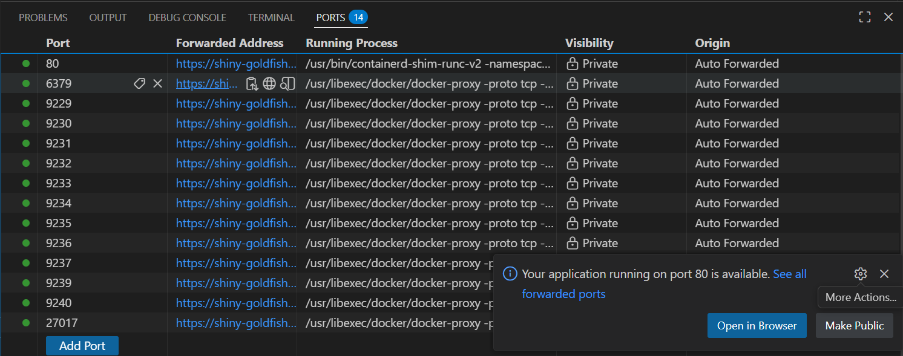

Para ahorrar tiempo y montar rápidamente el entorno de desarrollo, ofrecemos otra versión de la configuración del entorno de desarrollo: GitHub Codespace.

## Tutorial de configuración {#configuration-tutorial}

<Steps>
<Step title="Crear Codespaces">
Haz clic en el siguiente botón para crear un codespace en la nube para el desarrollo de server-pro.

[](https://codespaces.new/ayaka-notes/ayakaleaf-pro)

Se recomienda elegir un **tipo de máquina** (**Machine Type**) de al menos **4 núcleos**. Para tipos de máquina más grandes, puedes enviar una solicitud al equipo de soporte oficial de GitHub abriendo un ticket [aquí](https://support.github.com/contact?tags=rr-codespaces%2Ccat_codespaces).

<Frame>
  
</Frame>
</Step>

<Step title="Ejecutar el script de configuración">
Tendrás que esperar con paciencia a que se cree el codespace. Cuando tengas acceso a tu terminal, ejecuta el siguiente comando:

```text
cd develop/
bin/setup
bin/i18n
```

`bin/setup` descarga las imágenes e inicia los servicios; después, `bin/i18n` aplica las traducciones de los módulos de Ayakaleaf Pro, que los archivos de locales confirmados no contienen, consulta [Actualizar las traducciones i18n](/es/dev/environment/update-i18n-translations).

<Frame>
  
</Frame>

<Warning>

Este script (`bin/setup`) te permite configurar el entorno de desarrollo sobre el último commit de la rama `server-pro` en el menor tiempo posible. Puede que no sea aplicable a versiones antiguas u otras ramas.

Construimos la imagen Docker de desarrollo cada día con [GitHub Action](https://github.com/ayaka-notes/ayakaleaf-pro/actions).

</Warning>
</Step>

<Step title="Acceder a tu Launchpad">
Cambia a la pestaña de puertos y verás una lista de los puertos web disponibles. Haz clic en el de `80` (el `OVERLEAF_PORT` de `develop/dev.rc`). Ahora deberías ver la página launchpad. Mailpit, Grafana, Mongo Express y RedisInsight están en rutas del mismo puerto (`/mailpit/`, `/grafana/`, `/mongo-express/` y `/redis-insight/`), y el menú **Dev tools** del sitio enlaza a ellos una vez que inicias sesión. La consola de RustFS está en 9001 y Hoppscotch en 9170, consulta [Puertos](/es/dev/environment/setup-develop-environment-local#ports).

<Frame>
  
</Frame>

Verás:

<Frame>
  
</Frame>
</Step>

<Step title="Disfruta desarrollando">
¡Ahora es tu momento! Empieza a crear tu gran función. `bin/setup` ya inicia todos los servicios en modo de desarrollo (`node --watch`, igual que `bin/dev`), así que los cambios de código aparecen sin otro comando.

Después de cambiar `develop/dev.rc`, vuelve a ejecutar `bin/setup`: pasa por `bin/docker-compose`, que añade los archivos de las funciones activadas.

<Warning>

No inicies los servicios a mano con `docker compose -f docker-compose.yml -f docker-compose.dev.yml -f docker-compose.image.yml up`. Omite los archivos de funciones de `dev.rc`, por lo que `web`, `filestore` y `history-v1` se recrean sin la configuración de RustFS y recurren a volúmenes locales, donde faltan el historial y los archivos binarios de tus proyectos.

</Warning>
</Step>
</Steps>
