Haga clic en **Admin** y luego en **Project/Object Lookup**. La lista muestra los proyectos de todos los usuarios. La pestaña **Templates** junto a **Projects** muestra las plantillas publicadas; consulte [Gestión de plantillas](/on-premises/user-guide/administrators/template-management).

<Frame caption="Todos los proyectos">
  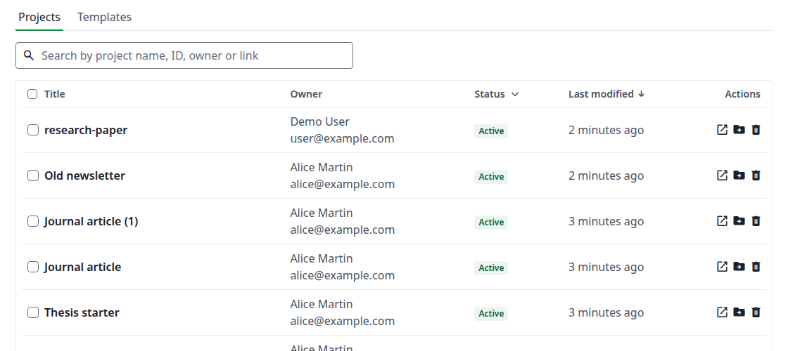
</Frame>

## Encontrar un proyecto {#find-a-project}

Escriba en **Search by project name, ID, owner or link**. Un enlace puede ser la dirección del proyecto o uno de sus enlaces para compartir. Use el filtro **Status** para acotar la lista. Haga clic en **Title** o **Last modified** para ordenar.

Los proyectos eliminados no aparecen en los resultados. Si su búsqueda también coincide con uno, una línea encima de la tabla lo indica, por ejemplo **Found 1 matching deleted projects**. Haga clic en **Display deleted projects** para verlos.

## Estado del proyecto {#project-status}

Cada proyecto tiene un estado, y el filtro **Status** muestra cuántos proyectos tiene cada uno.

<Frame caption="El filtro Status">
  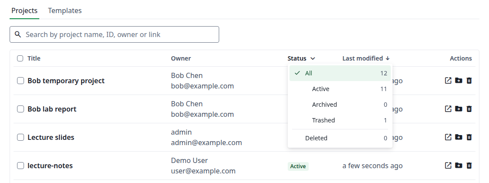
</Frame>

| Estado | Significado |
| --- | --- |
| **All** | Todos los proyectos que no están eliminados. |
| **Active** | El estado normal. |
| **Archived** | El propietario lo archivó. El proyecto está intacto y se puede recuperar. |
| **Trashed** | El propietario lo movió a la papelera. El proyecto está intacto y se puede recuperar. |
| **Deleted** | Eliminado por el propietario desde la papelera, por un administrador o junto con la cuenta del propietario. Solo un administrador puede recuperarlo. |

Un proyecto pasa por los estados en etapas:

1. **Active, Archived y Trashed** los elige el propietario en su propia página de proyectos. El propietario siempre puede volver atrás. **Restore** desde la papelera siempre lleva a Active, aunque el proyecto estuviera archivado antes.
2. **Deleted** es la siguiente etapa. El propietario solo puede eliminar desde la papelera; un administrador puede eliminar desde cualquiera de los tres.
3. **Restore** devuelve un proyecto eliminado como **Active**, sea cual sea su estado anterior, y su nombre recibe `(Restored)` al final. Solo un administrador puede hacerlo. Si la cuenta del propietario también está eliminada, restaure primero la cuenta: de lo contrario, el cuadro de diálogo indica **The owner of this project is deleted: restore the owner first**.
4. **Delete permanently** es la última etapa y no se puede deshacer. Por lo demás, los proyectos eliminados permanecen hasta que usted los quite, salvo que la instancia defina [`ENABLE_CRON_RESOURCE_DELETION`](/es/on-premises/configuration/overleaf-toolkit/environment-variables), que los quita a los 90 días.

<Info>

El estado sigue solo al propietario. Cuando un colaborador archiva un proyecto compartido o lo mueve a la papelera, se mueve en su propia página de proyectos, y el estado aquí no cambia.

</Info>

## Acciones sobre un proyecto {#actions-on-a-project}

| Icono | Acción | Qué hace |
| --- | --- | --- |
| Abrir | **Open Project** | Abre el proyecto en el editor, en una pestaña nueva. |
| Carpeta | **Change project owner** | Da el proyecto a otro usuario. |
| Papelera | **Delete** | Mueve el proyecto a **Deleted**. |
| Flecha | **Restore** | Recupera un proyecto eliminado. Solo para proyectos eliminados. |
| Papelera tachada | **Delete permanently** | Quita definitivamente un proyecto eliminado. Solo para proyectos eliminados. |

### Cambiar el propietario {#change-the-owner}

Haga clic en el icono de la carpeta, escriba un nombre o un correo electrónico, elija el usuario y haga clic en **Change project owner**. El cuadro de diálogo advierte que esto no se puede deshacer y que el nuevo propietario recibirá un aviso y podrá cambiar la configuración de acceso del proyecto. No se ofrecen las cuentas deshabilitadas. Si cambia el texto después de elegir, la elección se cancela: vuelva a elegir el usuario.

<Frame caption="Cambiar el propietario de un proyecto">
  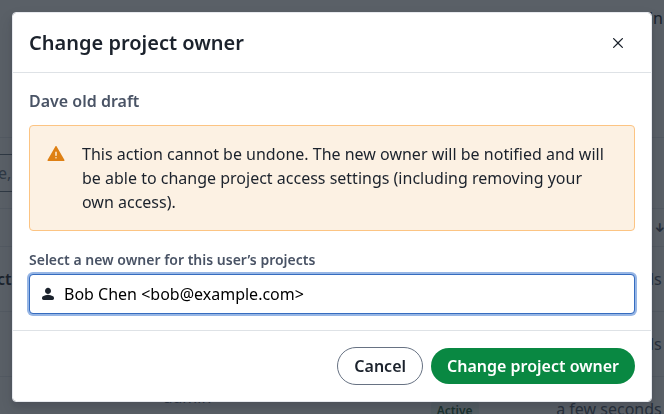
</Frame>

Para mover todos los proyectos de un usuario a la vez, consulte [Transferir los proyectos de un usuario](/es/on-premises/user-guide/administrators/user-management#transfer-a-users-projects).

### Eliminar, restaurar o eliminar definitivamente {#delete-restore-or-permanently-delete}

Haga clic en el icono de la papelera y luego en **Delete**. Para volver a encontrar el proyecto, elija **Deleted** en el filtro **Status**.

<Frame caption="Un proyecto eliminado">
  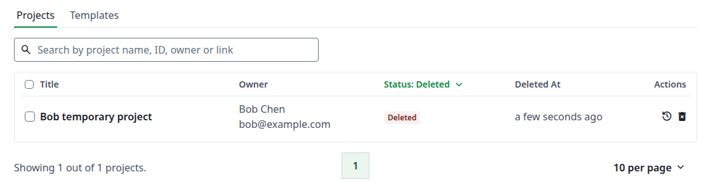
</Frame>

Haga clic en el icono de la flecha y luego en **Restore** para recuperarlo, o en la papelera tachada y luego en **Delete permanently** para quitarlo.

<Frame caption="Eliminar un proyecto definitivamente">
  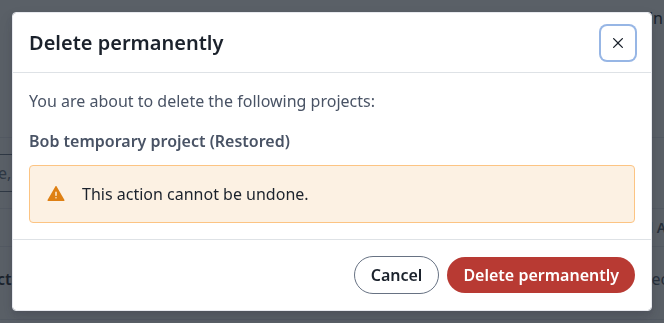
</Frame>

### Cambiar varios proyectos a la vez {#change-several-projects-at-once}

Marque los proyectos en la lista. Aparecen botones junto a la búsqueda: **Download**, **Change project owner** y **Delete**. **Download** guarda los proyectos seleccionados en un único archivo `.zip`. Con **Change project owner**, no se pueden elegir los propietarios actuales de los proyectos marcados. En la vista **Deleted**, los botones son **Restore** y **Delete permanently**.

<Frame caption="Acciones masivas">
  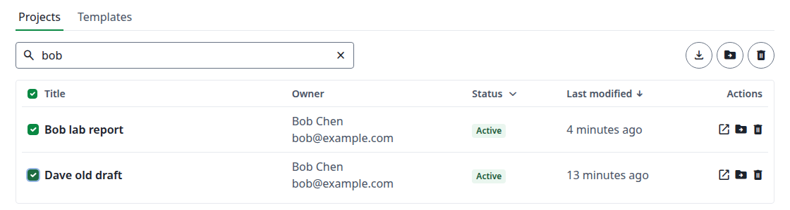
</Frame>

## La página del proyecto {#the-project-page}

Haga clic en el título de un proyecto para abrir su página. Arriba están los iconos para editar, abrir, descargar y eliminar el proyecto. Tiene cinco pestañas.

### Resumen {#overview}

Los detalles y la configuración del proyecto. Haga clic en el icono del lápiz para cambiar **Name**, **Link sharing**, **Compiler**, **TeX Live version** y **Main document**, o para hacer clic en **Change project owner**. Luego haga clic en **Save**.

<Frame caption="Editar un proyecto">
  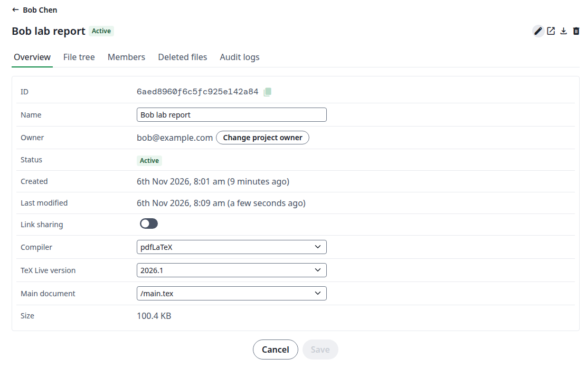
</Frame>

### Árbol de archivos {#file-tree}

Los archivos y carpetas del proyecto, de solo lectura.

<Frame caption="Los archivos de un proyecto">
  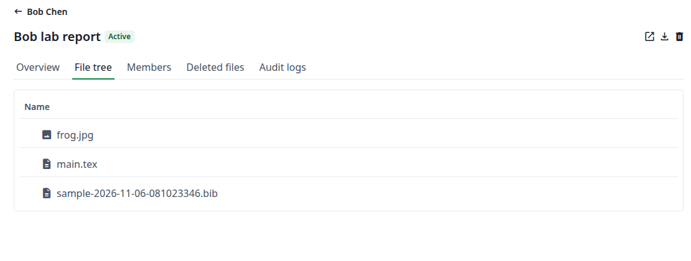
</Frame>

### Miembros {#members}

Quién tiene acceso: el propietario, los colaboradores y las invitaciones pendientes. Haga clic en el icono del lápiz para cambiarlos:

* Elija **Editor**, **Reviewer** o **Viewer** para un colaborador. El cambio se aplica de inmediato.
* Haga clic en la papelera junto a un colaborador y luego en **Remove access**.
* Para una invitación pendiente, haga clic en el sobre para **Resend invite**, o en la papelera para **Revoke Invite**.

Haga clic en **Done** cuando termine. El propietario no se puede cambiar aquí: use **Change project owner** en la pestaña **Overview**.

<Frame caption="Cambiar los miembros de un proyecto">
  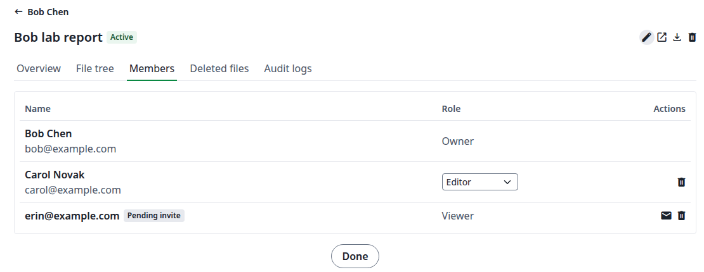
</Frame>

### Archivos eliminados {#deleted-files}

Archivos quitados del proyecto. Haga clic en el icono de la flecha junto a un archivo y luego en **Restore file**. Una copia con la fecha en su nombre se coloca en la carpeta raíz del proyecto, y la fila muestra su nombre. El archivo eliminado permanece en la lista.

La copia aparece en la pestaña **File tree** después de recargar la página.

<Frame caption="Un archivo restaurado">
  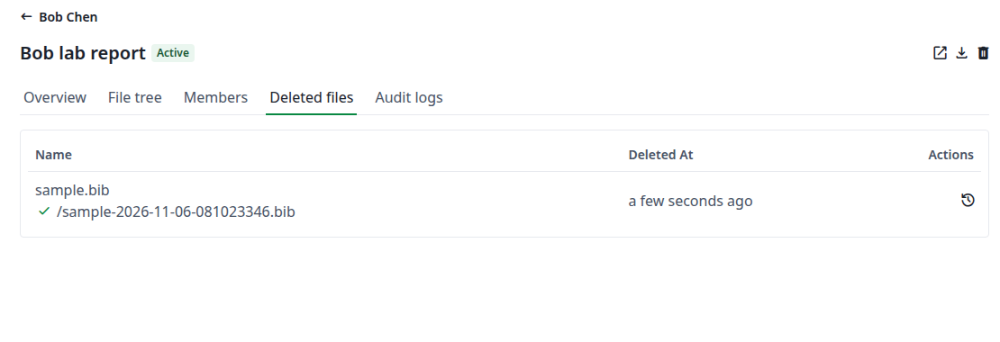
</Frame>

### Registros de auditoría {#audit-logs}

Lo que le ocurrió a este proyecto: la fecha, la operación, quién la hizo, la dirección IP y los detalles. Busque en ellos o filtre por **Operation**.

<Frame caption="Los registros de auditoría de un proyecto">
  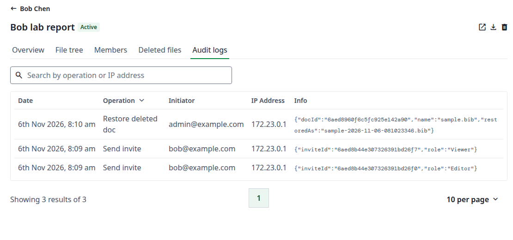
</Frame>
