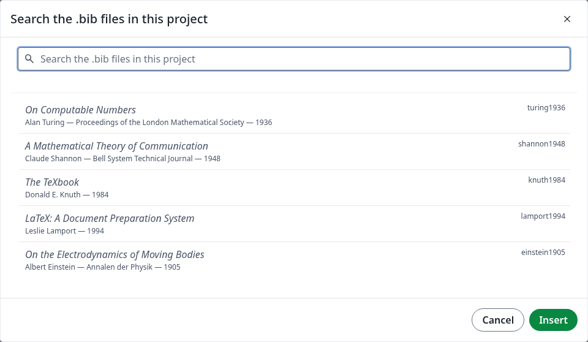

La búsqueda de referencias recorre todos los archivos `.bib` de tu proyecto, así que puedes encontrar una referencia sin recordar su clave de cita. No hay nada que configurar.

Tu proyecto necesita al menos un archivo `.bib`. Puedes subir uno o importar tu biblioteca desde [Zotero](/es/on-premises/user-guide/users/zotero-integration) o [Mendeley](/es/on-premises/user-guide/users/mendeley-integration).

## Insertar una cita {#insert-a-citation}

<Steps>
<Step title="Empezar una cita">
En un archivo `.tex`, escribe `\cite{`. El editor añade la llave de cierre. Debajo del cursor ves las claves de cita y un recuadro azul, **Open advanced reference search**.

<Frame caption="El recuadro azul bajo una cita">
  
</Frame>

El botón **Insert citation** de la barra de herramientas y **Insert** y luego **Citation** también empiezan un `\cite{}` por ti. El recuadro aparece también con otros comandos de cita, como `\citep`, `\autocite`, `\parencite` y `\textcite`.
</Step>

<Step title="Abrir la búsqueda">
Haz clic en **Search** en el recuadro azul o pulsa Ctrl+Espacio entre las llaves. El diálogo enumera todas las entradas con su título, clave de cita, autor, revista y año.

<Frame caption="Todas las entradas del proyecto">
  
</Frame>
</Step>

<Step title="Encontrar la entrada">
Escribe en el cuadro de búsqueda. Busca en la clave de cita, el autor, el título, la revista y el año, y resalta lo que encuentra. Todas las palabras deben coincidir, así que `turing 1936` encuentra el artículo de Turing de 1936. Otros campos, como la editorial, no se buscan.

<Frame caption="Búsqueda por autor y año">
  
</Frame>
</Step>

<Step title="Elegir una o varias entradas">
Haz clic en una entrada. Se vuelve verde y su clave aparece encima de la lista. Para añadir otra, haz clic en ella o vuelve a buscar: lo que elegiste se mantiene. Para quitar una, vuelve a hacer clic en ella o en la <strong>×</strong> junto a su clave.

<Frame caption="Dos entradas elegidas">
  
</Frame>
</Step>

<Step title="Hacer clic en Insert">
Las claves aparecen entre las llaves, separadas por comas. Si tu documento aún no tiene bibliografía, añade estas líneas antes de `\end{document}`, con los nombres de tus archivos `.bib` sin la extensión:

```latex
\bibliographystyle{plain}
\bibliography{refs,more}
```

Haz clic en **Recompile**. Las referencias aparecen en el PDF.

<Frame caption="La cita compilada">
  
</Frame>
</Step>
</Steps>

La búsqueda funciona igual en el editor **Visual**.

## Cambiar una cita {#change-a-citation}

<strong>Añadir una referencia:</strong> coloca el cursor entre las llaves de una cita existente y abre la búsqueda. **Insert** añade las claves nuevas después de las que ya están.

<strong>Reemplazar referencias:</strong> selecciona las claves en el editor y pulsa Ctrl+Espacio. Las claves aparecen encima de la lista y el botón ahora dice **Replace**. Quita las que no quieras, añade otras y haz clic en **Replace**. Una clave que no está en ningún archivo `.bib` se queda hasta que la quites.

<Frame caption="Reemplazar las claves seleccionadas">
  
</Frame>

## Usar el teclado {#use-the-keyboard}

| Tecla | Qué hace |
| --- | ------------ |
| **Flecha abajo** | Pasa del cuadro de búsqueda a la lista y luego baja por la lista |
| **Flecha arriba** | Sube por la lista |
| **Espacio** | Elige la entrada o la quita de lo que elegiste |
| **Intro** | Inserta lo que elegiste, cuando estás en la lista |
| **Tab** | Se mueve entre el cuadro de búsqueda, la lista y los botones |
| **Esc** | Cierra el diálogo sin cambiar nada |

## De dónde vienen las entradas {#where-the-entries-come-from}

La búsqueda abarca todos los archivos `.bib` del proyecto, incluidos los importados desde Zotero o Mendeley. Cuando editas un archivo `.bib`, la siguiente búsqueda encuentra las entradas nuevas.

## Si algo sale mal {#if-something-goes-wrong}

| Lo que ves | Por qué | Qué hacer |
| ------------ | --- | ---------- |
| La lista del diálogo está vacía | El proyecto no tiene ningún archivo `.bib` | Sube uno o crea uno |
| No hay recuadro azul, y Ctrl+Espacio muestra comandos de LaTeX | El cursor no está entre las llaves de una cita | Haz clic entre las llaves |
| Ctrl+Espacio no hace nada | Tu ordenador usa este atajo para otra cosa | Haz clic en **Search** en el recuadro azul |
| No se encuentra una entrada | La búsqueda solo abarca la clave, el autor, el título, la revista y el año | Busca por uno de esos campos |
