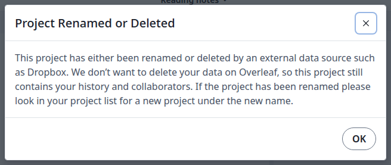

Mantenga todos sus proyectos sincronizados con una carpeta de su Dropbox. Los cambios van en ambos sentidos en segundo plano, con una excepción: lo que escribe en el editor llega a Dropbox unos minutos después de salir del proyecto, o cuando hace clic en **sync this project now**.

<Info>

Si no ve ninguna opción de Dropbox en **Account settings** ni en el editor, pida a su administrador que active la [sincronización con Dropbox](/es/on-premises/configuration/overleaf-toolkit/integrations/dropbox-synchronisation).

</Info>

## Vincular su cuenta de Dropbox {#link-your-dropbox-account}

Esto se hace una sola vez.

<Steps>
<Step title="Abrir la configuración de su cuenta">
Haga clic en **Account** y luego en **Account settings**. En **Project synchronisation**, busque **Dropbox** y haga clic en **Link**.

<Frame caption="Dropbox en la configuración de la cuenta">
  
</Frame>
</Step>

<Step title="Autorizar en Dropbox">
Se abre Dropbox. Inicie sesión si se le pide y luego autorice la aplicación.
</Step>

<Step title="Comprobar el vínculo">
Vuelve a la configuración de la cuenta. Un mensaje verde indica que su cuenta de Dropbox está vinculada, y el botón ahora dice **Unlink**. Debajo de Dropbox, un estado muestra que sus proyectos se están enviando.

<Frame caption="Su cuenta de Dropbox está vinculada">
  
</Frame>

El estado cambia a **Overleaf and Dropbox have processed all updates** cuando todos han llegado.

<Frame caption="Todo está sincronizado">
  
</Frame>
</Step>
</Steps>

Si su cuenta aún no está vinculada, la tarjeta **Dropbox** del editor le pide que la vincule primero. Haga clic en **Update Dropbox Settings**: la configuración de la cuenta se abre en una pestaña nueva. Vincule allí su cuenta y luego recargue la página del editor, como le indica el diálogo.

<Frame caption="El aviso cuando su cuenta no está vinculada">
  
</Frame>

Si no permite el acceso en Dropbox, vuelve a la configuración de la cuenta sin ningún mensaje, y el botón sigue diciendo **Link**.

### Si tiene proyectos con el mismo nombre {#if-you-have-projects-with-the-same-name}

No puede vincular mientras dos de sus proyectos tengan el mismo nombre. El mensaje los nombra. Los proyectos archivados y los de la papelera también cuentan.

<Frame caption="Dos proyectos con el mismo nombre">
  
</Frame>

Cambie el nombre de uno de ellos y vuelva a hacer clic en **Link**.

## Encontrar sus proyectos en Dropbox {#find-your-projects-in-dropbox}

Cada uno de sus proyectos es una carpeta en `Apps/<app name>/` de su Dropbox, con todos sus archivos. Su administrador eligió el nombre de la aplicación. Todos los proyectos se sincronizan, también los que cree más adelante: no puede elegir solo algunos.

Para ver la carpeta de un proyecto, abra el proyecto. En la barra izquierda, haga clic en **Integrations** y luego en **Dropbox**.

<Frame caption="El panel Integrations">
  
</Frame>

El diálogo nombra la carpeta y enlaza a ella en Dropbox.

<Frame caption="La carpeta de este proyecto">
  
</Frame>

Un proyecto nuevo con el mismo nombre que uno que ya tiene recibe una carpeta numerada, como `Field notes (1)`. El diálogo muestra cuál es su carpeta.

<Frame caption="Una carpeta numerada">
  
</Frame>

## Cambios que hace en Overleaf {#changes-you-make-in-overleaf}

No necesita hacer clic en nada.

* **Los archivos nuevos, cambios de nombre, movimientos y eliminaciones** llegan a Dropbox de inmediato. Una carpeta nueva aparece allí con su primer archivo.
* **Cambiar el nombre de un proyecto** cambia el nombre de su carpeta.
* **Las ediciones que escribe en el editor** no llegan a Dropbox mientras el proyecto está abierto, y hacer clic en **Recompile** no las envía. Se envían unos tres minutos después de que todos hayan salido del proyecto. Para enviarlas antes, consulte [Forzar una sincronización](#force-a-sync).
* **Eliminar un proyecto** deja su carpeta en Dropbox. Elimine la carpeta usted mismo si ya no la necesita.

## Cambios que hace en Dropbox {#changes-you-make-in-dropbox}

Aquí tampoco necesita hacer clic en nada. Dropbox avisa a Overleaf del cambio, que suele aparecer en segundos, también en un editor abierto, sin recargar.

* **Los archivos nuevos, ediciones, cambios de nombre y eliminaciones** en una carpeta de proyecto se aplican al proyecto. También las carpetas nuevas.
* **Una carpeta nueva en el nivel superior de la carpeta de la aplicación** se convierte en un proyecto nuevo.
* **Los archivos que Overleaf no sincroniza**, como los archivos `.DS_Store` o `.aux`, se quedan solo en Dropbox.

El historial del proyecto marca estos cambios con <strong>(via Dropbox)</strong>.

### Si el archivo está abierto en el editor {#if-the-file-is-open-in-the-editor}

El archivo cambia delante de usted, y un diálogo se lo indica. Haga clic en **OK**.

<Frame caption="Un archivo abierto cambió en Dropbox">
  
</Frame>

La versión de Dropbox reemplaza lo que había escrito y aún no se había enviado. Su texto no se pierde: queda en el historial del proyecto.

<Frame caption="El texto reemplazado en el historial">
  
</Frame>

### Cambiar el nombre o eliminar una carpeta de proyecto {#rename-or-delete-a-project-folder}

Cambie el nombre de un proyecto en Overleaf, no en Dropbox. Para Overleaf, una carpeta renombrada en Dropbox es una carpeta eliminada y otra nueva: obtiene un proyecto nuevo con el nombre nuevo, y el proyecto antiguo se mantiene.

Cuando elimina una carpeta de proyecto en Dropbox, el proyecto permanece en su lista de proyectos, con sus archivos e historial. La próxima vez que lo abra, un diálogo se lo indicará una vez. Haga clic en **OK**.

<Frame caption="La carpeta de este proyecto ya no está en Dropbox">
  
</Frame>

El proyecto sigue sincronizándose. Para volver a ponerlo completo en Dropbox, haga clic en **sync this project now**.

### Mientras un proyecto está archivado o en la papelera {#while-a-project-is-archived-or-in-the-trash}

Los cambios que haga en su carpeta de Dropbox no se aplican, y restaurar el proyecto no los incorpora. Overleaf deja entonces de enviar los archivos que cambió, de modo que ambos lados difieren. Guarde ese archivo una vez más en Dropbox: la versión de Dropbox reemplaza a la de Overleaf.

## Forzar una sincronización {#force-a-sync}

Cada proyecto tiene su propio enlace. Úselo cuando quiera sus ediciones en Dropbox ya, sin salir del proyecto.

<Steps>
<Step title="Abrir el diálogo de sincronización">
Abra el proyecto. En la barra izquierda, haga clic en **Integrations** y luego en **Dropbox**.
</Step>

<Step title="Hacer clic en sync this project now">
El enlace está al final de <strong>Changes not appearing in Dropbox?</strong>
</Step>

<Step title="Comprobar el resultado">
Un mensaje azul indica que se inició una sincronización manual, y el estado muestra **Sending and receiving updates**. Vuelve a **Overleaf and Dropbox have processed all updates** cuando termina la sincronización.

<Frame caption="Una sincronización manual en curso">
  
</Frame>
</Step>
</Steps>

El enlace envía todo el proyecto a Dropbox, incluidas las ediciones que todavía están en el editor. También lee los cambios pendientes en Dropbox, para todos sus proyectos. Si su sitio no puede recibir [notificaciones de Dropbox](/es/on-premises/configuration/overleaf-toolkit/integrations/dropbox-synchronisation#webhook), los cambios de Dropbox solo llegan de esta forma.

Puede hacerlo una vez por minuto en cada proyecto. Si lo intenta antes, un mensaje rojo le pide que espere.

<Frame caption="Espere un minuto antes de la siguiente">
  
</Frame>

## Desvincular su cuenta de Dropbox {#unlink-your-dropbox-account}

<Steps>
<Step title="Hacer clic en Unlink">
En **Account settings**, en **Dropbox**, haga clic en **Unlink**.
</Step>

<Step title="Confirmar">
Haga clic en **Unlink** en el diálogo.

<Frame caption="Desvincular su cuenta">
  
</Frame>
</Step>

<Step title="Comprobar el resultado">
El botón vuelve a decir **Link**, y la tarjeta **Dropbox** del editor indica que su cuenta no está vinculada. Ya no se sincroniza nada en ningún sentido. Sus proyectos y las carpetas de Dropbox conservan sus archivos.
</Step>
</Steps>

### Volver a vincular más tarde {#link-again-later}

Haga clic en **Link**. Sus proyectos se envían de nuevo a Dropbox:

* Cada archivo reemplaza al del mismo nombre en Dropbox. Lo que haya cambiado en esos archivos en Dropbox mientras estaba desvinculado se sobrescribe, así que traslade primero esos cambios al proyecto.
* Un archivo que solo existe en Dropbox se queda allí, y llega al proyecto la próxima vez que lo modifique.
* Un proyecto cuyo nombre cambió mientras estaba desvinculado recibe una carpeta nueva. La carpeta antigua se mantiene.

### Si Overleaf desvincula su cuenta {#if-overleaf-unlinks-your-account}

Overleaf desvincula su cuenta cuando Dropbox deja de aceptar el vínculo. La lista de proyectos indica el motivo hasta que vuelva a vincularla.

<Frame caption="Su cuenta fue desvinculada">
  
</Frame>

Para conocer los motivos, consulte el Q\&A de la [sincronización con Dropbox](/es/on-premises/configuration/overleaf-toolkit/integrations/dropbox-synchronisation).

<Info>

Para saber qué reciben los colaboradores en un proyecto compartido, consulte [Cómo funciona la sincronización](/es/on-premises/configuration/overleaf-toolkit/integrations/dropbox-synchronisation#cómo-funciona-la-sincronización).

</Info>
