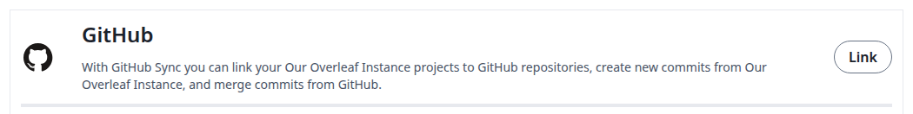

Conecte un proyecto a un repositorio de GitHub. Los cambios van en ambos sentidos, y solo cuando hace clic en **Sync**: nada se sincroniza por sí solo.

<Info>

Si no ve ninguna opción de GitHub en **Account settings** ni en el editor, pida a su administrador que active la [sincronización con GitHub](/es/on-premises/configuration/overleaf-toolkit/integrations/github-synchronisation).

</Info>

## Vincular su cuenta de GitHub {#link-your-github-account}

Esto se hace una sola vez.

<Steps>
<Step title="Abrir la configuración de su cuenta">
Haga clic en **Account** y luego en **Account settings**. Desplácese hasta **GitHub** y haga clic en **Link**.

<Frame caption="GitHub en la configuración de la cuenta">
  
</Frame>
</Step>

<Step title="Autorizar en GitHub">
Se abre GitHub. Inicie sesión si se le pide y luego autorice la aplicación.
</Step>

<Step title="Comprobar el vínculo">
Vuelve a la configuración de la cuenta, y el botón ahora dice **Unlink**.

<Frame caption="Su cuenta de GitHub está vinculada">
  
</Frame>
</Step>
</Steps>

Si su cuenta aún no está vinculada, **Import from GitHub** y la tarjeta **GitHub** del editor le piden que la vincule primero. Haga clic en **Link to your GitHub account**. También llegará a la configuración de la cuenta, en una pestaña nueva si empezó en el editor. Después vuelva atrás y empiece de nuevo.

<Frame caption="El aviso cuando su cuenta no está vinculada">
  
</Frame>

## Importar un repositorio {#import-a-repository}

Esto crea un proyecto nuevo a partir de un repositorio de GitHub, ya vinculado a él.

<Steps>
<Step title="Abrir el diálogo de importación">
En la página de proyectos, haga clic en **New project** y luego en **Import from GitHub**.

<Frame caption="El menú New project">
  
</Frame>

<Info>

**New project** aparece en cuanto tiene un proyecto. El menú **Create a new project** de la página de bienvenida no tiene importación, así que cree primero un proyecto en blanco.

</Info>
</Step>

<Step title="Elegir el repositorio">
Haga clic en **Import to Overleaf** junto al repositorio. La lista incluye sus repositorios y los de sus organizaciones.

<Frame caption="Sus repositorios de GitHub">
  
</Frame>

Si falta el repositorio de una organización, haga clic en <strong>Can't see what you're looking for?</strong> para ver la ayuda de GitHub sobre cómo aprobar la aplicación para esa organización.
</Step>

<Step title="Comprobar el proyecto">
El proyecto nuevo se abre con los archivos del repositorio.

<Frame caption="El proyecto importado">
  
</Frame>
</Step>
</Steps>

## Exportar un proyecto a un repositorio nuevo {#export-a-project-to-a-new-repository}

Esto crea un repositorio a partir de un proyecto del que usted es propietario y los vincula. Un proyecto solo se puede vincular de esta forma o importándolo: no puede vincularlo a un repositorio que ya existe.

<Steps>
<Step title="Abrir GitHub en el editor">
Abra el proyecto. En la barra izquierda, haga clic en **Integrations** y luego en **GitHub**.

<Frame caption="El panel Integrations">
  
</Frame>
</Step>

<Step title="Completar el repositorio">
Elija el **Owner**, que puede ser usted o una de sus organizaciones. **Repository Name** empieza con el nombre del proyecto. La descripción es opcional y **Private** está seleccionado de forma predeterminada. Haga clic en **Create a GitHub repository**.

<Frame caption="Export Project to GitHub">
  
</Frame>
</Step>

<Step title="Comprobar el vínculo">
El diálogo ahora dice **This project is linked to** y nombra el repositorio.

<Frame caption="El proyecto está vinculado">
  
</Frame>
</Step>
</Steps>

## Sincronizar {#sync}

<Steps>
<Step title="Abrir el diálogo de sincronización">
Abra un proyecto vinculado. En la barra izquierda, haga clic en **Integrations** y luego en **GitHub**.

**Recent commits in GitHub** enumera lo que llegará al proyecto.

<Frame caption="Un commit nuevo esperando en GitHub">
  
</Frame>
</Step>

<Step title="Describir sus cambios">
Si cambió algo en el proyecto, aparece un cuadro para el mensaje de commit. Es opcional: si lo deja vacío, el commit se llama `Updates from Overleaf`.

<Frame caption="El mensaje de commit de sus cambios">
  
</Frame>
</Step>

<Step title="Hacer clic en Sync">
Haga clic en **Sync**. Los commits nuevos de GitHub llegan al proyecto, y sus cambios van a la rama predeterminada del repositorio. Si ambos lados cambiaron cosas distintas, se fusionan por usted.
</Step>

<Step title="Comprobar el resultado">
El diálogo muestra <strong>No new commits in GitHub since last merge.</strong> y el cuadro del mensaje de commit desaparece. Los archivos del editor y los commits de GitHub están al día.

<Frame caption="Todo está sincronizado">
  
</Frame>
</Step>
</Steps>

### Si las mismas líneas cambiaron en ambos lados {#if-the-same-lines-changed-on-both-sides}

El diálogo indica que los cambios no se pudieron fusionar y nombra una rama nueva, `overleaf-YYYY-MM-DD-HHMMSS`, que contiene sus cambios.

<Frame caption="Un conflicto">
  
</Frame>

1. Fusione esa rama en la rama predeterminada en GitHub o con Git. Mientras tanto puede cerrar el diálogo: muestra el mismo mensaje cuando lo vuelve a abrir.
2. Haga clic en **I have manually merged. Continue**. El resultado fusionado llega al proyecto.
3. La rama permanece en GitHub. Elimínela cuando ya no la necesite.

## Desvincular un proyecto {#unlink-a-project}

Hágalo cuando ya no quiera que el proyecto se sincronice. Solo el propietario del proyecto puede hacerlo.

<Steps>
<Step title="Hacer clic en Unlink">
En el diálogo de sincronización, haga clic en **Unlink**.
</Step>

<Step title="Confirmar">
Haga clic en **Confirm**. La nota sobre una suscripción no le impide volver a vincular el proyecto.

<Frame caption="Confirmar la desvinculación">
  
</Frame>
</Step>

<Step title="Comprobar el resultado">
El diálogo ahora muestra **Export Project to GitHub**. El proyecto y el repositorio conservan su contenido. Para volver a sincronizar, exporte el proyecto a un repositorio nuevo o importe el repositorio en un proyecto nuevo.
</Step>
</Steps>

## Desvincular su cuenta de GitHub {#unlink-your-github-account}

En **Account settings**, en **GitHub**, haga clic en **Unlink** y luego de nuevo en **Unlink** en el diálogo.

<Frame caption="Desvincular su cuenta">
  
</Frame>

Sus proyectos siguen vinculados a sus repositorios. No puede sincronizarlos hasta que vuelva a vincular su cuenta.

<Info>

Para saber quién puede hacer qué en un proyecto compartido, consulte [Quién puede vincular y sincronizar](/es/on-premises/configuration/overleaf-toolkit/integrations/github-synchronisation#who-can-link-and-sync). Cada colaborador que sincroniza vincula su propia cuenta de GitHub.

</Info>
