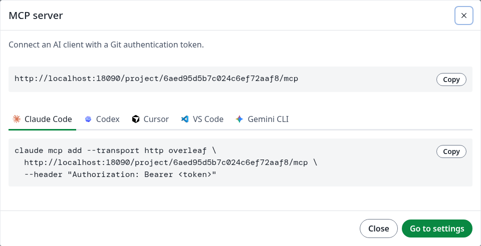

Cada proyecto tiene su propio servidor MCP, de modo que un cliente de IA en su ordenador puede leer y editar el proyecto, compilarlo y responder a sus comentarios. El cliente inicia sesión con un token de autenticación de Git.

<Info>

Si no ve ninguna tarjeta **MCP server**, consulte [Servidor MCP](/es/on-premises/configuration/overleaf-toolkit/integrations/mcp-server) para su administrador.

</Info>

## Novedades de la v6.3.3 {#new-in-v6-3-3}

A partir de la v6.3.3, el cliente también puede trabajar con el historial del proyecto: listar los cambios, comparar dos versiones, leer un archivo tal como era, guardar y eliminar versiones y restaurar un archivo o el proyecto completo. Puede listar los cambios con seguimiento y aceptarlos o rechazarlos, y convertir sus propias ediciones en cambios con seguimiento cuando usted se lo pida. Puede comentar un fragmento de texto y editar o eliminar mensajes de comentarios, leer y enviar mensajes en el chat del proyecto, mover y renombrar archivos y carpetas, crear carpetas y cambiar el idioma del corrector ortográfico. Quién puede hacer qué depende de su rol en el proyecto, como en el editor, porque el cliente trabaja con su token: consulte [Quién puede hacer qué](#who-may-do-what).

El servidor MCP se introdujo en la v6.3.1. La v6.3.1 y la v6.3.2 tienen las mismas 17 herramientas; la v6.3.3 tiene 33.

| Herramientas | v6.3.1 y v6.3.2 | v6.3.3 |
| ----- | ----------------- | ------ |
| `get_clone_info`, `get_settings`, `list_files`, `delete_file`, `compile`, `get_compile_log`, `get_output_file_link`, `word_count`, `reply_to_comment`, `resolve_comment`, `reopen_comment` | Sí | Sí, sin cambios |
| `read_file` | El contenido más reciente | También un archivo tal como era en una `version` |
| `edit_file`, `write_file` | Siguen el ajuste de control de cambios del proyecto | También `trackChanges`, para que la edición sea un cambio con seguimiento |
| `update_settings` | Compilador, imagen de TeX Live y documento principal | También el idioma del corrector ortográfico |
| `list_versions` | Versión, comentario y fecha | También el `id` que acepta `delete_version`, y quién la guardó |
| `list_comments` | Mensajes sin id | También el `id` de cada mensaje, que aceptan `edit_comment_message` y `delete_comment_message` |
| `list_changes`, `diff`, `create_version`, `delete_version`, `restore_file`, `restore_project`, `list_tracked_changes`, `accept_tracked_changes`, `reject_tracked_changes`, `add_comment`, `edit_comment_message`, `delete_comment_message`, `list_chat_messages`, `send_chat_message`, `move_file`, `create_folder` | No | Sí |

## Conectar un cliente {#connect-a-client}

<Steps>
<Step title="Abrir el cuadro de diálogo">
Abra el proyecto. En la barra izquierda, haga clic en **Integrations** y luego en **MCP server**.

<Frame caption="El panel Integrations">
  
</Frame>

El cuadro de diálogo muestra la dirección del servidor de este proyecto y una pestaña para cada cliente: **Claude Code**, **Codex**, **Cursor**, **VS Code** y **Gemini CLI**.

<Frame caption="El cuadro de diálogo MCP server">
  
</Frame>
</Step>

<Step title="Crear un token">
Haga clic en **Go to settings**. La configuración de su cuenta se abre en una pestaña nueva. En **Git integration**, haga clic en **Generate token**, o en **Add another token** si ya tiene uno. Haga clic en **Copy** y guarde el token en un lugar seguro, porque solo lo verá una vez. Después haga clic en **Close**.

<Frame caption="Su nuevo token">
  
</Frame>

También funciona un token que ya use para la [integración con Git](/on-premises/user-guide/users/git-integration), y un mismo token sirve para todos sus proyectos.
</Step>

<Step title="Añadir el servidor a su cliente">
De vuelta en el cuadro de diálogo, haga clic en la pestaña de su cliente y en **Copy** junto a la configuración.

| Pestaña | Dónde va | El token |
| --- | ------------- | --------- |
| **Claude Code** | Ejecute el comando en una terminal | Sustituya `<token>` en el comando |
| **Codex** | `~/.codex/config.toml` | Póngalo en la variable de entorno `OVERLEAF_TOKEN` |
| **Cursor** | `~/.cursor/mcp.json` | Póngalo en la variable de entorno `OVERLEAF_TOKEN` |
| **VS Code** | `.vscode/mcp.json` | El archivo tiene una solicitud de contraseña llamada `overleaf-token` en lugar del token |
| **Gemini CLI** | Ejecute el comando en una terminal | Sustituya `<token>` en el comando |

La dirección pertenece a un solo proyecto. Para conectar otro proyecto, añádalo con otro nombre, porque `overleaf` ya está en uso. En Claude Code, por ejemplo, cambie `overleaf` por `overleaf-lab` en el comando.
</Step>
</Steps>

## Comprobar la conexión {#check-the-connection}

### Con Claude Code {#with-claude-code}

```bash
claude mcp list
```

El servidor aparece como conectado:

```text
overleaf: https://<your-site>/project/<project-id>/mcp (HTTP) - ✔ Connected
```

### Con curl {#with-curl}

Esto funciona sea cual sea su cliente. Sustituya la dirección y el token, y envíe la solicitud `initialize` del protocolo MCP:

```bash
curl -X POST https://<your-site>/project/<project-id>/mcp \
  -H "Authorization: Bearer <token>" \
  -H "Content-Type: application/json" \
  -H "Accept: application/json, text/event-stream" \
  -d '{"jsonrpc":"2.0","id":1,"method":"initialize","params":{"protocolVersion":"2025-06-18","capabilities":{},"clientInfo":{"name":"curl","version":"1.0"}}}'
```

La respuesta nombra el servidor, seguido de sus instrucciones para los clientes:

```json
{"result":{"protocolVersion":"2025-06-18","capabilities":{"tools":{"listChanged":true}},"serverInfo":{"name":"overleaf","version":"1.0.0"},"instructions":"This server works on one Overleaf project. ..."},"jsonrpc":"2.0","id":1}
```

Para ver las herramientas, envíe `tools/list` con el mismo comando. La respuesta enumera 33 herramientas, o 31 si su sitio tiene desactivado el chat del proyecto. Antes de la v6.3.3 enumera 17.

```bash
  -d '{"jsonrpc":"2.0","id":2,"method":"tools/list","params":{}}'
```

Para llamar a una, envíe `tools/call`:

```bash
  -d '{"jsonrpc":"2.0","id":3,"method":"tools/call","params":{"name":"list_files","arguments":{}}}'
```

```json
{"result":{"content":[{"type":"text","text":"[\n  {\n    \"path\": \"main.tex\",\n    \"type\": \"doc\"\n  }\n]"}]},"jsonrpc":"2.0","id":3}
```

### En la configuración de su cuenta {#in-your-account-settings}

En **Git integration**, **Last used** muestra la fecha de un token que el servidor ha recibido.

<Frame caption="El primer token se ha usado">
  
</Frame>

### Si no se conecta {#if-it-does-not-connect}

| Lo que ve | Lo que significa |
| ------------ | ------------- |
| Estado `401`, o en Claude Code `✘ Failed to connect` con `HTTP 401` | El token falta, es incorrecto o se eliminó |
| Estado `404` | Ningún proyecto tiene este ID |
| Estado `405` | La solicitud no era un `POST` |
| Estado `406` con `Not Acceptable` | Falta el encabezado `Accept`: el cliente debe aceptar tanto `application/json` como `text/event-stream` |

## Lo que ve cuando un cliente trabaja {#what-you-see-when-a-client-works}

Las ediciones aparecen en un editor abierto a medida que el cliente las hace, como las de un colaborador, sin recargar. Los archivos y carpetas nuevos, los movimientos y los cambios de nombre aparecen en el árbol de archivos.

<Frame caption="Una línea añadida por edit_file">
  
</Frame>

`edit_file` solo cambia texto que aparece exactamente una vez. En otro caso el cliente recibe un error, como `oldString not found in main.tex, read_file again` o `oldString appears 2 times in main.tex, add context`, y no cambia nada.

A partir de la v6.3.3, `move_file` mueve o renombra un archivo o una carpeta, creando las carpetas de la nueva ruta si hace falta, y `create_folder` crea una carpeta. Si no se encuentra el archivo o la nueva ruta ya existe, el cliente recibe un error y no cambia nada. `update_settings` también puede cambiar el idioma del corrector ortográfico, por ejemplo a `de`, o desactivarlo.

Las respuestas a los comentarios aparecen en el panel de revisión con su nombre, porque el token es suyo. Un comentario resuelto a través del servidor sale del panel, y reabrirlo lo devuelve.

<Frame caption="Una respuesta enviada por reply_to_comment">
  
</Frame>

A partir de la v6.3.3, `add_comment` comenta un fragmento de texto. El texto debe aparecer exactamente una vez en el archivo; cuando aparece más de una vez, el cliente indica también un fragmento más largo a su alrededor que aparece una sola vez, y solo se comenta el texto. El comentario aparece en el panel de revisión con su nombre y se mantiene sobre su texto cuando el archivo cambia. `edit_comment_message` cambia uno de sus propios mensajes. `delete_comment_message` elimina un mensaje, y eliminar el primero elimina el comentario entero, como en el panel de revisión.

`compile` compila el proyecto y devuelve la lista de archivos de salida. Después, `get_output_file_link` da un enlace para descargar el PDF u otro archivo de salida. El enlace no necesita token y deja de funcionar al cabo de 5 minutos.

Para la lista completa de herramientas, consulte [Tools](/on-premises/configuration/overleaf-toolkit/integrations/mcp-server#tools).

## Cambios con seguimiento {#tracked-changes}

A partir de la v6.3.3, puede pedir al cliente que sus ediciones sean cambios con seguimiento, por ejemplo *Rewrite the abstract as a tracked change*. Entonces `edit_file` y `write_file` convierten el cambio en un archivo existente en un cambio con seguimiento a su nombre, incluso cuando el control de cambios está desactivado en el proyecto, y usted lo acepta o rechaza en el panel de revisión. Un archivo nuevo nunca es un cambio con seguimiento. Si no lo pide, las ediciones siguen el ajuste de control de cambios del proyecto, como las suyas en el editor: tienen seguimiento cuando el control de cambios está activado para usted o para todos.

Si la cuenta del propietario del proyecto no tiene control de cambios, el cliente recibe `Track changes is off for this project` y no cambia nada.

Para revisar cada edición del cliente, active el control de cambios para usted. Para distinguir sus ediciones de las suyas en el panel de revisión, dé al cliente el token de otra cuenta con la que comparta el proyecto.

`list_tracked_changes` enumera los cambios con seguimiento con su archivo, el texto insertado o eliminado, el autor y la hora. `accept_tracked_changes` y `reject_tracked_changes` aceptan los id de los cambios y funcionan como el panel de revisión: un cambio aceptado permanece en el texto, una inserción rechazada se elimina y una eliminación rechazada vuelve. Un editor abierto muestra el resultado sin recargar. Las herramientas indican al cliente que acepte o rechace solo los cambios que usted pida.

## Historial {#history}

A partir de la v6.3.3, el cliente ve el historial del proyecto tal como lo muestra el panel de historial.

| Herramienta | Qué hace |
| ---- | ------------ |
| `list_changes` | Enumera los cambios, los más recientes primero: quién cambió qué archivos y cuándo, con las versiones antes y después de cada cambio. Los cambios más antiguos llegan en lotes posteriores. |
| `diff` | Compara dos versiones: un archivo como diff unificado, como `git diff`, o los archivos añadidos, eliminados, editados o renombrados |
| `read_file` con `version` | Lee un archivo tal como era en una versión |
| `list_versions` | Enumera las versiones guardadas, con su comentario y quién las guardó |
| `create_version` | Guarda la versión más reciente, o una anterior, con un comentario, como **Label this version** |
| `delete_version` | Elimina una versión guardada; sus cambios permanecen |
| `restore_file` | Restaura un archivo tal como era en una versión, como **Restore this version** |
| `restore_project` | Restaura el proyecto completo tal como era en una versión, como **Restore project to this version** |

Una restauración es en sí un cambio nuevo, así que puede deshacerla de la misma forma. Las herramientas indican al cliente que restaure solo cuando usted lo pida.

Si el propietario del proyecto no tiene el historial completo del proyecto, el cliente solo ve los cambios de las últimas 24 horas, o el más reciente si todos son anteriores, como en el panel de historial. No puede comparar, leer ni restaurar versiones más antiguas.

## Chat del proyecto {#project-chat}

A partir de la v6.3.3, `list_chat_messages` lee el chat del proyecto, los más recientes primero, de 50 en 50 mensajes. `send_chat_message` envía un mensaje con su nombre, que aparece al instante en un chat abierto. Si su sitio tiene desactivado el chat del proyecto, el cliente no tiene ninguna de las dos herramientas.

## Quién puede hacer qué {#who-may-do-what}

El cliente puede hacer lo que permite su rol en el proyecto.

| Lo que hace el cliente | Propietario | Editor | Revisor | Lector (colaborador con nombre) | Lector (compartido por enlace) |
| -------------------- | ----: | -----: | -------: | --------------------------: | --------------------: |
| Leer archivos y ajustes, compilar, leer el registro, descargar el PDF | Sí | Sí | Sí | Sí | Sí |
| Escribir, editar, mover y eliminar archivos, crear carpetas, cambiar los ajustes | Sí | Sí | No | No | No |
| Ver el historial, los comentarios y los cambios con seguimiento | Sí | Sí | Sí | Sí | No |
| Leer y enviar mensajes de chat | Sí | Sí | Sí | Sí | No |
| Añadir comentarios y responderlos | Sí | Sí | Sí | No | No |
| Resolver, reabrir o eliminar un comentario | Sí | Sí | Los que inició | No | No |
| Editar un mensaje de comentario | Los suyos | Los suyos | Los suyos | No | No |
| Eliminar un mensaje de comentario | Sí | Sí | Los suyos | No | No |
| Aceptar o rechazar cambios con seguimiento | Sí | Sí | No | No | No |
| Guardar una versión | Sí | Sí | Sí | No | No |
| Eliminar una versión guardada | Sí | Las que guardó | Las que guardó | No | No |
| Restaurar un archivo o el proyecto | Sí | Sí | No | No | No |

Los editores que se unieron por enlace cuentan como editores. Los revisores no pueden editar archivos mediante MCP, ni siquiera como cambios con seguimiento.

## Desconectar un cliente {#disconnect-a-client}

Elimine el token: consulte [Eliminar un token](/on-premises/user-guide/users/git-integration#delete-a-token). A partir de entonces, el servidor responde `401` a ese token. Si también lo usa para Git, Git también deja de aceptarlo.
