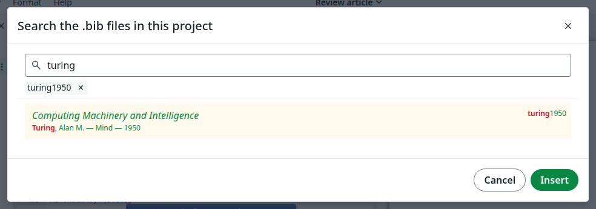

Importa una biblioteca de Mendeley a un proyecto como archivo `.bib` y cita desde él como de costumbre. El archivo es una copia: solo cambia cuando haces clic en **Refresh**.

<Info>

Si no ves ninguna opción de Mendeley en **Account settings**, pide a tu administrador que active la [integración con Mendeley](/es/on-premises/configuration/overleaf-toolkit/integrations/mendeley-integration).

</Info>

## Vincular tu cuenta de Mendeley {#link-your-mendeley-account}

Solo lo haces una vez.

<Steps>
<Step title="Abrir la configuración de tu cuenta">
Haz clic en **Account** y luego en **Account settings**. En **Reference managers**, busca **Mendeley** y haz clic en **Link to Mendeley**.

<Frame caption="Mendeley en la configuración de la cuenta">
  
</Frame>

La tarjeta **Mendeley** del panel **Integrations** del editor te lleva al mismo lugar, en la misma pestaña.

<Frame caption="El panel Integrations">
  
</Frame>
</Step>

<Step title="Autorizar en Mendeley">
Se abre Mendeley. Inicia sesión si se te pide y luego autoriza la aplicación.
</Step>

<Step title="Comprobar la vinculación">
Vuelves a la configuración de la cuenta. Un mensaje verde dice **Reference manager linked** y el botón ahora dice **Unlink**.

<Frame caption="Tu cuenta de Mendeley está vinculada">
  
</Frame>
</Step>
</Steps>

Si no permites el acceso en Mendeley, la misma sección dice **Sorry, something went wrong**. Haz clic en **Link to Mendeley** para volver a intentarlo.

## Crear un archivo a partir de tu biblioteca {#create-a-file-from-your-library}

<Steps>
<Step title="Abrir el diálogo Add files">
Abre un proyecto. En el árbol de archivos, haz clic en **New file** y luego en **From Mendeley**. Esta entrada solo aparece cuando tu cuenta está vinculada.
</Step>

<Step title="Elegir el nombre del archivo y la biblioteca">
**File Name** empieza como `mendeley.bib`. Conserva la extensión `.bib`: sin ella no obtienes vista previa, y ni `\cite` ni `\bibliography` encuentran sus entradas.

**Library** empieza como **My Library** y también enumera tus grupos. Un archivo contiene una biblioteca.

<Frame caption="Un archivo de tu biblioteca personal">
  
</Frame>
</Step>

<Step title="Hacer clic en Create">
El diálogo se cierra y el archivo aparece en el árbol de archivos. Haz clic en él: muestra cuándo se importó y sus entradas. No puedes editarlo en el editor.

<Frame caption="El archivo importado">
  
</Frame>

Si **Create** parece no hacer nada, ya existe un archivo con ese nombre. Elige otro nombre.
</Step>
</Steps>

### Importar un grupo {#import-a-group}

Repite los pasos con un nombre de archivo propio y elige el grupo en **Library**. Un proyecto puede tener varios de estos archivos.

<Frame caption="Un archivo de un grupo">
  
</Frame>

## Citar desde el archivo {#cite-from-the-file}

<Steps>
<Step title="Empezar una cita">
En un archivo `.tex`, escribe `\cite{`. La lista muestra las entradas de todos los archivos `.bib` del proyecto. Haz clic en una para insertarla.

<Frame caption="Las entradas de los archivos importados">
  
</Frame>
</Step>

<Step title="O buscar por título o autor">
Haz clic en **Search** debajo de la lista o pulsa Ctrl+Espacio entre las llaves. Escribe para filtrar, haz clic en una o varias entradas y luego en **Insert**.

<Frame caption="La búsqueda de referencias">
  
</Frame>
</Step>

<Step title="Añadir la bibliografía">
Añade estas líneas antes de `\end{document}`, con el nombre de tu archivo sin `.bib`. Si son varios archivos, separa los nombres con comas.

```latex
\bibliographystyle{plain}
\bibliography{mendeley}
```

Haz clic en **Recompile**. La referencia aparece en el PDF.

<Frame caption="La referencia compilada">
  
</Frame>
</Step>
</Steps>

Los archivos importados no se ofrecen en **Settings**, en **References**, **Main bibliography file for this project**, así que la lista queda vacía si el proyecto no tiene otro archivo `.bib`. Aun así puedes citar desde ellos.

<Frame caption="La lista vacía es lo esperado">
  
</Frame>

## Actualizar el archivo {#refresh-the-file}

Los cambios de tu biblioteca de Mendeley no llegan solos al proyecto.

<Steps>
<Step title="Abrir el archivo">
En el árbol de archivos, haz clic en el archivo importado.
</Step>

<Step title="Hacer clic en Refresh">
Todo el archivo se vuelve a importar desde la biblioteca que elegiste al crearlo: aparecen las entradas nuevas y desaparecen las eliminadas. La hora de la parte superior cambia.

<Frame caption="El archivo actualizado">
  
</Frame>
</Step>

<Step title="Recompilar">
Haz clic en **Recompile** para actualizar el PDF.
</Step>
</Steps>

Cada archivo se actualiza por separado: actualiza aparte el archivo de tu grupo. Para saber quién puede actualizar un archivo en un proyecto compartido, consulta las [notas para administradores](/on-premises/configuration/overleaf-toolkit/integrations/mendeley-integration#notes).

## Desvincular tu cuenta de Mendeley {#unlink-your-mendeley-account}

En **Account settings**, en **Mendeley**, haz clic en **Unlink** y luego otra vez en **Unlink** en el diálogo. El botón vuelve a decir **Link to Mendeley**.

<Frame caption="Desvincular tu cuenta">
  
</Frame>

Los archivos que importaste se quedan en tus proyectos y siguen compilando. **From Mendeley** desaparece del diálogo **Add files**, y **Refresh** muestra un error hasta que vuelvas a vincular tu cuenta.

<Frame caption="Actualizar sin una cuenta vinculada">
  
</Frame>

Después de volver a vincularla, **Refresh** funciona con los mismos archivos.

## Si algo sale mal {#if-something-goes-wrong}

**Could not load references from Mendeley, please re-link your account and try again**, o **There was an error accessing your Mendeley data** en el diálogo **Add files**: Overleaf ya no puede leer tu biblioteca, por ejemplo porque le retiraste el acceso en Mendeley. En **Account settings**, haz clic en **Unlink** y luego en **Link to Mendeley**. Hasta entonces, **Create** también falla, con el mensaje **The project that contains this file is not shared with you**, incluso en tu propio proyecto.

<Frame caption="Overleaf ya no puede leer tu biblioteca">
  
</Frame>

**The remote service produced an error** al hacer clic en **Refresh**: la solicitud a Mendeley falló. El archivo conserva su contenido. Vuelve a hacer clic en **Refresh** más tarde.
