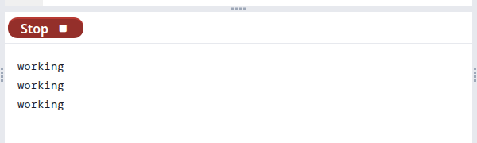
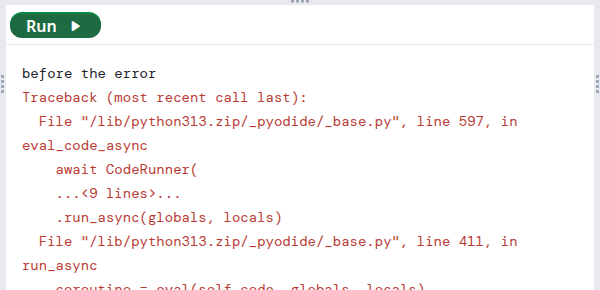

Los scripts de Python se ejecutan en su navegador, así que la salida aparece justo debajo del editor. No hace falta configurar nada.

<Steps>
<Step title="Crear un script">
En el árbol de archivos, haga clic en el icono **New file**. Escriba un nombre que termine en `.py` y haga clic en **Create**.

<Frame caption="Un nuevo archivo de Python">
  
</Frame>

Debajo del editor aparecen el botón **Run** y un panel de salida. La primera vez, el botón permanece desactivado mientras Python se carga.
</Step>

<Step title="Ejecutarlo">
Escriba su código y haga clic en **Run**. Lo que el script imprime aparece en el panel de salida. No necesita guardar antes.

Los archivos que escribe el script se guardan en su proyecto. Un mensaje le indica cuáles, por ejemplo **results.txt saved to your project**, y el archivo aparece en el árbol de archivos.

<Frame caption="La salida y un archivo guardado">
  
</Frame>
</Step>

<Step title="Detener un script">
Mientras un script se ejecuta, **Run** se convierte en **Stop**. Haga clic en él para interrumpir el script. El panel de salida termina con **Execution interrupted**.

<Frame caption="Un script en ejecución">
  
</Frame>
</Step>
</Steps>

## Usar una figura en su documento {#use-a-figure-in-your-document}

Los gráficos no tienen ninguna ventana donde aparecer, así que guárdelos en un archivo. Por ejemplo:

```python
import matplotlib.pyplot as plt

plt.plot([1, 2, 3], [1, 4, 9])
plt.savefig("figure.png")
```

`figure.png` aparece en su proyecto, listo para `\includegraphics{figure.png}`.

<Frame caption="Un gráfico guardado">
  
</Frame>

## Leer los archivos de su proyecto {#read-your-project’s-files}

Un script puede abrir los archivos de su proyecto por su ruta:

```python
print(open("results.txt").read())
```

## Si algo sale mal {#if-something-goes-wrong}

<strong>El script genera un error.</strong> El error aparece en rojo en el panel de salida, después de todo lo que el script imprimió antes.

<Frame caption="Un error en un script">
  
</Frame>

<strong>`ModuleNotFoundError: No module named ...`.</strong> Solo están disponibles los paquetes integrados en Pyodide, y no se pueden usar paquetes instalados con `pip`. NumPy y Matplotlib están entre los disponibles, y el mensaje enlaza a la [lista completa](https://pyodide.org/en/stable/usage/packages-in-pyodide.html).

<Frame caption="Un paquete no disponible">
  
</Frame>
