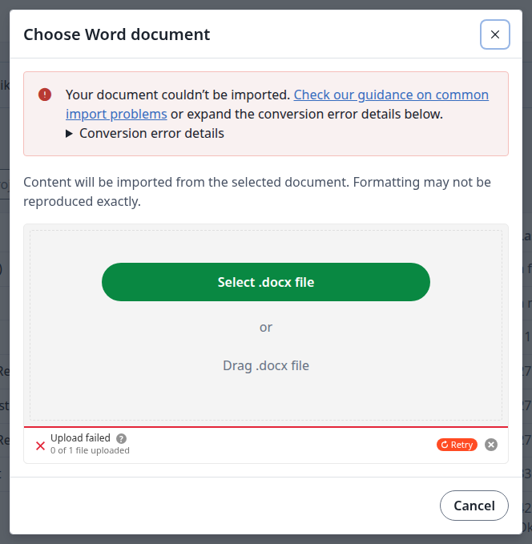

<Info>

Si no ve estas opciones, pida a su administrador que active [Pandoc Import and Export](/es/on-premises/configuration/overleaf-toolkit/pandoc-import-and-export).

</Info>

## Importar un documento {#import-a-document}

Esto crea un nuevo proyecto LaTeX a partir de un documento de Word (`.docx`) o un archivo Markdown (`.md`). El nombre del proyecto se toma del nombre del archivo.

<Steps>
<Step title="Abrir el cuadro de diálogo de importación">
En la página de proyectos, haga clic en **New project**. En **Import**, haga clic en **Word document** o **Markdown document**.

<Frame caption="El menú New project">
  
</Frame>
</Step>

<Step title="Elegir el archivo">
Haga clic en **Select .docx file** o arrastre el archivo al cuadro de diálogo. Para Markdown, el botón es **Select .md file**. La importación empieza de inmediato.

<Frame caption="Elegir un documento de Word">
  
</Frame>
</Step>

<Step title="Empezar a editar">
El nuevo proyecto se abre con el mensaje **Document ready for editing**. Haga clic en **Start editing**.

<Frame caption="La importación ha terminado">
  
</Frame>
</Step>

<Step title="Revisar el resultado">
El documento está ahora en `main.tex`, con sus títulos en el esquema del archivo. Haga clic en **Recompile** para ver el PDF. Revise el formato, en particular las tablas, figuras y citas, que pueden necesitar edición.

<Frame caption="El proyecto importado">
  
</Frame>
</Step>
</Steps>

### Si la importación falla {#if-the-import-fails}

Si el archivo no se puede convertir, el cuadro de diálogo indica **Your document couldn't be imported**. Despliegue **Conversion error details** para ver el motivo. No se crea ningún proyecto.

<Frame caption="Un documento que no se pudo importar">
  
</Frame>

El cuadro de diálogo solo acepta el tipo que eligió. Un archivo `.md` en el cuadro de diálogo de Word muestra **You can only upload: .docx**.

## Exportar un proyecto {#export-a-project}

Abra el proyecto y haga clic en su nombre en la parte superior del editor. Haga clic en una de estas opciones:

| Opción                              | Obtiene                                       |
| ----------------------------------- | --------------------------------------------- |
| <strong>Export as Word document (.docx)</strong> | Un archivo `.docx` con el nombre del proyecto        |
| <strong>Export as Markdown (.md)</strong>        | Un archivo `.zip` con `main.md`                  |
| <strong>Export as HTML (.html)</strong>          | Un archivo `.zip` con `main.html`                |

La descarga empieza sola. La conversión no puede reproducir todo el formato de LaTeX, así que revise el resultado.

<Frame caption="Las opciones de exportación">
  
</Frame>
