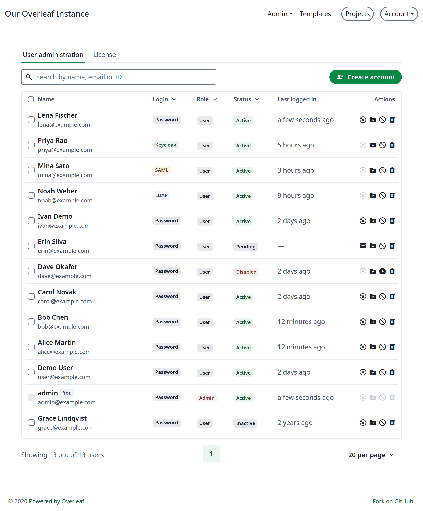
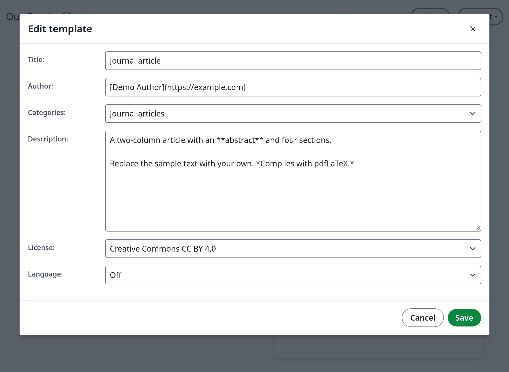

Overleaf-instanssin ylläpito laboratoriolle tai laitokselle tuo joka viikko samat kysymykset. Miksi tämä opiskelija ei pääse kirjautumaan? Kuka vielä käyttää palvelinta? Kuka antoi tuolle tilille ylläpitäjän oikeudet? Minne viime vuoden opinnäytetyö katosi? Rakensimme hallintapaneelin uudelleen, jotta voit vastata näihin avaamatta tietokannan komentotulkkia.

Uusi paneeli noudattaa Overleaf 6.3:n ulkoasua ja on käännetty kaikille käyttöliittymän tukemille kielille. Siinä on yksi luettelo kaikista käyttäjistä, yksi luettelo kaikista projekteista, oma sivu kullekin niistä, paikka mallipohjien hallintaan ja tarkastuslokit.

<Info>

Uusi hallintapaneeli on yhdistetty päähaaraamme, ja se julkaistaan virallisesti versiossa v6.4.0. Kaikki tämän kirjoituksen kuvakaappaukset ovat testi-instanssista, joka on täytetty keksityillä tileillä.

</Info>

### Mitä siinä on {#what’s-in-it}

* **Käyttäjäluettelo**: haku, suodattimet kirjautumistavan, roolin ja tilan mukaan sekä joukkotoiminnot.
* **Käyttäjäsivu**: yhden henkilön tili, projektit, ominaisuudet, integraatiot, tarkastuslokit ja istunnot.
* **Projektiluettelo**: kaikki instanssin projektit, haettavissa nimen, ID:n, omistajan tai jakolinkin perusteella.
* **Projektisivu**: yhden projektin asetukset, tiedostot, jäsenet, poistetut tiedostot ja tarkastuslokit.
* **Mallipohjien hallinta**: julkaise projekti mallipohjana, päivitä sitä ja pidä galleria järjestyksessä.
* **Tarkastuslokit**: kuka teki mitä, milloin ja mistä IP-osoitteesta.

## Yksi luettelo kaikille käyttäjille {#one-list-for-every-user}

Napsauta **Admin** ja sitten **Manage Users**. Jokainen tili on yksi rivi, joka näyttää, miten se kirjautuu, sen roolin ja sen tilan.

<Frame caption="Käyttäjäluettelo">
  
</Frame>

Hae nimen, sähköpostiosoitteen tai ID:n perusteella. Otsikot **Login**, **Role** ja **Status** ovat suodattimia, ja jokainen vaihtoehto näyttää, montako tiliä se palauttaisi. Näet yhdellä silmäyksellä, kuinka moni tulee sisään SAML:n kautta, ja jokainen OIDC-palveluntarjoaja näkyy sille antamallasi nimellä.

<Frame caption="Suodatus kirjautumistavan mukaan">
  
</Frame>

Jokaisella tilillä on täsmälleen yksi tila, ja neljän tilan summa on kokonaismäärä.

| Tila         | Mitä se tarkoittaa                                                        |
| ------------ | ------------------------------------------------------------------------- |
| **Active**   | On kirjautunut tai avannut projektin viimeisten 12 kuukauden aikana.      |
| **Pending**  | Ei ole koskaan kirjautunut.                                               |
| **Inactive** | On kirjautunut aiemmin, mutta ei viimeisten 12 kuukauden aikana.          |
| **Disabled** | Ylläpitäjä on estänyt tiliä kirjautumasta.                                |

Poistetut tilit eivät ole tiellä, vaan niillä on oma suodattimensa. Jos haku osuu myös poistettuun tiliin, taulukon yläpuolella oleva rivi kertoo siitä ja tarjoaa sen näyttämistä.

<Frame caption="Suodatus tilan mukaan">
  
</Frame>

Haku, lajittelu ja sivutus toimivat palvelimella, joten luettelot eivät enää pysähdy ensimmäisiin 1 000 riviin.

### Tuo ihmisiä mukaan sähköpostilla tai ilman {#bring-people-in-with-or-without-email}

**Create account** lisää käyttäjän ja antaa sinulle linkin, jota hän tarvitsee. Kun [sähköpostin toimitusta](/fi/on-premises/configuration/overleaf-toolkit/email-delivery  "mention") ei ole määritetty, valintaikkuna kertoo sen selvästi ja antaa kopioida linkin, joten pienikin instanssi voi ottaa uusia ihmisiä mukaan.

<Frame caption="Uuden tilin aktivointilinkki">
  
</Frame>

Paneeli tarjoaa kullekin tilille oikean linkin: **Send activation email** tilille, joka ei ole koskaan kirjautunut, voimassa 7 päivää, ja **Send reset link** tilille, joka on kirjautunut, voimassa 1 tunnin. SSO:n kautta kirjautuvilla tileillä ei ole paikallista salasanaa, joten ne eivät saa kumpaakaan.

### Muuta monta tiliä kerralla {#change-many-accounts-at-once}

Valitse muutama tili, niin työkalurivi tarjoaa toiminnot **Send activation email**, **Transfer this user's projects**, **Disable**, **Enable**, **Make admin**, **Remove admin** ja **Delete account**. Valintaikkuna luettelee tilit ennen vahvistusta. Jos osa epäonnistuu, se kertoo mitkä, ja jo onnistunut pysyy tehtynä.

<Frame caption="Joukkotoiminnot">
  
</Frame>

### Vaikea tehdä väärin {#hard-to-get-wrong}

* Oma tilisi on merkitty **You** ja sen toiminnot ovat harmaana, joten et voi poistaa itseäsi käytöstä, poistaa itseäsi tai alentaa itseäsi.
* Jokainen toiminto pyytää vahvistuksen valintaikkunassa, joka nimeää tilin.
* **Delete account** voi ensin luovuttaa käyttäjän projektit jollekulle toiselle.
* Poistettu tili voidaan palauttaa yhdessä sen mukana poistettujen projektien kanssa. Vain **Delete permanently** on lopullinen, ja se varoittaa sinua.

## Kaikki yhdestä henkilöstä {#everything-about-one-person}

Avaa käyttäjän sivu napsauttamalla nimeä. Sivulla on kuusi välilehteä ja samat toimintokuvakkeet kuin luettelossa.

### Tili {#account}

Tilin tiedot ID:stä ja sähköpostiosoitteista viimeisimpään kirjautumiseen ja sen IP-osoitteeseen. Napsauta kynää muuttaaksesi sähköpostiosoitetta, nimiä tai salasanaa tai kytkeäksesi **Admin**-asetuksen päälle tai pois.

<Frame caption="Tilin muokkaaminen">
  
</Frame>

### Projektit {#projects}

Tämän henkilön omistamat projektit omalla haullaan, tilasuodattimellaan ja toiminnoillaan.

<Frame caption="Käyttäjän projektit">
  
</Frame>

### Ominaisuudet {#features}

Mitä tälle tilille on otettu käyttöön, kuten yhteistyökumppanit projektia kohden, kääntämisen aikakatkaisu, integraatiot ja tekoäly, sekä tilin tekoälyn käyttö ja painike sen nollaamiseen.

<Frame caption="Käyttäjän ominaisuudet">
  
</Frame>

### Integraatiot {#integrations}

Henkilön Git-käyttötunnukset ja hänen yhdistämänsä palvelut.

<Frame caption="Käyttäjän integraatiot">
  
</Frame>

### Istunnot {#sessions}

Missä henkilö on kirjautuneena. **Clear sessions** kirjaa hänet ulos kaikkialta, ja se on ensimmäinen asia, joka tehdään, kun kannettava katoaa.

<Frame caption="Käyttäjän istunnot">
  
</Frame>

## Kaikki instanssin projektit {#every-project-on-the-instance}

Napsauta **Admin** ja sitten **Project/Object Lookup**. Luettelo näyttää kaikkien käyttäjien projektit omistajineen ja tiloineen. Hakukenttään voi kirjoittaa projektin nimen, sen ID:n, sen omistajan tai linkin. Liitä jakolinkki, niin löydät sen takana olevan projektin.

<Frame caption="Kaikki projektit">
  
</Frame>

**Status**-suodatin erottaa projektit **Active**, **Archived**, **Trashed** ja **Deleted**. Valitse useita projekteja ladataksesi ne yhtenä `.zip`-tiedostona, vaihtaaksesi niiden omistajan tai poistaaksesi ne. **Deleted**-näkymässä painikkeet ovat **Restore** ja **Delete permanently**.

<Frame caption="Projektien suodatus tilan mukaan">
  
</Frame>

## Kaikki yhdestä projektista {#everything-about-one-project}

Avaa projektin sivu napsauttamalla sen otsikkoa.

### Yleiskatsaus {#overview}

Muuta nimeä, linkkijakoa, kääntäjää, TeX Live -versiota ja päädokumenttia. **Change project owner** antaa projektin toiselle käyttäjälle, mikä auttaa, kun joku lähtee laboratoriosta ja hänen opinnäytetyönsä on jäätävä.

<Frame caption="Projektin muokkaaminen">
  
</Frame>

### Tiedostopuu {#file-tree}

Projektin tiedostot ja kansiot vain luku -tilassa.

<Frame caption="Projektin tiedostot">
  
</Frame>

### Jäsenet {#members}

Omistaja, yhteistyökumppanit ja odottavat kutsut. Muuta yhteistyökumppanin roolia, poista hänen käyttöoikeutensa tai lähetä kutsu uudelleen tai peruuta se.

<Frame caption="Projektin jäsenten muuttaminen">
  
</Frame>

### Poistetut tiedostot {#deleted-files}

Projektista poistetut tiedostot. **Restore file** sijoittaa kopion projektin juurikansioon, ja rivillä näkyy kopion nimi.

<Frame caption="Palautettu tiedosto">
  
</Frame>

## Mallipohjien hallinta {#template-management}

Mallipohja alkaa tavallisena projektina. Julkaiset sen editorista ja hallitset sitä sen sivulta galleriassa tai hallintapaneelista.

### Kaikki mallipohjat yhdessä taulukossa {#all-templates-in-one-table}

Napsauta **Admin**, sitten **Project/Object Lookup** ja sitten **Templates**-välilehteä. Se luettelee jokaisen julkaistun mallipohjan tekijän, omistajan ja viimeisimmän muutoksen kanssa, ja voit hakea siitä. Avaa mallipohja napsauttamalla otsikkoa, avaa käyttäjän sivu napsauttamalla omistajaa tai poista mallipohja napsauttamalla roskakoria. Poisto kirjataan [omaan tarkastuslokiisi](#when-there-is-no-log-left).

<Frame caption="Kaikki mallipohjat hallintapaneelissa">
  
</Frame>

### Julkaise editorista {#publish-from-the-editor}

Avaa projekti ja käännä sitä, kunnes PDF näyttää oikealta, koska galleria näyttää viimeisimmän onnistuneen käännöksen PDF:n. Napsauta sitten **File** ja sen jälkeen **Manage Template**, ja täytä otsikko, tekijä, luokka, Markdown-muotoinen kuvaus ja lisenssi. Projektin kääntäjä ja päädokumentti siirtyvät mallipohjaan, joten siitä avatut projektit käyttävät samoja.

<Frame caption="Projektin julkaiseminen mallipohjana">
  
</Frame>

### Päivitä mallipohja {#update-a-template}

Muuttaaksesi mallipohjan tiedostoja ja PDF:ää julkaise projekti uudelleen samalla otsikolla. Valintaikkuna kertoo, että otsikko on jo olemassa, ja painikkeesta tulee **Overwrite**. Projektit, jotka ihmiset ovat jo avanneet mallipohjasta, eivät muutu.

<Frame caption="Julkaiseminen samalla otsikolla">
  
</Frame>

### Mallipohjan sivu {#the-template-page}

Kaikki voivat käyttää painikkeita **Open as Template**, **View PDF** ja latauspainiketta. Ylläpitäjät saavat lisäksi painikkeet **Admin: Source Project**, **Edit** ja **Delete**.

<Frame caption="Mallipohjan sivu">
  
</Frame>

**Edit** muuttaa sitä, mitä galleria näyttää mallipohjasta: otsikkoa, tekijää, luokkaa, kuvausta ja lisenssiä sekä siitä avattujen projektien oikolukukieltä. Se ei koske tiedostoihin eikä PDF:ään. Mallipohja säilyttää oman kopionsa tiedostoista, joten lähdeprojektin poistaminen ei vie mallipohjaa mukanaan.

<Frame caption="Mallipohjan tietojen muokkaaminen">
  
</Frame>

### Galleria käyttäjillesi {#a-gallery-for-your-users}

Galleria avautuu kortilla kutakin luokkaa kohden, ja jokaisella luokalla on oma sivunsa. Luokat tulevat [mallipohjien](/fi/on-premises/configuration/overleaf-toolkit/templates  "mention") määrityksistäsi, joissa voit myös sallia julkaisemisen käyttäjälle, joka ei ole ylläpitäjä.

<Frame caption="Mallipohjagalleria">
  
</Frame>

**All templates** -sivu näyttää jokaisen mallipohjan ensimmäisen sivun esikatselun kanssa, ja käyttäjäsi voivat hakea siitä ja lajitella sen otsikon tai päivämäärän mukaan.

<Frame caption="Kaikki mallipohjat">
  
</Frame>

## Tarkastuslokit: kuka teki mitä ja milloin {#audit-logs-who-did-what-and-when}

Tähän osaan olemme tyytyväisimpiä. Jokaisella tilillä ja jokaisella projektilla on nyt oma tarkastuslokinsa, ja sivuston ylläpitäjät voivat lukea sitä suoraan paneelissa.

Avaa käyttäjän sivulla **Audit logs** -välilehti. Uusimmat merkinnät tulevat ensin.

<Frame caption="Tilin tarkastusloki">
  
</Frame>

Alhaalta ylös luettuna tämä sivu kertoo tarinan. Lena kirjautui sisään. Ylläpitäjä nosti hänen kääntämisen aikakatkaisunsa 300 sekuntiin, poisti hänen tekoälyn käyttöoikeutensa, lähetti hänelle salasanan palautuslinkin, teki hänestä ylläpitäjän ja perui sen, ja poisti sitten tilin käytöstä ja otti sen uudelleen käyttöön. Lena kirjautui taas sisään, ja ylläpitäjä tyhjensi hänen istuntonsa.

| Sarake         | Mitä se kertoo                                                                                       |
| -------------- | ---------------------------------------------------------------------------------------------------- |
| **Date**       | Milloin se tapahtui.                                                                                 |
| **Operation**  | Mitä tapahtui.                                                                                       |
| **Initiator**  | Kuka sen teki. Ylläpitäjän tilille tekemät toimet näyttävät ylläpitäjän, eivät käyttäjää.            |
| **IP Address** | Mistä pyyntö tuli.                                                                                   |
| **Info**       | Yksityiskohdat, kuten uusi kääntämisen aikakatkaisu tai lähtikö sähköposti todella.                  |

### Löydä tarvitsemasi merkintä {#find-the-entry-you-need}

Hae toiminnon tai IP-osoitteen perusteella. **Operation**-otsikko on suodatin, joka luettelee tämän lokin jokaisen toiminnon ja sen, kuinka monta kertaa se on tapahtunut.

<Frame caption="Suodatus toiminnon mukaan">
  
</Frame>

### Loki jokaiselle projektille {#a-log-for-every-project}

Projektisivulla on sama välilehti. Se näyttää, kuka kutsuttiin, kuka liittyi, kenen rooli muuttui, kuka latasi projektin ja kuka otti sen haltuunsa.

<Frame caption="Projektin tarkastusloki">
  
</Frame>

### Mitä tallennetaan {#what-gets-recorded}

Nämä ovat kunkin lokin tärkeimmät toiminnot niillä nimillä, jotka näet paneelissa.

| Loki     | Alue                         | Toiminnot                                                                                                                                                                                                                                   |
| -------- | ---------------------------- | ------------------------------------------------------------------------------------------------------------------------------------------------------------------------------------------------------------------------------------------- |
| Tili     | Kirjautuminen ja salasana    | Login, Logout, Failed password match, Update password, Reset password                                                                                                                                                                       |
| Tili     | Sähköposti ja SSO            | Add email, Remove email, Change primary email, Link SSO, Unlink SSO                                                                                                                                                                         |
| Tili     | Integraatiot                 | Link GitHub, Unlink GitHub, Link Dropbox, Unlink Dropbox, Integration account linked, Integration account unlinked, Create Git token, Delete Git token                                                                                      |
| Tili     | Ylläpitäjän toimet           | Create account, Send activation email, Send password reset email, Change name, Change admin access, Change features, Change AI features, Reset AI usage, Account suspension, Account reactivation, Clear sessions, Transfer projects, Delete account, Restore account |
| Projekti | Jakaminen                    | Send invite, Resend invite, Revoke invite, Accept invite, Join via token, Accept via link sharing, Remove collaborator, Leave project, Project role changed, Toggle access level, Transfer ownership                                       |
| Projekti | Tiedostot                    | Project downloaded, Project exported docx, Project exported markdown, Project exported html, Restore deleted doc                                                                                                                            |
| Projekti | Ylläpitäjän toimet           | Project deleted, Project restored                                                                                                                                                                                                           |
| Projekti | Git-synkronointi             | Integration repo linked, Integration repo unlinked                                                                                                                                                                                          |

### Kun lokia ei enää ole {#when-there-is-no-log-left}

**Delete permanently** poistaa tilin tai projektin yhdessä sen lokin kanssa, eikä mallipohjalla ole koskaan ollut lokia. Siksi nämä toimet kirjataan ne tehneen ylläpitäjän lokiin yhdessä poistetun kohteen sähköpostiosoitteen tai ID:n kanssa.

<Frame caption="Pysyvät poistot ylläpitäjän omassa lokissa">
  
</Frame>

### Hyvä tietää {#good-to-know}

* Merkinnät säilytetään kaksi ja puoli vuotta, minkä jälkeen MongoDB poistaa ne automaattisesti.
* Käänteisen välityspalvelimen takana aseta [`OVERLEAF_TRUSTED_PROXY_IPS`](/fi/on-premises/configuration/overleaf-toolkit/environment-variables  "mention"), jotta loki näyttää vierailijan osoitteen eikä välityspalvelimen osoitetta.
* Kaikkea ei vielä tallenneta. Git clone ja push, projektin asetusten kuten nimen tai kääntäjän muutokset sekä projektit, jotka omistaja luo, arkistoi, siirtää roskakoriin tai poistaa, eivät näy projektin lokissa.

## Kokeile {#try-it}

Uusi paneeli tulee Ayakaleaf Pro v6.4.0:n mukana. Vaiheittaiset ohjeet ovat jo verkossa:

* [Käyttäjien hallinta](/fi/on-premises/user-guide/administrators/user-management  "mention")
* [Projektien hallinta](/fi/on-premises/user-guide/administrators/project-management  "mention")
* [Mallipohjien hallinta](/on-premises/user-guide/administrators/template-management  "mention")

Jos jotain puuttuu tai jokin ei toimi odotetulla tavalla, kerro siitä meille [GitHubissa](https://github.com/ayaka-notes/ayakaleaf-pro/issues).
