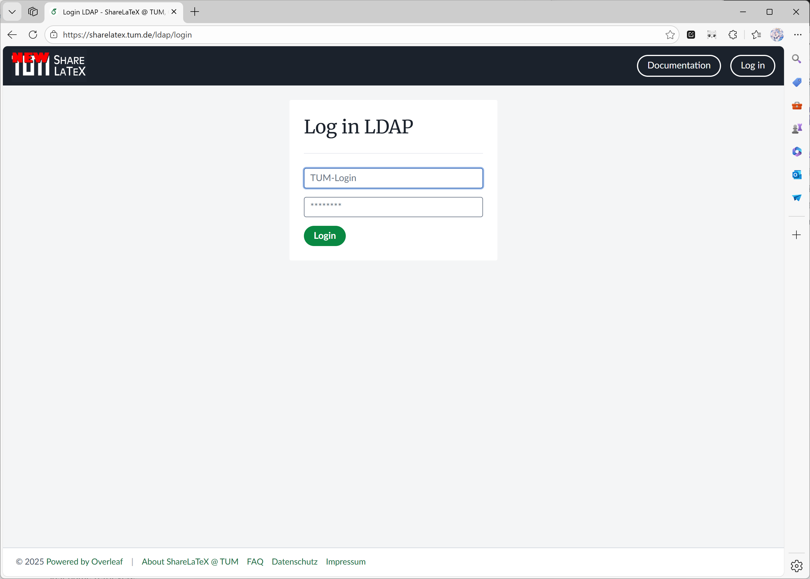

Git-integraatio on tällä hetkellä saatavilla [ayaka-notes/overleaf](https://github.com/ayaka-notes/overleaf)-versiossa.

<Info>

Tämän ominaisuuden kehitti alun perin [ayaka-notes/ayakaleaf-pro](https://github.com/ayaka-notes/ayakaleaf-pro).

</Info>

<Steps>
<Step title="Ota git-bridge käyttöön (vain Toolkit-käyttäjille)">
Jos käytät Toolkitia, ota `git-bridge` käyttöön asettamalla seuraava tiedostoon `config/overleaf.rc`:

```text title="config/overleaf.rc"
GIT_BRIDGE_ENABLED=true
```

Toolkit ohittaa sen, ellei myös `SERVER_PRO=true` ole asetettu. Muuta ei tarvita: Toolkit asettaa itse `sharelatex`-kontille muuttujat `GIT_BRIDGE_HOST`, `GIT_BRIDGE_PORT` ja `V1_HISTORY_URL`, joten ohita alla olevat kaksi Docker Compose -vaihetta. Luo kontit uudelleen ajamalla `bin/up`.
</Step>

<Step title="Lisää git-bridge-kontti (vain Docker-compose-käyttäjille)">
Jos käytät mukautettua `docker-compose.yml`-tiedostoa, lisää seuraava konttikonfiguraatio compose-tiedostoosi:

```yaml title="docker-compose.yml (git-bridge service)" wrap
git-bridge:
    restart: always
    image: ghcr.io/ayaka-notes/overleaf-pro/git-bridge:6.3.2 # tag should match the `sharelatex` container tag
    volumes:
        - ~/git_bridge_data:/data/git-bridge
    container_name: git-bridge
    expose:
        - "8000"
    environment:
        GIT_BRIDGE_API_BASE_URL: "http://sharelatex:3000/api/v0/" 
        GIT_BRIDGE_OAUTH2_SERVER: "http://sharelatex"
        GIT_BRIDGE_POSTBACK_BASE_URL: "http://git-bridge:8000"
        GIT_BRIDGE_ROOT_DIR: "/data/git-bridge"
    user: root
    command: ["/server-pro-start.sh"]
```

Käytä samaa tagia kuin `sharelatex`-imagessa. [MCP-palvelin](/fi/on-premises/configuration/overleaf-toolkit/integrations/mcp-server) (v6.3.1 ja uudemmat) on osa `sharelatex`-imagea ja otetaan käyttöön yhdessä Git-integraation kanssa, joten se ei tarvitse erillistä konttia.
</Step>

<Step title="Päivitä sharelatex-kontin konfiguraatio">
Sinun on myös linkitettävä `git-bridge`-kontti `sharelatex`-konttiin ja määritettävä seuraavat ympäristömuuttujat. Kiinnitä erityistä huomiota muuttujaan `V1_HISTORY_URL`:

```yaml title="docker-compose.yml (sharelatex service)"
sharelatex:
    links:
        - git-bridge
    environment:
         GIT_BRIDGE_ENABLED: true
         GIT_BRIDGE_HOST: "git-bridge"
         GIT_BRIDGE_PORT: "8000"
         # We use v1 now, if you used to set V1_HISTORY_URL, please update now
         V1_HISTORY_URL: "http://sharelatex:3100/api"
```
</Step>

<Step title="Todennus">
Git-asiakasta todennettaessa käyttäjät tarvitsevat henkilökohtaisen käyttöoikeustunnuksen (Personal Access Token). Käyttäjät voivat hallita henkilökohtaisia käyttöoikeustunnuksia sovelluksen käyttöliittymän kautta (katso dokumentaatio):

<Frame caption="Git-integraation henkilökohtainen käyttöoikeustunnus">
  
</Frame>
</Step>

<Step title="Valvonta ja resurssinäkökohdat">
Suosittelemme isäntäkoneen resurssien valvomista `git-bridge`n käyttöönoton jälkeen. Kuormituksen kasvu riippuu seuraavista:

* ominaisuutta käyttävien käyttäjien määrä
* instanssissasi isännöityjen projektien tyypit (suuremmat projektit vievät yleensä enemmän resursseja)
</Step>
</Steps>

### Projektien siirtäminen S3:een

Git-integraatio tallentaa levylle täydellisen git-repositorion jokaisesta projektista, jonka käyttäjä kloonaa. Jos levytilaa on rajallisesti, voit ottaa käyttöön swap-työn, joka siirtää vähemmän käytettyjä repositorioita AWS S3:een. Jos siirrettyä repositoriota tarvitaan uudelleen, se siirretään takaisin levylle. Seuraavat ympäristömuuttujat ohjaavat swap-työtä:

| Nimi                                  | Kuvaus                                                                                                                                        |
| ------------------------------------- | -------------------------------------------------------------------------------------------------------------------------------------------------- |
| `GIT_BRIDGE_SWAPSTORE_TYPE`           | Aseta arvoksi "s3" ottaaksesi swap-työn käyttöön.                                                                                                         |
| `GIT_BRIDGE_SWAPSTORE_AWS_ACCESS_KEY` | AWS-käyttöavaimesi                                                                                                                                |
| `GIT_BRIDGE_SWAPSTORE_AWS_SECRET`     | AWS-salaisuutesi                                                                                                                                    |
| `GIT_BRIDGE_SWAPSTORE_S3_BUCKET_NAME` | Tämä bucket sisältää zip-pakatut git-repositoriot                                                                                               |
| `GIT_BRIDGE_SWAPSTORE_AWS_REGION`     | Bucketin alue                                                                                                                                |
| `GIT_BRIDGE_SWAPJOB_MIN_PROJECTS`     | <p>Kuinka monta projektia levyllä pidetään vähintään.<br /><br /><strong>- Oletus:</strong> 50</p>                                                      |
| `GIT_BRIDGE_SWAPJOB_LOW_GIB`          | <p>Swappauksen alaraja. Swap-työ siirtää projekteja, kunnes levyn käyttö on tämän arvon alapuolella.<br /><br /><strong>- Oletus:</strong> 128 GB</p> |
| `GIT_BRIDGE_SWAPJOB_HIGH_GIB`         | <p>Swappauksen yläraja. Swap-työ aloittaa swappauksen, kun levyn käyttö saavuttaa tämän arvon.<br /><br /><strong>- Oletus:</strong> 256 GB</p> |
| `GIT_BRIDGE_SWAPJOB_INTERVAL_MILLIS`  | <p>Aikaväli levyn käytön tarkistamisen ja swap-työn suorittamisen välillä.<br /><br /><strong>- Oletus:</strong> 3600000 ms = 1 tunti</p>             |

### Kysymyksiä ja vastauksia

<Accordion title="Jos jaan projektini jonkun toisen kanssa, miten Git Bridgen käyttöoikeusmalli toimii?">

Käyttäjät, joilla on vain lukuoikeus, voivat ainoastaan kloonata projektin; käyttäjät, joilla on luku- ja kirjoitusoikeus, voivat kloonata projekteja ja pushata niihin. Huomaa: käyttäjien on oltava kirjautuneina liittyäkseen projektiin.

</Accordion>

<Accordion title="Miten kloonaan projektin, ja mitä käyttäjänimeä ja salasanaa käytän?">

Avaa editorissa vasemmasta palkista **Integrations** ja napsauta **Git integration**. Se näyttää kloonauskomennon muodossa:

```sh
git clone https://<your-overleaf>/git/<project_id>
```

Kun Git kysyy tunnistetietoja, anna käyttäjänimeksi `git` ja salasanaksi henkilökohtainen käyttöoikeustunnus (Personal Access Token). Luo tunnus kohdassa **Account Settings**; se on voimassa yhden vuoden. Tilisi salasana ei toimi.

Muutoksia ei synkronoida automaattisesti: hae editorissa tehdyt muutokset komennolla `git pull` ja lähetä omasi komennolla `git push`. `/git`-polkua palvelee `sharelatex`-kontti, joten sen edessä oleva käänteinen välityspalvelin ei tarvitse lisäsääntöä.

</Accordion>

<Accordion title="`git push` epäonnistuu virheeseen `HTTP 413` tai `curl 55 Broken pipe`">

Push on suurempi kuin latauskoon raja, joka asetetaan muuttujalla `MAX_UPLOAD_SIZE` (megatavuina, oletuksena `50`) ja joka koskee myös pusheja. Nosta sitä tiedostossa `config/variables.env`, esimerkiksi `MAX_UPLOAD_SIZE=200`, ja aja sitten `bin/up -d`. Jos käytät [TLS-välityspalvelinta](/fi/on-premises/configuration/overleaf-toolkit/tls-proxy) tai omaa käänteistä välityspalvelinta, nosta myös sen `client_max_body_size`-arvoa (`50M` Toolkitin tiedostossa `config/nginx/nginx.conf`).

Git-bridge hylkää myös yli 50 Mt:n tiedostot ja projektit, joissa on yli 2 000 tiedostoa. Nämä rajat asetetaan muuttujilla `GIT_BRIDGE_REPOSTORE_MAX_FILE_SIZE` (tavuina) ja `GIT_BRIDGE_REPOSTORE_MAX_FILE_NUM` tiedostossa `config/variables.env`.

</Accordion>

<Accordion title="Git-bridgen lokissa näkyy `Failed to fetch log level`">

Varoitus on harmiton, ja clone, pull ja push toimivat edelleen. Versiossa 6.2.x git-bridge kysyy kerran minuutissa lokitasoa Google Cloudin metatietopalvelimelta (`metadata.google.internal`), mikä toimii vain Google Cloudissa. Muualla pyyntö epäonnistuu, git-bridge kirjaa virheen (kuten `null` tai HTTP-tilakoodin) ja säilyttää lokitason muuttujasta `GIT_BRIDGE_LOG_LEVEL`. Versiosta 6.3.0 alkaen tarkistus on pois päältä, ja päivitys päivittää myös git-bridge-imagen, jonka versio seuraa pääimagea.

</Accordion>

<Accordion title="Tarvitsenko track-changes-palvelun tai asetuksen `OVERLEAF_IS_SERVER_PRO=true` Gitiä ja koko projektihistoriaa varten?">

<strong>Vastaus:</strong> Et. Ayakaleaf Prossa ei ole track-changes-palvelua. Projektihistoriaa ylläpitävät palvelut `project-history` ja `history-v1`, jotka toimivat aina `sharelatex`-kontin sisällä. Git-bridge lukee historian palvelusta `history-v1` osoitteesta `V1_HISTORY_URL` (`http://sharelatex:3100/api`), jonka Toolkit asettaa. Älä aseta muuttujaa `OVERLEAF_IS_SERVER_PRO`: mikään ominaisuus ei riipu siitä, se vain vaihtaa käynnistyksen yhteydessä ajettavat tietokantamigraatiot Server Pro -joukkoon.

</Accordion>
