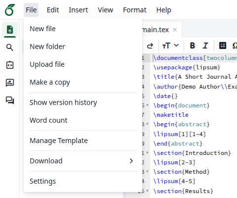

Julkaiset malleja editorista ja hallitset niitä niiden sivulla galleriassa tai hallintapaneelissa.

<Info>

Jos haluat ottaa gallerian käyttöön, valita sen kategoriat tai sallia julkaisemisen käyttäjälle, joka ei ole järjestelmänvalvoja, katso [Mallipohjat](/fi/on-premises/configuration/overleaf-toolkit/templates).

</Info>

## Projektin julkaiseminen {#publish-a-project}

<Steps>
<Step title="Käännä projekti">
Avaa projekti ja napsauta **Recompile**. Näkemäsi PDF on se, jonka galleria näyttää.

Niin kauan kuin editorissa ei ole PDF:ää, esimerkiksi kun avaat projektin, joka ei käänny, **Manage Template** on harmaana.

<Frame caption="PDF:ää ei vielä ole, joten julkaistavaa ei ole">
  
</Frame>

<Warning>

Julkaiseminen tallentaa tiedostot sellaisina kuin ne nyt ovat sekä viimeisimmän onnistuneen käännöksen PDF:n. Jos muokkasit projektia tämän käännöksen jälkeen tai viimeisin käännös epäonnistui, galleria näyttää vanhan PDF:n uudempien tiedostojen vieressä, ja ne eivät ehkä käänny. Käännä uudelleen, kunnes PDF on oikein, ja julkaise sitten.

</Warning>
</Step>

<Step title="Avaa lomake">
Napsauta editorin ylävalikossa **File** ja sitten **Manage Template**.

<Frame caption="File-valikko">
  
</Frame>
</Step>

<Step title="Täytä lomake">
<Frame caption="Manage Template -valintaikkuna">
  
</Frame>

| Kenttä | Huomautukset |
| --- | --- |
| **Title** | Alussa projektin nimi. Oltava yksilöllinen galleriassa. Enintään 150 merkkiä. |
| **Author** | Alussa sinun nimesi. Markdown-linkistä, kuten `[Demo Author](https://example.com)`, tulee linkki mallin sivulle. |
| **Categories** | Yksi kategoria, katso [Kategoriat](/fi/on-premises/user-guide/administrators/template-management#categories). |
| **Description** | Tukee Markdownia. Enintään 4096 merkkiä. Mallin sivu näyttää sen nimellä **Abstract**, ja galleria näyttää sen alun pelkkänä tekstinä. |
| **License** | **Creative Commons CC BY 4.0**, **LaTeX Project Public License 1.3c** tai <strong>Other (as stated in the work)</strong>. |

Projektin kääntäjä ja päädokumentti siirtyvät mallin mukana, joten aseta ne ensin projektissa. Mallista avatut projektit käyttävät samoja.
</Step>

<Step title="Napsauta Publish">
Mallin sivu avautuu.

<Frame caption="Uusi malli">
  
</Frame>

**Admin: Source Project**, **Edit** ja **Delete** ovat vain sinua varten. Muut käyttäjät näkevät vain **Open as Template**-, **View PDF**- ja latauspainikkeen.
</Step>

<Step title="Tarkista galleria">
Napsauta oikeassa yläkulmassa **Templates**. Uusi malli on luettelon ensimmäisenä.
</Step>
</Steps>

## Kategoriat {#categories}

Malli kuuluu yhteen kategoriaan. Nimet ja kuvaukset tulevat [määrityksistäsi](/fi/on-premises/configuration/overleaf-toolkit/templates#configuration), eikä niitä voi muuttaa sivustolla.

Näet ne näissä paikoissa:

* Lomakkeen **Categories**.
* Gallerian sivun `/templates` yläosan kortit. Pääset sinne napsauttamalla **Template Gallery** sivulla **All templates**.
* Sivu kullekin kategorialle, esimerkiksi `/templates/presentation`. Kategoria, jossa ei ole malleja, näyttää <strong>No Templates.</strong>
* **New project** ja sitten **More templates** projektisivulla.
* Linkki otsikon yläpuolella mallin sivulla.

<Frame caption="Kategoriat gallerian sivulla">
  
</Frame>

Lomakkeen **All templates** tarkoittaa, ettei mallilla ole omaa kategoriaa: malli on vain koko luettelossa.

## Mallin päivittäminen {#update-a-template}

Jos haluat muuttaa tiedostoja ja PDF:ää, julkaise projekti uudelleen samalla otsikolla.

<Steps>
<Step title="Muuta projektia">
Muokkaa projektia ja napsauta **Recompile**.
</Step>

<Step title="Julkaise uudelleen">
Napsauta **File** ja sitten **Manage Template**. Lomake näyttää mallin tiedot, joita voit muuttaa. Napsauta **Publish**.

Viesti kertoo, että otsikko on jo olemassa, ja painikkeeksi vaihtuu **Overwrite**.

<Frame caption="Julkaiseminen samalla otsikolla">
  
</Frame>

Jos muutat nyt **Title**-kenttää, viesti katoaa ja **Publish** luo uuden mallin.
</Step>

<Step title="Napsauta Overwrite">
Sama mallin sivu avautuu uuden PDF:n kanssa.

<Frame caption="Päivitetty malli">
  
</Frame>

Projektit, jotka käyttäjät ovat jo avanneet mallista, eivät muutu.
</Step>
</Steps>

<Warning>

Lomake löytää mallin projektin nimen perusteella. Jos nimesit mallin uudelleen **Edit**-toiminnolla, lomake avautuu projektin nimellä, sinun nimelläsi, ensimmäisellä kategorialla ja tyhjällä kuvauksella, eikä mallin otsikon kirjoittaminen palauta sen tietoja. **Overwrite** korvaa tällöin tiedot lomakkeen sisällöllä, joten täytä ne ensin uudelleen.

</Warning>

## Tietojen muokkaaminen {#edit-the-details}

Tämä muuttaa sitä, mitä galleria näyttää mallista, ei sen tiedostoja tai PDF:ää.

<Steps>
<Step title="Avaa malli">
Napsauta oikeassa yläkulmassa **Templates**, napsauta mallia ja sitten **Edit**.
</Step>

<Step title="Muuta kenttiä">
Kentät ovat samat kuin julkaistessa, ja niiden lisäksi on yksi: **Language** on mallista avattujen projektien oikeinkirjoituksen tarkistuksen kieli. Oletuskielellä julkaistulle projektille se näyttää **Off**, ja siitä avatut projektit käyttävät kieltä <strong>English (American)</strong>.

<Frame caption="Edit template -valintaikkuna">
  
</Frame>

Otsikko, joka on jo toisella mallilla, hylätään: **Save** pysyy harmaana, kunnes muutat **Title**-kenttää.
</Step>

<Step title="Napsauta Save">
Valintaikkuna sulkeutuu ja mallin sivu näyttää uudet tiedot.
</Step>
</Steps>

## Lähdeprojekti {#the-source-project}

**Admin: Source Project** avaa projektin, josta malli julkaistiin.

Mallilla on oma kopio tiedostoista. Jos poistat projektin pysyvästi, painike katoaa, ja käyttäjät voivat edelleen avata mallin. Projekti, joka on vain kohteessa **Trash**, säilyttää painikkeen. Katso myös kysymykset ja vastaukset kohdasta [Mallipohjat](/fi/on-premises/configuration/overleaf-toolkit/templates).

## Mallin poistaminen {#delete-a-template}

<Steps>
<Step title="Napsauta Delete">
Napsauta mallin sivulla **Delete**. Valintaikkuna mainitsee mallin nimen.

<Frame caption="Delete template -valintaikkuna">
  
</Frame>
</Step>

<Step title="Napsauta Confirm">
Palaat sivulle, jolta tulit, eikä malli ole enää galleriassa. Sen linkki näyttää nyt **Not found**.

Lähdeprojekti säilyy, samoin kuin projektit, jotka käyttäjät ovat avanneet mallista.
</Step>
</Steps>

## Mallien hallinta hallintapaneelissa {#manage-templates-in-the-admin-panel}

Napsauta **Admin**, sitten **Project/Object Lookup** ja sitten **Templates**-välilehteä. Se luettelee kaikki mallit tekijöineen ja omistajineen, ja voit hakea siitä.

<Frame caption="Kaikki mallit hallintapaneelissa">
  
</Frame>

* Napsauta otsikkoa avataksesi mallin sivun, tai avauskuvaketta avataksesi sen uudessa välilehdessä.
* Napsauta omistajaa avataksesi kyseisen käyttäjän sivun.
* Poista malli napsauttamalla roskakorikuvaketta ja sitten **Delete**. Valintaikkuna varoittaa, ettei toimintoa voi kumota, ja malli poistuu galleriasta.

## Jos julkaiseminen hylätään {#if-publishing-is-refused}

Lomakkeeseen voi kirjoittaa enemmän kuin sivusto hyväksyy. Yli 150 merkin **Title** näyttää `Template title exceeds the maximum length of 150 characters.`, ja yli 4096 merkin **Description** näyttää `Template description exceeds the maximum length of 4096 characters.`

Tämän jälkeen **Publish** pysyy harmaana, vaikka lyhentäisit tekstiä. Napsauta **Cancel**, sitten **File** ja **Manage Template**, ja täytä lomake uudelleen.
