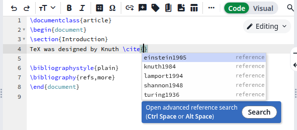

Viitehaku käy läpi projektisi kaikki `.bib`-tiedostot, joten löydät lähteen muistamatta sen viittausavainta. Mitään ei tarvitse määrittää.

Projektissa on oltava vähintään yksi `.bib`-tiedosto. Voit ladata sellaisen tai tuoda kirjastosi palvelusta [Zotero](/fi/on-premises/user-guide/users/zotero-integration) tai [Mendeley](/fi/on-premises/user-guide/users/mendeley-integration).

## Viittauksen lisääminen {#insert-a-citation}

<Steps>
<Step title="Aloita viittaus">
Kirjoita `.tex`-tiedostoon `\cite{`. Editori lisää loppusulkeen. Kohdistimen alla näet viittausavaimet ja sinisen ruudun, **Open advanced reference search**.

<Frame caption="Sininen ruutu viittauksen alla">
  
</Frame>

Myös työkalurivin **Insert citation** -painike sekä **Insert** ja sitten **Citation** aloittavat `\cite{}`-komennon puolestasi. Ruutu näkyy myös muissa viittauskomennoissa, kuten `\citep`, `\autocite`, `\parencite` ja `\textcite`.
</Step>

<Step title="Avaa haku">
Napsauta sinisen ruudun **Search**-painiketta tai paina Ctrl+välilyönti aaltosulkeiden välissä. Valintaikkuna luettelee kaikki merkinnät otsikon, viittausavaimen, tekijän, lehden ja vuoden kanssa.

<Frame caption="Projektin kaikki merkinnät">
  
</Frame>
</Step>

<Step title="Etsi merkintä">
Kirjoita hakukenttään. Haku kohdistuu viittausavaimeen, tekijään, otsikkoon, lehteen ja vuoteen ja korostaa löydökset. Jokaisen sanan on vastattava, joten `turing 1936` löytää Turingin vuoden 1936 artikkelin. Muita kenttiä, kuten julkaisijaa, ei haeta.

<Frame caption="Haku tekijän ja vuoden mukaan">
  
</Frame>
</Step>

<Step title="Valitse yksi tai useampi merkintä">
Napsauta merkintää. Se muuttuu vihreäksi, ja sen avain näkyy luettelon yläpuolella. Lisää toinen napsauttamalla sitä tai hakemalla uudelleen: valintasi säilyvät. Poista merkintä napsauttamalla sitä uudelleen tai avaimen vieressä olevaa <strong>×</strong>-merkkiä.

<Frame caption="Kaksi valittua merkintää">
  
</Frame>
</Step>

<Step title="Napsauta Insert">
Avaimet ilmestyvät aaltosulkeiden väliin pilkuilla erotettuina. Jos asiakirjassa ei vielä ole lähdeluetteloa, lisää nämä rivit ennen `\end{document}`-riviä käyttäen `.bib`-tiedostojesi nimiä ilman päätettä:

```latex
\bibliographystyle{plain}
\bibliography{refs,more}
```

Napsauta **Recompile**. Lähteet näkyvät PDF:ssä.

<Frame caption="Käännetty viittaus">
  
</Frame>
</Step>
</Steps>

Haku toimii samalla tavalla **Visual**-editorissa.

## Viittauksen muuttaminen {#change-a-citation}

<strong>Lähteen lisääminen:</strong> sijoita kohdistin olemassa olevan viittauksen aaltosulkeiden väliin ja avaa haku. **Insert** lisää uudet avaimet jo olemassa olevien perään.

<strong>Lähteiden korvaaminen:</strong> valitse avaimet editorissa ja paina Ctrl+välilyönti. Avaimet näkyvät luettelon yläpuolella, ja painikkeessa lukee nyt **Replace**. Poista ne, joita et halua, lisää muita ja napsauta **Replace**. Avain, jota ei ole missään `.bib`-tiedostossa, säilyy, kunnes poistat sen.

<Frame caption="Valittujen avainten korvaaminen">
  
</Frame>

## Näppäimistön käyttö {#use-the-keyboard}

| Näppäin | Mitä se tekee |
| --- | ------------ |
| **Alanuoli** | Siirtyy hakukentästä luetteloon ja sitten luettelossa alaspäin |
| **Ylänuoli** | Siirtyy luettelossa ylöspäin |
| **Välilyönti** | Valitsee merkinnän tai poistaa sen valinnoista |
| **Enter** | Lisää valinnat, kun olet luettelossa |
| **Tab** | Siirtyy hakukentän, luettelon ja painikkeiden välillä |
| **Esc** | Sulkee valintaikkunan muuttamatta mitään |

## Mistä merkinnät tulevat {#where-the-entries-come-from}

Haku kattaa projektin kaikki `.bib`-tiedostot, myös Zoterosta tai Mendeleystä tuodut tiedostot. Kun muokkaat `.bib`-tiedostoa, seuraava haku löytää uudet merkinnät.

## Jos jokin menee pieleen {#if-something-goes-wrong}

| Mitä näet | Miksi | Mitä teet |
| ------------ | --- | ---------- |
| Valintaikkunan luettelo on tyhjä | Projektissa ei ole `.bib`-tiedostoa | Lataa tai luo sellainen |
| Sinistä ruutua ei ole, ja Ctrl+välilyönti luettelee LaTeX-komentoja | Kohdistin ei ole viittauksen aaltosulkeiden välissä | Napsauta aaltosulkeiden väliin |
| Ctrl+välilyönti ei tee mitään | Tietokoneesi käyttää tätä pikanäppäintä muuhun | Napsauta sinisen ruudun **Search**-painiketta |
| Merkintää ei löydy | Haku kattaa vain avaimen, tekijän, otsikon, lehden ja vuoden | Hae jonkin näistä kentistä |
